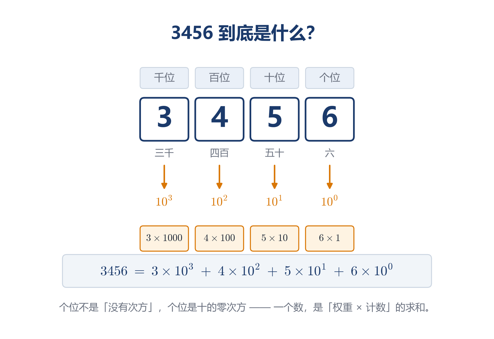
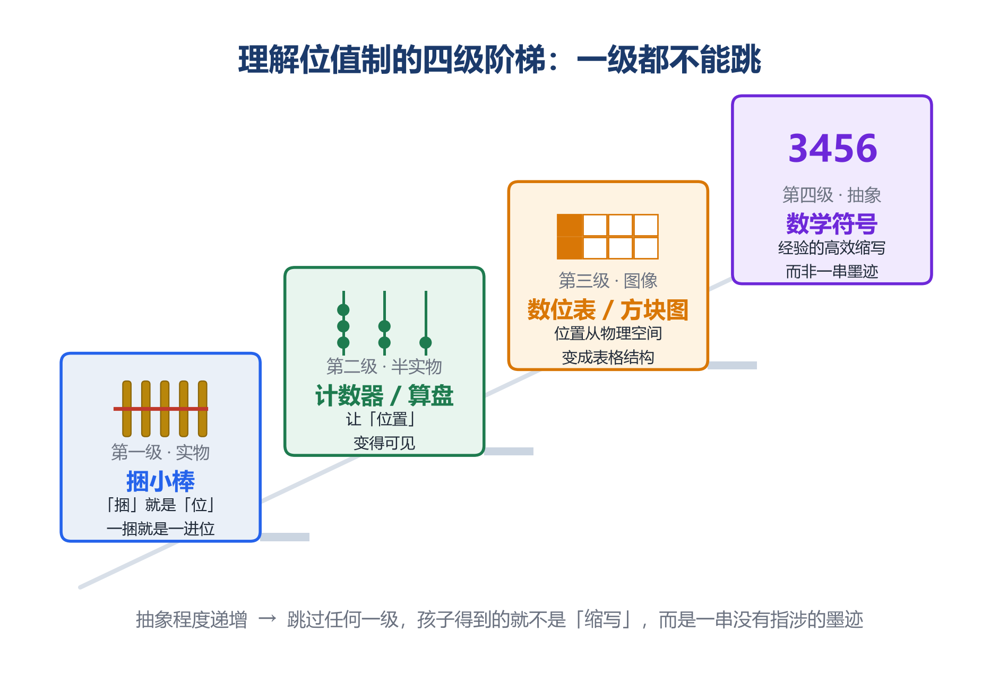
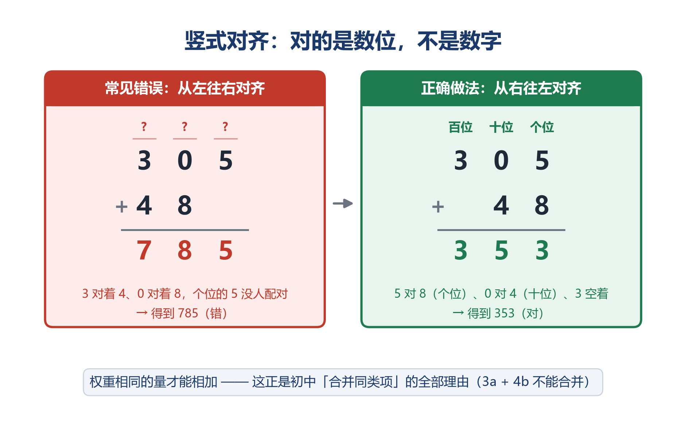
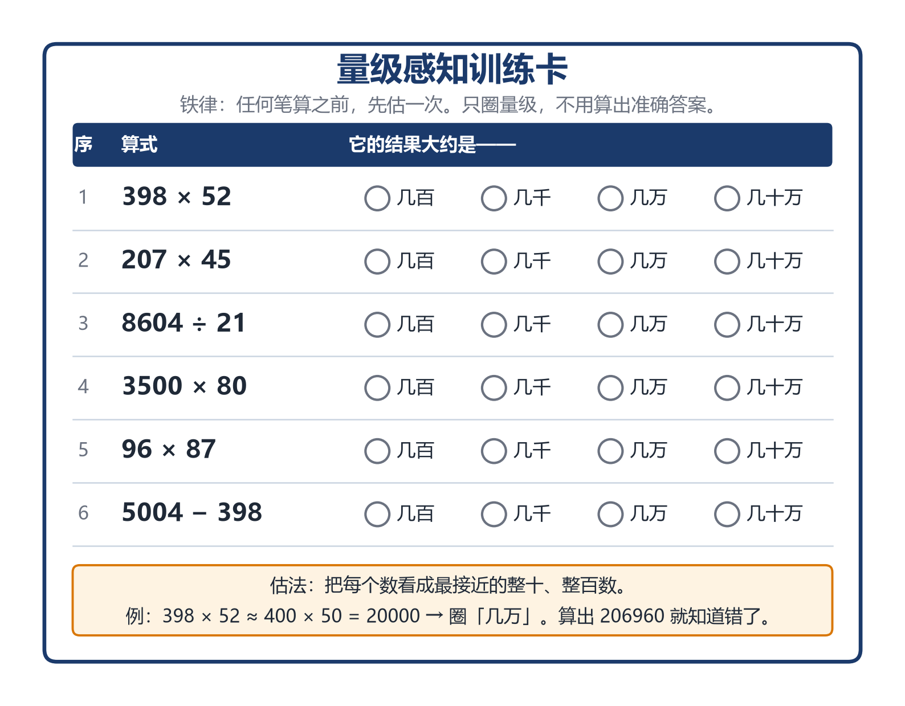
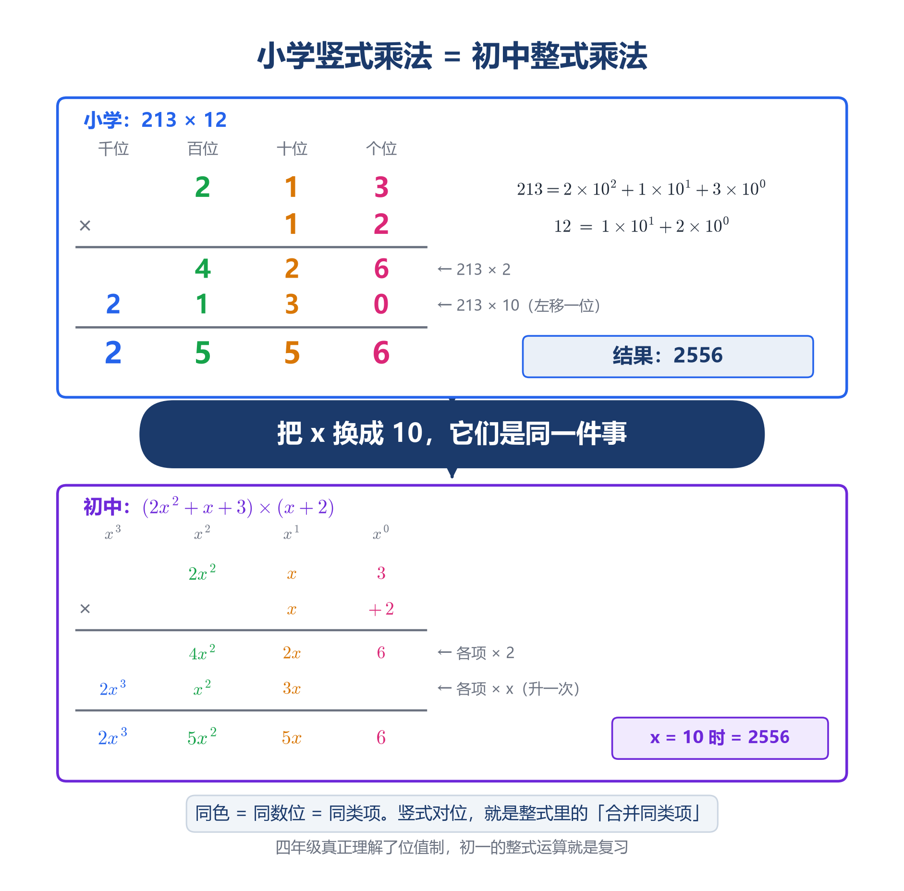

# 位值制：十个符号如何装下整个宇宙

> 「数学成神之路」小学数学 · 第 1 讲
> 原创 · 程大大的小记

> **本文导读**（全文约 9000 字，读完你会得到四样东西）
>
> ① **一个诊断问题**——一句话判断孩子是真懂数位，还是只会背数位表
> ② **三类高频错题**——中间带零、组数比大小、竖式与估算，附思维根源与根治方法
> ③ **一套家庭实操**——捆小棒、翻十倍、画数位表，含一张可打印的量级训练卡
> ④ **一张核心结构图**——小学竖式乘法与初中整式乘法的逐列对照。这是"小学数学直通初中代数"最有说服力的证据
>
> 如果只读一段，请读第六章。

---

## 一、引言：会写数，不等于懂数

先看一个真实场景。

一个四年级的孩子，"三千四百五十六"能读能写，数位顺序表能默写，"个、十、百、千、万"背得滚瓜烂熟。但你指着 3456 问他一句："这里的 3 和 4，哪个大？"

他大概率会脱口而出："4 大呀，4 比 3 大。"

错了。在 3456 里，3 表示三千，4 表示四百。**3 比 4 大得多**。

这不是粗心，也不是没背熟。**这是一个诊断信号**：在这个孩子心里，"3456"仍然是四个符号排成一队的样子，而不是一组有着严格权重的量。他知道每个数字长什么样、叫什么名字，却从未真正理解每个数字**值多少、以及为什么值这么多**。

换句话说，他把数字当成了**标签**，而不是**量**。而这，正是启蒙篇里我们反复强调的那个分野——"数"是关系而非标签。启蒙阶段没走透的这一步，会在小学的数位表上原样复发。

在上一篇《从"数"到"道"》里，我们谈过数学启蒙的根本任务，是让孩子理解"数"是关系而非标签，是集合的量而非一串发音。那一篇解决的是"数是什么"。

而这一篇要解决的，是一个更隐蔽、也更致命的问题：**我们用什么办法把数写下来**。

绝大多数家长和老师不会意识到，这件事本身需要专门去"教"。因为它太日常了——阿拉伯数字谁不会写？但恰恰是这份"日常"，掩盖了它作为人类思想史上一项顶级发明的分量。

皮亚杰（Jean Piaget）早就观察到，儿童对数的理解有一个"表面相似、内核空洞"的阶段：他们能操作符号，却不理解符号背后的结构。而位值制，正是儿童在小学阶段遇到的**第一个真正抽象的数学结构**——它比加减乘除抽象得多，因为运算至少还在"数东西"，而位值制已经在讨论"数字所在的位置本身具有意义"。

这一篇，我们就把它拆开来看。

---

## 二、本体论：一个符号的两种身份

### 1. 位值制的核心约定：绝对值与位置值

先看一组对照。

罗马数字写 3456，是这样的：

> MMMCDLVI

古埃及人写 3456，需要画 3 个"千"的符号、4 个"百"的符号、5 个"十"的符号、6 个"一"的符号——一共 18 个记号。

而我们写 3456，四个字符，搞定。

差别不在符号长得好看，而在一条根本性的约定：

**同一个符号，放在不同位置，代表不同的量**。

这就是位值制（Place Value System）的全部秘密。每个符号同时拥有两种值——**绝对值**（Absolute Value，符号本身代表的量，比如"4"就是四）和**位置值**（Place Value，它因为所在位置而被赋予的量，比如 3456 里的"4"是四百）。

> ⚠️ **两句历史见证**
>
> 拉普拉斯（Pierre-Simon Laplace）盛赞过这套记法的精妙：十个符号，每一个**既有一个绝对值，又有一个位置值**，如此简单的构想却蕴含着深远的思想。
>
> 而更早的记录，来自公元 662 年的叙利亚主教塞维鲁·塞博克特（Severus Sebokht）。他在著述中惊叹印度人"用九个符号就能表示一切数，无论多大"。
>
> 相隔一千一百年，两位身处完全不同文明的人，对同一件发明发出了同一种惊叹。**这句话的价值不在归属，而在它道出了一个事实：在没见过位值制的人眼里，这套记法近乎神迹**。

请体会一下"近乎神迹"这四个字。

在罗马数字系统里，"4"永远是 IV，"40"是 XL，"400"是 CD——你必须为每一个数量级另造一套符号。数量级越多，符号表越长，记忆负担越重，运算越不可能。**罗马人算不出复杂的乘除法，不是因为罗马人笨，而是因为他们的记数法把路堵死了**。

而位值制做了一件天才的事：**它把"数量级"这个维度，从符号里搬到了位置上**。

符号表被压缩到十个（0 到 9），而可表示的数被扩展到无穷。这是一次彻底的资源重组——用有限的材料，承载无限的信息。

### 2. 零：让"空"成为一个必须被标记的东西

位值制还有一个前提，容易被忽略：**必须有一种办法，表示"这个位置上是空的**"。

设想没有零。"三百零五"怎么写？如果直接写"35"，它到底是三十五还是三百零五？歧义无解。

所以零的第一身份不是"没有"，而是**占位符**（Placeholder）——它是一个必须被显式写出来的"空"。

这一点，中国人走得很早。

据史料记载，中国算筹记数法约产生于西周、春秋之际，至战国晚期趋于完整，汉魏时成熟——**这比印度—阿拉伯数字系统的定型要早得多**。《孙子算经》里那句著名的口诀，说的就是位值制的操作规则：

> "凡算之法，先识其位。一纵十横，百立千僵，千十相望，万百相当。"

注意开头四个字——"**先识其位**"。一千五百年前的中国数学家，把"位置"放在了整个算法的第一位。这不是巧合，这是位值制的本质。

算筹用纵横两种摆法交替表示各位，天然避免了混淆。但遇到空位怎么办？早期是**留一个空格**。据记载，到了金代司天监赵知微重修《大明历》时，已开始用"〇"来标记数据空位，比如把 309 写作"三百〇九"。

从"空格"到"〇"，看似只是一个书写习惯的改进，实质是一次巨大的概念跃迁："**空"从一个容易被忽略的疏漏，变成了一个必须被书写的对象**。

**而欧洲，在这一步上摔了一跤**。

公元 967 年前后，法国青年热尔贝（Gerbert of Aurillac）前往西班牙求学，在穆斯林统治下的加泰罗尼亚地区接触到阿拉伯数字。回国后，他制作了一块著名的算板——把板面纵向分成若干格，用刻着数字符号的筹码（apices）在格间移动计算。据记载，他只用**九个符号**，就能在算板上表示一切数，计算速度令同时代人惊叹，因此得了"魔术师"的绰号。

999 年，热尔贝成为教皇，号西尔维斯特二世（Sylvester II）——欧洲历史上罕见的学者教皇。

但他没能把这套数字推广开。

原因恰恰藏在那"九个符号"里：**他的算板没有零**。

没有零，空位就无法被显式标记；空位无法标记，位置就立不住；位置立不住，位值制就无从谈起。热尔贝造出的是一件精巧的计算工具，而不是一套可以脱离工具、直接在纸上书写的记数系统。工具随人失传，系统才能流传。

两百年后，斐波那契的《计算之书》补上了那第十个符号，欧洲才真正接住了位值制。

**一位教皇的失败，反过来证明了零的本体论地位：它不是"没有"，它是让"位置"得以存在的条件**。

启蒙篇里我们说过，"空"也是一种"有"。位值制，就是这句话最坚硬的技术实现——而热尔贝的算板，是它的反面教材。

> •实操切片：**「搬走积木，位置还在」**
> 这是启蒙篇埋下的素材，现在可以正式用上。
> 摆出三堆积木：3 块、4 块、5 块，从左到右代表百位、十位、个位，问孩子这是多少（345）。
> 然后把中间那堆**全部拿走**，问："现在是多少？"
> 孩子会说"35"或"8"。
> 这时候追问一句关键的话："**可是那个位置还在啊**。"
> 让他自己发现：位置没消失，只是位置上什么都没有——所以需要一样东西来"占住"它。
> 他可能会画个圈，可能会说"空着"，可能会犹豫很久。
> **无论他怎么做，都对了。因为他正在重新发明零**。
> 然后你可以告诉他：一千年前的人也卡在这里，他们先是留个空格，后来画了个圈，叫"〇"。欧洲有位教皇，就是因为没画这个圈，失败了。

### 3. 数是一个"过程"的凝固

再深一层。

3456 到底是什么？

在位值制的框架下，它不是一个"东西"，而是一个**算式的简写**：

> 3456 = 3×1000 + 4×100 + 5×10 + 6×1
> 　　 = 3×10³ + 4×10² + 5×10¹ + 6×10⁰

请注意最后这个式子里的 10⁰——它等于 1。**个位不是"没有次方"，个位是十的零次方**。

这句话对孩子来说很反直觉，但它是位值制的完整表达。一个数，本质上是一串"权重 × 计数"的求和。

这意味着什么？

意味着**每一个多位数，都是把"数数"这个过程凝固下来的产物**。3456 记录的是这样一件事：我数了 3 次一千，又数了 4 次一百，又数了 5 次十，又数了 6 次一。

启蒙篇里我们讲过，孩子指着三个苹果数"1、2、3"，那个"3"是对整个计数过程的总结，是从"过程"到"结果"的第一次抽象飞跃。

位值制是同一件事的第二次飞跃：**它把"数大数"这个冗长的过程，压缩成了四个字符**。

所以，孩子"会写 3456"和"理解 3456"，中间隔着的不是熟练度，而是有没有意识到——**这四个字符是一台被压缩了的计算机，每个位置都是一个正在运行的权重组件**。


> 数位表（千位/百位/十位/个位）上方写 3456，下方用箭头分别引出 3×1000、4×100、5×10、6×1，底部标注完整等式。
> 这张图是全文的地基，务必放在第二章末尾。

---

## 三、认识论：四级阶梯，一级都不能跳

位值制的抽象程度，决定了它不可能靠"讲"学会。

布鲁纳（Jerome Bruner）的表征系统理论（EIS 模型）在这里同样适用：任何一个抽象概念，儿童都需要经历**动作表征（Enactive）→ 形象表征（Iconic）→ 符号表征（Symbolic**）的完整链条。位值制尤其如此，因为它的核心——"位置决定大小"——是一个纯粹的关系性概念，看不见摸不着。

我把这个链条细化成四级。

### 第一级：实物——数的可触摸形态

**工具**：小棒、豆子、纽扣、乐高颗粒，任何可以逐个清点的实物。

**关键动作：捆扎**。

给孩子 47 根小棒，让他数出来。数完之后，问一句："这样一大堆，我们怎么才能一眼看出是多少？"

引导他自己发现：**十根捆成一捆**。

于是 47 变成了"4 捆 + 7 根"。

这一步不能省，也不能由大人代劳直接告诉他"十根一捆"。因为"十根捆成一捆"这件事，本身就是位值制的物理原型——"**捆"就是"位"，一捆就是一进位**。 当孩子亲手把第十根小棒捆进去的时候，他身体记住了"满十进一"。

这个体验，比背一百遍"满十进一"都有效。

> •实操切片：**「捆小棒」进阶版**
> 准备 200 根小棒和若干橡皮筋。让孩子表示以下各数：8、13、47、105、120。
> 到 105 的时候他必然卡住——5 根散的，一捆都没有，怎么表示"中间那个空"？
> 让他自己想。他可能会摆一个空位，可能会画个圈，可能会说"这里什么都没有"。
> **无论他怎么做，都对了。因为他正在重新发明"零**"。
> 然后你可以告诉他：一千多年前的人也卡在这里，他们一开始就是留个空格。

### 第二级：半实物——计数器与算盘

**工具**：计数器（数位柱）、算盘、自制的纸盘数位器。

从"捆小棒"到"数位表"之间，需要一个过渡：**把"捆"变成"位置**"。

计数器上的每一根柱子，就代表一个数位。孩子把珠子从个位柱拨到十位柱，他看到的是"珠子移动了位置"，理解的是"数量升级了"。

**这一步的核心价值在于：它让"位置"变得可见**。

算盘是这一级的完美教具——中国人用它算了几百年。让孩子在算盘上做"9 + 1"：个位满十，清零，向十位进一。这个动作里，位值制的全部规则都在场。

> •实操切片：**「翻十倍」游戏**
> 在计数器上摆出 34。然后问孩子：如果我要它变成十倍，怎么办？
> 他会说"再加两个 4"或者别的。
> 引导他发现：**把每一颗珠子往左移一格，就自动变成了十倍**。
> 34 → 340 → 3400。
> 这个游戏做完，孩子对"×10 就是整体左移一位"会有肌肉记忆。而这正是小数点移动、科学记数法、乃至后面所有位值运算的底层直觉。

### 第三级：图像——数位表与方块图

**工具**：数位顺序表、点阵方块图（Base-10 Blocks）。

到这一级，实物退场，图像接管。

数位表是一张纸，上面画着格子，格子里写数字。它看起来只是"整理了一下"，但它做的事情极为关键：**它把"位置"从物理空间（柱子的左右）抽象成了纯粹的表格结构**。

配合点阵方块图效果更好：一个小方块是 1，一条十连块是 10，一块百板是 100，一个大立方是 1000。让孩子用这些方块拼出 3456——他会真切地"看见"三千是一个巨大的立方体，而六个一只是角落里六个小点。

"**看见数量的悬殊"，是数感（Number Sense）的起点**。


> 纵向阶梯，四级依次为「实物·捆小棒」→「半实物·计数器/算盘」→「图像·数位表/方块图」→「抽象·数学符号」，每级配一个小图标。

### 第四级：符号——最后的抽象

只有前三级走扎实了，"3456"这四个字符才真正获得意义。

此时可以告诉孩子一句让他会心一笑的话：

"**数学家是很懒的。他们不想每次都摆小棒、拨算盘、画方块，所以发明了这四个字符，把刚才所有的事情一次记下来**。"

启蒙篇里用过这句话讲符号化阶段，这里它同样成立——**符号不是要取代经验，符号是经验的高效缩写**。

如果一个孩子没经历过前三级，直接进第四级，他得到的就不是"缩写"，而是一串没有指涉的墨迹。他能默写数位表，但他算不出 3 和 4 谁大。

### 分寸：哪个年级，停在哪一级

四级阶梯不是"越快越好"。这里必须给一个反向的提醒，因为本篇通篇在讲位值制的分量，很容易让家长走向另一个极端——**过早拔高**。

那同样是错的。启蒙篇的原则是"拒绝过早抽象"，这一篇也必须遵守。

| 阶段 | 大致年级 | 该走到哪一级 | 不要提前做什么 |
|---|---|---|---|
| 第一学段 | 一、二年级 | 第一级为主，二年级过渡到第二级 | 不讲"10 的幂"，不要求写展开式，不出现"位值"这个术语 |
| 第二学段 | 三、四年级 | 第二级 → 第三级 → 第四级 | 不引入科学记数法，不讲负指数 |
| 第三学段 | 五、六年级 | 第四级稳固，可向小数延伸 | 多项式对照只作拓展兴趣，不作要求 |

**三条硬边界**：

1. "**10 的零次方"这类表述，四年级前不要讲**。 它是位值制的完整表达，但对低年级孩子是纯粹的符号噪音，只会制造恐惧。
2. **展开式（3×1000+4×100+…）要到三四年级、且孩子已经熟练操作过方块图之后才引入**。 先有图像，再有式子，顺序不能反。
3. **第六章的多项式对照，是给家长和教师看的，不是给孩子做的**。 它的价值在于让你明白"现在教的这个动作，六年后会通向哪里"，从而不焦虑、不抢跑。

> ⚠️ 表中年级划分对应《义务教育数学课程标准（2022 年版）》三个学段的大致安排，各地教材进度略有差异，请以孩子实际使用的教材为准。

一句话：**位值制值得用六年慢慢长出来，不值得用六个月硬灌进去**。

---

## 四、典型错题解剖：三种错误，同一个根源

理论讲完了。这一章是本文最实用的部分——**三类高频错题，以及它们背后真正的病灶**。

### 错题一：中间带零的数

**症状**

- 读数："3050"读成"三千五十"（应为三千零五十）；"1008"读成"一千八"（应为一千零八）
- 写数："五千零六十"应写 5060，孩子常写成 50060 或 506；"二百零七"应写 207，常写成 27

**病灶**

孩子心里没有"位"的概念，只有"数字串"的概念。

他在写"五千零六十"时，思维过程是："五、千、零、六、十"——听到"零"就写个 0，听到"六"就写个 6，听到"十"就……卡住了。因为他不知道该把 6 放在十位还是个位。

**根治方法**

回到数位表。**强制要求：写任何多位数之前，先画格子**。

| 万位 | 千位 | 百位 | 十位 | 个位 |
|:---:|:---:|:---:|:---:|:---:|
|  | 5 | 0 | 6 | 0 |

"五千零六十"——五千，千位写 5；零六十，说明百位是空的，写 0；六十，十位写 6；个位没提，是空的，写 0。

**关键是那句"个位没提，是空的**"。 孩子犯错，几乎都错在最后一个空位没被显式地写出来——因为他从没被训练过"没有提到的位，也要占一个格"。

这恰恰是零作为占位符的意义：**空位必须被书写**。

### 错题二："最大的四位数是多少"

**症状**（这类题看着简单，错得极普遍）

- "用 3、0、8 三个数字组成最大的三位数"答 830（对）
- "组成最小的三位数"答 038（**错，应为 308**）
- "用 0、0、5、8 组成一个零都不读的四位数"——大量孩子无从下手
- "组成只读一个零的四位数"——错得更离谱

**病灶**

这组题考的不是"大小比较"，而是**位值制的边界规则**：

1. **最高位不能是零**。 "038"不是三位数，它是两位数 38 的另一种写法。孩子答 038，说明他把"三位数"理解成"有三个数字的串"，而不是"最高位在百位上的数"。
2. **零读不读，取决于它在不在末尾、以及是否连续**。 这是位值制的语法规则，不是死记的朗读口诀。

**根治方法**

问孩子一个问题："038 和 38 是同一个数吗？"

如果他说是，追问："那为什么我们平时不写 038？"

引导他自己发现：**因为最高位的零不提供任何信息，写它是浪费**。 但**中间的零绝对不能省，省了数就变了**——305 省掉零变成 35，差了近十倍。

一句话总结给孩子："**末尾的零决定大小，中间的零决定存在**。"

至于"零读不读"，本质是同一件事：**末尾连续的零不用读（因为它们只表示量级），中间和末尾交界处的零必须读（因为它标记了一个空位**）。

### 错题三：竖式对位与估算缺失

**症状一：竖式算错**

```
   305
+   48
------
   785   ← 错在哪？
```

孩子是从**左边**开始对齐的：3 对着 4，0 对着 8，剩下个位的 5 没人配对，就直接落了下来。3 加 4 得 7，0 加 8 得 8，再拖个 5——785。

正确答案是 353。

这个错误比"算错"严重得多，因为**孩子根本没在算错，他是在用一套自洽但错误的逻辑算出了一个"合理"的结果**。他不觉得自己错了，这才是最麻烦的地方。

**病灶**：他把数字当成了一串字符，从左往右读，就从左往右对齐——**就像写字一样**。而竖式要求的是从右往左对齐，因为右边才是权重的起点（个位）。

**根治方法**：一句话——"**竖式对齐，对的是数位，不是数字**。"

个位加个位，十位加十位。这不是老师的规定，这是位值制的必然：只有权重相同的量才能直接相加。3 个百加 4 个十，本来就没法直接合并，就像 3 米加 4 秒一样荒谬。

**这个道理，同时也是初中"合并同类项"的全部理由**。 到了初一，孩子会学到 3a + 4b 不能合并——如果他四年级时真正理解了"权重不同不能相加"，初一那节课就是复习。


> 错误竖式（785）与正确竖式（353）并排，红绿对比，配文字"对齐的是数位，不是数字"。

**症状二：估算意识缺失**

孩子算"398 × 52"，笔算得出 206960，然后心安理得地写上答案。

正确答案是 20696。差了一个数量级，他毫无察觉。

**病灶**：这是位值制理解不牢最危险的表现——**孩子对"这个数应该是多大"没有任何感觉**。

**根治方法**：养成一个铁律——**任何笔算之前，先估一次**。

398 × 52 ≈ 400 × 50 = 20000。所以答案应该在两万上下。

算出 206960？那是二十万，超出估算十倍，必有错。

这个习惯看起来是"多此一举"，实际上它是**位值制的终极检验**：一个真正理解位值制的孩子，看到 398 和 52，脑子里会自动浮现"四百乘五十"，因为他对每个数字的量级有直觉。

估算不是低配版计算。**估算是位值制的自由运用**。


> 六道算式 × 四档量级选项（几百/几千/几万/几十万），底部附估法说明。
> **建议作为本文的读者福利**：图片做成可打印的 A4 版，公众号后台回复关键词领取，既提升互动，也自然涨粉。

### 本章小结：位值制的代价

三个错题，病灶是同一个——**孩子把数字当字符，而不是当量**。

但这里必须往深处再走一步，因为本章开头那个"785"，牵出了位值制自身的一个根本矛盾。

**先看一个历史细节**。

1202 年，比萨青年列奥纳多（后来被称为斐波那契，Leonardo Fibonacci）出版了《计算之书》（Liber Abaci）。

他的父亲威廉，是比萨派驻北非布日伊（今阿尔及利亚）的商务官员。少年列奥纳多在父亲的商馆里学记账，第一次见到印度—阿拉伯数字——他发现用这套符号算账，又快又准。

于是他把这本书写给了整个欧洲的商人阶层。书里讲的不只是算术，还有记账、利息、汇率、合伙分账。

请注意这个细节：**把位值制带进欧洲的，不是数学家，是商人**。

**而这个细节里，藏着位值制最深的两面性**。

商人在乎的从来不是"为什么可以这样算"，而是"这样算对不对、快不快"。位值制恰恰完美满足这个需求——它是一套**不理解也能正确执行的程序**。

对齐、相加、满十进一。每一步都是机械的，每一步都不需要你知道"权重"是什么意思。

这正是它的伟大，**也正是它的危险**。

一个孩子可以完全不理解位值制，却把竖式做得又快又对。家长看到满分，就放心了。

**但"能执行规则"和"理解规则"，是两件完全不同的事**。

回到那个 785。那个孩子不是粗心，也不是不会算——他是在一丝不苟地执行一套自洽的规则，只是那套规则是错的，而他毫无察觉。位值制的机械性，让他有能力把一个错误执行到底。

启蒙篇里我们批判过"算术中心主义"，说它让孩子"虽然能熟练运算，却对为什么一无所知"。现在必须补上一句更尖锐的话：

**位值制，是"算术中心主义"得以成立的技术前提**。

它把数学思考压缩成了规则，压缩得越成功，越容易被当成"无需理解的东西"。人类花了两千年才发明出这套记法，而它的副作用是——**它太好用了，好用到让人忘记去想为什么**。

这不是位值制的错。这是使用者的风险。我们太容易满足于"孩子会算了"，而忘了问一句"他懂了吗"。

所以这一讲反复强调捆小棒、强调算盘、强调画数位表、强调估算——不是教学法上的保守，**而是在抵抗位值制自带的这个陷阱**。

**规则让人走得快，理解让人走得远。位值制给了我们前者，而我们必须自己挣来后者**。

---

## 五、思想渗透：位值制的三次远征

如果位值制只是"一种记数方法"，它撑不起这一讲的篇幅。

它的真正分量在于：**它是后续几乎所有数学内容的结构原型**。 小学数学里有三条线，直接长在位值制上；还有第四条，会在下一章单独讲——那是全文的高潮。

### 远征一：向小——十进小数

整数向右延伸，过了个位是什么？

位值制给出的答案优雅得惊人：**继续除以十**。

个位是 10⁰，那么下一位就是 10⁻¹ = 0.1，再下一位是 10⁻² = 0.01。

小数点不是一道分隔符，**它是位值制向无穷小的自然延伸**。 0.375 = 3×10⁻¹ + 7×10⁻² + 5×10⁻³，和 375 的分解式结构完全相同，只是权重变成了负指数。

一个真正理解位值制的孩子，学小数时不会有认知障碍——他只需要接受一件事：**数位表可以往右继续画下去，永远画不完**。

而这，又是启蒙篇里那个"无限"的种子。

### 远征二：向大——六十多个数量级

光速是 299792458 米每秒。地球到太阳约 1.496×10¹¹ 米。银河系直径约 9.46×10²⁰ 米。

写起来要命。

位值制的解法：**把系数和量级分开写**。

> 9.46 × 10²⁰

这个记法的全部含义是：位值制允许我们把"数"拆解为"一个 1 到 10 之间的系数"和"一个十的幂"。而十的幂，就是位置。

**现在，让我们兑现这个标题**。

物理学能谈论的最小长度，是普朗克长度，约 10⁻³⁵ 米。

人类能观测的最大尺度，是可观测宇宙的直径，约 10²⁷ 米。

从 10⁻³⁵ 到 10²⁷，中间隔着**六十多个数量级**。

而表示这一切所需要的，只有十个符号，加一条约定：位置决定权重。

**同一张数位表：向右画三十五格，小到普朗克尺度；向左画二十七格，大到可观测宇宙的边缘**。

六十多个数量级，十个符号。

科学记数法不是新发明，它是位值制的自我升级。从一年级学的数位表，到高中物理课上写的 10²⁰，中间没有任何概念断裂——只是位置挪了几格而已。

"十个符号装下整个宇宙"，不是修辞。**它是字面意思**。

### 远征三：向深——进制的普遍性

十进制不是唯一选择。

巴比伦人用六十进制（所以我们今天一小时 60 分钟、一圈 360 度）；玛雅人用二十进制（并且独立发明了零）；计算机用二进制。

**关键在于：位值制与进制无关**。

二进制 1011 = 1×2³ + 0×2² + 1×2¹ + 1×2⁰ = 11。

结构和十进制一模一样，只是"满十进一"换成了"满二进一"。

这个认识极具启发性：**位值制是一套通用的编码框架，十只是我们恰好选用的参数**（大概率因为人类有十根手指——这是一个生理学偶然，不是数学必然）。

让孩子意识到"我们用的这套方法其实是可以换参数的"，是培养抽象思维最有效的训练之一。**他开始把规则本身当成对象来审视，而不只是遵守它**。

---

## 六、位值制就是多项式：从数位表到代数

前面三次远征，都还在"数"的范围内。

最后一次远征，要跨出数的边界——**跨进代数**。

这是位值制最重要的一次远征，也是最容易被忽略的一次。它值得单独成章。

### 1. 两个长得一模一样的式子

请看：

> **3257** = 3×10³ + 2×10² + 5×10¹ + 7×10⁰
>
> **3x³ + 2x² + 5x + 7**

它们是不是长得一模一样？

**是的。把 x 换成 10，第二个式子就是第一个数**。

这不是巧合，这是一个深刻的结构事实：

**一个十进制整数，就是以 10 为变量的多项式，在 x = 10 处的取值**。

### 2. 竖式乘法，就是整式乘法

这个洞察的威力，要在乘法里才看得出来。

小学四年级，孩子做 213 × 12 的竖式：先算 213×2 得 426，再算 213×10 得 2130（写的时候左移一位），最后相加得 2556。

初中二年级，学生做 (2x²+x+3)(x+2) 的竖式：先算各项乘 2 得 4x²+2x+6，再算各项乘 x 得 2x³+x²+3x（写的时候左移一项），最后合并同类项得 2x³+5x²+5x+6。

**把 x 换成 10，第二式的结果就是 2556**。

不是"类似"，不是"像"——是**同一件事的两种书写**。


> 上下对照：上半是 213×12 的竖式，下半是 (2x²+x+3)×(x+2) 的竖式。
> 四个数位用四种颜色，上下两半共用同一组列位置，**逐列严格对齐**；中间一行大字："把 x 换成 10，它们是同一件事。"
> 选这个例子，是因为它逐列相加都无进位（个位 6+0、十位 2+3、百位 4+1、千位 0+2），所以小学与初中的对应关系在每一列上都成立，没有任何例外干扰视线。
> **建议这张图单独做成竖版长图传播**。

### 3. 一张对照表，把小学和初中接上

初中整式运算里所有的规则，小学数位表里全都已经存在了：

| 小学（位值制） | 初中（整式） |
|---|---|
| 相同数位才能相加 | 只有同类项才能合并 |
| 满十进一 | 系数满十则升次 |
| 竖式乘法按位对齐 | 多项式乘法按次数对齐 |
| 乘 10 就整体左移一位 | 乘 x 就整体升一次 |
| 借位 | 提取公因式后的调整 |
| 个位是 10⁰ | 常数项是 x⁰ |

**四年级那道竖式乘法，和初二那道整式乘法，隔着的只是符号，不是思想**。

### 4. 承重墙

所以，回到本篇开头那个诊断问题。

孩子答不出"3456 里的 3 和 4 哪个大"，看起来只是一个数感缺失的小毛病。但如果放着不管，它会一路蔓延：

- 位值理解不牢 → 小数点对不齐
- 小数点对不齐 → 分数与小数互换出错
- 分数小数混乱 → 比例与百分数崩盘
- 而这一切的地基松动，会在初一学"整式"时，以"合并同类项老是错"的形式集中爆发

到那时再补，代价是小学六年的十倍。

**位值制不是一个知识点，它是小学六年数与运算的承重墙**。

墙歪了，上面盖什么都不会正。

---

## 七、结语：符号的经济性，就是思维的经济性

我们为什么要专门花一整讲，去谈"怎么写数字"这件看起来最简单的事？

因为在这件事里，藏着人类文明进步的一条底层逻辑。

罗马人不是不聪明。他们建了万神殿，修了引水渠，制定了通行千年的法律。但他们算不出复杂的乘除，因为他们的记数法把可能性锁死了。**一个文明能走多远，很大程度上取决于它的符号系统能承载多少思想**。

热尔贝也不是不聪明。他是那个时代欧洲最有学问的人，做到了教皇。但他的算板只有九个符号——少了那一个"空"，一整套系统就立不起来，最终随他一起失传。**有时候，一个文明缺的不是能力，是一个位置**。

位值制的伟大，不在于它让计算变快了。

而在于它证明了一件事：**面对无限，人类不需要造无限的符号。他只需要一套好的规则**。

十个符号，加上"位置决定权重"这一条约定，就装下了从普朗克长度到宇宙边缘的六十多个数量级。这不是节俭，这是一种思想的胜利——**它用结构代替了枚举，用规则代替了记忆**。

而这，恰恰是数学这门学科最根本的思维方式。

但我们也必须记住第四章那个提醒：这套规则太成功了，成功到让人可以不去理解它。斐波那契的父亲靠它记账，靠的是"算得对"，不是"懂得深"。**位值制给了人类一种可以不思考就正确的能力——而教育的任务，是让孩子在拥有这种能力之后，依然选择去思考**。

我们教孩子理解位值制，不是在教他一个知识点。我们是在让他亲手触摸一次人类最伟大的发明之一，让他体会：**原来一个巧妙的约定，可以撬动整个宇宙**。

当一个孩子真正理解了 3456，他理解的不只是四个数字。他理解的是——

"**3"之所以是三百，不是因为它长得像 3，而是因为它站在那个位置上**。

位置决定意义。

这句话，值得他用一生去体会。

---

**参考文献思路**

> 克莱因《古今数学思想》（记数法的起源与位值制的形成）
>
> 弗赖登塔尔《作为教育任务的数学》（数学化与再创造）
>
> 布鲁纳《教育过程》（表征系统理论 EIS 模型）
>
> 皮亚杰《发生认识论原理》（数的概念建构）
>
> 史宁中关于"数与运算一致性"的论述
>
> 《孙子算经》（"凡算之法，先识其位"）
>
> 《义务教育数学课程标准（2022 年版）》三个学段"数与运算"主题

---

**互动**

你家孩子在"大数的读写""数位""竖式对位"上踩过哪个坑？

**评论区说说那道让你哭笑不得的错题**。 我会挑三个最典型的，专门回应——被选中的话，你家孩子的错题就成了几千人受益的案例。

想要那张「量级感知训练卡」的高清打印版？后台回复 **训练卡** 领取。

---
