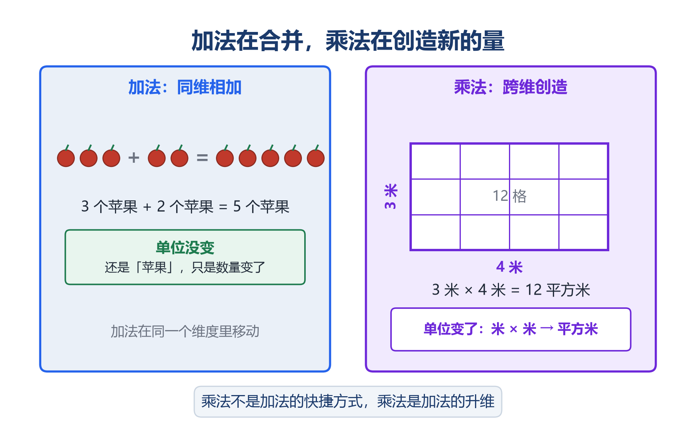
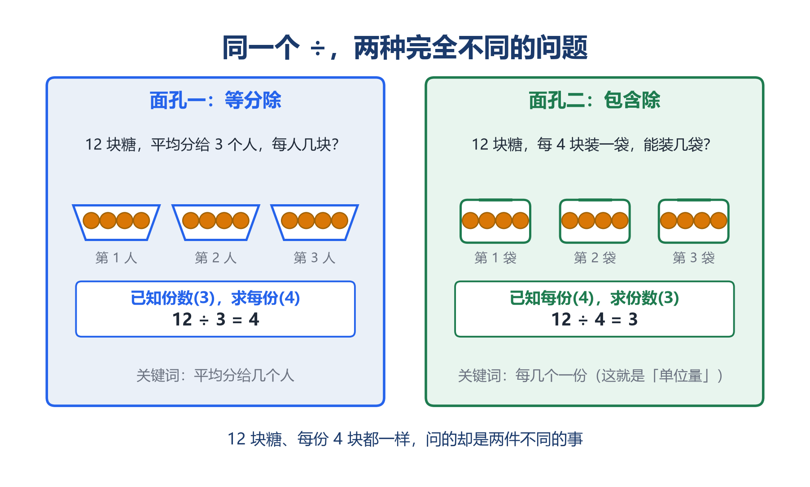
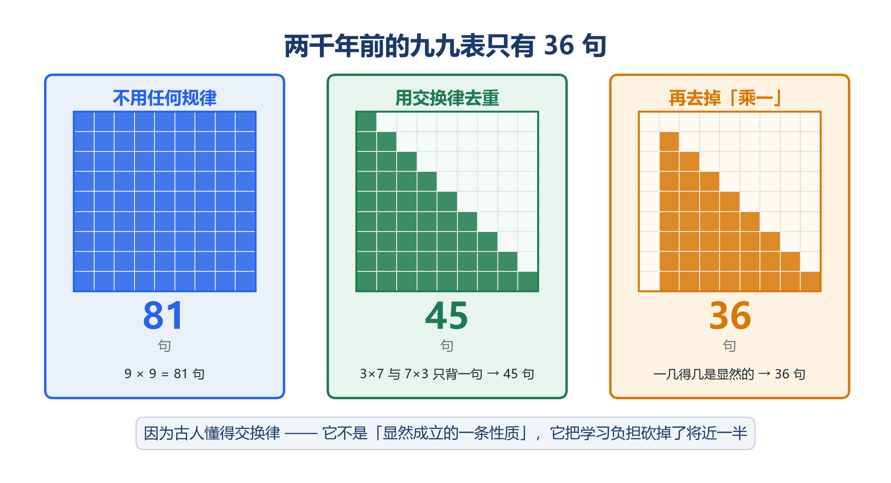
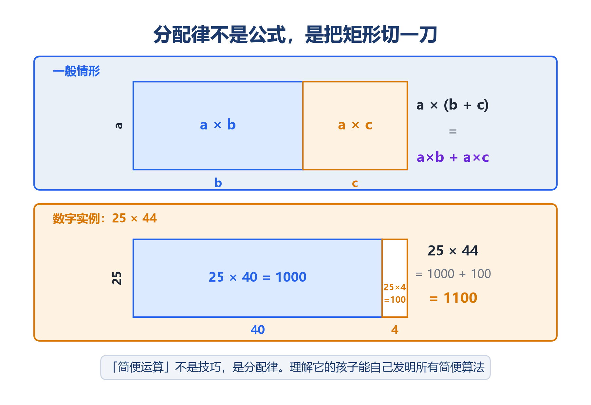
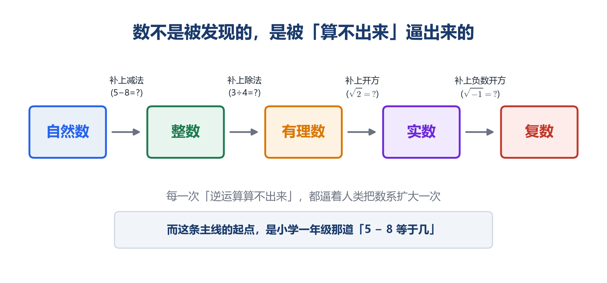
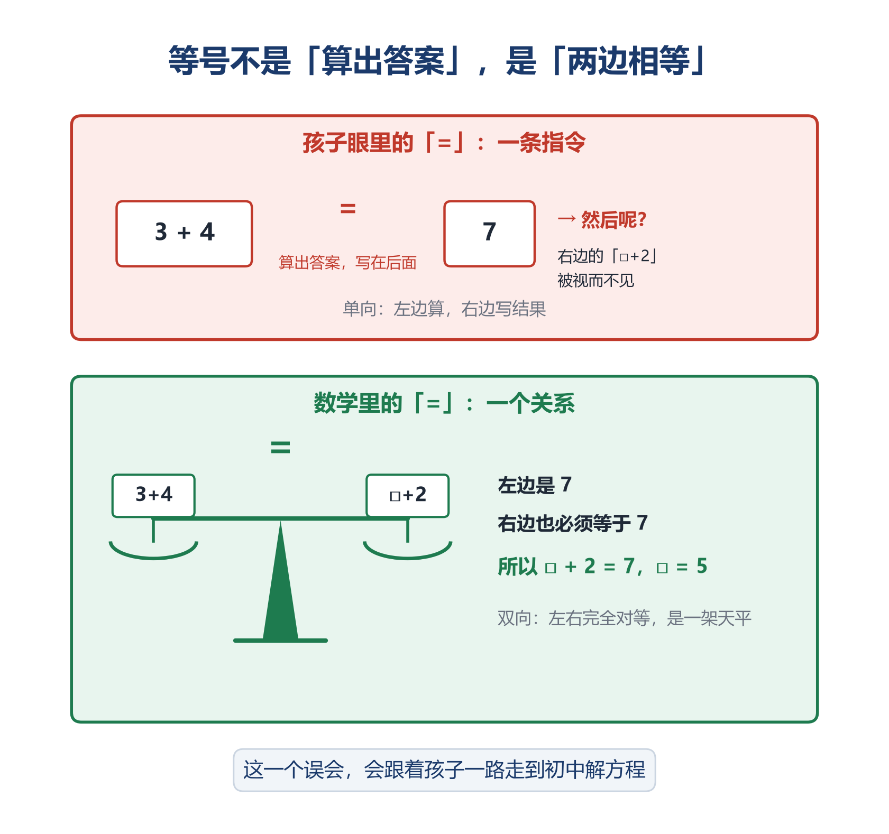
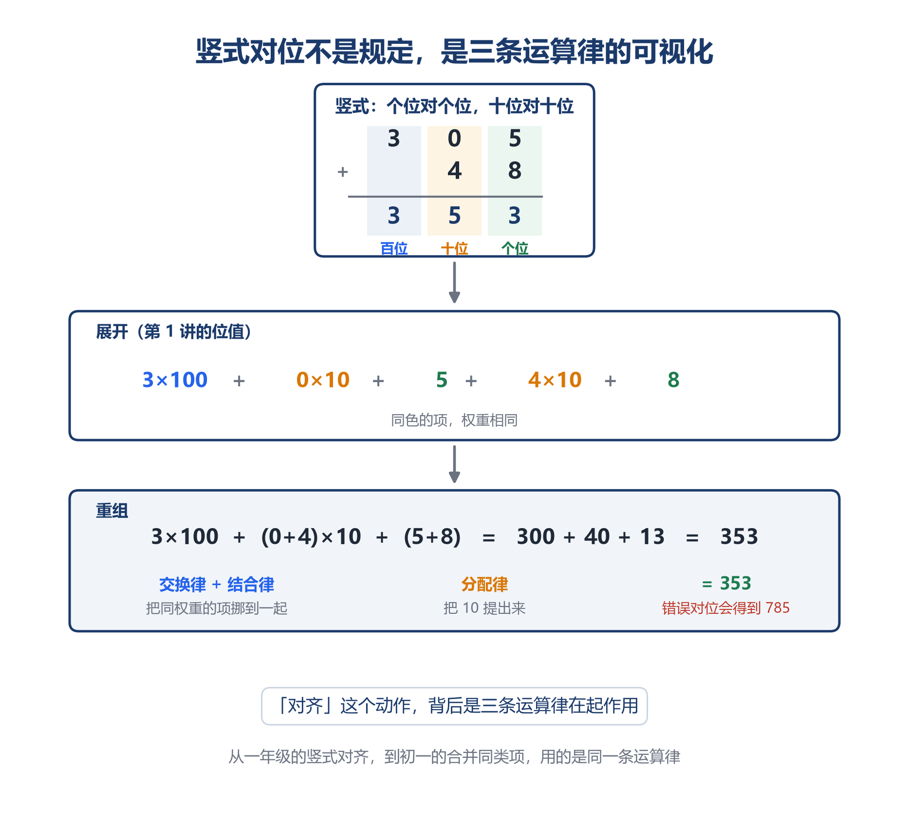

# 四则运算的意义：加减乘除到底是什么

> 「数学成神之路」小学数学 · 第 2 讲
> 原创 · 程大大的小记

> **本文导读**
>
> 这一讲想请你想四件事：
>
> ① 为什么 3+4=7 是一件了不起的事——**你不用把苹果放到一起，就知道了答案**
> ② 为什么加法和乘法不是同一种东西的两次重复——**加法在合并，乘法在创造新的量**
> ③ 为什么乘法交换律是一项**恩典**，而不是理所当然
> ④ 为什么一个卷面全对的孩子，可能什么都没懂——**外包的悖论**
>
> 顺路还会解开一个谜：为什么"等号"的真正威力不是"相等"，而是**可以替换**——整个初中代数，就是这一件事。
>
> 如果只读一章，请读第七章。

---

## 一、引言：一个卷面全对的孩子，可能什么都没懂

你家孩子口算满分吗？乘法口诀背得滚瓜烂熟吗？竖式计算从不出错吗？

如果是，恭喜你。然后请你问他一个问题：

> **"3 × 4 和 4 × 3，凭什么一样？"**

他大概率答不上来。或者告诉你"老师说的"。或者"乘法交换律"。

**再问一句："那为什么减法就没有交换律？5 − 3 和 3 − 5 为什么不一样？"**

这次他几乎一定答不上来。

---

**这不是因为他没学好。**

恰恰相反，他学得很好。口诀背了，题目做了，考试拿了满分。他只是从来没有被问过"为什么"——因为课本不要求问，老师没时间问，家长看到红勾就放心了。

**这就是四则运算最深的陷阱：它不仅允许不理解，它还把不理解完美地隐藏起来。**

位值制那一讲里我们说过，不懂数位的孩子会把竖式算成 785——至少会暴露。但四则运算不会。口诀背熟了，进退位记牢了，**卷面上全是红勾，一个错都没有**。而他对"为什么可以这样算"一无所知。

这个陷阱的名字，叫**外包的悖论**。第七章会专门讲它。

但在走到那里之前，我们需要先回答一个更基本的问题：

**加减乘除，到底是什么？**

这四个从一年级就开始算的东西，其实从来没有被好好定义过。而它们真正的样子，比你以为的要深得多。

这一讲，我们就从这里开始。

---

## 二、本体论：运算是什么

### 1. 数学是人类零成本的实验

3 + 4 = 7。

这道题最惊人的地方，不是答案是 7。

**是你根本不需要把苹果放到一起，就知道了有多少个。**

请停下来想一想这件事的分量。

在运算出现之前，人类要知道"这堆加那堆有多少"，只有一个办法：**真的把它们放到一起，然后数。** 想知道"吃掉三个还剩几个"，只能真的吃掉再看。

**世界是唯一的实验场，而实验是有成本的。**

运算改变了这件事。它让人类第一次可以**在头脑里模拟世界**——把三筐粮食和五筐粮食"在脑子里"合并，而不必真的搬动一筐粮食。

从此，人类可以：

- 不用真的分一遍粮食，就知道每人能分多少
- 不用真的走完那段路，就知道要走几天
- 不用真的打完那场仗，就知道粮草够不够

**每一次计算，都是一次零成本的实验。**

这是文明的分水岭。因为在运算之前，试错要付出真实的代价；在运算之后，人可以先在符号上试错，再在现实里行动。

**数学不是世界的描述，数学是世界的沙盘。**

而四则运算，就是这个沙盘上最初的四条规则。

### 2. 加法在合并，乘法在创造

加法和乘法，课本上被并列成"两种运算"，好像乘法只是加法的高级版——"3×4 就是四个 3 相加"。

**这个说法会让孩子的理解永远停在浅层。**

因为加法和乘法做的根本不是一件事。

**加法是同维相加。** 3 个苹果 + 2 个苹果 = 5 个苹果。加完之后，你得到的还是苹果。**量的种类没有变，只是数量变了。**

**乘法是跨维创造。** 3 米 × 4 米 = 12 平方米。

请注意这里发生的事：**单位变了。**

米是长度，平方米是面积。你拿两个长度相乘，得到的不是"更长的长度"，而是一个**全新种类的量**。

这不是巧合，也不是记号游戏。这是乘法最深刻的性质：

> **加法在同一个维度里移动，乘法可以创造出新的维度。**

一个孩子摆 3 行 4 列的点阵，他数出 12 个点。这个"12"不是一个长度，不是一个数量，它是一个**面积**——一个二维的东西。

**乘法是数学里第一次"无中生有"。** 它从两个一维的量，造出了一个二维的量。

而这件事的后果，会一路延伸到很远：

- 速度（米/秒）× 时间（秒）= 路程（米）
- 密度 × 体积 = 质量
- 单价 × 数量 = 总价
- 长 × 宽 × 高 = 体积（这次创造出了三维）
- 到了初中：x × x = x²（未知数自己乘自己，造出了平方）

**所有公式的本质，都是乘法在创造新的量。**

而加法做不到这件事。你永远无法把两个长度加起来，得到一个面积。

---

**所以"乘法是重复的加法"这个说法，错在哪里？**

它错在：重复加法只能得到同一个维度里更大的数。

3 + 3 + 3 + 3 = 12，这个 12 还是"12 个东西"。
3 × 4 = 12，如果 3 和 4 是长度，这个 12 是"12 个平方单位"。

**数字都是 12，但它们是两种不同的量。**

孩子如果只把乘法理解成"加很多次"，他就永远看不到乘法在创造新维度这件事。而看不到这一点，他就无法真正理解：

- 为什么面积公式是"长乘宽"而不是"长加宽"
- 为什么体积是三个数相乘
- 为什么速度乘以时间等于路程
- 为什么初中 x² 里的"平方"是有意义的

**乘法不是加法的快捷方式。乘法是加法的升维。**


> 左「加法：同维相加」——3 个苹果 + 2 个苹果 = 5 个苹果，标注"量的种类不变"
> 右「乘法：跨维创造」——一个 3 米 × 4 米的矩形，网格铺满，标注"12 平方米：从两个长度，造出一个面积"
> 配主文案："**加法在合并，乘法在创造新的量。**"

### 3. 其实只有两种运算

现在来看四则运算的真实结构。

| 性质 | 加法 | 乘法 | 减法 | 除法 |
|---|:---:|:---:|:---:|:---:|
| 交换律（a○b = b○a） | ✓ | ✓ | ✗ | ✗ |
| 结合律 | ✓ | ✓ | ✗ | ✗ |
| 单位元（存在 e 使 a○e = a） | ✓（0） | ✓（1） | ✗ | ✗ |

**加法和乘法三项全过。减法和除法三项全败。**

这不是巧合。因为：

> **减法和除法不是独立的运算。它们是加法和乘法的"倒放"。**

a − b = c 的意思，就是 c + b = a。
a ÷ b = c 的意思，就是 c × b = a。

**你不需要单独定义减法和除法。它们被加法和乘法完全决定了。**

所以四则运算的真实结构是：

```
        加法  ←──倒放──  减法
         │
       分配律（唯一的桥梁）
         │
        乘法  ←──倒放──  除法
```

**两种运算，两个逆，一条桥。** 这就是四则运算的全部骨架。

> ⚠️ 这个结构在数学里有个名字，叫**域**（Field）。有理数、实数、复数都是域。一个小学生做四则运算时，他已经生活在一个域结构里了——只是没人告诉他。

---

**为什么这件事重要？因为它能回答孩子的一类困惑。**

孩子常问："为什么减法没有交换律？"

老师的回答通常是："就是没有，记住。"

**正确的回答是：因为减法不是独立运算，它是加法的倒放。而倒放的操作，本来就不必继承正放的性质。**

打个比方：穿袜子再穿鞋，脱的时候必须先脱鞋再脱袜子。

**"穿"和"脱"是互逆的操作，但顺序必然相反。** 你不会问"为什么脱的顺序和穿的顺序不一样"——因为逆操作本来就该反过来。

减法就是加法的"脱"。

---

**顺便说一件有趣的事。**

减法和除法虽然"残缺"，但它们的残缺是有价值的。

正因为减法不可交换，人类才被迫发明了负数——因为 5 − 8 在自然数里算不出来（第五章会讲这件事）。

正因为除法不可封闭，人类才被迫发明了分数——因为 3 ÷ 4 在整数里算不出来。

**运算的缺陷，是数系生长的动力。** 一个完美的、什么都不缺的运算系统，反而不会生长。

这一点，后面讲分数时会正面展开。

### 4. 除法的两张面孔

除法有一个很容易被忽略的坑：**"÷"这一个符号，承担着两种完全不同的问题。**

**面孔一：已知份数，求每份多少。**

> 12 块糖，平均分给 3 个人，每人几块？　12 ÷ 3 = 4

**面孔二：已知每份多少，求能分几份。**

> 12 块糖，每 4 块装一袋，能装几袋？　12 ÷ 4 = 3

两道题写的都是"12 ÷"，算的都是除法，**但它们在现实里是完全不同的两件事**。一个是"分给几个人"，一个是"能分成几组"。

孩子如果只熟悉其中一种，遇到另一种情境的应用题就会懵。而小学应用题里"每份数 × 份数 = 总数"这套关系，两种面孔要求的未知量是不同的。

**更关键的是，第二张面孔（每份多少）是"比例思维"的种子。** 因为"每份多少"就是一个**单位量**——而单位量是比和比例的核心。后面讲比例时会回到这里。


> 左：12 块糖分给 3 个人，画出 3 个盘子各 4 块，标注"已知份数(3)，求每份(4)"
> 右：12 块糖每 4 块装一袋，画出 3 个袋子，标注"已知每份(4)，求份数(3)"
> 配主文案："同一个 ÷，两种完全不同的问题。"

---

## 三、认识论：意义不能靠背

### 为什么"算得快"不等于"懂"

现在的孩子口算速度普遍很快，乘法口诀滚瓜烂熟。

但"算得快"和"懂意义"是两回事。一个能把口诀背到九九八十一的孩子，可能完全答不出"3×4 和 4×3 有什么不一样"。

这就是启蒙篇批判的"算术中心主义"：**把运算压缩成条件反射，然后误以为条件反射就是理解。**

运算的意义，必须经历和第 1 讲位值制一样的阶梯才能建立：**实物 → 图像 → 符号**。

**实物**：两堆积木合到一起（加法）；摆 3 行 4 列的点阵（乘法）；真的拿 12 颗豆子分给 3 个碗（除法）。

**乘法一定要摆点阵，不要只背口诀。** 因为点阵是交换律、分配律、面积模型的共同源头。摆过点阵的孩子，将来学多项式乘法会有直觉；只背过口诀的孩子，将来只能死记公式。

**图像**：数轴上向右跳（加）、向左跳（减）；点阵图、面积图（乘）；线段等分（除）。

**符号**：只有前两级扎实了，"3×4=12"才有意义。否则它只是一串需要背诵的字符。

> •实操切片：**「转身游戏」**
> 让孩子用棋子摆一个 3×4 的长方形（3 行 4 列）。
> 问："一共几个？"他数出 12。
> 然后说："现在把它转个身。"（旋转 90 度）
> 再问："现在几个？"
> 他会发现：还是 12，但现在是 4 行 3 列。
>
> **问一句："为什么转身之后数量没变？"**
>
> 让他自己说出："因为还是那些棋子，只是换了个方向。"
>
> **这一刻，他理解了乘法交换律——不是背的，是看见的。**
>
> 进阶（四年级）：追问"那 3×4 和 4×3 到底一样不一样？"
> 引导他发现：**结果一样，但意义不一样。** 一个是"3 行每行 4 个"，一个是"4 行每行 3 个"；如果 3 和 4 是长和宽，转个身矩形就换了方向。
> 这个"结果同、意义异"的分辨，是乘法理解的分水岭。

### 分寸：哪个年级，停在哪一层

和前几讲一样，必须给反向提醒。本篇第二章的思想深度是刻意为之的，**它的目标读者是家长和老师，不是孩子。**

| 阶段 | 大致年级 | 该抓什么 | 不要提前做什么 |
|---|---|---|---|
| 第一学段 | 一、二年级 | 加减法的"合并/去掉"意义、数轴跳跃 | 不讲"逆运算""交换律"这类术语，不讲数系扩充 |
| 第二学段 | 三、四年级 | 乘法的阵列/面积意义、除法两张面孔、三条运算律 | 不引入"封闭性""单位元""域"等概念 |
| 第三学段 | 五、六年级 | 逆运算的统一视角、运算律的灵活运用 | 多项式乘法只作兴趣拓展，不作要求 |

**两条硬边界**：

1. **"乘法是重复加法"这个说法，到三年级必须升级成"乘法是阵列/面积"。** 否则交换律、分配律、乃至初中的 x²，都无从理解。
2. **本章第 3 节（域结构）、第七章（外包的悖论），是写给大人的。** 它们的价值在于让你明白"孩子现在算的这个式子，底下压着什么"，从而知道该往哪个方向引导，而不是把术语灌给孩子。

> ⚠️ 表中年级划分对应《义务教育数学课程标准（2022 年版）》三个学段的大致安排，各地教材进度略有差异，请以孩子实际使用的教材为准。

---

## 四、典型错题解剖：三种错误，同一个根源

### 错题一：靠关键词猜运算

**症状**：题目里有"一共"就加，有"还剩"就减，有"平均"就除，有"每"就乘。孩子不看题意，只扫描关键词。

**病灶**：孩子从来没有建立运算的**意义**，只建立了"关键词 → 运算符号"的条件反射。

一旦题目出得"不标准"，反射就失灵：

> "小明有 5 个苹果，比小红少 3 个，小红有几个？"

"少"这个字，反射告诉他用减法，5 − 3 = 2。**错了。** 这题是比较，小红比小明多，应该是 5 + 3 = 8。

**根治**：让孩子把题目"演"出来，而不是"扫"出来。先用常识判断答案该变大还是变小，再选运算。

一句话口诀：**"先想清楚是变多还是变少，再决定加还是减。"**

### 错题二：等号当指令

**症状**：3 + 4 = □ + 2，填 7 或 9。或者更常见的：孩子口算全对，但你问他"等号是什么意思"，他说"就是等于啊"——说不出"两边相等"这四个字。

**病灶**：孩子把等号理解成"接下来写答案"的指令，而不是"两边相等"的关系。这在引言里已经点出过——卷面全对，但对等号的理解是空的。

这不是一个孤立的错题，这是整个代数学习的地基问题。**第六章会专门展开**，这里先给根治方法。

**根治**：**天平模型。** 画一架天平，等号是中间的支点。左边放什么，右边必须放同样重的。

> •实操切片：**「天平游戏」**
> 让孩子在纸上画天平，做这几道题：
> - 5 + 3 = 4 + □
> - 10 = 6 + □
> - 2 + 8 = □ + 5
> - **□ + 7 = 7 + 9**
>
> 每道题都要求他先算出等号一边是多少，然后问："另一边要放多少，天平才平？"
>
> **注意最后一道。** 这道题不用算 7+9=16 再减 7——两边都有 7，直接看出 □ = 9。
>
> **孩子如果能看到这一点，说明他真的把等号当成了关系，而不是指令。**
>
> 这个动作，直接就是初中"解方程保持等式平衡"的雏形。

### 错题三：乘除意义混淆

**症状**：
> "每盒 6 支笔，4 盒一共几支？" → 6 × 4 = 24 ✓
> "24 支笔，每 6 支装一盒，能装几盒？" → 孩子犹豫，甚至用 24 × 6

**病灶**：孩子没有区分除法的两张面孔（第二章第 4 节）。更深层的是，他不知道**乘和除是互逆的**——如果他知道 6 × 4 = 24，那么"24 里有几个 6"就是同一件事反过来问。

**根治**：用"乘法事实家族"打通乘除。一组三个数（4、6、24）写出四个算式：

> 4 × 6 = 24　　6 × 4 = 24　　24 ÷ 4 = 6　　24 ÷ 6 = 4

**这四个算式是同一件事的四个侧面。** 让孩子对每一组数都写全四个，他就不会再混淆乘除。

### 本章小结：一个卷面全对的孩子，可能什么都没懂

三个错题，根源是同一个——**孩子把运算当成了对符号的操作，而不是对量的操作。**

但这里有一件事，比这三个错题严重得多，而且必须说清楚。

**第 1 讲讲位值制时，我们说过"能执行规则"和"理解规则"是两回事。但位值制至少留了一个破绽——孩子如果真不懂数位，竖式会算错，那个 785 会暴露他。**

**四则运算没有这个破绽。**

口诀背熟了，竖式对齐了，进退位记牢了——**卷面上全是红勾，一个错都没有。**

而他对"为什么可以这样算"一无所知。

---

这是四则运算最深的陷阱：**它不仅允许不理解，它还把不理解完美地隐藏起来。**

家长看到满分就放心了。老师看到全对就打勾了。没有人知道，这个孩子刚刚用六年时间，把一套完全不理解的规则练成了肌肉记忆。

**而肌肉记忆不会迁移。**

到了初中，当题目从"算出答案"变成"理解结构"——负数、方程、函数——那些从来没被建立起来的意义，就会变成一堵堵墙。而孩子会困惑：我小学数学明明每次都是满分啊。

**他没错。错的是"满分"这个信号，它测量的从来不是理解。**

这个陷阱，第七章会给出它真正的名字。

---

## 五、思想渗透：运算的三次远征

四则运算看起来是小学数学最基础的一章。但它藏着三条通向远方的线。

### 远征一：交换律是一项恩典

孩子觉得 3 × 4 = 4 × 3 天经地义。

**但请你认真想一想：这件事真的理所当然吗？**

生活中的绝大多数操作都不交换：

- 穿袜子再穿鞋 ≠ 穿鞋再穿袜子
- 先打折再满减 ≠ 先满减再打折
- "我爱你" ≠ "你爱我"

数学里也一样：

- 函数复合不交换：先加 1 再乘 2，和先乘 2 再加 1，结果不同（3 → 8 vs 3 → 7）
- 矩阵乘法不交换，这是线性代数的基本事实
- 而量子力学里，位置和动量不交换（pq ≠ qp）——**这正是海森堡不确定性原理的数学根源**

**在一个"不交换才是常态"的宇宙里，乘法交换律是一项特殊的恩典。**

而我们因为太早得到它，从未感激过它。

---

**古人感激过。**

中国的乘法口诀，先秦原版只有 **36 句**——从"九九八十一"起，到"二二如四"止。

为什么是 36 句，而不是 81 句？

因为 1 到 9 的两两相乘，本来有 81 种组合。但**交换律砍掉了一半**：3×7 和 7×3 是同一件事，只背一句就够。81 减到 45。再去掉 9 句"一几得几"（乘 1 显然），剩 **36 句**。

**两千年前的中国人，把交换律编进了教材设计里。** 他们不是不知道 3×7 和 7×3 都能算，他们是**懂得只背一句**。

这就是交换律的真实价值：**它不是"显然成立的一条性质"，它是把学习负担砍掉将近一半的一条规律。**


> 左：一个 9×9 的完整方阵，81 格全涂色，标注"不用任何规律：81 句"
> 右：同一个方阵，只涂对角线及以下的 45 格，标注"用交换律：45 句"，并进一步淡化 9 格"乘一"，标注"再去掉显然的：36 句"
> 配主文案："**两千年前的九九表只有 36 句。因为古人懂得交换律。**"

### 远征二：运算律不是技巧，是代数的骨架

加法交换律、结合律，乘法交换律、结合律、分配律——这些在小学是"简便计算的技巧"。

但它们的真实身份，是**代数公理系统的雏形**。

一个立刻能用的实战价值：

> 25 × 44 = 25 × (40 + 4) = 1000 + 100 = 1100
> 99 × 78 = (100 − 1) × 78 = 7800 − 78 = 7722
> 101 × 99 = (100 + 1)(100 − 1) = 10000 − 1 = 9999

**"简便运算"不是 tricks，它是分配律的应用。** 理解分配律的孩子能自己发明所有简便算法；只会背"凑整"口诀的孩子，换个数字就不会了。

最后一道尤其漂亮：101 × 99 = 10000 − 1。这是**平方差公式**，初中二年级的内容，而它在这里只是一个心算技巧。

而分配律 a × (b + c) = a × b + a × c，用面积模型看，就是**把一个矩形切一刀**：


> 一个大矩形，长 a，宽 (b+c)，被竖线切成两块：左边 a×b，右边 a×c
> 标注"a×(b+c) = a×b + a×c"
> 下方配数字实例：25×44 的矩形，切成 25×40 和 25×4
> 配主文案："分配律不是公式，是把矩形切一刀。简便运算不是技巧，是分配律。"

**整个初中代数，都建立在这几条法则之上。** 合并同类项靠分配律，整式乘法靠分配律，因式分解是分配律的逆用。

这一条线太重要，值得单独拿一整讲去讲透。

### 远征三：数是被"算不出来"逼出来的

数学里有个词叫**封闭**：一个运算在某个数的范围内，总是能得出范围内的结果。

- 加法在自然数里封闭
- **减法在自然数里不封闭**：5 − 8 = ？自然数里没有答案
- 乘法在整数里封闭
- **除法在整数里不封闭**：3 ÷ 4 = ？整数里没有答案

**而人类解决这两个问题的方式，完全一样：把数系扩大。**

| 遇到的困境 | 什么运算算不出来 | 于是发明了什么 |
|---|---|---|
| 欠债、温度零下 | 减法：5 − 8 = ? | **负数**（自然数 → 整数） |
| 分东西、量布 | 除法：3 ÷ 4 = ? | **分数**（整数 → 有理数） |
| 开方开不尽 | 开方：$\sqrt{2} = ?$ | **无理数**（有理数 → 实数） |
| 负数开平方 | 开方：$\sqrt{-1} = ?$ | **虚数**（实数 → 复数） |

**这两千五百年的主线，起点是小学一年级那道"5 − 8 等于几"。**

而后面讲分数时会揭示一个更惊人的事实：**负数和分数，是用同一种方法构造出来的**（都是"有序对的等价类"）。人类两次面对同样的困境，给出了结构完全相同的解法。


> 一条向右生长的线：自然数 →（补上减法）→ 整数 →（补上除法）→ 有理数 →（补上开方）→ 实数 →（补上负数开方）→ 复数
> 每一步标注"缺什么运算，就发明什么数"
> 配主文案："数不是被发现的，是被'算不出来'逼出来的。"

---

## 六、等号：一个符号里的两种世界观

前面五章讲的都是"运算"。

最后一章，要讲一个比运算更基础、却被所有人忽略的符号——

**等号 "="。**

这是本讲通向代数的真正出口。

### 1. 等号是怎么来的

1557 年，威尔士数学家罗伯特·雷科德（Robert Recorde）在《砺智石》一书中，第一次使用了我们今天这个"="。

他的理由很有诗意。他说，他选两条平行且等长的线段来表示相等，是因为——

> **"没有哪两样东西，比两条等长的平行线更相等的了。"**

请注意这句话里的关键词：**相等（equal）**。

雷科德发明这个符号，是为了表达"**两边相等**"这个**关系**。它从诞生的第一天起，就不是"算出答案"的指令。

**是我们后来把它用错了。**

### 2. 孩子的等号，和数学家的等号，是两个东西

| | 孩子眼里的 "=" | 数学里的 "=" |
|---|---|---|
| 含义 | "接下来写答案" | "两边相等" |
| 身份 | 一条指令（动词） | 一个关系（陈述） |
| 方向 | 单向：左边算，右边写结果 | 双向：左右完全对等 |
| 例子 | 3+4=7（算出来） | 3+4 = 5+2（两边都是 7） |

**孩子把等号当成一条单行道。而等号是一架天平。**

回到一个简单的问题：3 + 4 = □ + 2，□ 填几？

- 把等号当"指令"的孩子：3+4 算出 7，然后……□+2 是什么？懵了，乱填 7 或 9。
- 用"关系"的眼光看：左边是 7，右边也必须等于 7，所以 □+2 = 7，□ = 5。**清清楚楚。**


> 上半「孩子的等号」：3+4 →[=]→ 7，画成一条单向箭头，标注"'='是一条指令：算出答案"
> 下半「数学的等号」：一架天平，左盘 3+4，右盘 □+2，支点标"="，标注"'='是一个关系：两边相等"
> 配主文案："**等号不是'算出答案'，是'两边相等'。这一个误会，会跟孩子到初中解方程。**"
> **建议这张图单独做成传播长图。**

### 3. 但"相等"还不是最深的——最深的是"可以替换"

到这里，大多数讲等号的文章就停了：等号是关系，不是指令。

**但还要再往下一层。**

问一个问题：**"相等"到底给了我们什么能力？**

答案是三个字：**可以换。**

如果 a = b，那么在任何式子里，**a 出现的地方都可以换成 b，式子仍然成立。**

这在逻辑学上叫**等量代换**（莱布尼茨律）。

**它是等号真正的威力所在。**

"两边相等"只是一个静态的描述；**"可以互相替换"才是一个能拿来干活的工具。**

而代数的全部操作，本质上就是一件事：**用相等的东西，替换相等的东西。**

### 4. 代数的全部秘密：替换

"替换"这个词听起来太朴素了。但请注意一件事：

**孩子六岁就在做它，而且做得很熟练——只是从来没有人告诉他，他做的是代数。**

看一件所有中国孩子都学过的事：凑十法。

> **9 + 6 = ？**

老师教的方法是：把 6 分成 1 和 5，先算 9 + 1 = 10，再算 10 + 5 = 15。

**请仔细看这个操作在数学上做了什么。**

> 9 + 6
> = 9 + (1 + 5)　　【用 1+5 替换 6，因为 6 = 1+5】
> = (9 + 1) + 5　　【结合律：改变运算顺序】
> = 10 + 5
> = 15

**这是一段完整的、每一步都有依据的代数推导。**

而做这段推导的人，是一个六岁的一年级小学生。

**他在做代数。他只是不知道自己在做代数。**

---

这件事的分量，比它看起来大得多。

因为**整个初中代数，做的事情和凑十法在结构上完全相同**：

| 凑十法 | 初中代数 |
|---|---|
| 把 6 换成 1+5 | 把 x²+5x+6 换成 (x+2)(x+3) |
| 依据：6 = 1+5 | 依据：乘法分配律 |
| 目的：让计算变容易 | 目的：让方程变好解 |
| 每一步都保持值不变 | 每一步都保持等式成立 |

**因式分解，就是给代数式"凑十"。**

一个真正理解凑十法在做什么的孩子，将来学因式分解不会有认知障碍——因为他早就在做同一件事了：把一个式子换成更好算的、但值相等的形式。

而一个只把凑十法当"口诀"背的孩子，将来只能把因式分解也当口诀背。

> •实操切片：**「说出你的理由」**
>
> 这是本讲最重要的一个实操，也是最简单的一个。
>
> 孩子做口算时，别只问"等于几"，**问一句"你怎么算的"**。
>
> 他可能会说："9+6，我把 6 拆成 1 和 5。"
> 这时候追问一句：**"为什么可以把 6 拆成 1 和 5？"**
>
> 大多数孩子会愣住。因为他们从来没被问过这个。
>
> 你可以告诉他："因为 6 就等于 1+5 呀。**相等的东西，可以互相换。**"
>
> **这九个字，是整个代数的地基。** 孩子现在听不懂没关系，但这句话会在他心里留一个位置。等到初中第一次做因式分解时，那个位置会被激活。
>
> 进阶（三四年级）：让他做 25×44，然后问"你怎么算的"。他说"25×4=100，所以 25×44=25×4×11=1100"。
> 再追问："为什么 25×44 可以变成 25×4×11？"
> **他答出来的那一刻，他就理解了结合律——不是背的，是自己说出来的。**

### 5. 补上第 1 讲欠的一笔：竖式对位为什么合法

第 1 讲里我们说过一句话：**"竖式对齐，对的是数位，不是数字。"**

当时给的理由是："只有权重相同的量才能直接相加。3 个百加 4 个十，就像 3 米加 4 秒一样荒谬。"

**这个理由是对的，但它只是直觉。现在可以把它补完整。**

看 305 + 48。按第 1 讲的位值展开：

> 305 = 3×100 + 0×10 + 5×1
> 48 = 　　　　 4×10 + 8×1

把它们加起来：

> 305 + 48
> = (3×100 + 0×10 + 5) + (4×10 + 8)
> = 3×100 + (0×10 + 4×10) + (5 + 8)　　【交换律 + 结合律：把同权重的项挪到一起】
> = 3×100 + (0+4)×10 + 13　　　　　　　【分配律：把 10 提出来】
> = 300 + 40 + 13
> = 353

**看清楚了吗？**

竖式的"对齐"，就是把第二步那个"把同权重的项挪到一起"**做成了一个动作**。

- 个位对个位 → 5 和 8 放在一起
- 十位对十位 → 0×10 和 4×10 放在一起
- 百位对百位 → 3×100 单独放着

**而"挪到一起"的合法性，来自交换律和结合律。"把 10 提出来"的合法性，来自分配律。**

> **竖式对位不是一条规定，它是三条运算律的可视化。**

第 1 讲那个算出 785 的孩子，他错在哪里？现在可以说得更准了：

**他不是在"对齐"上出错，他是在无意识地违反了分配律。** 他把 3×100 和 4×10 当成同类项合并了——而这两项权重不同，无法用分配律提取公因子。

**这也解释了初中那个"合并同类项"：**

- 3a + 4b 为什么不能合并？因为 a 和 b 是不同的"权重"，提不出公因子
- 3a + 4a 为什么能合并成 7a？因为 (3+4)a = 7a，分配律用得上

**从一年级的竖式对齐，到初一的合并同类项，用的是同一条运算律。**


> 三层对照：
> 上层「竖式」：305 + 48 的标准竖式，用颜色标出个位、十位、百位三列
> 中层「展开」：(3×100 + 0×10 + 5) + (4×10 + 8)，同色标注对应项
> 下层「重组」：3×100 + (0+4)×10 + (5+8) = 353，标注"交换律+结合律把同权重项挪到一起，分配律把 10 提出来"
> 配主文案："**竖式对位不是规定，是三条运算律的可视化。**"

### 6. 为什么这件事决定代数的成败

**因为方程，就是"等号是关系"加上"可以替换"这两个观念的直接产物。**

方程 x + 3 = 7，说的不是"算出 x+3 等于几"，而是"**存在一个 x，使得 x+3 和 7 相等**"。

解方程，就是**在保持等号两边相等的前提下，把 x 隔离出来**。

每一步操作的合法性，都来自两条：

1. **天平律**：两边同时加、减、乘、除同一个数，等式仍然成立。
   为什么？因为天平两边同时加同样的重量，天平仍然平。**这是"等号是关系"的直接推论。**

2. **替换律**：式子里任何地方，都可以用相等的东西替换相等的东西。
   **这就是凑十法在做的事。**

---

**现在，把这条线拉直：**

| 阶段 | 对等号的理解 | 能做什么 |
|---|---|---|
| 一年级 | "=" 是"算出答案" | 3+4=7 |
| **本讲（应该到达）** | "=" 是"两边相等，且可以替换" | 3+4 = 5+2；凑十法 |
| 初中 | "=" 是"含未知数的等式" | 解方程 x+3=7 |
| 初中 | "=" 是"式子可以变形" | 因式分解、整式乘法 |
| 高中 | "=" 是"两个函数恒等" | 证明恒等式、求定义域 |
| 大学 | "=" 是"等价关系" | 商结构、同构 |

**从一年级到初中，隔着的就是"等号是关系，而且可以替换"这一层窗户纸。**

捅破了，解方程是顺理成章的事——因为它只是"维持天平平衡 + 合法替换"。
捅不破，解方程就是一套需要死记的、莫名其妙的"移项变号"口诀。

---

如果这一讲你只能记住一句话，请记住这句，并且转述给你的孩子：

> **"等号不是让你算出答案。等号是告诉你，它左右两边是同一个东西——所以你可以把它们互相替换。"**

**这句话，是算术思维和代数思维的分水岭。**

而绝大多数孩子，从来没有被人这样告诉过。

---

## 七、结语：外包的悖论

我们为什么要花一整讲，去谈加减乘除这四个从一年级就开始算的运算？

因为它们太熟悉了，熟悉到**从没有人停下来问过一句：它们到底是什么？**

而在这一讲的最后，我想说一件比"运算是什么"更重要的事。

### 1. 运算律的伟大，在于它让你不必理解

回到第四章那个陷阱：一个卷面全对的孩子，可能什么都没懂。

**现在我们可以说出它的名字了。**

口诀的意义是什么？是**让你不必思考就能算对**。

竖式的意义是什么？是**让你不必理解位值也能算对**。

分配律的意义是什么？是**让你不必看清结构，只要按规则展开就能算对**。

**这是运算律最伟大的地方——它把思考外包给了规则。**

而外包，是人类文明的本质。

- 文字外包了记忆：从此不必把所有事记在脑子里
- 货币外包了价值判断：从此不必记住一头羊换几把斧头
- 运算外包了推理：从此不必每次都从头想
- 计算机外包了计算：从此不必自己算

**每一次成功的外包，都让文明跃升一级。**

九九表就是人类最早的大规模外包之一。它把 81 个乘法事实压缩成 36 句口诀，让一个识字不多的商人也能做复杂的账。**这不是教育的偷懒，这是文明的加速器。**

### 2. 但每一种工具，都在解放一种能力，同时废掉一种能力

这是外包的代价，而且这个代价是**当场就付的**。

- 文字让我们能记录一切，**也让我们不再需要记住任何事**
- 计算器让我们能算复杂的数，**也让我们失去了对数量的直觉**
- GPS 让我们永不迷路，**也让我们不再认得回家的路**
- 搜索引擎让我们无所不知，**也让我们不再深入理解任何东西**

**而九九表，让我们能算得又快又对，也让孩子可以完全不必理解乘法，就把小学数学全部"学完"。**

这就是四则运算的悖论：

> **它是人类最成功的思维外包，也因此是最完美的理解替代品。**

它太好了，好到可以完全代替理解，而且**不留任何痕迹**。

位值制至少会暴露——不懂数位的孩子会把竖式算成 785。
四则运算不会暴露——不懂乘法意义的孩子，口诀照样背得滚瓜烂熟，卷面照样满分。

### 3. 所以问题不是"要不要外包"

写到这里，很容易滑向一个结论："那就别让孩子背口诀，要理解优先。"

**这个结论是错的。**

不背口诀的孩子，会把全部的认知资源耗在"7×8 等于几"上，没有余力去思考题目本身。**外包是必要的，它是思考的前提，不是思考的敌人。**

真正的问题是另一个：

> **外包之后，你还记不记得被外包掉的是什么？**

一个只会背口诀的孩子，和一个背了口诀、**同时知道 3×4 为什么等于 4×3** 的孩子，卷面分数完全一样。

但他们不是同一种人。

前者拥有一个工具。后者拥有工具，**并且知道这个工具为什么能用、什么时候会失效**。

而当题目超出工具适用范围的那一刻——比如初中的负数、比如高中的函数、比如大学里那个不交换的矩阵乘法——**只有后者知道该怎么办。**

因为前者从来不知道规则从哪里来，所以他不知道规则在哪里结束。

---

**这就是这一讲想留给家长的一句话：**

你让孩子背口诀，是对的。你让他练口算，也是对的。

**但请偶尔问一句"为什么"。**

不是考他，是提醒他——也提醒你自己——**在那些滚瓜烂熟的规则底下，压着一些曾经需要人类花几千年才想明白的东西。**

而孩子问出"为什么 3×4 等于 4×3"的那一刻，他不是在打扰教学进度。

**他是在做人类做过的事。**

---

### 最后，说一件贯穿这个系列的事

第 1 讲讲位值制，那里说：**零是地基。** 教皇西尔维斯特二世的算板有九个符号，缺了第十个——零——整套系统就立不起来。

这一讲讲运算，我们看到了零的第二份工作：

**a + 0 = a。** 加零等于没加。零是**透明的**。
**a × 0 = 0。** 乘零一切归零。零是**抹除性的**。

**同一个零，两种完全相反的虚无。**

一种虚无是"缺席"——它在那里，但不改变任何东西。
另一种虚无是"取消"——它一出现，所有东西都消失。

**这是哲学里最难处理的一对概念，而孩子在一年级就在同时使用它们，毫无障碍。**

到了分数那一讲，我们会看到零的第三份工作：**它是除法的边界。** 任何数除以它，运算就崩塌。

**同一个零，三种身份：**

- 在"写"的时候，它是**地基**（占位符）
- 在"加"的时候，它是**透明**的（什么都不改变）
- 在"乘"的时候，它是**抹除**的（一切归零）
- 在"除"的时候，它是**深渊**（运算失效）

一个符号，四种截然不同的角色。而孩子从一年级就开始写它，一直写到大学。

**这就是数学。最熟悉的东西，往往最陌生。**

而"数学成神之路"要做的，就是把那些被熟悉感掩盖住的陌生，一个一个重新揭开。

**我们现在，才走完小学的第二步。**

---

**参考文献思路**

> 克莱因《古今数学思想》（运算与数系的演进）
>
> 《九章算术》及刘徽注
>
> 周向宇《中国古代数学的成就》（中国科学院）
>
> 弗赖登塔尔《作为教育任务的数学》（运算意义与数学化）
>
> 史宁中关于"数与运算一致性"的论述
>
> 《义务教育数学课程标准（2022 年版）》第一、二学段"数与运算"主题

---

**互动**

你家孩子口算满分，但你问他"3×4 和 4×3 凭什么一样"，他答得上来吗？

**评论区说说那个让你意识到"孩子会算但不懂"的瞬间。** 我会挑三个最典型的，专门回应。

需要本篇的「天平游戏」练习卡吗？（12 道等式平衡题，附天平图，可打印）后台回复 **天平卡** 领取。

---
