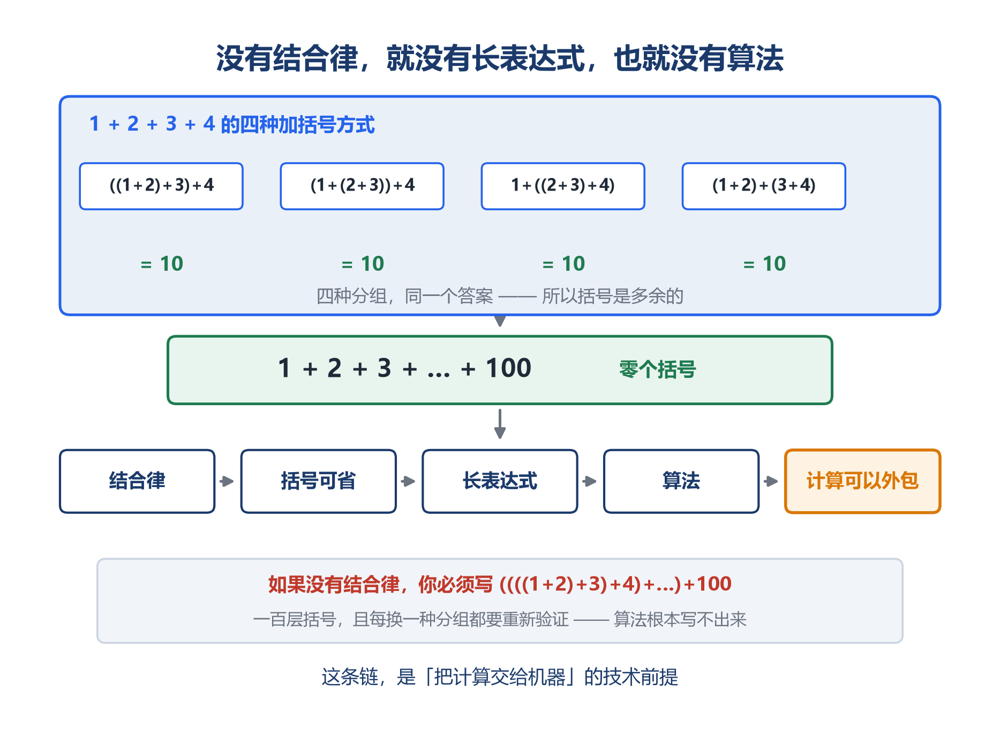
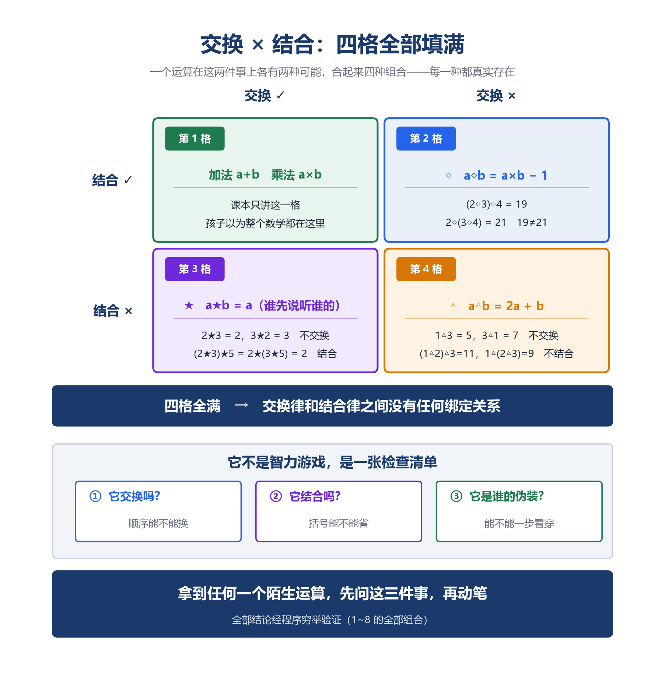
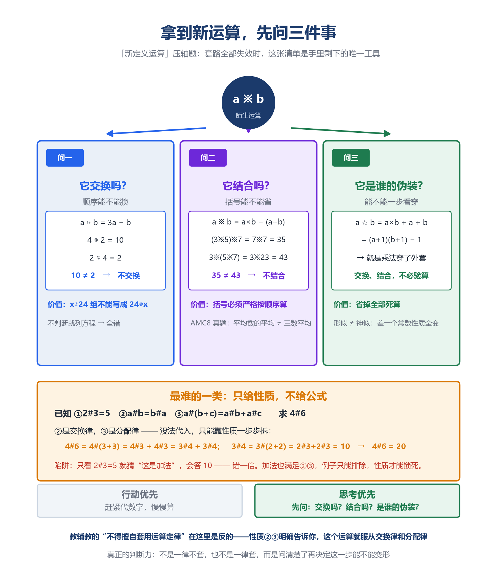
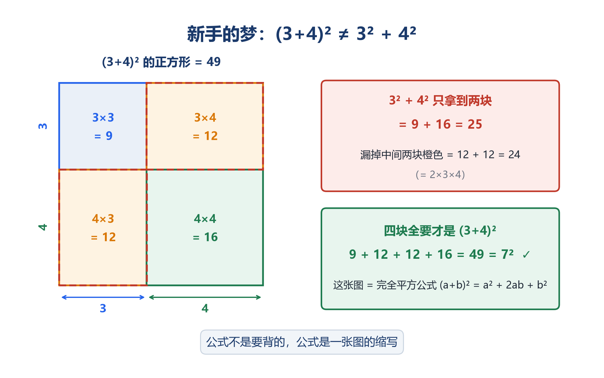
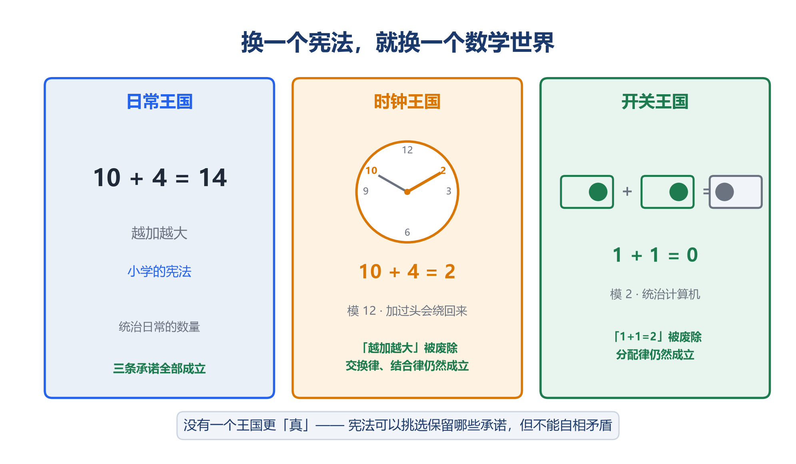

# 运算的法则：数学第一次不问"是多少"

「数学成神之路」小学数学 · 第 3 讲

原创 · 程大大的小记

**导读**

先看一道题。

```
规定一种新运算：a ※ b = a×b − (a + b)。求 (3※5)※7。
```

孩子甲老老实实从左往右算：3※5 = 15−8 = 7，再 7※7 = 49−14 = **35**。

孩子乙看了一眼，觉得"反正都是 ※，括号放哪都一样"，先算了右边：5※7 = 35−12 = 23，再 3※23 = 69−26 = **43**。

两个答案都"看起来对"。但只有一个是真的对。

**乙错在哪？** 不是算错了数字，是他把一条**不该用的承诺**用上了——他默认 ※ 像加法一样"怎么加括号都行"。而加法之所以能这样，是因为它有一条叫"结合律"的承诺在担保。※ 没有这条承诺，括号就不能随便挪。

**这道题，就是这一讲的入口。**

它同时问了三件事，而这三件事正好是本讲的三根柱子：

① **结合律到底买到了什么？** 为什么有了它，"1+2+…+100"才能一个括号都不写？为什么没有它，算法就不可能存在？（第二章）

② **交换律和结合律是一回事吗？** 孩子能不能亲手造出"交换但不结合""结合但不交换"的运算，把它们拆开？（第三章前半）

③ **拿到一个陌生运算，除了死算还能做什么？** 乙的错误告诉我们：动手之前必须先问三个问题。这三个问题，恰好也是小学压轴题"新定义运算"真正在考的东西。（第三章后半）

而第四章那三道著名错题（125×8÷125×8=1、(3+4)²=25、20−(5−3)=12），病根全在同一个地方：**孩子不知道 `a+b=b+a` 是哪一类句子**——他把它当成了可以照着形状套用的公式，而公式和承诺是两种东西。

如果只读一章：想弄明白那道 ※ 题为什么乙错，读第三章；想知道三道错题为什么错，读第四章；觉得运算律"没内容"，读第二章；想知道"1+1=2"居然也可以不成立，读第五章。

---

## 一、引言：一个什么都没算的式子

35 和 43，一个对一个错。要弄明白错在哪，得先从一个更简单的式子说起。

**3 + 4 = 7**

**a + b = b + a**

第一个式子，孩子一年级就会。它算出了一个数：7。算完，这句话就说完了，它的使命结束了。

第二个式子呢？

**它算出了什么？**

什么都没有。它没有告诉你任何一个数是多少。你没法从它里面"算出"任何东西——它连一个具体的数都没出现。

**但它是数学里最重要的一类句子。**

因为它说的不是某一次加法，而是**所有可能的加法**。它在作一个承诺：

无论 a 和 b 是什么数，无论它们多大、多怪、是整数还是分数还是将来的未知数——**你把它们调换顺序，结果不会变。**

这是一句关于"加法这种运算本身"的话。它不描述任何一个数，它描述**计算这件事的规律**。

---

**这是数学第一次把目光从"数"转向"计算本身"。**

在此之前，孩子学的所有数学都在回答"是多少"：3+4 是多少、12÷3 是多少、这块地有多大。数学是一门**算出答案**的学问。

而 `a + b = b + a` 不问"是多少"。它问的是：**"这种计算，有什么性质？"**

它不产出答案，它产出**保证**。

**从"算出数"到"算出结构"，这就是算术和代数的分界线。** 孩子第一次在课本上写下交换律（哪怕写的是 □+△=△+□），他就已经跨过了这条线，只是没人告诉他。

---

一旦开始研究"运算本身"，三个问题就跟着来了：

**这些性质，各自换来了什么？**（第二章：结合律买到的东西，比课本让你以为的大得多）

**它们之间，有没有谁依赖谁？**（第三章：没有。四格表，孩子可以亲手填满）

**它们能不能脱离我们熟悉的那套数而存在？**（第五章：能。钟表上 10+4=2，交换律照样成立）

三道著名错题（第四章）是这三个问题的反面教材：**孩子不是算错了，是他不知道 `a+b=b+a` 是哪一类句子。** 他把它当成了一个可以照着形状套用的公式——而公式的用法是"看到形状匹配就套用"，承诺的用法是"先弄清它担保的是什么"。

---

## 二、结合律买到的自由，比你想的大得多

三条律里，结合律最不受重视。课本通常一句"(a+b)+c=a+(b+c)"就带过了，练习也少——因为它在简便运算里不像交换律那样常用。

**但它买到的自由最大。这一章是本讲最反常识的地方。**

### 1. 一个括号都不需要

问一个问题：下面这个式子，需要写几个括号？

**1 + 2 + 3 + 4 + … + 100**

**一个都不需要。**

为什么？因为结合律保证了：**无论你怎么加括号，结果都一样。**

四个数相加，一共有 5 种加括号的方式：

```
((1+2)+3)+4  = 10
(1+(2+3))+4  = 10
1+((2+3)+4)  = 10
1+(2+(3+4))  = 10
(1+2)+(3+4)  = 10
```

五种分法，同一个答案。

这个"5 种"不是随便数出来的，它有个规律，叫**卡塔兰数**：

| 相加的数的个数 | 括号方式数 |
|:---:|:---:|
| 3 | 2 |
| 4 | 5 |
| 5 | 14 |
| 6 | 42 |
| 7 | 132 |

数越多，括号的可能写法爆炸式增长。100 个数相加，括号的写法一共有 **57 位数**那么多（约 2.3×10⁵⁶）——作为参照：整个地球上所有原子加起来约 1.3×10⁵⁰ 个，这个数还是它的一百七十多万倍。

**而结合律说：这些写法，结果全都一样。**

所以括号是多余的——**既然怎么写都一样，那就不写。**

**这就是"1+2+3+…+100"这个式子能够存在的原因。**

如果没有结合律，这个式子就是**歧义的**。你必须写成 ((((1+2)+3)+4)+…)+100，九十九层括号。而且每换一种分组，都得重新验证结果是否相同——那不是数学，那是酷刑。

### 2. 顺着这条链往下走

**没有结合律，就没有"长表达式"。**

而没有长表达式，就没有**算法**——因为算法的本质，就是一长串可以连续执行、不必中途重新解释的操作。

请顺着这条链再往下看一步：

```
结合律
  → 括号可以省略
    → 长表达式成为可能
      → 算法成为可能
        → 计算可以写成固定流程，交给任何人（或任何东西）执行
```

第 2 讲讲过运算律让人"不必理解也能算对"，并称之为**外包的悖论**。这一讲可以把那句话讲得更准确：

**外包之所以可能，地基就是结合律。**

是它让"一长串操作"这件事本身成为可能。没有它，每一步都得停下来重新解释"先算哪两个"，流程就写不下来，也就无法交给别人执行。

你手里的计算器、手机、电脑，能连续执行一长串运算而不必中途问"接下来算哪一对"——靠的就是这条最不起眼的律。

**一个只会背结合律公式的孩子，不会知道这一点。而它恰恰是三条律里，把人类文明推得最远的一条。**





### 3. 两条律的分工

对比着看，两条律的分工就清楚了：

| | 管什么 | 买到的自由 | 典型用法 |
|---|---|---|---|
| **交换律** | 顺序 | 随便排 | 7+38+3，先算 7+3 |
| **结合律** | 分组 | 省略括号 | 1+2+…+100，一个括号不写 |

交换律买到的自由，是让**这一次计算**好走一点。

结合律买到的自由，是让**一长串计算**这件事成为可能。

前者是省钱，后者是开路。**开路比省钱重要得多，但课本几乎不讲它。**

（分配律在第 2 讲讲透了：它是加法世界和乘法世界之间唯一的桥，初中的合并同类项、整式乘法、因式分解都是它两个方向的化身。这一讲不再重复；后面第三章 §10 那道压轴题、第四章错题二，都会用到它。）

---

## 三、交换和结合，是两件事

前两章讲的都是这两条律各自的作用。这一章要拆开它们。

孩子学运算律，课本总是把交换律和结合律并排讲、一起练，名字也长得像。于是他心里默认：**这两条是绑在一起的，有了一条就有另一条。**

**它们不是。它们是两件完全独立的事。**

而且这件事，五六年级的孩子可以自己动手证明。

### 1. 一张 2×2 的表格

先把问题摆清楚。一个运算，在"交换"和"结合"这两件事上各有两种可能，合起来就是四种组合：

| | 结合 ✓ | 结合 × |
|---|---|---|
| **交换 ✓** | ？ | ？ |
| **交换 ×** | ？ | ？ |

**这四个格子，能不能都填满？**

如果能，就证明了两条律互不依赖——存在一个运算，它交换但不结合；也存在一个运算，它结合但不交换。

如果不能，说明其中一格是空的，那两条律之间就真的有某种绑定。

课本从不问这个问题，因为它默认孩子不会去造新运算。但造运算恰恰是最有意思的事。

### 2. 第一格：交换 ✓ 结合 ✓

这一格最好填——**加法和乘法都在这里。**

3+4 = 4+3，(3+4)+5 = 3+(4+5)。乘法同理。

课本讲的就是这一格。孩子以为整个数学都在这一格里。

### 3. 第二格：交换 ✓ 结合 ×

给他一个从没见过的运算符号：

**a ◇ b = a×b − 1**

先问：**◇ 交换吗？**

```
2 ◇ 3 = 2×3 − 1 = 5
3 ◇ 2 = 3×2 − 1 = 5
```

相等。再试一组：

```
4 ◇ 7 = 28 − 1 = 27
7 ◇ 4 = 28 − 1 = 27
```

还是相等。**◇ 交换。**

再问：**◇ 结合吗？**

```
(2 ◇ 3) ◇ 4 = 5 ◇ 4 = 20 − 1 = 19
2 ◇ (3 ◇ 4) = 2 ◇ 11 = 22 − 1 = 21
```

**19 ≠ 21。◇ 不结合！**

**第二格填上了：一个交换却不结合的运算。**

### 4. 第三格：交换 × 结合 ✓

这一格最难想到，但它的例子最日常。定义：

**a ★ b = a**　（结果永远是前面那个数）

换句话说：**谁先说，听谁的。**

交换吗？

```
2 ★ 3 = 2
3 ★ 2 = 3
```

**2 ≠ 3。★ 不交换。**（先后顺序当然要紧——谁先说就听谁的。）

结合吗？

```
(2 ★ 3) ★ 5 = 2 ★ 5 = 2
2 ★ (3 ★ 5) = 2 ★ 3 = 2
```

**相等。★ 结合。**

道理也简单：不管你怎么加括号，**最前面那个数永远是 2**，括号改变不了谁排在第一位。

**第三格填上了：一个结合却不交换的运算。**

### 5. 第四格：交换 × 结合 ×

**a △ b = 2a + b**

```
交换：1 △ 3 = 2×1+3 = 5　　3 △ 1 = 2×3+1 = 7　　5 ≠ 7　→ 不交换
结合：(1 △ 2) △ 3 = 4 △ 3 = 2×4+3 = 11
      1 △ (2 △ 3) = 1 △ 7 = 2×1+7 = 9　　　11 ≠ 9　→ 不结合
```

**四格全部填满。**

| | 结合 ✓ | 结合 × |
|---|---|---|
| **交换 ✓** | 加法、乘法 | **◇**（a×b − 1） |
| **交换 ×** | **★**（取前一个数） | **△**（2a + b） |

**交换律和结合律之间没有任何绑定关系。** 四种组合都真实存在。

（上面四个结论我都用程序穷举验证过：1~8 的全部组合，◇ 交换 64 组全成立、结合有反例；★ 结合 512 组全成立、交换有反例；△ 两者都有反例。）



### 6. 这件事的分量

请注意孩子刚才做了什么。

他原本以为交换律和结合律是一对。现在他亲手把它们拆开了，而且是**用四个自己造的运算拆开的**。

这不只是"发现了几个奇怪的运算"。这是他第一次体会到：

**数学的性质之间，没有想当然的绑定关系。每一条都要单独检验。**

这个体验的价值，远超 ◇△★ 本身。

而且这里藏着这一章最值钱的一句话。检验完之后，追问孩子：

**"你能找到一个反例吗？找不到，你敢说它'永远'成立吗？"**

◇ 试了 2◇3 和 4◇7，都交换。那它"永远"交换吗？孩子不敢说。

**这就是数学里一个极重要的不对称：**

**举再多例子，也不能证明"永远"；但一个反例，就足以推翻。**

◇ 结合性就是这样被推翻的——他只算了一组 (2◇3)◇4 和 2◇(3◇4)，就够了。

这是证明观的起点，而且它完全在小学范围内。孩子不需要知道什么叫"反证法"，他只需要体会到"我不敢说永远"这种感觉。

**实操切片：「填满这张表」**（五、六年级，本讲最重要）

把那张 2×2 表格画在纸上，四个格子空着。给孩子 ◇ 和 △ 的定义，让他自己检验、自己填。

然后问他：**"还有一格是空的——交换不成立、但结合成立的运算，你能造一个吗？"**

这一问是整个游戏的高潮。多数孩子造不出来，这很正常。你可以给他 ★，也可以让他自己想（"什么东西，换个顺序结果就变了，但加括号不影响？"）。

也可以让他自己编运算，你来检验。

**提醒**　结合性一定要用括号老老实实算两遍，别跳步。△ 的 (1△2)△3=11 和 1△(2△3)=9，跳一步就会算错。

### 7. ☆：一个穿了外套的乘法

回到那张表。第一格里除了加法和乘法，还藏着一个更有趣的运算：

**a ☆ b = a×b + a + b**

它交换吗？结合吗？先算算看：

```
交换：2 ☆ 3 = 6+2+3 = 11　　3 ☆ 2 = 6+3+2 = 11　　相等
结合：(2 ☆ 3) ☆ 4 = 11 ☆ 4 = 44+11+4 = 59
      2 ☆ (3 ☆ 4) = 2 ☆ 19 = 38+2+19 = 59　　　相等
```

**☆ 交换，也结合。它落在第一格。**

看起来平平无奇——第一格已经有加法和乘法了，多一个☆有什么稀奇？

**稀奇的地方在这里。** 让孩子算一件事：

```
(a+1)(b+1) − 1 = ab + a + b + 1 − 1 = ab + a + b
```

右边正是 ☆ 的定义。所以：

**a ☆ b = (a+1)(b+1) − 1**

这句话翻译成人话就是：

**☆ 的算法是——把两个数各加 1，相乘，再减 1。**

```
2 ☆ 3：(2+1)×(3+1) − 1 = 3×4 − 1 = 12 − 1 = 11　✓
```

**所以 ☆ 根本不是一个新运算。它就是乘法，只是穿了件外套。**

它做的事是：先把每个数加 1，做乘法，再把结果减 1 还原回来。加 1 和减 1 互相抵消，中间那一步就是纯粹的乘法。

**既然骨子里是乘法，它当然继承乘法的全部性质：交换、结合。** 刚才那两组验算不是巧合，是必然。

还有一个细节能印证这件事。问：☆ 有没有单位元？（单位元就是那个"加了等于没加""乘了等于没乘"的数。）

```
a ☆ 0 = a×0 + a + 0 = a　　✓
```

**☆ 的单位元是 0。**

而乘法的单位元是 1。为什么差了一个 1？因为☆把每个数都加了 1 才去乘——**0 加 1 正好是 1，也就是乘法的单位元。**

外套和里子，处处对得上。

### 8. 为什么 ◇ 不行，☆ 却行

现在可以回答一个更深的问题了。

◇ 和 ☆ 长得那么像——都是"两数相乘，再加减一点东西"：

```
◇：a×b − 1
☆：a×b + a + b
```

**为什么一个结合、一个不结合？**

因为 ☆ 能改写成 (a+1)(b+1)−1 这个"先变形、再乘法、再还原"的样子，◇ 不能。☆ 是乘法的伪装，◇ 只是碰巧长得像。

**伪装成真乘法，就继承真乘法的一切；只是长得像，什么都继承不到。**

这里还有一件更微妙的事。看这三个运算：

```
☆：a×b + a + b　= (a+1)(b+1) − 1　　结合 ✓
◆：a×b − a − b + 2 = (a−1)(b−1) + 1　　结合 ✓
※：a×b − a − b　= (a−1)(b−1) − 1　　结合 ×
```

三个式子长得几乎一样，都是"(a±1)(b±1)±1"的形式。

**但 ※ 不结合：**

```
(3※5)※7 = 7※7 = 35
3※(5※7) = 3※23 = 43
35 ≠ 43
```

差别在哪？**差在那个常数有没有对上。**

回到上面那三个式子，只看它们的右半边——那就是它们各自的做法：

☆：两个数**各加 1**，相乘，乘完再**减 1**。各加 1 之后相乘，会比原来的 a×b 多出一块 1×1 = 1，末尾那个 −1 正好把它抵掉——**一进一出，中间就是纯粹的乘法。**

◆ 同理：各减 1，相乘，末尾 +1 把多减的补回来，也抵消。

而 ※：两个数各减 1，相乘，末尾**还要再减 1**。该补回来的地方写成了减——**多减了 2，抵消不掉了。** 所以它虽然长得像乘法，骨子里不是。

*（想深究的家长可以看这一句，孩子不需要知道：只有 `a∘b = (a+c)(b+c) − c` 这种"挪 c、相乘、再挪回 −c"的形式，才是乘法穿了外套。我用 c = −3、−1、0、1、5 全部验算过，无一例外。）*

**这就是"形似不等于神似"。** 差一个常数，性质全变。

这个"换一个角度看，它其实是老朋友"的动作，在数学里叫**同构**，是高等代数的核心思想。**但这个名字不要告诉孩子。** 让他体会到这件事就够了。

---

**现在回头看一下那张 2×2 的表。**

它看起来像个智力游戏。但它其实是**一套检查清单**——拿到任何一个陌生运算，你要问的就是这三件事：

1. 交换吗？（顺序能不能换）
2. 结合吗？（括号能不能省）
3. 是不是某个老朋友的伪装？（能不能一步看穿）

**而这三件事，正好是小学压轴题"新定义运算"真正在考的东西。**

下一章就讲这个。

---

### 9. 回到开头那道题：三个问题的兑现

现在可以回头解引言里那道题了。

```
规定一种新运算：a ※ b = a×b − (a + b)。求 (3※5)※7。
```

**问一：※ 交换吗？**

```
3 ※ 5 = 15 − 8 = 7
5 ※ 3 = 15 − 8 = 7   ✓ 交换
```

**问二：※ 结合吗？**

```
(3 ※ 5) ※ 7 = 7 ※ 7 = 49 − 14 = 35
3 ※ (5 ※ 7) = 3 ※ 23 = 69 − 26 = 43
35 ≠ 43              ✗ 不结合
```

**所以括号绝对不能省，也不能"随便先算哪一对"。** 孩子乙就是把这一步当成了可以省的，才得到 43。

**问三：它是谁的伪装？** 看形式 a×b − (a+b) = a×b − a − b，对照本章 §8 的三个式子，它正是那个 **※：a×b − a − b = (a−1)(b−1) − 1**——差了一个常数，不是乘法的伪装，所以不结合。

正确答案：**(3※5)※7 = 35**。

这道题的全部价值不在答案，在那三个问题。**会做这类题的孩子和不会做的孩子，差别不在聪明，在于第一反应：**

| | 拿到新运算的第一反应 |
|---|---|
| 不会做的孩子 | 赶紧代数字，慢慢算 |
| 会做的孩子 | 先问：它交换吗？结合吗？是谁的伪装？ |

前者是**行动优先**，后者是**思考优先**。而这一整讲训练的就是后者。



### 10. 真正的压轴题：只给性质，不给公式

上面那些题，公式都是给你的。但最难的一类，**连公式都不给**：

```
定义一种运算 #，满足三条性质：
① 2 # 3 = 5
② a # b = b # a
③ a # (b + c) = a # b + a # c

求 4 # 6
```

这道题没法"代入"——**根本没有公式可代。** 但它给了性质②和③。你认得它们吗？

**②是交换律，③是分配律。** 题目在告诉你：# 这个运算，服从那两条承诺。剩下的事，就是把 4#6 一步步拆解到性质①那个已知点上。

```
4 # 6 = 4 # (3 + 3)      【把 6 拆成 3+3】
      = 4 # 3 + 4 # 3     【性质③ 分配律】
      = 3 # 4 + 3 # 4     【性质② 交换律】
```

还差 3#4。继续拆：

```
3 # 4 = 3 # (2 + 2)      【把 4 拆成 2+2】
      = 3 # 2 + 3 # 2     【性质③】
      = 2 # 3 + 2 # 3     【性质②】
      = 5 + 5 = 10       【性质① 已知！】
```

所以 4 # 6 = 10 + 10 = **20**。

请注意这道题里发生的两件大事。

**第一件：性质①的作用，不是让你"猜这是什么运算"。** 孩子看到 2#3=5，第一反应几乎必然是"这不就是加法吗"，然后算 4#6 = 10。**错一倍。** 加法确实满足全部三条性质，但它不是唯一的候选。我验算过，(5/6)×a×b 也满足 2#3=5，却给出 4#6 = 20。**两个运算都满足那个已知例子，却给出完全不同的答案。** 所以性质①不是用来"识别"的，是用来**定系数**的。真正锁定答案的是性质②③——**是它们规定了 # 必须长什么样。**

**第二件：这道题的解法，就是这一整讲在讲的东西。** 把 6 拆成 3+3 再用③拆开——**分配律**；把 4#3 换成 3#4——**交换律**；一层层拆到 2#3 这个已知点——**第二章那条链：长表达式可以被自由变形**。孩子在解这道压轴题时，用的全是这一讲的三条承诺，他只是不知道自己在用。

这也解释了为什么"几乎所有娃都不会"：教辅告诉他"不得擅自套用常规运算定律"，但这道题唯一的解法，就是套用常规运算定律。**真正的判断力不是"一律不套"，也不是"一律套"，而是——先问它交换吗、结合吗、是谁的伪装，问清楚了再决定这一步能不能变形。**

---

## 四、三道著名错题：把保证当成了公式

上一章讲的是拿到陌生运算时该问什么。这一章讲它的反面：**面对最熟悉的运算，孩子也常常不问，直接照着形状套。**

三道错题，毫不相干，病根同一个。

### 错题一：125 × 8 ÷ 125 × 8 = 1

**症状**


```
125 × 8 ÷ 125 × 8 = ？
```


大量孩子（和家长）的答案是 **1**，理由："125×8 除以 125×8，当然等于 1。"

**正确答案是 64。** 从左往右：125×8=1000，1000÷125=8，8×8=64。

**病灶**

错的人在心里偷偷加了括号：125×8 ÷ **(125×8)** = 1。

但原题没有括号。而**运算符号只作用于它相邻的数**：÷ 只除它右边的 125，不会把 ×8 也一起除掉。

更深一层：**"125×8=1000"这个条件反射被滥用了。** 孩子一看到 125 和 8 就凑成 1000，凑整的冲动压过了对式子结构的阅读。

**这是简便运算训练过度的典型后遗症——技巧变成了条件反射，条件反射压过了理解。**

请注意这里的讽刺：第 2 讲讲过，简便运算是"在承诺的保护下选择路径"。而这道题错在——**他选了一条没有承诺保护的路。** 那个"1"需要括号才成立，而括号不存在。

**根治**

一条规则讲透：**没有括号时，同级运算从左往右，每一步只碰相邻的数。**

然后做一组对照练习：

```
125 × 8 ÷ 125 × 8 = 64
125 × 8 ÷ (125 × 8) = 1
(125 × 8 ÷ 125) × 8 = 64
```

**同一个数字序列，括号不同，答案不同。** 让孩子自己算一遍，他会对"括号声明了什么"有肌肉记忆。

顺带一个同类陷阱：**100 ÷ 5 × 2**。乘除同级，从左往右，是 (100÷5)×2 = 40。有人会"交换"成 100÷(5×2) = 10。

**错在把交换律用到了除法上。** 而第 2 讲那张表已经说明：除法不交换，也不结合。交换律只管加法和乘法——**这就是边界。**

### 错题二：(3+4)² = 3² + 4²

**症状**


```
(3 + 4)² = 3² + 4² = 9 + 16 = 25
```


正确答案是 7² = 49。

这个错误在英文世界有个著名绰号，叫 **freshman's dream**（新手的梦）——因为几乎每一届学生都会做这个梦。

**病灶**

孩子把分配律**过度推广**了：a×(b+c) = a×b + a×c 用熟了，看到 (3+4)² 就以为平方也能"分配"进去。

但平方不是乘法分配。平方是 **(3+4)×(3+4)**——两个**相同的和**相乘，分配律要用**两次**：

```
(3+4)² = (3+4) × (3+4)
= 3×(3+4) + 4×(3+4)　【第一次分配】
= 9 + 12 + 12 + 16　　【第二次分配】
= 49
```

**孩子漏掉的，是两个 12——也就是 2×3×4 = 24。**

**这不是"算错"，是把一条承诺用到了它不担保的地方。** 分配律担保的是"乘法可以穿进加法括号"，它从来没担保过"平方可以穿进去"。

**根治**

面积图。画一个边长 (3+4) 的正方形，切成四块：3×3、3×4、4×3、4×4，也就是 9、12、12、16。

3² 只是左上角那块，4² 只是右下角那块。**中间两块 12，就是漏掉的 24。**

一眼看见，永不再错。

**而这道题的价值远不止纠错**——这张切好的图，就是初中的**完全平方公式**：


```
(a+b)² = a² + 2ab + b²
```


那个让无数初中生背得痛苦不堪的"2ab"，就是图里那两块矩形。

**公式不是要背的，公式是一张图的缩写。**

如果孩子现在看懂了这张图，他初二就不需要背完全平方公式——**他只需要想起这张图。**





### 错题三：20 − (5 − 3) = 20 − 5 − 3

**症状**

正确答案：20 − 2 = 18。

典型错误：去括号得 20 − 5 − 3 = 12。

**病灶**

去括号时**忘了变号**。而忘变号的根源，是把减法理解成"去掉"这个动作，而不是理解成"加上一个相反的整体"。

用第 2 讲的话说：孩子把减号当成了动作（拿走），没把它当成**数的一部分**。

"20 − (5 − 3)"的真实含义是：从 20 里去掉"5 和 3 的差"这**一整块**。你去掉的是一块，不是先后去掉两个数。

**这也是越界**：分配律担保的是**乘法**可以穿进括号，可这里括号前面是**减号**，不是乘号。减号不能直接穿进去。

**根治**

第一步，**先算括号**。5−3=2，把"要退掉的那一块"先算成一个数，原式 = 20−2 = 18。这一步永远不会错，因为它就是运算顺序本身。

第二步（五六年级），讲透变号的道理，用生活语言：


你有 20 元，要退掉一个"5 元商品减 3 元优惠券"的订单。

退掉 5 元商品：−5。但优惠券也一起退了，你失去了 3 元的优惠，等于多花 3 元：+3。

**退掉一个"减"，就是一个"加"。**


孩子能懂、能记住、能用对，这就够了。

### 本章小结：三道题，一个病根

三道错题看起来毫不相干：一道是凑整冲动，一道是平方分配，一道是忘记变号。

**但病根是同一个：孩子把"承诺"当成了"公式"。**

公式的用法是：看到形状匹配，就套用。

承诺的用法是：**先确认它担保的范围，再决定能不能用。**

- **125×8÷125×8**：以为"相同的数相除得 1"随处可用——但那个"1"需要括号才成立，而括号不存在
- **(3+4)²**：以为分配律见到括号就能穿进去——但它担保的是**乘法**对加法，平方不是乘法分配
- **20−(5−3)**：以为去括号就是抹掉括号——但抹掉的前提是括号前面是加号

**三道题，错的都是同一件事：孩子不知道 `a+b=b+a` 是哪一类句子。**

他以为那是一个可以照着形状套用的公式。看到"相同的数相除"，套；看到括号，套；看到减号，套。

但公式和承诺是两种东西：

公式的用法是——看到形状匹配，就套用。

承诺的用法是——**先弄清它担保的是哪一件事，再决定这一步能不能用。**

背公式的人，公式越多越容易用错，因为他手里的全是"形状"。

懂承诺的人，知道每一条担保的是什么，所以他敢用，也知道什么时候不能用。

---

## 五、换一个宪法，看看哪些条款还在

第四章讲的是：同一条律管不到减法、管不到除法、管不到平方。这还只是在"我们熟悉的这套数"里面划范围。

这一章要说一件更让人意外的事：**连"1+1=2"这种看起来天经地义的东西，也不是必须的。**

### 1. 时钟上的加法

我们一直默认：数越加越大。

但钟表不是这样。

**10 点再过 4 小时是几点？** 2 点。

在这里，**10 + 4 = 2**。

### 2. 开关的加法

再看电灯开关。按一下变亮，再按一下变暗。

**"按 1 次" 加 "按 1 次" 等于什么？** 等于"按 0 次"——灯回到了原来的状态。

在这里，**1 + 1 = 0**。

而这正是计算机底层每秒亿万次在做的算术。

### 3. 真正值得停下来想的，是接下来这件事

"10+4=2"听起来像个脑筋急转弯。但请看这张表——我把时钟王国里所有可能的组合都算了一遍，一种没漏：

| 条款 | 时钟王国 | 开关王国 |
|---|:---:|:---:|
| "数越加越大" | **废除** | **废除** |
| 1+1=2 | 成立 | **废除** |
| 加法交换律 | ✓ 全部 144 组成立 | ✓ |
| 加法结合律 | ✓ 全部 1728 组成立 | ✓ |
| 乘法交换律、结合律 | ✓ | ✓ |
| **分配律** | ✓ | ✓ 全部 8 组成立 |

*（表里的 144、1728、8 是怎么数出来的？时钟王国只有 12 个数（0 到 11），开关王国只有 2 个数（0 和 1）。检验交换律要挑两个数：第一个位置有 12 种可能，第二个位置也有 12 种，12×12 = 144 组。检验结合律要挑三个数：12×12×12 = 1728 组。开关王国同理，2×2 = 4、2×2×2 = 8。这就是小学五年级"搭配问题"的思路——每个位置有几种可能，乘起来就是总组数，不需要排列组合的公式。）*

**换了世界，有些条款被废除，有些条款被完整保留。**

被废除的是关于**数的大小**的条款。

被保留的全是关于**运算结构**的条款——交换律、结合律、分配律，一条都没丢。

时钟王国里 10+4 仍然等于 4+10；开关王国里 1×(1+0) 仍然等于 1×1+1×0。

### 4. 这说明什么


**"1+1=2""数越加越大"这些不是数学的骨架，是血肉。骨架是运算律。**

血肉可以换，骨架一换，就不再是"数"了。


时钟王国和开关王国都不是玩具，也不是比喻。**每一块钟表都在执行时钟王国的算术，每一台电脑都在执行开关王国的算术。** 它们是完全合法的数学世界，只是约定不同。

### 5. 这能给孩子什么

一个极其重要的观念：**数学世界不止一个。**

孩子从小到大接触的所有数学，都在同一个世界里——数越加越大，1+1=2。他默认这就是"数学"。

而告诉他"时钟上 10+4=2，而且那里交换律照样成立"，他会第一次意识到：**原来那些规则不是天经地义的，是一套可以被换掉的约定。**

这个观念的价值，怎么估都不过分。因为**知道规则可以被换，才会去问规则从哪里来。**





**提醒**　时钟王国在数学上叫"模 12 算术"，开关王国叫"模 2 算术"。**术语不要给孩子。** 对孩子只说"时钟上的加法""开关的加法"。

五年级以上的孩子，可以让他自己算几组：3 点过 11 小时是几点？（2 点）按 7 次开关，灯是亮还是灭？（亮，因为 7 是奇数）——他在做模运算，但不需要知道这个词。

---

## 六、家长该怎么讲

### 1. 字母表示是小学内容，但顺序不能反

先解决一个常见误解：**用字母表示运算律，是小学四年级的明确要求，不是超纲。**

人教版四年级下册第三单元《运算律》的教学目标里就写着"能用字母表示加法交换律和结合律"；北京版四年级上册第二单元、沪教版四年级第一单元同样如此。

教材的标准路径是**三级递进**：

```
文字表示　甲数 + 乙数 = 乙数 + 甲数
   ↓
图形表示　△ + ○ = ○ + △
   ↓
字母表示　a + b = b + a
```

人教社刊文说得很清楚：运算律教学要"深挖等式与字母背后的意义，提升代数思维"，最终"从具体的实例抽象到用字母表示的代数式"。

**所以问题不在"要不要用字母"，在于怎么走到那一步。**

### 2. 绝大多数家长跳过前两级

典型的讲法是：直接说"这是交换律，a+b=b+a，记住"。

**这是从第三级开始教。** 孩子记住的是一串符号，不是一个事实。

正确的顺序永远是：**先看见事实，再给名字，最后才是符号。**

- **看见事实**：3+4 和 4+3 数出来都是 7（第 2 讲的点阵转身已经做过这件事）
- **给名字**："这个现象叫交换律"
- **符号**："数学家懒得每次举例子，所以用字母一次说完：a+b=b+a"

**字母是缩写，不是起点。**

跳过前两级的后果是：孩子能默写公式，但公式对他没有任何意义。等到题目一变形状——就是第四章那三道错题——他就不知道怎么用了。因为他从来没有看见过事实，只记住了字面。

### 3. 本讲三个实操

第 2 讲已经给了三个验证运算律的实操（点阵转身、数积木、解剖竖式）。这一讲不重复，补三个新的：

**「填满这张表」**（第三章，五、六年级）

本讲分量最重的亲子活动，也是唯一能让孩子**亲手拆开交换律和结合律**的机会。做法见第三章第 6 节。

**「括号游戏」**（四、五年级）

给孩子四个数，比如 1、2、3、4，让他把 5 种加括号的方式全部写出来，逐一算。

**问一句："为什么五种写法答案都一样？"**

他会说："因为都是加这四个数啊。"

**这句话就是结合律的全部内容。** 将来他学 (a+b)+c = a+(b+c) 时，把公式翻译回这句话，公式就活了。

进阶：五个数，14 种写法，全部算一遍，全是 15。让他自己体会"写法爆炸，答案唯一"。

**「时钟上的加法」**（三、四年级起）

不看表，只问他：

```
9 点再过 5 小时是几点？　　（2 点）
7 点再过 8 小时是几点？　　（3 点）
11 点再过 3 小时是几点？　 （2 点）
```

然后问："**这里的加法和平常的加法，有什么不一样？哪里不一样？哪里还一样？**"

"不一样"他会说：加过头会绕回来。

"还一样"他多半答不上来。这时候你告诉他：**9+5 和 5+9 都是 2 点，交换律还在。**

**这一句话，就是第五章的全部内容。**

### 4. 分寸：哪个年级，停在哪一层

| 阶段 | 大致年级 | 该抓什么 | 不要提前做什么 |
|---|---|---|---|
| 第一学段 | 一、二年级 | 加法交换律的直觉（3+4 和 4+3 都是 7，数一数就知道） | 不给律的名字，不写任何符号公式 |
| 第二学段 | 三、四年级 | 简便运算要**说出理由**；跟着课本走"文字→图形→字母"三级；时钟上的加法 | 不讲结合律的字母形式，不讲"承诺""担保范围"这套说法 |
| 第三学段 | 五、六年级 | **填满四格表游戏**、括号游戏、三道错题的对照练习 | 不引入"同构""模运算"等术语，不做形式化证明 |

**两条硬边界**：

1. **字母公式永远放在具体事实之后。** 先让孩子看见事实，再给名字，最后才是符号。
2. **第五章（三个王国）、第六章的三级递进分析，是写给家长和老师的。** 它们的价值在于让你明白孩子脚下的地基是什么，从而知道往哪个方向引导——**不是把术语灌给孩子**。

**提醒**　表中年级划分对应《义务教育数学课程标准（2022 年版）》三个学段的大致安排，各地教材进度略有差异，请以孩子实际使用的教材为准。

---

## 七、结语：承诺，是自由的前提

我们为什么要花一整讲讲三条看起来最"没内容"的律？

因为它们大概是小学数学里**最容易被教坏**的东西。

教坏了的运算律，是一句口诀（"交换律就是换位置"）、一个考点（"用简便方法计算"）、一组刷题（凑整、拆数、默写十遍）。

而教对了的运算律，是孩子第一次见到**一个不回答"是多少"的句子**：

- 他发现 1+2+…+100 一个括号都不用写，而这个"不用写"是有理由的——理由不在任何一个具体的加法里，在加法本身
- 他填满过一张 2×2 的表：◇ 交换却不结合，★ 结合却不交换——他知道这两条律之间没有想当然的绑定
- 他诊断过三道错题，知道它们错的是同一件事：把一个"关于计算的保证"当成了"关于形状的公式"
- 他算过时钟王国里的 10+4=2，知道这套保证不是唯一的一套

**这四件事，没有一件出现在考卷上。但它们才是这一讲真正想给孩子的东西。**

---

回到引言那个什么都没算的式子。

`a + b = b + a`

它没有算出任何一个数。但它作出了一项承诺，而这项承诺：

- 让孩子可以挑最好走的路去算
- 让长表达式成为可能，从而让算法成为可能
- 让计算可以交给不懂它的人，从而让计算机成为可能

它也有管不到的地方——管不到减法、除法、乘方，管不到平方。而它在时钟王国里依然成立，尽管那里"数越加越大"已经不成立了。

**正因为这句话说的不是任何一次具体的加法，它才能担保所有的加法——也才有"担保什么、不担保什么"这回事。**

抽象不是空洞。抽象是覆盖面的代价与报酬：说得越不具体，管得越宽。

---

这大概就是数学最反直觉、也最迷人的地方：


**最抽象的东西，往往最有力量。**

**因为它不描述任何一件具体的事，所以它能担保所有的事。**


`a + b = b + a` 没有算出任何一个数。但正因为它不属于任何一次具体的加法，它才能同时管住三年级的凑整、四年级的简便运算、初中的因式分解，以及你手里那台计算器里的每一次运算。

---

启蒙篇说，数学启蒙的终极目的是赋予孩子"理性的自由"。

这一讲可以给它一个具体的注脚：


**自由不是没有法则。**

**自由是知道法则担保什么、以及在哪里失效——**

**因为只有这样，你才敢用它，也才知道什么时候不能用。**


第四章那三道错题的孩子，缺的从来不是聪明，是这句话。

---

**参考文献**

- 克莱因《古今数学思想》（代数符号与运算律的历史）
- 弗赖登塔尔《作为教育任务的数学》（运算律的教学顺序）
- 史宁中关于"数与运算一致性"的论述
- 《义务教育数学课程标准（2022 年版）》第二学段"数与运算"主题
- 人教版四年级下册第三单元《运算律》教师教学用书

---

**互动**

a + b = b + a——这个式子算出了什么？

什么都没算。但你能不能跟孩子说清楚，它到底在说什么？

**评论区说说你家孩子问过、而你答不上来的那个"为什么"。** 我会挑三个最有代表性的，专门回应。

需要这一讲的练习卡吗？

①「填满这张表」操作单（2×2 四格 + ◇△★ 三个运算的检验表格 + ☆ 的进阶）

②「括号游戏」练习（4 个数 5 种写法 / 5 个数 14 种写法）

③「三道错题」对照练习（125×8÷125×8 的三种括号 + (3+4)² 四宫格 + 去括号变号）

④「时钟上的加法」12 题

后台回复 **运算卡** 领取打印版。
