# 分数的革命：一个指不到的数

「数学成神之路」小学数学 · 第 4 讲

原创 · 程大大的小记

**导读**

先问一个问题——问身边任何学过分数的人，包括成年人：

**一块饼，平均分成 2 份，取其中 1 份；另一块一模一样的饼，平均分成 4 份，取其中 2 份。两次拿到的饼，一样多吗**？

一样多。

那换一句话再问：**1/2 和 2/4，是同一个数，还是两个数**？

多数人愣一下，然后说："大小相等啊。"

"大小相等"没错。但它回答的不是我问的那件事。我问的是"同一个还是两个"。

还有一句更靠前的话要问：

"**二分之一"这个东西，你见过吗**？

孩子见过半块饼、半杯水、半张纸。可"二分之一"呢？

没有。谁也没有见过它。见到的，永远是它的某一次现身。

半块饼是它的一次现身。2/4 是它的一次现身。50/100 也是。你说"二分之一"的时候，每次都在借一个现身来说它。

而人类认识它，靠的不是指着它。

这一讲要做两件事：把"名字"和"东西"分开看一次；然后看一件更大的事：**从这一个数开始，人类学会了造数。而造数有一条规矩**。

如果只读一章，读第六章。

---

## 一、一个指不到的数

### 1. 预备：分数是什么

这一讲要讨论的东西，读者一定见过。所以先把话说清楚——**这一讲说的"分数"，就是课本上那个分数**：

**把单位"1"平均分成若干份，表示这样的一份或几份的数，叫分数**。

一块饼，平均分给四个人，每人分到 3/4——把这一块饼看成单位"1"，平均分成 4 份，取其中 3 份。

（它还有另一种说法："3/4 是那个乘以 4 等于 3 的数"。那是从除法那一头看它。两种说法指的是同一个东西。）

**这个定义是对的。这一讲不推翻它**。 对三年级的孩子来说，它也是唯一能接受的定义。

这一讲要问的，是这个定义**没有回答**的一个问题：

一块饼，平均分成 2 份，取其中 1 份，写成 1/2；
另一块一模一样的饼，平均分成 4 份，取其中 2 份，写成 2/4。

两次拿到的饼一样多。

**那 1/2 和 2/4，是同一个数，还是两个数**？

定义里没有这个答案。

### 2. 这个数是怎么造出来的

要看清上面那个问题为什么难，得先知道 3/4 这个数是怎么来的。

先从一道一年级就能看懂的题说起。

**3 ÷ 4 等于多少**？

在整数范围内，这道题没有答案。3 除以 4，商 0 余 3，你得不到一个整数。

你可以说"除不尽"。但"除不尽"没有回答任何问题，它只是一句认输的话。

把题目换个说法，它在现实里有答案：3 块饼，平均分给 4 个人，每人分多少？每个人都实实在在拿到了饼，没有谁空着手。

现实有答案，数学没有答案。

于是人类造了一个新数，叫它 3/4。

**3/4 是什么？它是那个"乘以 4 等于 3"的数**。

（第 2 讲讲除法时给过一条：**c × b = a，才算 a ÷ b = c**。所以 3÷4 的答案，必须是一个乘 4 得 3 的数。）

人类在这堵墙前站了很久。古埃及人有相当发达的数学，但他们处理分数的方式是绕开：把分数拆成分子为 1 的"单位分数"之和。《莱因德纸草书》开篇整整一张表，就在解决"怎么把 2/n 拆开"。

而在中国，这堵墙被正面穿过去了。《九章算术》卷一《方田》章里，约分、合分（加）、减分、乘分、经分（除）五种运算的规程都写齐了。公元 263 年，刘徽为它作注。

刘徽那几句注里，有一句话是这一讲的骨头。

### 3. 你从来没有见过二分之一

一个最普通的动作：指。

孩子学数，是从"指"开始的。三块糖，伸出手指，一二三，他数的是糖，指到的也是糖。数完了，"3"这个字也就有了着落。

**3 是什么？孩子能指出来**。

严格说，他指到的是糖，不是"3"这个字。不过这不要紧，因为在整数里，3 只有一个名字。

孩子写下"3"，所有人都知道他说的是它。他不需要停下来问："我刚才说的那个 3，是哪一个 3？"

分数不一样。

你说"二分之一"，必须先在 1/2、2/4、50/100、500000/1000000 里挑一个。

而你挑的每一个，都不是它。它们只是它的一次现身。

你一直在名字之间走，没有一步跨到那个数本身。

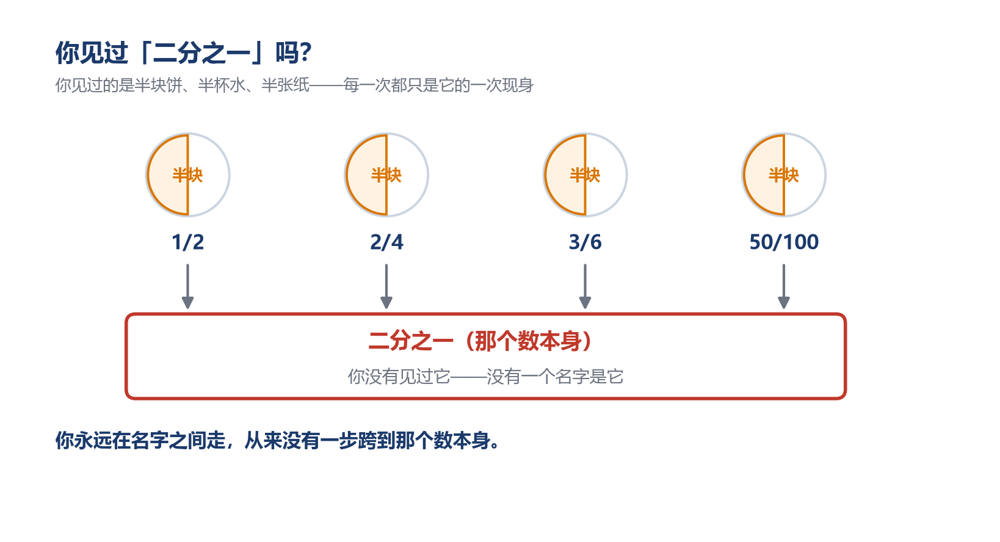

### 4. 人类第一次认识一个指不到的东西

在此之前，人类认识的每一个数，都是指得到的。

1、2、3 能指，指着三块糖。一根绳子的长度、一斗米的重量，也能指，指着那根绳子、那斗米。孩子不知道答案的时候，答案在世界里：他去数、去量，它自己在那里。数错了是他的事，数本身没有错。

**3/4 指不到**。

现实里你能找到"三块饼分给四个人"这件事，但你找不到一个叫 3/4 的东西。它不在纸上，不在数轴上，也不在现实里。

可人类照样认识它。照样用它算账、分地、配药、换算。

不靠看，不靠量，靠的是一条说清"什么算它"的规定。

这是抽象能力的一次跳级。第 1 讲讲位值制时说过一句话：面对无限，人类不需要造无限的符号，他只需要一套好的规则。这一讲是同一件事的另一面：面对一个指不到的数目，人类不需要把它指出来，他只需要规定"什么算它"。

这件事还有个连带的后果：

**既然是造出来的，那造它的人就得负责：这套东西站不站得住，得验**。

在 3/4 之前，"数错了"只可能发生在你身上，你数错了、量错了，数本身没有错。

从 3/4 开始，你选的那套构造可能是站不住的。你选一套构造、给一条判据，这套东西要么立得住，要么立不住。

数学从这一天起，多了一件要负责的事。


### 5. 有一个孩子用行动回答了这个问题

有一个孩子，他算 1/2 + 1/3，写下 **2/5**。分子加分子，分母加分母。

老师打叉，写"要通分"。孩子记住了"不能这样算"。

没有人告诉他：这个叉，叉掉的不只是一个计算结果。

他用他的算法，回答了一个问题。

这个问题是：1/2 和 2/4，是不是同一个数？

他的算法给的答案是：不是。

---

## 二、只能规定的相等

### 1. 能用的办法，全都预设了答案

刚才那个孩子的答案是错的——1/2 和 2/4 当然是同一个数。但他撞上的问题是对的，而且躲不开：**凭什么说它们是同一个数**？

先自己试一遍。拿 1/3 和 2/6 开刀。

**办法一：约分**。 2/6 的分子分母都除以 2，得 1/3，一样。

可"约分"凭什么合法？凭"分子分母同除一个数，分数大小不变"。而这句话，正是"2/6 和 1/3 是同一个数"的另一种说法。**你用结论证明了结论**。

**办法二：化成小数**。 1/3 = 0.333……，2/6 = 0.333……，长得一样。

可你只写出了前面几位。后面那无穷多位你看不见，你是**假定**它们一样。

**办法三：通分**。 1/3 上下乘 2，得 2/6。而"乘 2/2 不改变值"，又是同一条性质。

三条路，全部绕回原点。

这类问题的特点就在这里：**它太靠底了，你手上所有的工具，都是站在它上面才成立的**。 你没法用它自己来证它自己。

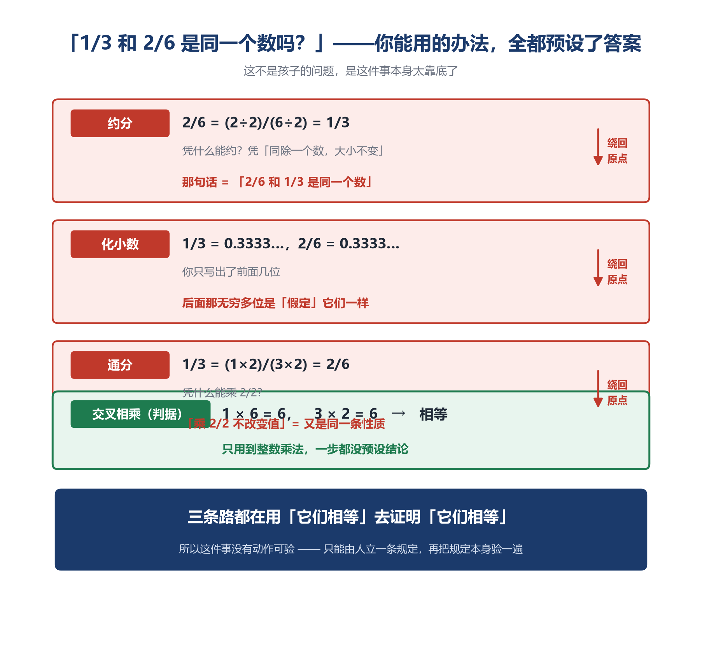

### 2. 只能规定——而规定一出，三件事躲不掉

一件事没有动作可以验，又必须成立，怎么办？

只能规定。

半块饼，切成 1/2 是它，切成 2/4 也是它，切成 50/100 还是它——量本身就是这样，这一层没得选。可"**把它们写成一个数**"，是人多走的一步。

这一步完全可以不走。面对 1/2 = 2/4，另一种态度是：**它们不是同一个数，只是大小恰好相等**。

代价立刻显出来。1/2 + 1/3 里的那个 1/2，和 3/6 + 2/6 里的那个 3/6，就是两个不同的东西。那这两次运算凭什么给出同一个结果？没有凭什么，只能是巧合。孩子往后的每一道分数题，都立在这个巧合上。

所以数学选了另一条路：**它们是同一个数，写法只是它的名字**。

这条路贵得多。名字有无穷多个，你不可能一个一个核。你得给出**一条可以检验的规矩**，而且这条规矩本身还得站得住。

具体说，"1/2 和 2/4 是同一个数"这句话一出口，立刻带来三个问题——也正是这一章往下走的路线：

**第一，你得能判断**。 名字有无穷多个，"同一个"必须有一条能检验的标准，不然这句话是空的。

**第二，这条标准自己不能出问题**。 它不能闹出"1/2 等于 2/4，2/4 等于 4/8，但 1/2 不等于 4/8"这种荒唐局面。

**第三，你在这个数上做的运算，要经得起换名字**。

这三个问题，在整数身上一个都用不着。整数只有一种写法，3 就是 3，没有第二种——你不必问"换个名字会不会变"，根本没有别的名字可换。

### 3. 那一条判据

先说第一个问题：给出两个分数，怎么判断它们是不是同一个数？

先别急着看答案，自己判一次。

**3 块饼分给 4 个人，和 6 块饼分给 8 个人，每人分到的一样多吗**？

你不会去算 3/4 和 6/8 各等于多少小数——那是后面的事。你会做一件更原始的动作：**把人凑成一样多，再比饼**。

4 人和 8 人，凑到一样多，最少要 32 人。怎么凑？

```
第一种：3 块饼分 4 人。照这个样子摆 8 桌，每桌 4 人分 3 块
        → 一共 32 人，一共 24 块饼
第二种：6 块饼分 8 人。照这个样子摆 4 桌，每桌 8 人分 6 块
        → 一共 32 人，一共 24 块饼
```

**关键在于：每一桌的情形，和原来那一桌一模一样**。 8 桌都是"4 人分 3 块"，4 桌都是"8 人分 6 块"。没有人多拿，也没有人少拿。

人数一样了，剩下就只看饼数：**24 = 24，一样多**。

注意这一步靠的是什么——**只靠"把人分成几桌、把饼分成几摞"，这是整数的分堆，没有用到任何分数的性质**。

"**凑成同样多的人，再比块数"——这个动作，就是那条判据的全部来历**。 它不是谁拍下来的，是任何一个分过饼的人都会做的第一件事。

**把它写成一般形式**。 a/b 和 c/d，要把人数统一，最省事的办法是统一成 b×d 个人：

```
a/b　摆 d 桌，每桌 b 人分 a 块　→　共 (a×d) 块饼，(b×d) 人
c/d　摆 b 桌，每桌 d 人分 c 块　→　共 (c×b) 块饼，(d×b) 人
```

人数都是 b×d，而且每一桌的情形都没变。于是它们是不是同一个数，只取决于饼数是否相同：**a×d 与 c×b**。

要把它写成一句话，先得说清记号：**下面用一对数 (a, b) 表示「分子是 a、分母是 b」的那个分数**——3/4 就写成 (3, 4)，6/9 就写成 (6, 9)。这样一句话就够了：

(**a, b) 和 (c, d) 是同一个数，当且仅当 a × d = b × c**

（"当且仅当"的意思是：左边这件事和右边这件事，永远同真同假，没有第三种情况。）

验一下：

```
(1, 2) 和 (2, 4)：1×4 = 4，2×2 = 4　→　同一个数
(1, 2) 和 (3, 6)：1×6 = 6，2×3 = 6　→　同一个数
(4, 6) 和 (6, 9)：4×9 = 36，6×6 = 36　→　同一个数
(1, 2) 和 (3, 5)：1×5 = 5，2×3 = 6　→　不是同一个数
```

这就是**交叉相乘**。

它在练习册里的身份，和在这里完全不同：在练习册里它是"比较大小的快捷技巧"，在这里它是"什么叫同一个分数"的定义本身。孩子天天在用这个技巧，却不知道自己在运用一条判据。

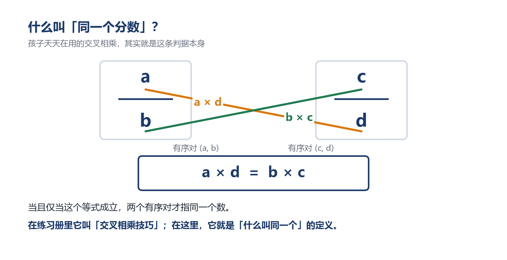

---

**再给一条完全不用分饼的路，作为第二重印证**。

从第 2 讲那句除法定义出发：**a/b 是"那个乘 b 等于 a 的数**"。 设 a/b 和 c/d 是同一个数 x，则 x×b = a、x×d = c。第一式两边乘 d，第二式两边乘 b，两个左边都是 x×b×d（乘法交换律，第 3 讲那三条承诺之一），所以右边必须相等：**a×d = c×b**。反过来也成立。

这条路只用了除法定义和乘法交换律，没有碰分数自己的任何性质。我们另外用程序穷举过 1 到 12 的全部组合共 20736 组，「a/b 与 c/d 相等」和「a×d = b×c」永远同真同假，零反例。

---

**而这条判据，中国人一千八百年前就在用了，还给它起了名字**。

公元 263 年，刘徽注《九章算术》，写下一段叫"**齐同术**"的注文："**凡母互乘子谓之齐，群母相乘谓之同**。"

- **齐**——分母互乘**对方**的分子（3/4 与 6/8：3×8 = 24，6×4 = 24）
- **同**——所有分母相乘，得到公分母（4×8 = 32）

齐同之后两个分数都成了 24/32，一模一样，所以是同一个数。请注意"齐"这一步：3×8 和 6×4，**这就是 a×d 和 b×c**。 刘徽那条操作规程，写下来正是这一章的判据；而"齐同之后分母相同、分子直接相加"，就是通分。他那段注里还有六个字，是这一讲最深的一处，后面会回到它。

### 4. 这条判据不能随手挑

上面那条看起来像顺手写的。不是。

看两个不合格的：

**反例一：定得松**。 "大小接近就算同一个。" 那 1/2 和 0.5000001 算不算？差多少算接近？没有答案，这条判据没法用。

**反例二：定得随意**。 "分子分母的和一样，就算同一个。" 那 1/2 和 2/1 都"和是 3"，可它们明明是两个数。

所以判据必须满足三条，缺一条，整个结构当场塌掉：

（**1）自反性**：任何分数和它自己是同一个。要证 (a, b) 与 (a, b) 算同一个，即 a×b = b×a。这是乘法交换律。成立。

（**2）对称性**：A 和 B 是同一个，那么 B 和 A 也是同一个。要证：若 ad = bc，则 cb = da。同样靠乘法交换律。成立。

（**3）传递性**：A 和 B 同一个、B 和 C 同一个，那么 A 和 C 同一个。

这一条不显然，必须认真证。它也是最要命的一条——如果不成立：

```
1/2 = 2/4，2/4 = 4/8，但 1/2 ≠ 4/8
```

"同一个"这个词就废了。你可以顺着链子把任何两个分数说成同一个，也可以说成不同一个，分数这个概念当场崩塌。

**证明如下**。

判据给的是两句等式：ad = bc 和 cf = de。要证的是 af = be。

**办法是让两串等式"接上**"。 把第一句两边同乘 f，第二句两边同乘 b，两串就都出现了同一个中间项 bcf——它一抵消，剩下的正好是 af = be。

用的全是第 3 讲讲过的运算律，没有一句新的。

而"分母不为零"这条，在这里第一次显出真面目：**它不是外加的禁令，它是这套结构的地基**。 判据里写的就是 ad = bc，两个分母要是有一个为零，这个式子立刻塌掉。


### 5. 一族有序对，才是那个数

判据还顺手解开了一个死结。

最省事的说法是：分数就是一对数——分子写在前、分母写在后，3/4 就是 (3, 4)。（这样的一对数，次序不能颠倒，叫**有序对**。第 2 讲预告过这个词，这里把它展开。）

但这个说法立刻撞墙：(**1, 2) 和 (2, 4) 是两个不同的有序对**：第一个分量不同，第二个分量也不同。可它们偏偏要是同一个数。

判据一出，死结解开：

**分数不是"一个有序对"，是"一族有序对**"。 所有满足 ad = bc 的有序对归成一族，这一族里的每一个，都是同一个分数的一个名字。

把这族写出来（花括号的意思是：把这一堆东西装在一起，当成一个整体）：

```
1/2 = { (1, 2), (2, 4), (3, 6), (4, 8), (5,10), …, (n, 2n), … }
```

这个集合本身，就是"二分之一"这个数。

不是集合里的某个成员是它。是这整族东西，才是它。

（这一族不是被人预先设计出来的，是被那条判据逼出来的。你先定了怎么算同一个，"同一个"的那些东西自然聚成一堆。）

你把 1/2、2/4、3/6 粘成了一个东西。这不是"差不多所以算了"——**恰恰相反，它必须精确到能写下来**：粘谁、不粘谁，由 ad = bc 一条定死。

丢掉的是"写法"，留下的是"关系"。**抽象不是把细节一概忽略，抽象是精确地说清：哪些细节不区分**。

"二分之一"是什么，到这里有答案了：它不是一个东西，是一族东西之间的关系。

这条关系具体是什么？是比。

1/2 说的是"一个量对另一个量的比"——三个单位对四个单位的比，五个单位对十个单位的比，说的是同一个比。分子分母只是把这个比写下来的方式。

所以"二分之一"是一个比，不是一对数字。

启蒙篇那句话，在这里第一次真正兑现：

**数是关系，不是标签**。

标签是钉在一个东西上的。而"二分之一"钉不到任何东西上。它是一族名字之间那条"算同一个"的关系，圈出来的东西。

连 2 也没能例外。

在分数的框架里，2 落在 (2, 1) 那一族：

```
2 = 2/1 = 4/2 = 6/3 = 8/4 = 10/5 = ……
```

那个一年级就认识的 2，原来也有一族名字。分数并没有在整数之外多加一种数。它把已经有的整数重新装了一遍。

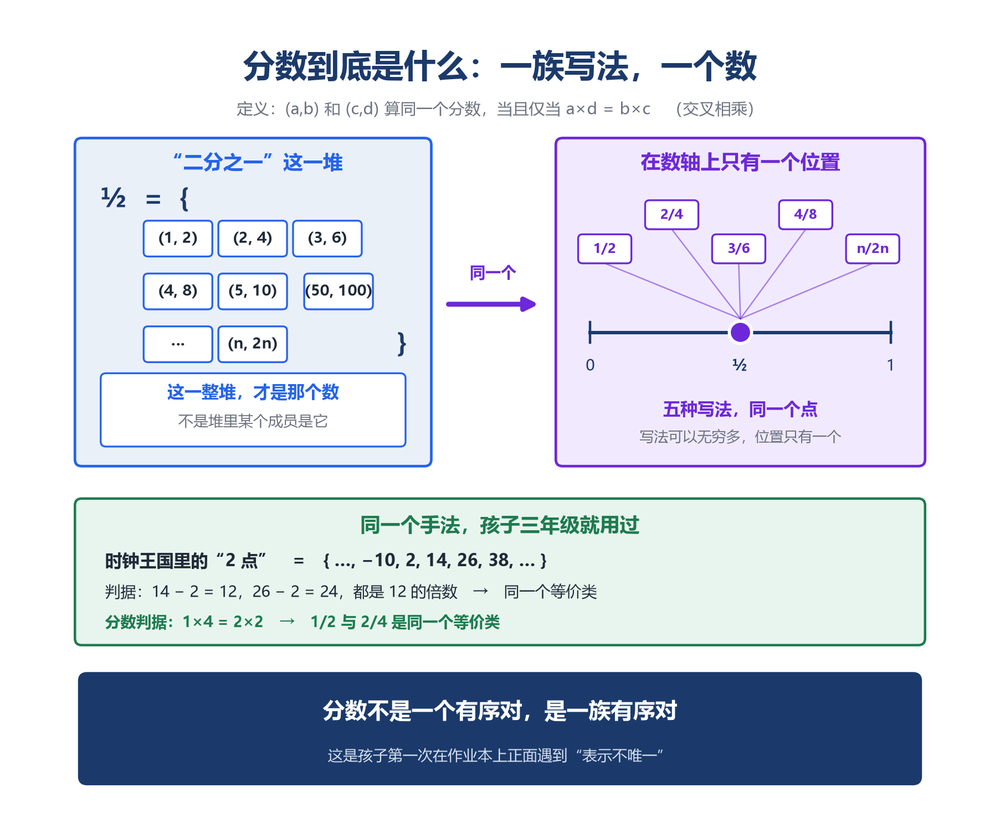

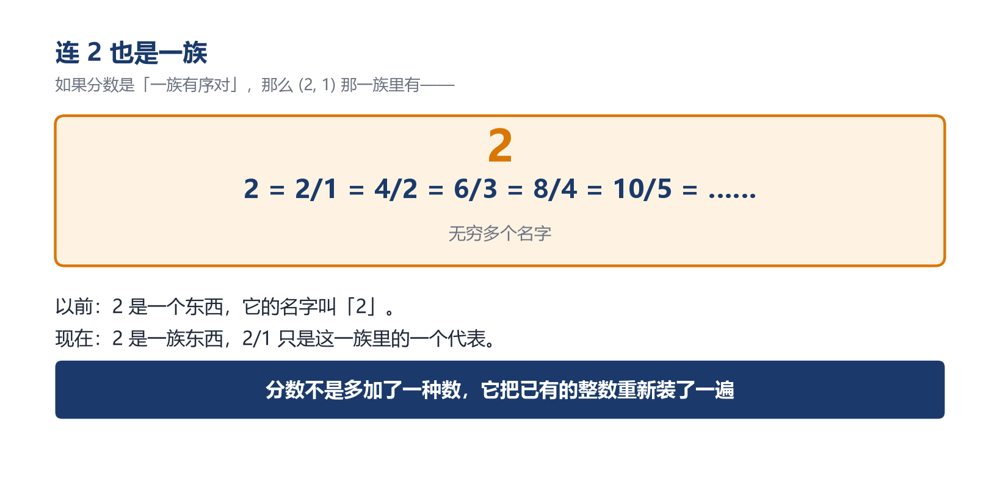

### 6. 孩子早就见过这种"一族"

第 3 讲那个"时钟王国"：钟表上 10 点再过 4 小时是 2 点，所以 10 + 4 = 2。

换个角度看它。在时钟王国里，哪些数是"同一个"？

```
2 点 = 14 点 = 26 点 = 38 点 = ……
```

这也是一整族。

**第 2 讲还提过一句：负数和分数，是用同一种方法构造出来的**。 那句话在这里可以兑现了。

负数就是同一套手法：拿一对自然数 (a, b)，把它读成"a 减 b"——(3, 5) 和 (0, 2) 说的是同一件事，都等于 −2。

| | 怎么算「同一个」 | 一族里有几种写法 |
|---|---|---|
| 时钟王国（模 12） | a 与 b 同一个，当且仅当 12 整除 (a−b) | 无穷多种：2、14、26、…… |
| 分数 | a/b 与 c/d 同一个，当且仅当 ad = bc | 无穷多种：1/2、2/4、3/6、…… |
| 负数 | (a, b) 与 (c, d) 同一个，当且仅当 a + d = b + c | 无穷多种：3−5、0−2、1−3、…… |

（负数要初中才学。这里只作对照，孩子不需要懂。）

**同一个手法，换一条判据，就造出一个新的数系**。 区别只在你把那一对数读成什么：读成"分子和分母"，得到分数；读成"两个数相减"，得到负数。

两件事是同一个动作：先定一条"算同一个"的规矩，再按它把对象分族。

这不是分数专有的怪事。数学处理"同一件事有很多种说法"，用的就是这套做法。

而分数，是孩子第一次在作业本上正面遇到它。钟表那次是偷偷遇到的。


---

## 三、你的规则，认名字还是认数

### 1. 先看乘法

我们有了一个新数，它有一族名字，也有了判断两个名字是否同一个的办法。

接下来要问的是：这种新数上的运算，还站得住吗？

先看乘法。课本用面积模型解释分数乘法：画一个矩形，横向切 2 份取 1 份，纵向切 3 份取 1 份，重叠区域就是 1/6。这个解释是好的。

还有一条更硬的路，能证明这条法则不是规定，是被逼出来的。

```
为什么 1/2 × 1/3 必须等于 1/6？

按第一章那个定义——a/b 是那个乘以 b 等于 a 的数——来算：

(1/2 × 1/3) × (2 × 3)
= 1/2 × 1/3 × 2 × 3　　【结合律：括号可省】
= 1/2 × 2 × 1/3 × 3　　【交换律：重排因子】
= 1 × 1
= 1

所以 1/2 × 1/3 就是"那个乘以 6 等于 1 的数"，也就是 1/6。
```

没有第二种可能。

这又是第 3 讲那句话：不是发明新规则，是让旧规则把新规则逼出来。

乘法没问题。加法有问题。

### 2. 换个名字，答案会不会变

看分数加法：**a/b + c/d = (ad + bc) / (bd**)

验一下：1/2 + 1/3 = (1×3 + 2×1)/(2×3) = 5/6。对。

可一个分数有一族名字。1/2 可以写成 3/6，1/3 可以写成 2/6。

那换一套名字去算，会不会算出不同的答案？

```
3/6 + 2/6 = (3×6 + 6×2)/(6×6) = 30/36
30/36 = 5/6 吗？验证：30×6 = 180，36×5 = 180　→　相等

5/10 + 4/12 = (5×12 + 10×4)/(10×12) = 100/120
100/120 = 5/6 吗？验证：100×6 = 600，120×5 = 600　→　相等
```

三次不同的名字，三个不同的中间过程，同一个答案。

这只是三次试验。第 3 讲讲过那个不对称：举再多例子也不能证明"永远"，但一个反例就足以推翻。

所以必须证明：无论选哪个名字，结果都一样。

### 3. 这道审查有个名字：良定义性

"**良定义"的意思是：结果不依赖于你选了哪个名字**。

它是分数带来的新义务，整数世界里没有。

为什么没有？这条义务只在「一个东西有好几个名字」的地方存在。整数那边，一个数只有一个名字，你写下的规则不必再问它认的是哪个名字，那里没有第二个名字。

反过来说：名字一多，一条规则光"算得对"就不够了，它还得"认得出是哪个数"。

**从此以后，你在分数上定义的任何运算，都必须先通过一道审查：它会不会因为"名字"而变卦**？

这道审查的来历，就是第一章那个"指不到"。

关系不认名字，只认数。

良定义性就是这么来的。它不是外面加进来的技术要求，"数是关系"这句话本身就把这件事逼出来了。

这件事，上一讲讲过它的前半段。

上一讲讲运算律，说它们不是计算的规则，是"数"这个概念的**承诺**——交换律、结合律、分配律，是一个东西要配叫"数"，就必须兑现的条款。那是在问：**谁有资格叫数**。

这一讲往前走一步。分数兑现了那些承诺，所以它配叫数。可它带来了一件整数没有的麻烦：**它有无穷多个名字**。

于是多出第二道关：建立在它身上的运算，还得证明一件事——**它认的是数，不是名字**。

**承诺回答"谁有资格叫数"，良定义性回答"在名字不唯一的世界里，运算站不站得住**"。 两道关都是被逼出来的，没有一道是人随手定的。

### 4. 加法通过审查

（下面用带下标的字母表示「另一个名字」：a₂/b₂ 就是 a/b 的另一个写法，代表同一个数，不是一个新的数。）

要证的是这一句：**换个名字算，结果不变**。

为什么不变？

**判据本身就是一句等式：ab₂ = a₂b**。 它说的是"a/b 和 a₂/b₂ 是同一个数"。

现在把这句话**代进算式里去**。1/2 加 1/3，算出来是 (1×3 + 2×1)/(2×3)。换成 3/6 加 2/6，算出来是 (3×6 + 6×2)/(6×6)。这两个结果是不是同一个数，按判据要比一比。

比的时候，两边都会展开成好几项。而**按那两个等式换一遍，左右两边就长成同一个样子了**。

这不是巧合。判据既然说"这两个名字是同一个数"，把它代进任何一个式子里，两边自然对齐。**它有多强，取决于判据本身有多强**。

### 5. 通分：那个理由只说了一半

有了良定义性，通分这个动作的身份就清楚了。

通分通常给的理由是：**分母就是分数单位，单位不同不能直接相加**。 1/2 的单位是"半个"，1/3 的单位是"三分之一"，要先统一成"六分之一"：1/2 是 3 个 1/6，1/3 是 2 个 1/6，一共 5 个 1/6。

这个理由是对的，也够深。它和第 1 讲"3 个百不能加 4 个十"、第 2 讲"加法是同维相加"是同一条线：加法的本质是同维相加，而分母就是维度标签。

但它只说了一半。它回答了"为什么要统一单位"，没回答另一半：**凭什么可以随便换单位**？

```
目标：1/2 + 1/3

第1步　3/3 = 1，2/2 = 1　　　　　【乘法单位元】
第2步　1/2 = 1/2 × 3/3，1/3 = 1/3 × 2/2　　【乘 1 不改变值】
第3步　1/2 × 3/3 = 3/6，1/3 × 2/2 = 2/6　　【分数乘法法则】
第4步　3/6 + 2/6 = (3+2)/6 = 5/6　　【分配律的逆用】
```

全程没有一步是规定通分。

而第 2 步那个"乘 1 不改变值"，正是良定义性在保证的：1/2 换成 3/6 还是同一个数，所以后面算出来的结果不会变。良定义性要是不成立，这一步就走不下去。

一句可以让孩子记住的话："**分数加法，加的是分数单位的个数。单位不一样，就不能直接加**。"

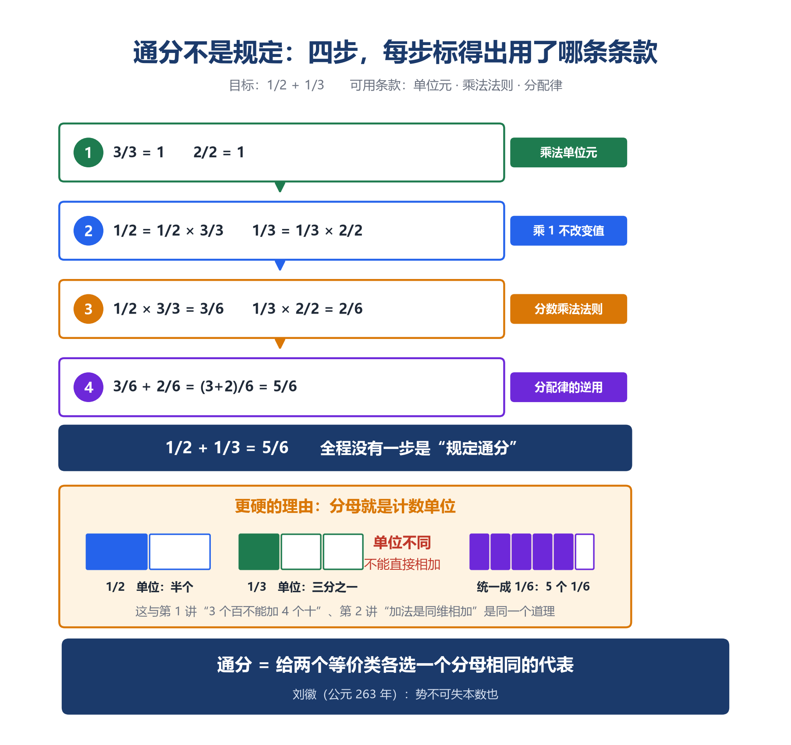

---

## 四、四道错题，同一个病根

上面三章是这一讲的骨头。这一章看四道真实的错题。它们看起来毫不相干，病根是同一个。

### 第一道：1/2 + 1/3 = 2/5

分子加分子，分母加分母。

先说清这孩子是怎么想的。他不是乱写。

在他眼里，1/2 不是一个数，是两个数上下摞在一起：一个 1，一个 2。1/3 也一样：一个 1，一个 3。既然是四个数摞着，那加起来当然上面归上面、下面归下面——1+1 得 2，2+3 得 5。

这个习惯是从整数那里学来的，而且学了四年都没错过。竖式加法就是个位加个位、十位加十位，同位相加。第 1 讲那条"3 个百不能加 4 个十"，讲的也是这件事——加法要同类相加。

**他错在哪？错在他把分子和分母当成了两个各自独立的数**。

可分子和分母不是两个数，是一件事的两半。1/2 说的是"把某个东西平均分成 2 份，取其中 1 份"——2 说的是怎么分，1 说的是取几份，两个绑在一起才成一句话。你把"怎么分"和"取几份"拆开各自相加，得到的就不再对应任何一个分数了。

拿第 1 讲对比就清楚了：352 里的 3、5、2 确实可以分开看，它们是 3 个百、5 个十、2 个一，三个独立的部分，加起来才是 352。**分数不是这样。分数的上下两个数是同一件事的两半，拆开就散架**。

那正确的做法是什么？

回到"同类才能相加"这条老规矩。3 个百不能加 4 个十，因为单位不同；1/2 和 1/3 也不能直接加，因为**分数单位不同**——一份是 1/2，一份是 1/3，两份大小不一样，没法数一共有几份。

要相加，先把它们换成同一种分数单位。这就是通分：

```
1/2 = 3/6　　每份是 1/6，取 3 份
1/3 = 2/6　　每份是 1/6，取 2 份
3/6 + 2/6 = 5/6　　每份一样大了，份数才能直接加
```

**通分不是老师额外加的一道手续，它就是"同类才能相加"在分数上的样子**。

孩子漏掉的正是这一步：单位还没统一，他就把份数加起来了。

现在再看他那个算法本身。给它一个记号，写成 ⊕：

**a/b ⊕ c/d = (a+c)/(b+d**)

它是不是一个运算？用第三章那道审查切下去：

```
用 1/2 和 1/3：　　1/2 ⊕ 1/3 = (1+1)/(2+3) = 2/5
换写法 3/6 和 2/6：3/6 ⊕ 2/6 = (3+2)/(6+6) = 5/12
再换 5/10 和 4/12：5/10 ⊕ 4/12 = (5+4)/(10+12) = 9/22

而 1/2 = 3/6 = 5/10，1/3 = 2/6 = 4/12
2/5 = 0.400000，5/12 = 0.416667，9/22 = 0.409091　→　三个互不相同
```

同样两个数，换三套写法，⊕ 给出三个不同的答案。

我们用程序穷举了分子、分母都不超过 5 的全部 25 种写法，两两相加共 625 组，逐组验算：**⊕ 的答案与真正的分数加法相符的，一组都没有**。 更要命的是上面已经看到的——同一个数只要换一套写法，⊕ 的答案还会跟着变卦。一个连"自己等不等于自己"都保证不了的操作，根本不配叫运算。

结论：⊕ 通不过审查，它根本不是一个运算。

这不是说"这个答案算错了"，是说那个操作在数学上不成立。它连"运算"的最低要求都够不着：给定输入，必须有唯一确定的输出。

它不是算错。它认的是名字。

孩子没有用嘴回答"1/2 和 2/4 是不是同一个数"，他用算法回答了。他答的是：不是。

所以这道题要纠正的有两层。浅的一层是习惯：分子和分母不是两个独立的数，不能各自相加。深的一层更要紧：**分数相加必须先把分数单位统一，这就是通分**。 通分不是老师额外加的一道手续，它就是"同类才能相加"在分数上的样子。

家长能帮上忙的，不是把规则再念一遍，而是让孩子自己撞见矛盾：

```
1/2 是半块饼，1/3 是三分之一块饼。两块合起来，比半块多还是比半块少？
```

孩子会答"比半块多"。那你再问他：2/5 比 1/2 大还是小？

```
1/2 = 0.5　　　2/5 = 0.4　　　→　　2/5 比 1/2 还小
```

**合起来反而变少了。这不可能**。

让孩子自己发现答案不合理，比告诉他"要通分"有效得多。因为他记住的是"我算出了一个不可能的结果"，而不是"又背了一条规则"。规则会忘，那种别扭感不会。

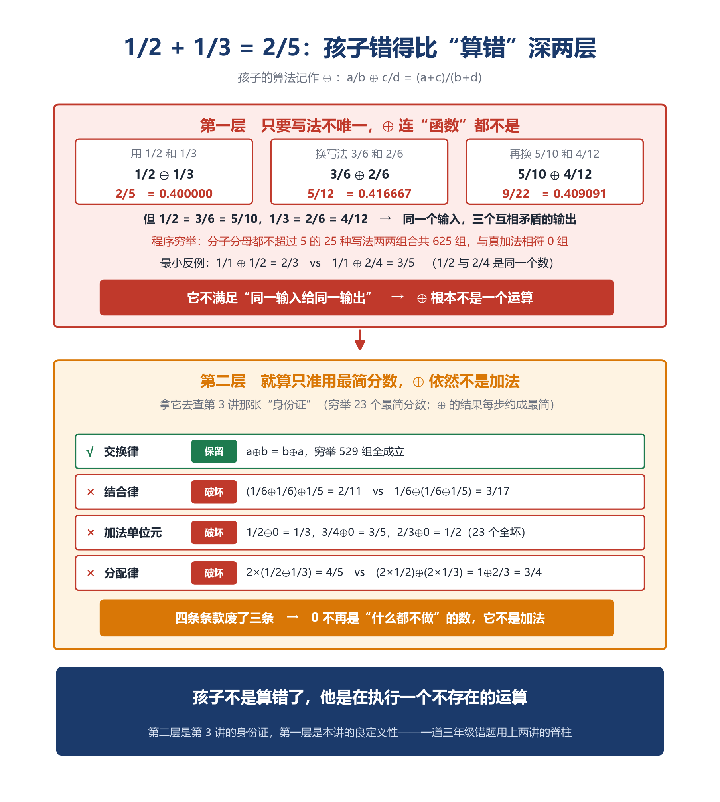

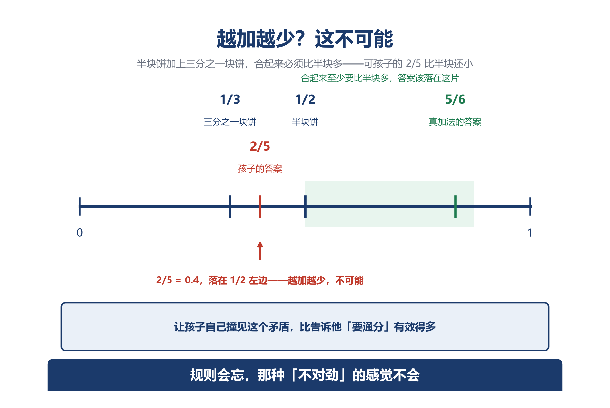

### 第二道："用去 1/2 米"和"用去它的一半"

```
一根绳子长 6 米，用去 1/2 米，还剩多少米？
一根绳子长 6 米，用去它的 1/2，还剩多少米？
```

孩子给出同一个答案，或者根本看不出这是两道题。

（答案：第一道 6 − 0.5 = 5.5 米；第二道 6 × (1−1/2) = 3 米。）

"1/2 米"是一个量，它有单位，它就是 0.5 米，和绳子原来多长毫无关系。

"1/2"是一个分率——它没有单位，它说的是"用去的长度和原来长度之间的关系"，必须先知道原来多长才能算出具体是多少。

一个是东西，一个是关系。

所以"1/2"不能带单位。关系没有单位。

### 第三道：一桶油，两次用去 1/3

```
一桶油，第一次用去 1/3，第二次用去余下的 1/3，还剩多少？
孩子的典型做法：1 − 1/3 − 1/3 = 1/3
正确答案：第一次剩 2/3；第二次用去 2/3 × 1/3 = 2/9；还剩 2/3 − 2/9 = 4/9
```

**两个 1/3 的单位 1 不是同一个**。

第一个 1/3 的"1"是整桶油，第二个 1/3 的"1"是第一次用完后剩下的油。

孩子把分数理解成了一个**固定的东西**（"三分之一就是那么多"），而不是一个**挂在某个对象上的关系**（"取这个东西的三分之一"）。

关系必须挂在对象上。对象变了，结果就变了。所以这不是两次减法，是两次乘法。

一句提醒：**每出现一个分数，就问一次：它是谁的几分之几**。

### 第四道："50% 米"

百分数是分率，分率说的是关系，关系没有单位。

给关系加上单位，等于把它当成了东西。

### 四道题，一件事

把它们并排放，四道题的描述完全不同：

| 错题 | 在他心里，分数是什么 |
|---|---|
| 1/2 + 1/3 = 2/5 | 1/2 是两个数：上面的 1、下面的 2；所以分子加分子、分母加分母 |
| "1/2 米" 和 "用去它的 1/2" | 那个 1/2 就是一段固定的长度 |
| 两次用去 1/3，剩 1/3 | 1/3 是一个固定的量，用两次就减两次 |
| "50% 米" | 50% 是一段长度，还能配上"米" |

看右边这一列——四道题，孩子犯的是同一类错：

**他把每一个分数，都当成了一个孤立的"东西**"。

要么是几个独立的数（1/2 拆成 1 和 2），要么是一段固定的量（1/2 米就是半米；两次 1/3 就是两个三分之一块）。在他的世界里，写下"1/2"，后面就有一个实实在在的东西等着——就像写"5 米"，后面真有 5 个 1 米摆在那儿。

这个看法在整数和带单位的量上一直成立，所以他用了四年都没出错。

**到了分数，它塌了。因为分数不是一个东西，是一条关系**。

1/2 不是能拆成 1 和 2 的两个数，是"1 对 2"这个比：分子说取几份，分母说分成几份，两个绑在一起才成一句话。

分率里的 1/2 也不是一段固定的长度，是"部分占整体的一半"：整体变了，它跟着变。所以你必须先问一句——**这是谁的 1/2**？

一句话收束这一章：**孩子把分数当成了孤立的数，可分数是关系**。 四道题，错的是同一件事。

### 四道题，一张地图

上面说的是病根：他把分数当成了孤立的东西。可病根看不见摸不着，家长需要一张能随手用的地图。

这张地图只有一条线，就一个区分：**这个分数，说的是"多少东西"，还是"占整体的几分之几**"？

小学里管前者叫**具体的量**，管后者叫**分率**。

**具体的量**，是能数、能称、带单位的东西：1/2 米、3/4 千克、5/6 平方米。它自己就能落地——半米就是半米，跟别的东西没关系。

**分率**，是一个东西占另一个东西的几分之几：用去全长的 1/2、男生占全班的 2/5、打八折（原价的 8/10）。它不落地，它挂在某个"整体"上——整体是谁，得先问清楚。

一句话就能分开：**能带单位的，是具体的量；不能带单位、只能问"谁的几分之几"的，是分率**。

四道错题里的三道，全是把分率当成了具体的量：

```
"用去它的 1/2"：1/2 是分率，得先知道全长多少，6 米的一半才是 3 米
"两次用去 1/3"：两个 1/3 是分率，而且挂的整体不同（第一次挂整桶，第二次挂剩下的）
"50% 米"：50% 是分率，分率不能带单位，"50% 米"根本不成话
```

第二道和第三道，孩子就是把"分率"当成了"一段固定的长度"。第四道更明显——他干脆给分率硬套了个单位"米"。

---

**分数和运算碰在一起，就三种情况，各有各的规矩**：

```
量 × 数　　6 米 × 1/2 = 3 米　　　　取一半，还是长度
量 × 量　　1/2 米 × 1/3 米 = 1/6 平方米　　单位变了，从米到平方米
量 ÷ 量　　3 米 ÷ 2 秒 = 3/2 米每秒　　单位也变了，成了速度
```

第二、三行是第 2 讲那条主线的现身：**加法在同一种单位里合并，乘法除法却能造出新的单位来**。 孩子分不清"1/2 米"和"1/2"，不是粗心——是他还没习惯"运算会造出新东西"这件事。

把它们画成一张表，四道错题一目了然：

| 错题 | 走错的那一步 |
|---|---|
| 1/2 + 1/3 = 2/5 | 分数单位没统一就相加（该先通分，见第一道） |
| "1/2 米" 与 "用去它的 1/2" | 没看出一个是具体的量、一个是分率 |
| 两次用去 1/3 | 两个分率挂的整体不同，不能直接减；该用乘法复合（2/3 × 2/3 = 4/9） |
| "50% 米" | 给分率加上了单位——分率是关系，关系不带单位 |

---

这张地图，家长一句话就能用起来。每次孩子碰到带分数的应用题，先陪他问一句：

**这个分数，是"多少东西"，还是"占谁的几分之几**"？

问清了这一句，第二、三、四道错题基本就堵住了。至于第一道（通分），那是另一件事——它不是分不清量和分率，是分数单位没统一。两件事，别混在一起教。

---

## 五、三次远征

四道题的账，到这里算清了。病根不是粗心，是孩子把分数当成了孤立的东西——可分数是关系。

病根看清了，才谈得上往前走。而分数这个新数，会带孩子去三个方向：往密处去，往危处去，往深处去。三次远征，一次比一次远。

### 一、向密：分数把数轴填密了

整数在数轴上是一串孤立的点：1、2、3……点与点之间是空的。

分数一进来，情况变了。0 和 1 之间塞进了无穷多个分数，任意两点之间都是。

怎么证"任意两个分数之间还有分数"？这里要请回上一章那个被否掉的算法 ⊕：a/b ⊕ c/d = (a+c)/(b+d)。它当加法是废的，可它藏着一个漂亮的性质——

**只要 a/b < c/d（b、d 为正），(a+c)/(b+d) 就一定严格落在两者中间**。

这个结果有个名字，叫**中介数**（mediant；不是统计学那个"中位数"，是另一个词）。凭什么它落在中间？用第 2 章那条判据一比就清楚：a/b < (a+c)/(b+d)，交叉相乘就是 a×(b+d) < b×(a+c)，化开得 a×d < b×c——而这恰恰就是"a/b < c/d"的意思。另一半同理。**落在中间这件事，正是那条老判据的直接后果，不用另立新规矩**。

而它落在中间，本身又是个分数。反复用它，就有无穷多个。

这叫**稠密性**。

这件事和第 1 讲正好对上。第 1 讲里数位表"往右永远画不完"，那是往外没有尽头；这里"中间永远还能再塞一个"，是往里也塞不满。

而这一次的无限，比上一次绕人。

因为整数的无限是"数不完"，但它有明确的走法：每个数都有一个紧接着的下一个。1 的下一个是 2，2 的下一个是 3，你可以一个一个数下去。

分数的无限不是这样。它没有"下一个"。

1/2 的下一个分数是什么？没有答案。你随便说一个，比如 0.6 = 3/5，那么 1/2 和 3/5 之间还夹着 (1+3)/(2+5) = 4/7；换成 4/7，中间又有 (1+4)/(2+7) = 5/9。

这个游戏永远没有终点。

一个可以马上问孩子的具体问题：1/2 和 3/5 之间，能不能找一个分数？能，4/7。再找？5/9。这个游戏永远玩不腻，也永远玩不完。

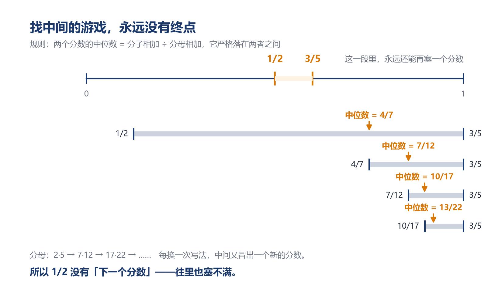

而把"找中间"这件事做到极致，会长出一个惊人的东西。

从两个极端开始：0/1 和 1/0（后者理解成无穷大）。取它们的中介数：(0+1)/(1+0) = **1/1**。

现在有三个数：0/1、1/1、1/0。再对相邻两个各取中介数：

```
0/1 与 1/1 → (0+1)/(1+1) = 1/2
1/1 与 1/0 → (1+1)/(1+0) = 2/1
```

再来一轮：1/3、2/3、3/2、3/1。再一轮：1/4、2/5、3/5、3/4……

一层一层长下去，得到一棵树。它有个名字：**Stern-Brocot 树**。

1858 年，德国数学家莫里茨·斯特恩（Moritz Stern）写下了它。三年后，1861 年，一位法国钟表匠阿希尔·布罗科（Achille Brocot）**独立发现了同一棵树**——他研究它，是为了设计齿轮的传动比。钟表匠要在有限的齿数里找到最接近某个目标比值的组合，而这棵树把全部可能的比值不重复地列了出来。

**请注意这个巧合：上一讲那个"时钟王国"讲的是时间，这一讲发明这棵分数树的人，正是一位钟表匠**。 时间、齿轮、分数比，在同一个地方相遇，不是偶然——钟表是"比率"最古老的物理化身。

而这棵树有一条惊人的性质：**它把所有正分数（最简形式）不重复、不遗漏地全部列出来**。

我们用程序生成了前 12 层：

```
前 12 层累计新插入 4095 个分数（= 2¹²−1）
每个新分数都自动是最简的（不用约分）　✓
新分数之间从不重复　　　　　　　　　　✓
分子、分母都不超过 5 的最简正分数全部出现　✓
1/2 在第 2 层，2/3 在第 3 层，3/7 和 5/8 都在第 5 层　✓
```

"**自动最简"这一条不显然**。 (1+2)/(2+3) = 3/5 是最简的，可凭什么永远如此？因为这棵树里相邻两项永远满足一个关系：交叉相乘再相减，永远等于 1。

而这个"差 1"，恰好逼出了分子分母互质。道理很短：假设有一个大于 1 的数能同时整除分子和分母，那它也一定能整除两者的差——可差是 1，除了 1 没有别的数能整除它。矛盾。所以这样的数不存在，分数已经是最简的。

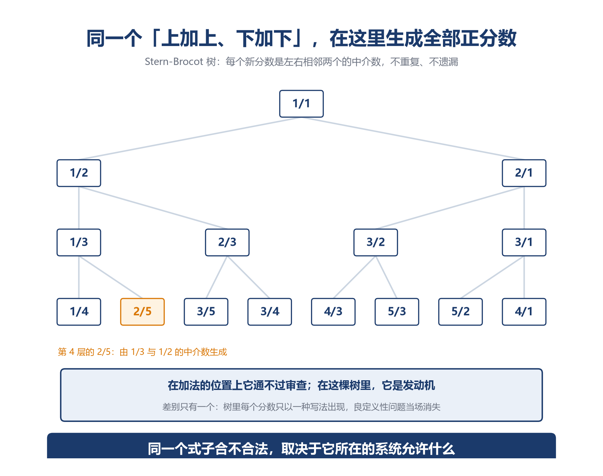

---

**现在，回到那个最关键的问题**。

同一个式子 (a+c)/(b+d)：

- 在**分数加法**的位置上，它是废的——通不过良定义性检验（第四章那 625 组穷举，一组都不符），而且违反加法的身份条款
- 在 **Stern-Brocot 树**里，它是核心引擎——不重复不遗漏地生成全部正分数，一位钟表匠靠它设计齿轮

**差别在哪**？

差别只有一个：**在树里，每个分数只以一种写法出现**。

第四章那个 ⊕ 通不过审查，是因为分数有无穷多种写法，换个写法答案就变。可树里从头到尾只用最简形式，1/2 就是 1/2，没有 2/4 来捣乱——**写法唯一了，良定义性问题当场消失**。

而树里也根本不需要结合律和单位元。⊕ 在树里只用于相邻两项之间，它唯一需要的性质，是"输出落在两个输入之间"——也就是那条中介数定理。

**同一条规则，在不同的结构里，合法性完全不同**。

**一个式子合不合法，不取决于式子本身，取决于它所在的系统允许什么**。

这又是上一讲那句话的另一面。上一讲说：换一个王国，有些条款被废除，有些被保留。这一讲看到：**换一种用法，同一个式子可以从废物变成发动机**。

脱离系统谈对错，是没有意义的。

*（Stern-Brocot 树是课外内容，孩子不需要会画。这里只让他知道一件事：他那个被判了"错"的算法，在另一个地方是宝贝。）*

### 二、向危：可它没填满

分数把数轴填得很密。密到任意两个分数之间都有无穷多个分数。

那填满了吗？

没有。

两千五百年前，有一群人比谁都相信"数能把世界说完"。毕达哥拉斯学派有一条信条：万物皆数。而他们说的"数"，就是整数，和整数与整数之比。

然后他们撞上了一件事：一个边长为 1 的正方形，它的对角线长度——就是 $\sqrt{2}$——写不成任何两个整数之比。

他们的信条当场就塌了。据说发现这件事的人被同伴扔进了海里；故事真假不论，这是数学史上第一次危机。

（$\sqrt{2}$ 与无理数是初中的内容，这里只作兴趣拓展，不要求孩子掌握。）

这里要停一下，把两种「立规矩」分开看。

他们选的入口是"数是比"。**这个入口本身没有出错**。在"比"这个范围里，它一直成立，一直好用，一直装得下东西。

出错的是他们多信的一件事：这个入口能装下世界上所有的量。

那是信念，不是入口。

他们撞上的东西，逼着他们做的是换一个入口：不是改结论（结论在入口里面是对的），是造一批新数出来，把装不下的那些装进去。

自己选的入口不够用了，得换一个更大的。换的时候有一条规矩：入口里装的东西，一件都不能变。

他们尝到的是：自己造出来的东西，反过来把原来的信念推翻了。

也不是最后一次。往后每一次数不够用，人类都得再走一遍同一条路：造一种新的，老规则一条都不能变，而且新东西必须验算它站得住。

这条路从 3/4 开始。

### 三、向深：这个动作，孩子已经做过两次

这一路往下会走到很远：到了大学，数学家把"什么算同一个"正式写成了定义，从此数学里多了一句口头禅——"这个定义是良定义的吗？"

但对家长来说，重要的不是这条路走多远，而是这样一件事：**你家孩子已经亲手做过两次了，只是没人点破**。

第一次，是三年级看钟表。2 点、14 点、26 点，说的是同一个钟点——它们相差 12 的倍数，就被当成"同一个"。

第二次，就是这一讲的分数。1/2、2/4、3/6，是同一个数——它们交叉相乘相等，就被当成"同一个"。

**两次做的其实是同一个动作：先定一条"什么算同一个"的规矩，按这条规矩把东西分堆，然后拿整堆当一个来用**。

往后孩子学数学，只要再碰到"一个东西有好几个名字"的情况，用的还是这个动作。名字会越换越陌生，做的事始终是这一件。

所以这一段不是要你给孩子讲什么高深理论，恰恰相反——是提醒你：**孩子手里已经握着一个很厉害的本事，他自己还不知道**。

他折过那叠纸条（都一样大），他在数轴上标过那几个点（都落在同一处），他做过"换个名字再算一遍"（答案不变）。这些动作，就是"把等价的东西当成一个"这件事最朴素的样子。

**做过了，将来它换一身陌生的名字再出现，他也认得出来**。 这比现在告诉他一个术语，有用得多。

---

## 六、人只定得了开头

### 1. 分数是人类第一次造出来的数

回头看这一路，孩子认识的数，来路只有两种。

**一种是找到的**。 1、2、3、100，伸出手指头数，它们就在那儿；一根绳子有多长、一斗米有多重，去量一量，它自己在那里。这一类，你只要认识它。

**另一种是造出来的**。 3÷4 在整数里没有答案，于是人类造了 3/4。

分数属于第二种。

而造出来和找到，有一个根本区别：

找到的东西，世界上有东西替它作证；造出来的东西，只有它自己。

3 是不是三个，数一下就知道；一米是不是一米，量一下就知道。世界会回答你。

3/4 是不是 3/4？没有人能回答你，世界不认识它。

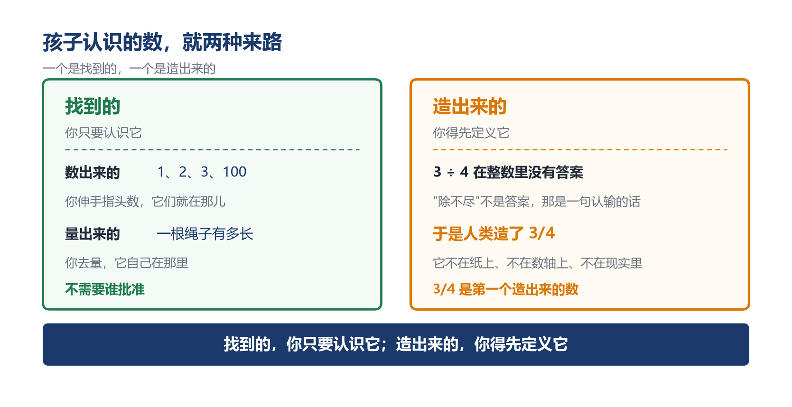

### 2. 造出来的东西，为什么还是硬的

你造出 3/4 之后，不能就这么放下。得回答：它和 6/8 是不是同一个？判据自洽吗？运算换个名字还成立吗？

前三章做的，就是这件事。做完之后，它站住了。

按道理说，人定的东西，人应该能改。可它改不动。

"1/2 和 2/4 是同一个数"——这条是人说的，是你的自由。

但从这一步往后，就不由人了。

你定了这条规定，那么 1/2 + 1/3 等于多少，就不再由你决定。你可以去验：换个名字算一遍，答案必须一样。它必须一样，无论你希不希望——否则你的规定和算术就打架。

你还可以试更狠的一步：把"1/2 和 2/4 是同一个数"改成"不是"。那么 5/6 这个答案当场作废，整本分数课本要重写。

一般人以为，数学之所以可靠，是因为它写的是世界的真相——三角形本来就是那个内角和，质数本来就那么分布，人只是把它们找了出来。

可"把 1/2 和 2/4 写成一个数"——这件事世界上没有哪个东西本来就是这样。那是人挑的构造。

那它凭什么这么硬？

因为规则一定下来，就不再归定它的人管。你定的只是"什么算同一个"；至于"它们加起来是多少"，从你定完那一条起就不由你。你也可以改——改完就是一整套不同的算术，但那也不是你说了算，是那套体系说了算。

这就是数学能同时做到两件看似矛盾的事的原因：它是人类最自由的创造，也是人类最不能讨价还价的地方。

人能选的是入口。入口一进，剩下的，由它自己走。

---

从 3/4 往后，数系还会扩很多次。而这条路一直遵守一条规矩：**老规则一条都不能变**。

除法逼出分数，$\sqrt{2}$ 逼出无理数，x² = -1 逼出虚数——每一次都是"添新数，不废旧律"。

但要看清一件事："**不废旧律"不等于"什么都不放**"。

这一讲开头那个孩子，他确实放下了一样东西——"**一个数只有一个名字**"。

这条直觉他从一年级就带着：3 就是 3，写出来只有一种样子，指过去就是它。四年里它从没出过错。可分数一进来，它必须被放下：1/2、2/4、3/6，同一个数，无穷多个名字。

**放下它，才换来了整个分数世界**。

所以造数这件事，从来不是只往上加。每造出一种新数，都要先看清自己交出了什么。

而交出的东西分两类，分清它们，是这一讲最深的一件事：

**交换律、结合律、分配律，是数的老律。一条都不能丢——丢了它就不配叫数**。 上一讲讲过，它们是"数"这个概念的承诺，是身份证上的条款。

"**一个数一个名字"不是律，是直觉**。 直觉可以放，放了还能长出新的东西来。

律要守住，直觉可以放。孩子分不清这两样，就会以为分数在胡闹；分清了，他就看见了一次真正的扩张。

### 3. 一千八百年前，有人说过同一件事

回到第一章留下的那几句话。

第二章讲过刘徽那段"齐同术"的注文——它给出的，正是"什么叫同一个分数"那条判据。而讲完这套操作规程之后，他还写下了六个字：

"**势不可失本数也**。"

变换的时候，不能丢掉它本来的数。

用今天的话说：你只能在一族名字内部换代表，绝不能跳到别的族去。

1/2 换成 3/6，合法——它们在同一族里。1/2 换成 2/3，不合法——那是另一个数。

那六个字，就是第三章那道审查的中国古代表述——那时离"良定义性"这个词的出现，还有一千多年。

他还写了一句更大的话："乘以散之，约以聚之，齐同以通之，此其算之纲纪乎。"——乘法把它拆开，约分把它聚拢，齐同把它打通，这就是运算的总纲。

"**算之纲纪"，说的就是运算律，再加上一条：不能丢掉本数**。


### 4. 零的第四张面孔

前面讲那条判据为什么成立的时候，分母不为零的道理露过一次头。这里推到底。

先把话说清楚："**分母不能为零"不是分数独有的规矩，任何除法都由不得它**。 第 2 讲讲除法时给过一条定义（第二章第 3 节）：

**a ÷ b = c，当且仅当 c × b = a**

b 要是为零，右边就成了 c × 0 = a。而 a 有两种取法，出的事也完全不同——

**情况一：a ≠ 0（比如 5 ÷ 0**）。 若 5 ÷ 0 = c，就必须有 c × 0 = 5。但任何数乘 0 都等于 0，所以 c × 0 = 0，于是 0 = 5。矛盾。→ 没有任何数满足要求，5 ÷ 0 无解。

**情况二：a = 0（比如 0 ÷ 0**）。 若 0 ÷ 0 = c，就必须有 c × 0 = 0。这个式子 c = 1 成立，c = 2 成立，c = 999 成立，c 取任何数都成立。→ 0 ÷ 0 的解不唯一。

两种为什么都致命？因为"运算"这个词有严格要求：**给定输入，必须有且仅有一个输出**。

- "有"——排除情况一（5÷0 根本没答案）
- "仅有一个"——排除情况二（0÷0 有无穷多答案）

所以除以零不是被禁止了，它根本构不成一个运算。禁止一个不存在的东西，是没有意义的说法。

这和第四章那个 ⊕ 是同一类问题：⊕ 因为"认名字"而不成为运算，除以零因为"解不唯一"而不成为运算。两个都不是被禁止的，都是不够格的。

而"任何数乘 0 等于 0"本身也不是规定，它能从分配律推出来，四行：

```
0 = 0 + 0　　　　　　【加法单位元】
a × 0 = a × (0 + 0)
      = a×0 + a×0　　【分配律】
两边减去 a×0：0 = a × 0　　证毕
```

同一个零，四张面孔：写的时候它是地基（占位符），加的时候它是透明的（什么都不改变），乘的时候它是抹除的（一切归零），除的时候它是深渊（运算失效）。

启蒙篇里说，让孩子感知"空也是一种有"。这句话到这里完整了：空不只是一种有，它还是一条边界。跨过它，规则都要重新谈。

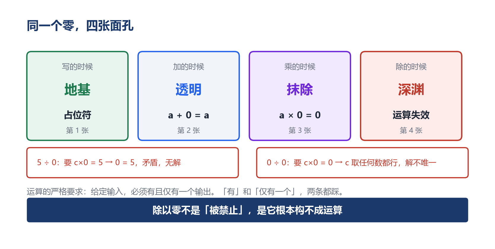

---

## 七、家长该怎么讲

这些推导不要求孩子全会。家长的活儿只有一件：补课堂上没时间做的体验。

### 1. 先澄清一个误解：分数的"基本性质"不是新知识

教材讲"分数的基本性质"——分子分母同乘或同除一个不为零的数，分数的大小不变——很多家长和孩子都把它当成一条要背的新规则。

它不是。孩子早就知道：半块饼是半块饼，你把每块再切成两半，拿走的还是那半块。分数的基本性质说的是同一件事，只是换成了符号。

**所以这一节要做的，是让孩子把早已经知道的事认出来**。

这也解释了为什么背规则的孩子会卡：他背的是符号，没有见过事实。

### 2. 绝大多数家长讲反了顺序

典型讲法：直接说"分子分母同乘同除，大小不变，记住"。

**这是从结论开始教**。 孩子记住的是一串符号，不是一个事实。

正确的顺序永远是：**先看见事实，再给名字，最后才是符号**。

- **看见事实**：折纸条，1/2、2/4、3/6 叠起来对着光看，一样长
- **给名字**："这个现象叫分数的基本性质"
- **符号**："分子分母同乘同除，大小不变"

（这和第 3 讲讲交换律时说的是同一件事：字母是缩写，不是起点。跳过前两步的后果也一样——孩子能默写性质，但遇到分母不同的两个分数要相加时，不知道为什么要通分。）

### 3. 本讲三个实操

先说一条原则：学校关于分数的安排是扎实的，家长要做的是补体验，不是抢进度。

分数的定义、分数单位、基本性质、约分通分、最简分数，每一步都有图形支撑，例题量也够。家长真正能补的，是课堂没时间做的三件事。

**第一件 ·「制造一百个 1/2」（三、四年级，必须经历**）

准备一叠同样大小的长方形纸条（至少 10 张）。

第一张对折一次，涂 1 格，写"1/2"。

第二张对折两次，涂 2 格，写"2/4"。

第三张想办法分成 6 格，涂 3 格，写"3/6"。

……一直做到分不动为止。

然后把所有纸条叠起来，对着光看。

问一句就够了："你发现了什么？"

他会说："都一样。"

再问："那这些分数呢？"

让他自己说出那句话："它们是同一个数。"

到这一步就够了。不要提"等价类"，不要提"良定义"。名字可以晚点给，甚至永远不给。等他上到"分数的基本性质"那一课，他会在课本上撞见自己折过的那些纸条。

**第二件 ·「数轴上的同一个点」（必须经历**）

在数轴上标出 1/2，再标 2/4，再标 3/6，再标 4/8。

它们全落在同一个点上。

这一张图胜过十句解释。它把"无数个名字是同一个数"变成了一件看得见的事。

而且它顺带解决一个大问题：**分数比大小**。3/4 和 4/5 哪个大？用"切蛋糕"很难回答——两块不同的蛋糕怎么比？在数轴上，一眼看出来：谁靠右谁大。通分比较是程序，数轴是直觉，两个都要有。

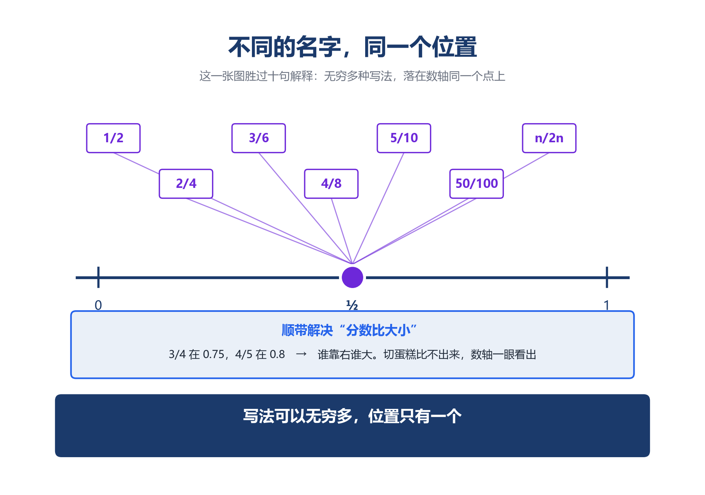

**第三件 ·「换个名字再算一遍」（五、六年级，可以经历**）

三个活动里，这一个最重要：它让孩子亲手走一遍那道审查，而不是听你讲。

给他一道分数加法，比如 1/2 + 1/3，让他算出 5/6。

然后说："现在不许用 1/2 和 1/3。把它们换成别的名字，再算一遍。"

他会写 2/4 + 2/6，或者 3/6 + 2/6。让他算完。

问一句："答案一样吗？" 一样。

再问那句关键的："为什么一样？它们明明长得不一样。"

大多数孩子答不上来。这时候你可以告诉他：

"因为它们本来就是同一个数，只是穿了不同的衣服。加法算的是数，不是衣服。"

这句话，就是良定义性的全部。孩子现在听不懂术语没关系，但这句话会在他心里留一个位置。

### 4. 分寸：哪个年级，停在哪一步

本篇通篇在讲分数的分量，很容易让家长走向另一个极端——**过早拔高**。那同样是错的。启蒙篇的原则是"拒绝过早抽象"，这一讲也必须遵守。

| 阶段 | 大致年级 | 该做到哪一步 | 不要提前做什么 |
|---|---|---|---|
| 第一学段 | 一、二年级 | 会分"一半""四分之一"；知道分得越多，每份越小 | 不写分数符号，不出现"分母""分子"这两个词 |
| 第二学段 | 三、四年级 | 认识分数；折纸条撞见一个数的多种名字；在数轴上找到同一个点；会比较大小 | 不讲"等价类"，不做任何证明，不把交叉相乘当判据讲 |
| 第三学段 | 五、六年级 | 分数的基本性质、约分通分；做「换个名字再算一遍」；知道通分的道理是"单位不同" | 不做传递性证明，不出现"良定义性"这个词 |
| 学有余力 | 六年级后 | 可讲除零推导（第六章第 4 节），可玩「找中间」游戏，可读第三章那道审查 | 不引入集合论符号 |

**三条硬边界**：

1. "**分子分母同乘同除，大小不变"不许当起点讲**。 它是结论。从结论开始，孩子能默写，但遇到 3/6 + 2/6 时不知道为什么要通分——因为他没见过"它们本来就一样长"这件事。
2. "**分母不能为零"不许讲成规定**。 让他自己撞：把 5÷0 写成 5/0，问一句"有没有一个数乘 0 等于 5？"没有。0/0 呢？任何数乘 0 都等于 0，太多了。到这里他自己能说出"所以不成立"。禁令记不住，道理记得住。
3. "**等价类""良定义性""交叉相乘是判据"这些说法，六年级前不要出现在孩子面前**。 它们是写给你看的，不是给孩子的词汇。孩子需要的是那张纸条和数轴上的那个点，不是名字。名字可以永远不给。

表中年级划分对应《义务教育数学课程标准（2022 年版）》三个学段的大致安排，各地教材进度略有差异，请以孩子实际使用的教材为准。

一句话：**分数的分量，值得用三年慢慢长出来，不值得用一个暑假灌进去**。

**这条路通向哪里**： 初中解分式方程时，老师会说四个字："检验增根"。为什么要检验？因为两边同乘的那个式子可能等于 0，而两边同乘 0，任何等式都成立，假的也能变成真的。追到根上，那正是第三章那道审查：换代表的时候，不能丢掉"分母不为零"这个条件。小学五年级的化简练习，解决的就是初中那四个字要解决的问题。

---

## 八、结语：人说了算的，和不由人的

这一讲做的事，说到底只有一件：**把"名字"和"数"分开**。

1/2、2/4、3/6 是名字，那个指不到的东西才是数。孩子第一次学会：写下的符号，不等于它指的东西。

分开之后，课本上那六条"规则"就全变了样：

| 通常的说法 | 追问之后 |
|---|---|
| "3÷4 就是四分之三" | 整数不封闭，分数是造出来补这个缺口的 |
| "分子分母同乘同除，大小不变" | 一个数是一族名字，"是同一个"要一条约定说清，不是看出来的 |
| "比较大小可以交叉相乘" | ad = bc 不是技巧，是"什么算同一个"的判据 |
| "通分才能相加" | "单位不同"这个理由对了一半，另一半靠良定义性：换名字不会改结果 |
| "分子乘分子，分母乘分母" | 不是规定，是交换律和结合律逼出来的 |
| "分母不能为零" | 除以零不是被禁止，是它根本构不成运算 |

六条追下去，全都是必然。这跟第 3 讲的结论是同一件事：**数学里那些看起来像"规定"的东西，绝大多数是被更底层的结构逼出来的**。

这一讲比第 3 讲多走了一步。第 3 讲讲的是：新数的规则由旧律逼出来。这一讲讲的是——**光被逼出来还不够。新数有多个名字，所以你还得证明这条规则不会因为"名字"而变卦**。

名字一多，就多出一条整数世界里根本不存在的义务。

而这条义务，和上一讲那条承诺，是同一件事的两面：**数不是天然就在那里的，它是被规则立起来的**。 立规则的时候人以为自己在做一件小事，可规则一立，后果就不由人了——加法只能是 5/6，"找中间"只能落在两个数之间，两段长度相乘只能造出面积。

**人只定得了开头**。

---

而这条路还有下一段。当那些名字里，混进一个**还不存在的数**——一个明知道有、却还不知道是多少的数——会发生什么？

分数教会孩子的，是"一个数可以有无穷多个名字"；下一步要教的是——"**一个名字，可以先没有数**"。

---

**参考文献**

- 《九章算术》方田章（约分术、合分术、减分术、乘分术、经分术）及刘徽注（齐同术），公元 263 年
- 克莱因《古今数学思想》（数系的扩充）
- 弗赖登塔尔《作为教育任务的数学》（数学化、再创造）
- 郑毓信《数学教育哲学》
- Kieren 关于分数子结构的多重表征理论
- 史宁中关于"数与运算一致性"的论述
- 《义务教育数学课程标准（2022 年版）》第二、三学段"数与运算""数量关系"主题
- 人教版五年级下册第四单元《分数的意义和性质》教师教学用书

---

**互动**

孩子算 1/2 + 1/3 = 2/5，你会怎么说？

是直接告诉他"错了，要通分"，还是先问他一句——"**半块饼加上三分之一块饼，会越加越少吗**？" 让他自己撞见那个不可能的结果。

**评论区说说那道让他（或让你）崩溃的分数题**。 我会挑三个最典型的，专门回应。

需要这一讲的练习卡吗？

①「制造一百个 1/2」折纸操作单

②「数轴上的同一个点」标注练习

③「换个名字再算一遍」体验单

④「找中间」数轴游戏（20 组）

后台回复 **分数卡** 领取打印版。
