# 代数的黎明：等号是一张筛子

「数学成神之路」小学数学 · 第 5 讲

原创 · 程大大的小记

**导读**

有一类孩子，家长最说不通。

小学数学次次满分，或者差一两分。计算快、应用题会做、卷面干净，老师说"这孩子有天赋"。家长心里是踏实的——满分还有什么可担心的。

到了初中，成绩一路往下掉。补习班上了，题也刷了，不见起色。孩子自己更委屈："**我小学可是次次满分的啊**。"

家长通常把这归因于两件事：要么"初中题难了"，要么"孩子不努力了"。

两个都不是。真正的差别在这里——

**小学数学靠认题型就能撑住，中学数学不行**。 小学应用题的题型是有限的——和差、倍比、行程、工程、鸡兔同笼……几十类，每类练几个例题，认得出来就能套，套对就能拿满分。麻烦的是："**认题型"和"认关系"这两种学法的孩子，在小学考卷上都是 100 分，一模一样，分不出来**。 满分把差别完全盖住了，家长一点预警都收不到。

到了初中，题型开始爆炸：三个未知数、多层嵌套、逆向关系绕来绕去，还要和几何混在一起，没人能再整理出那么多类。这时候盖住的东西才露出来：认题型的孩子手里那几十类套路，一道都对不上；认关系的孩子照旧只做一个动作——从题目里找出"什么东西和什么东西是同一个"。

**而这道坎，是在小学那几年悄悄分开的**。 分开它的不是聪明和笨，是"认题型"和"认关系"。

这一讲要讲的，就是那道分水岭的起点。而且它有一个很具体的位置——就在孩子五年级第一次写"设这个数为 x"的那个下午。

先看一个真实的场景。同一道题：

**比一个数的 3 倍多 5 的数是 20，求这个数**。

孩子甲写：$(20 − 5) ÷ 3 = 5$。一步到位，干净利落。

孩子乙写：设这个数为 $x$，则 $3x + 5 = 20$，然后两边同减 5，两边同除 3，得 x = 5，最后还代回去检验了一遍。

两个都对。但有一件怪事：**乙会解方程，可是他从来不主动用**。 你不说"用方程解"，他就退回甲那条路。你让他用方程，他有时还会卡住：x 设好了，式子列不出来，磨两分钟，把 x 划掉，回到算术。

工具在手里，却不知道什么时候该拿它出来。

家长看到这里，很容易觉得这是个小毛病：等他题做多了，自然会用。

**恰恰相反。这个"不肯用"，是孩子在替自己守住他四年来建立的一整套等号规则**。 他不是不熟练，是他读不懂方程那个等号——他从小到大见过的每一个等号，右边都写着答案，而 $x + 5 = 12$ 的右边写着 12，那 12 不是他算出来的。在他的等号语法里，这个式子根本不合法。

**这一讲要讲清的就是这件事，而且我会说明：这不是熟练度问题，是等号被读错了**。

读错等号，小学阶段几乎不受影响——小学不需要方程也能做题。它的账，是初中一起收的。

---

**这一讲的六根柱子**：

① **代数是一道分水岭，分下去的不是聪明和笨，是"认题型"和"认关系**"。 列方程最难的一步是"列"——从一段中文里找出"什么东西和什么东西是同一个"。这是整个小学阶段孩子第一次要自己把相等关系挖出来（前四讲的相等都是给定的）。小学题型有限，认题型就能拿满分；初中题型爆炸，认题型的孩子对不上任何一类，认关系的孩子照旧只做那一个动作。而且认关系是练出来的，不是天生的。

② **等号有两种身份**。 $3+4=7$ 是一句**陈述**：一个已经成立的事实，说完就完了。$x+5=12$ 不是陈述，它是一个**条件**：把所有数筛一遍，只留下能让这句话成立的那个。它是一张筛子。

③ **孩子读的是第一种，方程要求第二种**。 他从小到大见过的每个等号，右边都写着答案。让他先写下 $x+5=12$——一个还不知道成不成立的式子——在他的等号语法里，这是违规的。

④ **筛子有三种脾气，每一种都对应一类真实错误**。 筛空（一个都不留）、全过（谁都留下）、筛孔被改大（凭空多出解）。第三种就是初中"检验增根"四个字的全部机制，而它在小学就能看见雏形。

⑤ **算术要洞察，方程只要诚实**。 假设法需要你凭空想到"假设全是鸡"，方程只需要把题目每句话照直翻译。这是一次用程序替代聪明的交易。第 2 讲那个"外包的悖论"，在这里外包的不再是计算，是机巧。

⑥ 卡住人类八百年的，不是解题能力，是不敢把符号交给一个"还不知道是多少"的量。 孩子的难，和人类的难，是同一个难。

如果只读一章，读第七章。

---

## 一、引言：一个式子，两种读法

先做一个小实验。给孩子看这四个式子，问他哪个不一样：

```
3 + 4 = 7
12 ÷ 3 = 4
25 × 4 = 100
x + 5 = 12
```

几乎所有孩子都会指第四个，理由也几乎一样："**它算不出来**。"

这个回答很有意思。它说明孩子看出了第四个式子和前三个**不是一类东西**，但他说不出差在哪，只能说"算不出来"。

我们来把这件事说清楚。

**前三个是陈述句**。

$3 + 4 = 7$ 是一句话，它在报告一个事实：3 加 4 确实等于 7。这句话**已经成立**，不需要你去验证什么，也不需要你去找什么。它说完就说完了。

$25 × 4 = 100$ 也一样。它陈述了一件事，这件事是真的，句号。

**第四个不是陈述句**。

$x + 5 = 12$ 在报告什么？它什么都没报告。因为 x 还不知道是多少，这句话**成不成立根本没人知道**。

如果 x = 7，它成立。如果 x = 8，它不成立。如果 x = 100，它不成立。

**所以它不是一句话，它是一个条件**。 它的意思是：

**在所有数里面，把那些"加 5 以后等于 12"的挑出来**。

这就是筛子。

前三个式子不需要筛任何东西。它们只是陈述已经确定的事实。第四个式子在筛数：把所有数倒进去，摇一摇，漏下去的全扔掉，留在筛子里的就是答案。

孩子说"它算不出来"，其实说对了一半。它确实**不能像前三个那样直接算出来**，因为它根本不是一个待计算的式子。**它是一个待执行的筛选**。

---

这个区别能解释孩子所有的卡顿。

孩子为什么不主动用方程？因为在他的经验里，等号右边必须是答案。

从一年级到四年级，他写下的每一个等号都是这个形状：

```
左边是已知的、能算的　→　等号　→　右边是算出来的结果
```

等号是一条单向的箭头。左边进去，右边出来。

现在你让他写 $x + 5 = 12$。这个式子的左边有个 x，算不出来；右边的 12 是题目给的，不是算出来的。在他熟悉的等号语法里，这个式子根本不合法。

他不是不想用方程。他是**写不出来**——因为写出来那一刻，他就违反了自己四年建立起来的等号规则。

所以他磨两分钟，把 x 划掉，回到 $(20−5)÷3=5$。那个式子左边能算、右边是答案，形状是对的，他心里踏实。

孩子的卡顿就是这么来的。

第 2 讲讲过，等号的威力不在"相等"两个字，在于它允许**替换**——相等的东西可以互相代换。那一讲讲的是陈述句层面的等号：既然 $3+4$ 和 $7$ 相等，你就可以把一个换成另一个，凑十法就是这么来的。

**这一讲要往前走一格：等号还能是筛子**。

陈述句层面的等号说"这两个东西是同一个"。筛子层面的等号说"**去找那个能让这句话成立的东西**"。

前者是关于事实的，后者是关于任务的。整个代数，都建在第二种读法上。

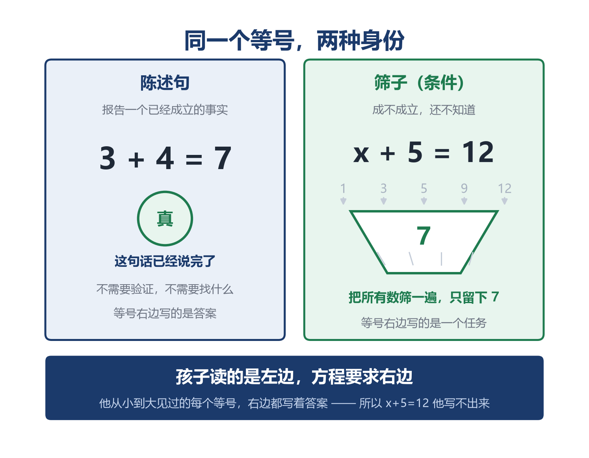


---

**顺带解决一个常见的误会**。

有人会问：那 $x + 5 = 12$ 到底算不算一个"等式"？它左边又不等于右边。

算。而且这恰恰是关键——**它现在不等于，我们的任务是让它等于**。

解方程这件事，从头到尾只做一个动作：**在不改变筛住哪些数的前提下，把这张筛子改造得越来越简单，直到它简单到一眼能看出答案**。

```
x + 5 = 12        ← 原始筛子
x + 5 − 5 = 12 − 5    ← 两边同减 5
x = 7             ← 筛子改造完毕，答案自己跳出来了
```

$x = 7$ 也是一张筛子——只不过是一张筛孔已经调到最简单的筛子：它筛的就是"等于 7 的那个数"。

所以"解方程"这四个字的准确含义是：**把一个复杂的筛子，等价地改造成一个简单的筛子**。

而"等价"这两个字，是全部难点所在：筛子改得不等价，筛住的数就变了，答案跟着就错。

---

## 二、x：一个被允许指向"不存在之物"的符号

筛子要有孔，孔就得有个名字。这个名字就是 x。

而 x 这个符号，是人类迟到得非常厉害的一项发明。

**先看它迟到了多久**。

公元三世纪，亚历山大里亚的丢番图（Diophantus）写下《算术》十三卷。他解方程的能力已经是当时世界的顶点，但他给未知数用的记号，是希腊字母 ς——sigma 的一个变体，代表 arithmos，"数"。

数学史家把这种阶段叫**缩写法代数**（syncopated algebra）：介于全散文和全符号之间，用几个缩写代替反复出现的词。

**但这半步没有走完**。 丢番图的 ς 只是某一道题里某个特定未知数的代号。它不代表"一般的数"，不能参与规律性的推演。他的每道题仍然是一道道题，解完就完了。

公元 820 年前后，波斯数学家花拉子米（al-Khwarizmi）写下《代数学》（*al-Kitāb al-mukhtaṣar fī ḥisāb al-jabr wal-muqābala*，"还原与对消计算概要"）。这是历史上第一部系统讲解方程的著作。

英文 algebra 就是从书名里的 al-jabr（还原，指把负项移到另一边变正）经拉丁语转写而来；algorithm（算法）则来自他名字的拉丁化形式 Algoritmi——两个词来源不同，但都指向同一个人。

这本书已经能解一元二次方程，方法完备、步骤清晰。但**全书没有一个符号**。

今天写成 $x^2 + 10x = 39$ 的题，他要这样叙述：

*"一个平方数，加上它的十个根，等于三十九个迪拉姆。问这个平方数是多少。"*

整本书都是这样的散文。未知数叫"东西"或"根"，平方叫"财产"，常数叫"迪拉姆"（当时的货币单位）。

**他能解，但他没法写**。 每一步都必须在具体的语言里完成，无法抽象出一条通用规则。

---

**真正推开这扇门的是韦达**。

1591 年，法国人韦达（François Viète）在《分析方法入门》（*In artem analyticem isagoge*）里做了一件看似平淡的事：

**用元音字母（A、E、I、O、U）表示未知量，用辅音字母（B、C、D……）表示已知量**。

这一步的分量，怎么估都不过分。

在韦达之前，字母顶多是某个特定未知数的代号，丢番图的 ς 就是这样。韦达之后，字母可以**同时**表示未知的和已知的，于是 $A + B = C$ 这样的式子第一次有了意义：

它不属于任何一道具体的题。它描述的是一整类关系。

代数从"解方程的手艺"，变成了"研究一般关系的学问"。

最后一步在 1637 年。笛卡尔（Descartes）在《几何学》（*La Géométrie*）里确立了今天通行的约定：**x、y、z 表示未知数，a、b、c 表示已知数**，同时引入了 x²、x³ 这样的指数写法。

四百年过去，全世界每一本中学课本还在用他定的这套记号。

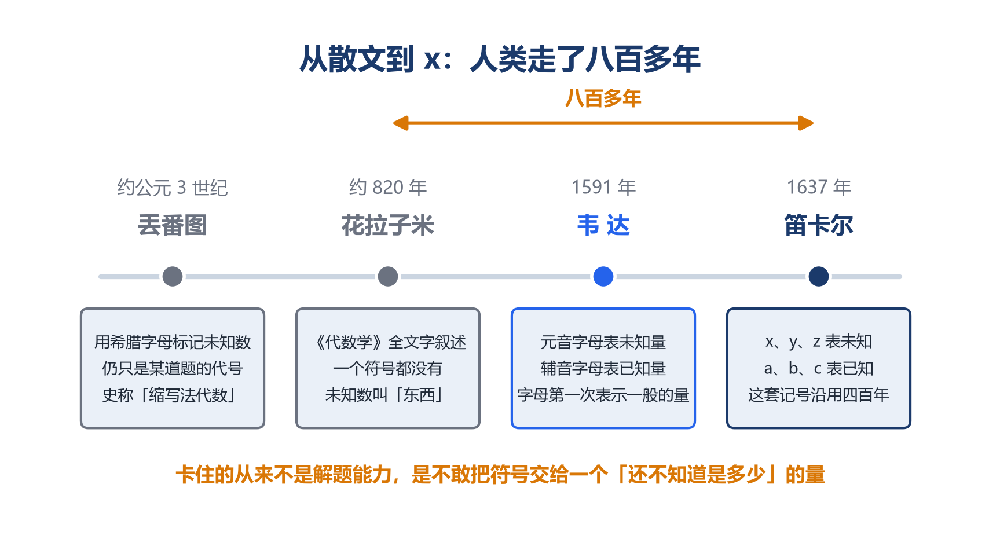


---

从花拉子米到笛卡尔，八百多年。

这八百多年里，人类解方程的能力其实早就够了。卡住的不是能力，是不敢把一个符号交给一个"还不知道是多少"的量。

散文式代数虽然笨重，但它安全：每一个词都指向一个确定的东西。"一个平方数"——你知道你在说什么。而 $x^2$——x 是多少？不知道。那 $x^2$ 是什么？**一个不知道是多少的东西的平方**？ 这在很长时间里被认为是不严肃的。

现在回到孩子身上。

设 x 要求的，就是**允许一个符号先于它的内容存在**。

孩子的迟疑是完全正当的。他甚至可能觉得这是在作弊：明明要求的就是这个数，凭什么先假装知道它？

**而这件事，他四年前就学过一次**。

第 1 讲讲位值制时说过：305 中间那个 0，不是"什么都没有"，它是**一个位置的占有者**。百位是 3，个位是 5，十位上确实没有东西，但这个位置必须有人守着，否则 35 和 305 就分不开了。

零的第一重身份是占位符：**它替"没有"占了一个位**。

x 干的是同一件事，只是占的是另一种位：

**零替"没有"占位，x 替"还不知道"占位**。

两个符号都不携带具体的量，它们的职责是**守住一个位置，让式子的结构不散架**。

有了 x 站在那里，$3x + 5 = 20$ 这句话才是完整的：它说清了"某个数的 3 倍，再加 5，等于 20"这个筛选条件。x 不需要立刻知道是多少，**它只需要在场**。

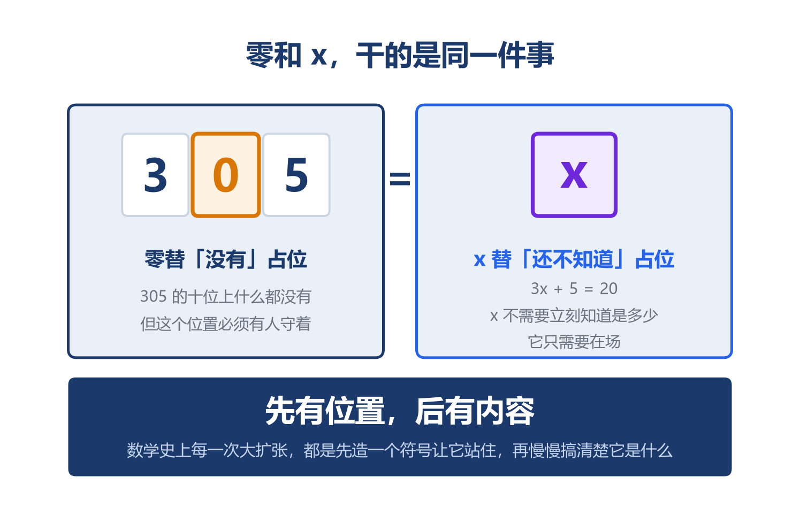


---

这也解释了为什么"设 x"必须配一句中文。

教材要求写"设这个数为 x"，很多孩子嫌麻烦，直接写"设 x"。这不是格式负担——**那半句中文是 x 的身份证，它规定了 x 代表谁**。

没有这半句，x 就只是一个游荡的符号，后面的式子无处下手。孩子列不出方程，很大一部分原因是跳过了这一步：x 设了，但没想清楚它是谁，于是翻译到一半就断了。

**检查作业时先看"设"那一句写得清不清楚，比看式子对不对更有用**。

---

而一旦接受了"符号可以先于内容存在"，一件更大的事就跟着来了。

x 既然是一个数，它就能参与**任何**运算，包括乘它自己。

```
x · x = x²
```

第 3 讲画过那个四宫格：把边长 (3+4) 的正方形切成 9、12、12、16 四块，用来解释完全平方公式。那里 a 和 b 都是**已知的数**，你画的是一个具体的正方形。

**现在边长是 x**。

这个正方形的面积是多少？是 x²。边长还不知道，面积却已经可以被写出来了。

这是符号带来的全新能力：你可以在不知道具体数值的情况下，**表达出量与量之间的结构**。第 3 讲那个四宫格展开的是已知边长的正方形，这里展开的是边长未知的正方形。同一张图，多了一层自由。

而这正是第 2 讲那条主干暗线的又一次现身：乘法在创造新的维度。

3 米 × 4 米 = 12 平方米，单位从米变成了平方米。
x 米 × x 米 = x² 平方米——未知量乘自己，撑出了一个新维度，而且这个维度在 x 还没确定时就已经存在。

孩子写不出 $x^2$，因为小学不要求。但他在五年级接受"设 x"的那一刻，已经在为这一步做准备了：接受了符号可以先于内容，下一步就是让符号参与升维。

这条路往后还很长：初中的 $x^2$、高中的向量、大学的张量，全是符号在创造新维度。而起点，就是那个被允许指向"不存在之物"的 x。

---

## 三、筛子的三种脾气

筛子这个比喻不是修辞。它有严格的脾气，而每一种脾气都对应孩子的一类真实错误。

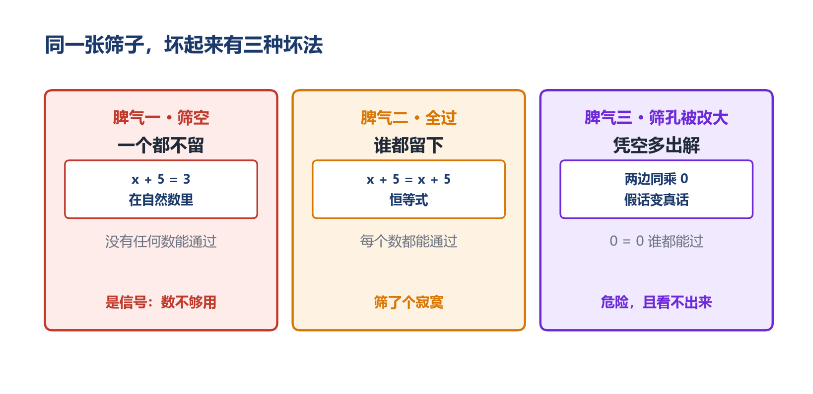

### 脾气一：筛空——一个都不留

$x + 5 = 3$，在小学的自然数范围里，筛子摇完，**里面什么都没有**。

没有任何一个自然数，加 5 之后等于 3。

孩子会说"这题无解"，然后跳过。

但"筛空"这件事，在数学史上是一次又一次的信号灯。

第 4 讲讲过：3 ÷ 4 在整数里算不出来，除法在整数里不封闭。人类没有认输，而是**造了一种新数**，让它有答案。这就是分数的诞生。

$x + 5 = 3$ 是完全同构的一件事：这个筛子在自然数里筛空了。

**筛子没变，是筛的范围不够大**。

如果允许"欠 2"这样的数存在，筛子里就有一个东西了：−2。

*（负数是六年级认识、初中七上才做运算的内容，这里只说"筛空是一个信号"，不要求孩子会算。）*

这个信号在数学史上响过很多次：

```
3 ÷ 4 算不出来　→ 发明分数
x + 5 = 3 筛空了　→ 发明负数
x² = 2 筛空了　　→ 发明无理数
x² = −1 筛空了　　→ 发明虚数
```

每一次"这里没有答案"，后面都跟着一次扩张。

而这一切的起点，是有人愿意把"筛空"当成一个信息来看待，而不是当成一道错题跳过。

孩子跳过 $x+5=3$，是合理的，他手上还没有负数这个工具。但**家长可以告诉他一句话：这道题不是出错了，是我们的数还不够用**。

这句话会在两年后，他第一次见到负数的时候，自己响起来。

### 脾气二：全过——谁都留下

$0 · x = 0$。

这个筛子摇完，**所有数都留在里面**。因为 0 乘任何数都是 0（第 2 讲讲过，这可以从分配律推出来）。

反过来，$0 · x = 5$，摇完，**里面一个都没有**。因为 0 乘任何数都是 0，不可能等于 5。

这两种情况都不是"一个解"。 一个是"全都是解"，一个是"全都不是解"。

孩子在这里会困惑：为什么别的方程都有一个答案，这两个这么怪？

因为**筛孔的大小不一样**。

普通方程的筛孔刚好卡住一个数；$0·x=0$ 的筛孔大到一个不漏；$0·x=5$ 的筛孔小到一个不留。

**而筛孔的大小，是由方程里的数决定的——零是唯一能把筛孔推到极端的数**。

这也解释了为什么"除以零"在数学里那么致命（第 4 讲讲过）：零不是被禁止的，它是**能让筛子彻底失效**的那个数。

### 脾气三：筛孔被改大——凭空多出解

这是三种脾气里最重要的一种，因为它直接通向初中那四个字。

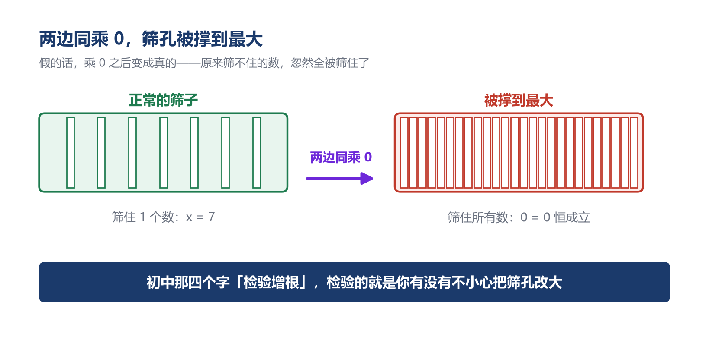

解方程的动作是**改造筛子**：$x + 5 = 12$ 改成 $x = 7$。

改造必须遵守一条铁律：**改造前后，筛住的数必须一个不多、一个不少**。

等式的性质（两边同加同减、同乘同除一个非零数）保证了这一点。这不是规定，是可以验证的：

```
x + 5 = 12   →  筛住 {7}
x + 8 = 15   →  筛住 {7}　　（两边同加 3）
2x + 10 = 24 →  筛住 {7}　　（两边同乘 2）
x = 7        →  筛住 {7}　　（两边同除 2）
```

四张筛子，形状完全不同，**筛住的东西一模一样**。这就是"等价变形"。

**但如果两边同乘 0 呢**？

```
x + 5 = 12   →  筛住 {7}
0·(x + 5) = 0·12  →  0 = 0  →  筛住 {所有数}
```

**筛孔被撑到了最大**。 原本只留下 7，现在什么都留下。

更糟的是，这个动作甚至能让**假命题变成真命题**：

```
5 = 7        ← 这是假的
5 × 0 = 7 × 0
0 = 0        ← 这是真的
```

一个假陈述，乘 0 之后变成了真陈述。

所以"两边同乘 0"不是等价变形。它凭空造出了无穷多个"解"。

初中那四个字"检验增根"，检验的就是这件事。

初中解分式方程 $(x+1)/(x−2) = 3$，两边同乘 (x−2)。这一步依据的是"两边同乘一个**非零**数"。可如果 x−2 = 0，这一步就是两边同乘 0：筛孔被撑大，凭空多出解来。

老师要求"代回原方程检验"，不是额外加的规矩，**是在检查你有没有不小心把筛孔改大了**。

第 4 讲讲刘徽那六个字"势不可失本数也"：变换的时候不能丢掉它本来的数。说的也是这件事：约分、通分、两边同乘，都是在改造式子，而改造必须保住原本筛住的东西。

一千八百年前那六个字，和初中那四个字，和这一讲的"筛孔不能被改大"，是同一句话。

孩子现在不需要知道增根。但他需要知道一件事：**每一步变形都要问一句"我有没有改掉筛住的数**"。 这个习惯，会一直陪他到高中。

### 而这一整套，是第 4 讲那件事的重演

把刚才所有合法的变形写在一起，你会看见一件熟悉的事：

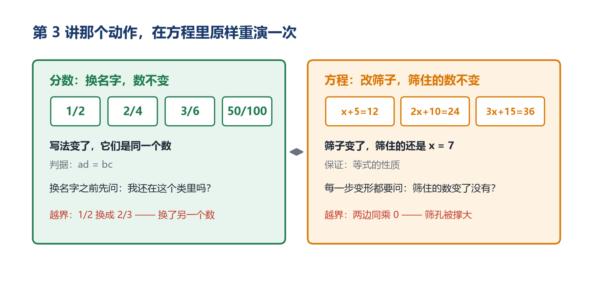

```
x + 5 = 12
x + 8 = 15　　　　　（两边同加 3）
2x + 10 = 24　　　　（两边同乘 2）
3x + 15 = 36　　　　（两边同乘 3）
100x + 500 = 1200　　（两边同乘 100）
x + 5 − 5 = 12 − 5　　（两边同减 5）
x = 7　　　　　　　（最简形式）
```

这七个式子，长相完全不同，筛住的数却一模一样。我们逐一验证过，每一个筛出来的都只有 7，一个不多，一个不少。

**它们是同一张筛子的七种写法**。

第 4 讲讲过：1/2 = 2/4 = 3/6 = 50/100，长相不同，是同一个数的不同写法。那个"同一堆写法"，数学上叫**等价类**。

方程这里，同样的结构原样出现了。

```
第 4 讲：1/2 = 2/4 = 3/6 = …　　　一个数，无穷多种写法
第 5 讲：x+5=12 = 2x+10=24 = …　　一张筛子，无穷多种写法
```

而且两边都有同一道审查：**换写法的时候，不能换到别的类里去**。

分数那边，1/2 可以换成 3/6（还在同一堆里），不能换成 2/3（那是另一个数）——刘徽说"势不可失本数也"。

方程这边，x+5=12 可以换成 2x+10=24（筛住的还是 7），不能换成 0=0（筛孔被撑大，谁都通过），也不能换成 3x=20（只减了一边，筛孔整个错位，在整数里干脆筛空）。

"**两边同乘 0 会多出解"和"1/2 不能换成 2/3"，是同一类错误：跳出了等价类**。

---

所以"解方程"这四个字，现在可以说得更准确了：

**在一个等价类里，挑一个最简的代表**。

$x + 5 = 12$ 这个类里有无穷多个式子，解方程就是从里面挑出 $x = 7$ 这个最简单的写法，简单到筛孔的形状一眼可见。

而第 4 讲讲约分时说过一模一样的话：每个分数类里挑一个最简分数当代表。"化成最简"和"解出 x"中间隔着一整套符号，做的却是同一行操作。

这也是为什么检验是必要的，而且不是格式负担：

你从 $x+5=12$ 一路改到 $x=7$，凭什么相信这一路没有跳出去？凭每一步都是等式的性质。但人会失手：漏减一边、多乘一项、不小心乘了个含未知数的式子。**检验就是把最终答案代回最原始那张筛子，确认它真的被筛住了**。

第 4 讲那个著名的 2/5，错在跳出了等价类；初中那个"增根"，错在跳出了等价类；孩子把 $3x+5=20$ 写成 $3x=20$，也错在跳出了等价类。

三个年级，三种题目，同一个病。

而根治的办法也是同一个：**每次换写法之前，问一句——我还在这个类里吗**？


---

## 四、四道错题，都在改造筛子这一步

理解了筛子，四道典型错题就都能诊断了。它们的病根不在"解"，全在"改"。

### 错题一：设了 x，列不出式子

*一根绳子，用去 15 米后，剩下的比原来的一半多 3 米。原来多长？*

孩子写：设原来长 $x$ 米。 然后卡住。

**病根：他不知道筛子的孔该开在哪**。

列方程不是"把 x 塞进式子"，是先找到一句话，它**同时能用两种方式说出来**。这道题里那句话是"剩下的"：

```
剩下的 = x − 15　　　（用去 15 米后）
剩下的 = x ÷ 2 + 3　　（比原来一半多 3 米）
```

同一个"剩下的"，两种说法。**两种说法必须指向同一个东西，所以它们相等**：

```
x − 15 = x ÷ 2 + 3
```

筛子造好了。解出 x = 36，检验：36 − 15 = 21，36 ÷ 2 + 3 = 21，对上了。

**列方程的真正技术，是找那个"能被两种方式说出来的东西**"。 找到它，筛子的边界就有了；找不到，x 设得再规范也没用。

这个技术在小学有个朴素的名字，叫"找等量关系"。它听起来像套话，但它是整个方程方法里**唯一需要动脑的地方**——其余全是机械操作。

### 错题二：一边动了，另一边没动

```
3x + 5 = 20
    3x = 20        ← 左边的 5 减掉了，右边没减
     x = 20 ÷ 3    ← 还写成了分数
```

**病根：筛孔被改坏了**。

原筛子筛住的是 5（$3×5+5=20$，对）。改完之后筛住的是 20/3。**筛住的数变了，这不是等价变形**。

纠正的方式不是让他"记住要两边同减"，是让他自己发现筛子坏了：把 x = 20/3 代回原方程检验，$3 × 20/3 + 5 = 25$，不等于 20。**筛子歪了，检验会自己报警**。

这也是为什么小学阶段坚持用"等式的性质"讲每一步是有道理的——它让每个动作都有物理图像（天平两边同时操作），孩子能自己判断这一步是不是等价。

有些孩子在校外提前学了初中的"移项变号"，反而容易机械出错：把符号搬过去却忘了变号，或者对不含 x 的项也乱移。根源就是跳过了天平，直接背了口诀。 口诀是等价变形的结论，不是等价变形本身。

### 错题三：把答案写成 5 = x

老师打个叉，孩子很委屈：这不是一回事吗？

**数学上是一回事**。 等号是对称的，$x = 5$ 和 $5 = x$ 筛住的是同一个数。

但习惯上，$x = 5$ 是"未知数的值是多少"这个问句的标准答法。这属于书写规范，不属于数学错误——**可以告诉孩子两种都对，但约定俗成把 x 写在前面**。

有意思的是，孩子会写出 $5 = x$，恰恰说明**他心里的等号已经在变了**。

如果等号还是那条单向箭头（左边算，右边出答案），他绝不可能把箭头反过来写。他敢写 $5 = x$，说明他开始把等号看成"两边一样"的关系，而不是"算出结果"的指令。

这个"错误"其实是进步的痕迹。

### 错题四：x 设错了对象

*甲乙两地相距 300 千米，两车同时相向而行，甲车每小时 60 千米，乙车每小时 40 千米，几小时相遇？*

孩子设：设相遇时甲车行了 $x$ 千米。 然后列不出式子。

不是不能这样设，但这样设会让筛子的边界变得很绕。设 $x$ 小时相遇，等量关系是显然的：

```
甲走的路 + 乙走的路 = 全程
60x + 40x = 300
100x = 300
x = 3
```

检验：甲走 180，乙走 120，180 + 120 = 300。对。

**设未知数的原则很朴素：设题目问的那个量，或者设那个"其他量都能用它表示出来"的量**。

题目问"几小时相遇"，就设小时。甲走的路 = 60x，乙走的路 = 40x，两个量都被 x 串起来了，筛子的边界自然浮现。

反过来，如果设甲走了 x 千米，那乙走的就是 300 − x 千米，还要各自除以速度求时间，最后令两个时间相等——同样的答案，绕了两倍的路。

**四道错题，一个病根：筛子没造对**。 要么找不到边界（错题一、四），要么改造时把孔改坏了（错题二）。

解方程的步骤从来不是难点。难点全在从中文到筛子的那一次翻译。

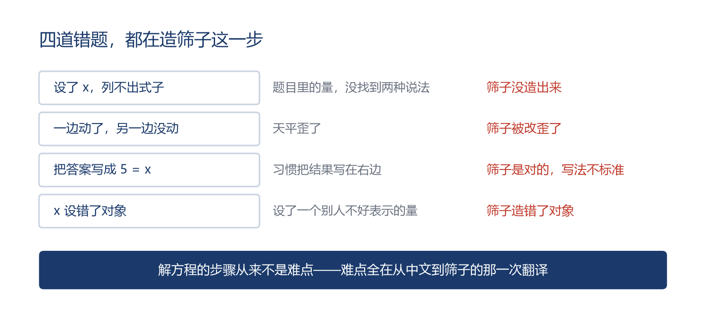

---

## 五、三次远征

前面四章把筛子讲透了：等号是条件不是陈述，x 是为未知占位，改造筛子必须保住筛住的数，错题全在造筛子这一步。这一章走远一点，看三样东西——一道刻在石头上的筛子、一副摆在地上的算筹、和这张筛子后来走到的四个地方。

### 远征一：刻在石头上的筛子

丢番图去世以后，有人在他的墓碑上刻了一道题。

这道题用一段散文讲完了他的一生：

*这里长眠着丢番图。他生命的六分之一是童年；再过了生命的十二分之一，他长出了胡须；又过了生命的七分之一，他结了婚；婚后五年，他有了儿子；儿子的寿命是父亲的一半；儿子死后四年，他也去世了。*

问题是：丢番图活了多少岁？

一千多年来，这道题被无数人抄写、引用、当作代数的开场白。原因很简单：它是"用筛子描述世界"这件事最干净的一次示范。

如果不用方程，你得倒着想：从"死后四年"往回推，从"儿子寿命是父亲一半"往回推……每一步都要在脑子里维护一个不断变化的量，很费劲。

用筛子就完全不同。设他活了 x 岁，然后**照着那段话，一句一句翻译**：

```
童年            x ÷ 6
长出胡须        x ÷ 12
到结婚          x ÷ 7
婚后五年得子     5
儿子的一生      x ÷ 2
儿子死后四年     4
----------------------------------
这些加起来      就是他的一生 x
```

于是这张筛子是：

```
x÷6 + x÷12 + x÷7 + 5 + x÷2 + 4 = x
```

通分（6、12、7、2 的最小公倍数是 84）：

```
14x/84 + 7x/84 + 12x/84 + 42x/84 = 75x/84 = 25x/28
25x/28 + 9 = x
9 = x − 25x/28 = 3x/28
x = 84
```

验算：童年 14 年，长胡须 7 年，到结婚 12 年，婚后 5 年得子，儿子活 42 年，儿子死后 4 年——14+7+12+5+42+4 = 84。全部对上，而且每一段都是整数，没有零头。

**注意这道题的形状**。 它没有"逆推"，没有"假设法"，没有任何需要灵光一闪的技巧。它只有一件事：把一段希腊文老老实实翻译成一张筛子。

筛子一旦造好，剩下的全是机械操作。

这正是筛子方法的本质：它不要求你聪明，它要求你诚实。

顺便说，这道题里每个分数都是"x 的几分之几"。第 4 讲讲分数时说过，一个分数说的是"一个量对另一个量的比"——在这里，那个比就是"这一段占一生的几分之几"。六分之一是比，x 是被比的那个量，$x÷6$ 是比出来的结果。分数在这里不是被当成"半个饼"，而是被当成一个**倍数关系**在用。同一个东西，在四年级是切蛋糕，在这里变成了描述人生的语言。

*（这段计算涉及分数方程，超出小学简易方程的范围，只作欣赏——让孩子看懂"翻译"这一步的价值就够了，不要求他会解。）*

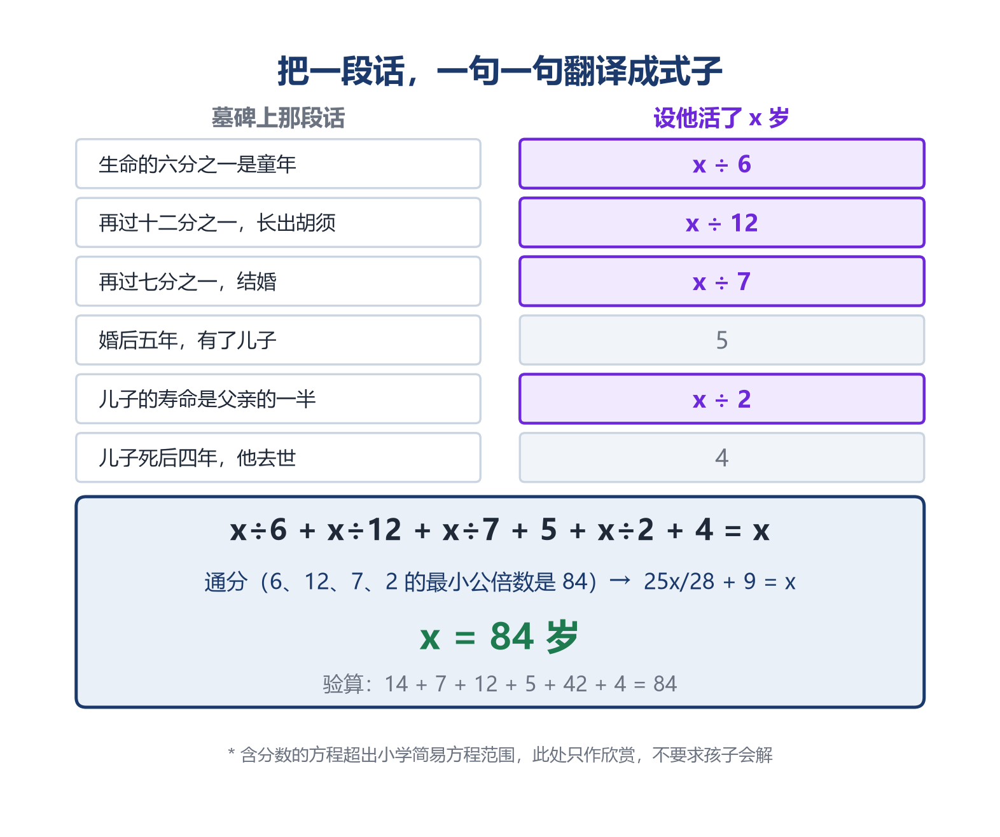


### 远征二：算筹摆出的筛子

《九章算术》第八章，章名就叫**方程**。

今天我们天天说的"方程"这个词，就是从这一章来的。

那一章第一道题是这样的：

*上禾三秉、中禾二秉、下禾一秉，打出的谷子共三十九斗；*

*上禾二秉、中禾三秉、下禾一秉，共三十四斗；*

*上禾一秉、中禾二秉、下禾三秉，共二十六斗。*

*问三种禾每秉各打多少谷子？*

三个未知数，三个条件。用今天的话说，是一个三元一次方程组——**三张筛子叠在一起**。

但《九章算术》里没有未知数，没有等号，没有任何符号。它的解法是这样的：**把每道题的系数，用算筹（小竹棍）在地上摆成一行一行**。

```
        上禾  中禾  下禾 │ 斗
右行：    3    2    1  │ 39
中行：    2    3    1  │ 34
左行：    1    2    3  │ 26
```

这个方阵，就是"方程"二字的来历——**方**是方阵，**程**是程式、度量。它不描述一个式子，它描述的是一张**表**。

然后做两步操作，原书叫"**遍乘直除**"：

**遍乘**——把一行整体乘上某个数。比如右行遍乘 2、中行遍乘 3，让两行的第一个数变得一样（都是 6）：

```
右行×2：  6   4   2  │ 78
中行×3：  6   9   3  │ 102
```

**直除**——把两行上下相减，那一列就消掉了：

```
        0   5   1  │ 24
```

上禾从这一行里彻底消失了。

**用筛子的语言说：这一步是把"上禾"这个未知数从筛子里消掉，让筛孔收紧一格**。 三个未知数的筛子，变成了两个未知数的筛子。再来一轮，就剩一个。

这套操作，今天叫**消元法**。欧洲教科书把它归给高斯（19 世纪初）。《九章算术》成书于公元一世纪前后。**同样的方法，中国早了大约一千八百年**。

接下来发生的事，比方法本身更重要。

消元的过程中，不可避免地会出现"小数减大数"：6 − 9 = ？地上摆着 6 根筹，要减掉 9 根，不够。

中国人没有绕开它，而是发明了负数。《九章算术》在同一章里给出了"正负术"——正负数的加减法则，用斜放的算筹表示负数。这是世界上最早系统给出负数运算法则的记载之一。

远征一那个"筛空"信号，在这里又响了一次。 前面讲过，$x+5=3$ 在自然数里筛空，是数系需要扩张的信号。《九章算术》的算筹方阵里，"6 减 9"这个动作做不下去——同样是筛空，同样逼出了负数。

负数不是哲学家想出来的，也不是为了"欠债"这种生活场景硬造的。**它是被算法逼出来的**：算法走到那一步，必须有个东西接住，否则整张方阵就散了。

第 3 讲讲过的"运算的规则会自己长出新东西"，在这里应验了一次。当年分配律逼出了负负得正（那部分内容留到初中再讲），这里消元法逼出了负数。数系的每一次扩张，都是被某种"不能停在这里"的压力推出来的。

*（三元方程组与负数运算都超出小学范围，这一段是给家长和大孩子的史料拓展。小学生只需要知道一件事：方程这个词，是中国人起的。）*

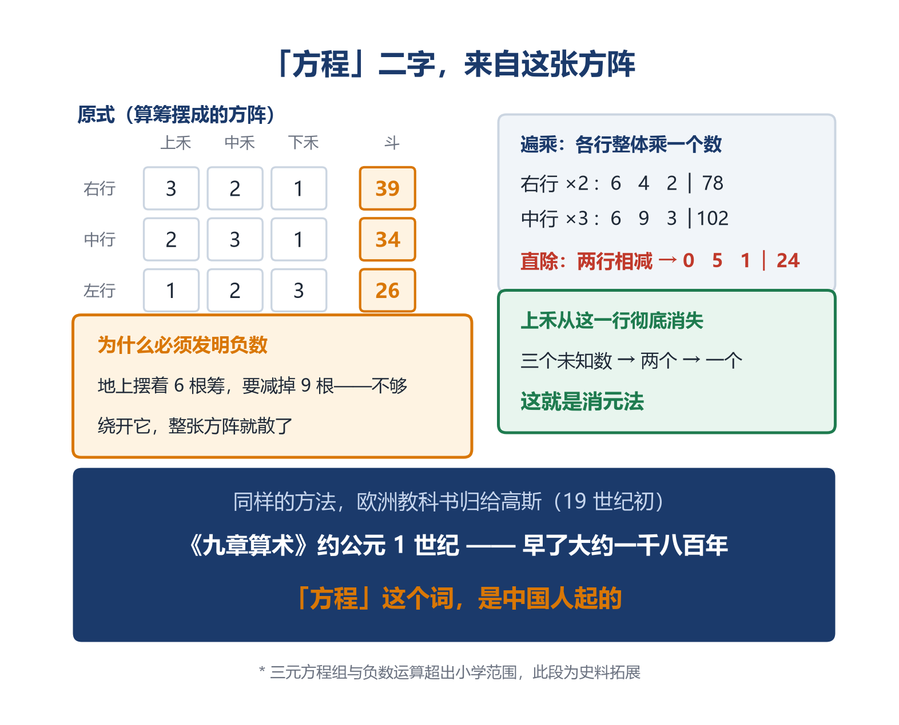


### 远征三：一张筛子能走多远

前两张远征都在往回看：丢番图的墓碑、九章的算筹。这一张往前走：**五年级这张筛子，后来走到了哪里**。

**第一站：筛出一段**

$x < 4$。这不是方程，是不等式，但它同样是一张筛子：把所有数倒进去，在自然数范围里留下的是 0、1、2、3。

有一点值得留意：**筛出来的不再是一个数，而是一堆数**。

而那一堆数，同样是答案。孩子在这里第一次遇到"答案是一个集合"这种事。小学不教"解集"这个词，也不要求他会解不等式，但"**答案可以不止一个，甚至可以是一整段**"这个观念，从这张筛子开始就成立了。

**第二站：叠筛子**

```
x + y = 10
x − y = 4
```

两张筛子叠在一起。第一张筛住所有加起来是 10 的数对，第二张筛住所有相差 4 的数对。**同时通过两张的，只有 (7, 3**)——我们在 0~14 的范围里穷举过，确实只有这一对。

**条件越多，筛孔越细，留下的越少**。

回头看远征二那个算筹方阵，它其实就是三张筛子叠在一起：三个未知数、三个条件。而"遍乘直除"做的事，是**把叠在一起的筛子一层层拆开**：先消掉一个未知数，三张变两张；再消一个，两张变一张。

这就是消元的本质：减少筛子的层数，直到只剩一层，答案自己跳出来。

*（方程组是初中内容，这里只说"叠筛子"这个图像，不要求孩子会解。）*

**第三站：筛空逼出新数**

```
x + 5 = 3　　在自然数里筛空　→ 逼出负数
3x = 4　　　在整数里筛空　　→ 逼出分数
x² = 2　　　在有理数里筛空　→ 逼出无理数
x² = −1　　在实数里筛空　　→ 逼出虚数
```

四次数系扩张，全都是同一个动作：**筛子空了，于是把筛的范围扩大**。

而人类每一次扩大范围，都不是先想清楚再扩的。是"这里没有答案"逼着他们扩的。第 4 讲讲分数诞生时说过这句话，这里它第四次应验。

*（无理数与虚数都远超小学，此处只作一条线的展示：让孩子知道"无解"不是终点。不要求理解，更不要求会算。）*

**第四站：筛子变成图形**

这是最远的一站，也是最深的一站。

$y = 2x$ 看起来不像筛子。它不筛选什么，它像一台机器：给一个 x，吐一个 y。

但把它改写成 $2x − y = 0$，它立刻变回筛子：它筛住所有让这句话成立的 (x, y) 数对。

```
(1, 2) → 2×1 − 2 = 0　通过
(2, 4) → 2×2 − 4 = 0　通过
(3, 6) → 2×3 − 6 = 0　通过
(1, 3) → 2×1 − 3 = −1　不通过
```

**而把所有通过的数对画在坐标纸上，它们连成一条直线**。

一张筛子，画出来是一条线。

这就是笛卡尔 1637 年在《几何学》里干的事：他不但定下了 x、y、z 这套记号，还发明了坐标系，**让代数的筛子和几何的图形变成同一个东西的两种写法**。

从此以后，两件事合流了：

- **方程的解集，画出来是图形**
- **图形的性质，写出来是方程**

小学那条"正比例图像是一条过原点的直线"，根子就在这里：$y = kx$ 这张筛子筛住的数对连起来必然过原点——因为 x = 0 时 y 必须是 0，这条线不可能不过原点。

*（坐标系是初中内容，这里只说"画出来是一条线"这个现象，不要求孩子会画。）*

**第五站：它还会走很远，但孩子已经握住了起点**

再往下走，这张筛子会换上一串越来越陌生的名字，筛住的东西也会从数变成点、变成更一般的对象。那些都是大学以后的事，家长不需要知道，孩子更不需要。

这里只留一句话给你：

**往后数学里凡是出现"把条件写下来，看哪些东西满足它"的地方，用的都是五年级这张筛子的动作**。 名字会变，动作不变。

而远征二那个"一层层消下去"的动作，也还活着。《九章算术》的算筹方阵，今天的课本叫高斯消元法；你在计算器或数学软件里敲一句"解方程组"，底下跑的仍是它的后代。

**公元一世纪的一副小竹棍，和今天的计算机，是同一条线上的两个点**。 两千年里，那个动作没有变过：把条件摆成方阵，一层层消下去。

孩子不知道这些。他只知道自己在摇一张筛子。

**这就够了。他摇过了，将来它换名字再出现，他认得出来**。


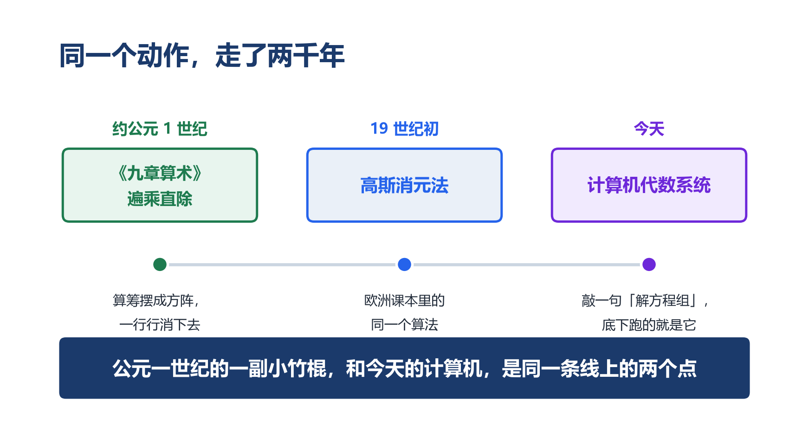

从五年级那张 $x+5=12$ 的筛子，到坐标纸上的一条直线，中间没有断点。

每一站都只是往下走一步：**把条件写下来，看它筛住什么**。

而"筛住的东西"这件事，长大后有个名字，叫**解集**。小学不教这个词。但孩子五年级已经在摇筛子了。他只是在摇，还不知道自己摇的是什么。

---

## 六、方程把"聪明"换成了"耐心"

现在可以回答引言里那个怪事了。

**为什么孩子会解方程，却想不到用方程**？

因为在他心里，方程是"更麻烦的解法"。

看这道题：四年级的鸡兔同笼，35 个头，94 只脚，鸡兔各几只。

算术的**假设法**是这样的：

```
假设 35 只全是鸡 → 35 × 2 = 70 只脚
实际有 94 只脚 → 多出 94 − 70 = 24 只
每把一只鸡换成兔，多 2 只脚 → 24 ÷ 2 = 12 只兔
鸡 = 35 − 12 = 23 只
```

答案对，方法也漂亮。但看第一步："**假设全是鸡**"。

这一步从哪来的？题目没说，条件里也没有。它是解题的人**凭空想到**的。想到这一步，后面顺流而下；想不到，就只能干瞪眼。

这就是算术方法的特点：**它依赖洞察**。 每一道应用题都藏着一个小机关，你要看出那个机关，才能解开。所以算术好的孩子，往往是"看题快"的孩子。

方程的方法完全不同：

```
设兔有 x 只，则鸡有 (35 − x) 只
脚的总数：4x + 2(35 − x) = 94
         4x + 70 − 2x = 94
              2x = 24
               x = 12
```

**没有洞察**。 设未知数，把"头的总数"和"脚的总数"这两个等量关系翻译出来，然后按等式的性质一步步走。任何一道这样的题，都是这同一套动作。

这是两种完全不同的能力：

| | 算术 | 方程 |
|---|---|---|
| 靠什么 | 看出这道题的机关 | 把每句话翻译成筛子 |
| 每道题 | 都要重新想 | 都是同一套流程 |
| 思维方向 | 从已知倒推未知 | 让未知先参加，再筛出它 |
| 谁擅长 | 反应快、直觉好的孩子 | 踏实、肯按步骤走的孩子 |
| 天花板 | 题越复杂越容易卡死 | 题越复杂优势越明显 |

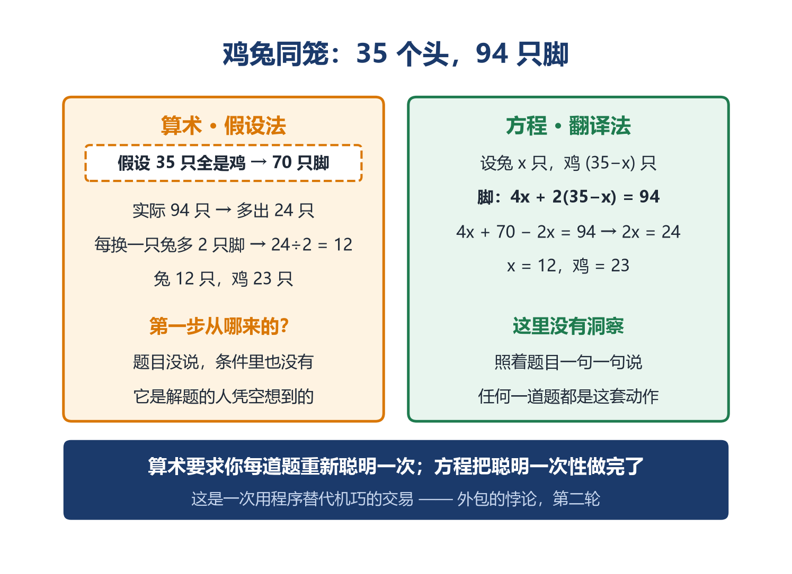


第 2 讲讲过"外包的悖论"：运算律让人类把计算外包给规则，文明因此起飞，代价是孩子可能卷面全对却一无所知。

方程是这次外包的第二轮，而且更彻底。

这一轮外包出去的，是**机巧**。算术要求每道题都重新聪明一次；方程把聪明一次性做完了（发明它的人聪明过了），之后任何人只要会翻译、肯按步骤走，就能得到答案。

所以方程真正革命性的地方，不是它更能解难题，而是它**把"解难题"这件事从一种天赋，变成了一种流程**。

这也正是孩子不主动用它的原因：在他的经验里，这道题用算术两三步就出来了，何必设 x、列式、两边同减、两边同除、再检验，写上七八行？

**他是错的，但他的错有道理**。

在小学的应用题范围内，算术确实常常更快。方程的优势要到题真正复杂起来——三个未知数、多层嵌套、逆向关系绕来绕去——才会显现。而那时候，孩子已经上初中了。

所以"会解方程却想不到用方程"，是一个**过渡期的正常现象**，不是缺陷。真正要担心的不是他不用方程，而是他**不会翻译**：给他一道题，他能解 $3x+5=20$，但从"比一个数的 3 倍多 5 是 20"这句话到那张筛子，这一步迈不过去。

解方程是操作，谁都能练熟。从中文到筛子的那次翻译，才是代数的核心能力。 而它练不了套路，只能练理解——理解等号是"筛子"不是"箭头"，理解 x 是"占位符"，理解等量关系是"同一个东西的两种说法"。

这就是这一讲前面几章在做的事。

---

## 七、分水岭：认题型，还是认关系

现在可以说那句最要紧的话了。

**代数是一道分水岭。分下去的不是聪明和笨，是"认题型"和"认关系**"。

先把这句话里那个动作说清楚，因为它很容易被含糊过去。

列方程最难的一步，不是解，是**列**。而"列"难在哪？难在你要从一段中文里，找出**什么东西和什么东西是同一个**。

回到第四章那道绳子题：

**一根绳子，用去 15 米后，剩下的比原来的一半多 3 米。原来多长**？

孩子设了 x 就卡住了。他缺的不是运算能力，是他没看出这段话里藏着一个"同一个东西"——"**剩下的**"。它有两种说法：一种是 $x − 15$，一种是 $x ÷ 2 + 3$。两种说法指的是同一段绳子，所以它们相等。

**方程就是从这句话里长出来的**。

这个动作有个准确的名字：**从文字里提取相同关系**。

---

请注意一件事：**这是整个小学阶段，孩子第一次要自己把相等关系找出来**。

前四讲他从来没有被要求过这件事。

- 第 1 讲，$305$ 里那个 0 占什么位——位置是给定的，数位表摆在那儿
- 第 2 讲，$3 + 4 = 7$——相等是给定的，式子已经写好了
- 第 3 讲，$a + b = b + a$——相等是给定的，要讨论的是它凭什么成立
- 第 4 讲，$1/2$ 和 $2/4$ 是不是同一个——相等是**有判据的**，交叉相乘一比就知道

**每一次，"什么和什么相等"这件事，都是别人已经给他准备好的**。 他要做的是接受、验证、运用。

只有到了方程这里，没人再给他准备好。一段话摆在面前，相等关系藏在里面，**他得自己把它挖出来**。

这是一次性质完全不同的动作。前面四讲练的是"用规则"，这一讲第一次要求"找关系"。

---

而这两种动作，恰好对应两种完全不同的学法。

**认题型**：这道题像哪一类？是"和差问题"还是"行程问题"？见过的那类，套那个套路；没见过的，就傻了。

**认关系**：这道题里，什么东西和什么东西是同一个？找到了，方程自己就出来了。

小学阶段，认题型是够用的。因为小学应用题的题型是有限的、可穷举的——和差、倍比、行程、工程、鸡兔同笼、盈亏……辅导书把它们整理成几十类，每类配几个例题，练熟了，满分。

**满分把两种学法的差别完全盖住了**。 认题型的孩子和认关系的孩子，在小学考卷上都是 100 分，一模一样。

到了初中，题型开始爆炸。三个未知数、多层嵌套、逆向关系绕来绕去、还要和几何图形混在一起——**没人能给你整理出那么多类**。这时候认题型的孩子会突然发现：手里那几十类套路，一道都对不上。

而认关系的孩子不会遇到这个坎。因为他的动作从来不是"这题像哪一类"，而是"什么东西和什么东西是同一个"。**题型会变，这个动作不变**。

---

所以有一句话得说在前头，而且要说得很小心。

家长看到孩子列不出方程，很容易想："是不是我家孩子脑子不够用？"

**不是**。

认题型和认关系，是两种不同的能力，不是一条轴上的高低。而且更要紧的是：**认关系这种能力，是练出来的，不是天生的**。

它靠什么练出来？靠孩子自己动手找，而不是被告知。你直接告诉他"这道题的等量关系是剩下的"，他记住了这道题，但那个动作还是没长出来。你问他一句"这道题里，哪个东西被说了两遍？"，让他自己找出那个"剩下的"——**这个"找"的过程本身，就是在练那个动作**。

后面"给家长的分寸"一章，会给两个当场能用的练法。但先把这一句记住：**孩子列不出方程，缺的从来不是聪明，是没有人让他自己找过**。

---

上面说的是"列"这一头。同一道分水岭，在"记公式"那一头也出现一次——而且更容易被家长看见。

---

### 根一：(a+b)² = a² + 2ab + b²，根在第 3 讲那个四宫格

这是初中第一个要背的公式，也是最容易背错的一个。孩子最常犯的错是漏掉中间那项，写成 $(a+b)^2 = a^2 + b^2$。

漏掉它，是因为在他心里 **2ab 没有来处**——公式右边三项，凭什么中间会多出一项？背的时候少背一项，太正常了。

可第 3 讲讲过那张四宫格：把边长 (3+4) 的正方形切一刀，分成四块。

```
边长 3+4 的正方形，切成四块：

  3×3 = 9     3×4 = 12
  4×3 = 12    4×4 = 16

四块合起来 9 + 12 + 12 + 16 = 49 = (3+4)²
```

看清楚中间那两块：**12 和 12，加起来就是 2×3×4 = 24，它就是 2ab**。

$2ab$ 不是公式里凭空多出来的一项，它是那个正方形中间的两块长方形。**面积摆在那里，你漏不掉它**。

一个知道根的孩子，就算他忘了公式长什么样，也能三秒钟自己推出来：画个正方形，切一刀，四块面积加起来。而只背过公式的孩子，忘了就是忘了。

---

### 根二："移项变号"，根在本讲第 3 章那架天平

初中第一个要背的口诀就是它。孩子最常犯的错是移了项忘了变号，或者对不含 x 的项也乱移。

因为它被当成一条**独立的规矩**在背：项从左边搬到右边，符号要翻一下。凭什么翻？没人说。

可本讲第 3 章说清楚了：解方程是改造筛子，每一步都必须**两边同时做同一个动作**，筛住的数才不会变。

```
3x + 5 = 20
两边同减 5：3x = 15      ← 天平两边同时拿掉 5
两边同除 3：x = 5
```

"**移项变号"不是另一条规则，它就是"两边同减 5"的简写**。 那个 +5 从左边消失、在右边以 −5 出现，不是它自己跳过去的，是你在两边同时减了 5 之后的结果。

知道这一点，孩子不会忘变号——因为他根本不需要记"变号"这件事，他记的是"天平两边要一样"。而不含 x 的项为什么不能乱移？因为移项的前提是两边同减，你减的是同一个数，不是"想搬哪项搬哪项"。

---

### 根三："检验增根"，根在本讲第 3 章的"筛孔被改大"

初中解分式方程，老师反复要求"代回去检验"。孩子把它当成格式负担，写两行敷衍了事。

本讲第 3 章脾气三已经说清了机制：**两边同乘一个可能为零的式子，筛孔会被撑大，凭空多出解来**。

```
(x+1)/(x−2) = 3
两边同乘 (x−2)：x + 1 = 3(x−2)
化简：2x = 7，x = 7/2　　代回原方程，成立
```

这一步的依据是"两边同乘一个**非零**数"。可 x−2 是不是零，事先不知道。如果 x = 2，这一步就成了两边同乘 0：$0 = 0$ 恒真，筛孔撑到最大，什么数都成了"解"——但 x = 2 代回原方程，分母是 0，式子根本不存在。

**检验不是格式要求，是在查一件事：我刚才那一步，有没有把筛孔改大**。

一个知道根的孩子，检验时心里是有目标的；一个只知道"老师要检验"的孩子，检验时只是在抄一遍算式。

---

### 根四：分数除法"乘倒数"，根在第 2 讲的除法定义和第 4 讲的判据

这条小学就在背了："除以一个分数，等于乘它的倒数。"

孩子背了六年，几乎没人告诉他为什么。可它真不是规定——**它是被除法定义逼出来的**。

第 2 讲给过除法的定义：$a ÷ b = c$，当且仅当 $c × b = a$。用这条定义推一次：

```
设 a/b ÷ c/d = x
按定义：x × (c/d) = a/b
两边乘 d/c：x = a/b × d/c
```

验一下：3/4 ÷ 2/5 = 15/8，而 3/4 × 5/2 = 15/8。相等。

这条"法则"的来路，用的全是已经立好的东西：第 2 讲的除法定义、第 4 讲的判据（ad = bc）。**没有一步是新规定的**。

---

### 一条地基，长出五条公式

上面四条根，其实都踩在同一块地基上——**第 3 讲那三条运算律，特别是分配律**。

```
a × (b + c) = a×b + a×c
```

从这一条出发，中学前两年的公式基本都能长出来：

| 中学要背的 | 它其实是分配律的哪一面 |
|---|---|
| 合并同类项　3x + 5x = 8x | 分配律逆用：(3+5)x |
| 去括号　−(a − b) = −a + b | 用 −1 去乘：−1×a + −1×(−b) |
| (a+b)² = a²+2ab+b² | 分配律连用两次 |
| (a+b)(a−b) = a²−b² | 同上，中间两项抵消 |
| 移项变号 | 等式性质（分配律保证的"两边同做"） |

**知道根，这五条是一条；只背条文，这五条是五个互不相干的记忆负担**。

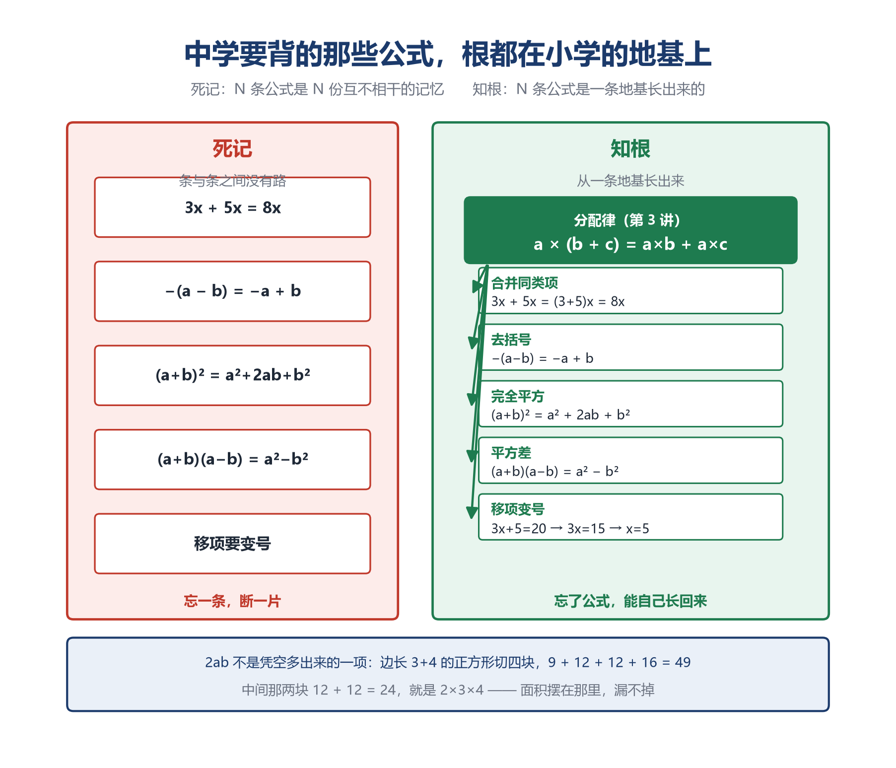

差别会随年级放大。初中五十条，高中上百条。只背条文的人，负担线性增长，总有一天背不动；认关系的人，手里始终只有那几条地基，剩下的能自己长回来。

---

所以那道分水岭，两头是同一个动作。

**列方程这一头**，要认的是"什么东西和什么东西是同一个"；**记公式这一头**，要认的是"这条式子和哪块地基是同一个"。

两头都不是记性活。都是**认关系**。

而小学阶段，这两头都能用认题型、背条文蒙过去，还能拿满分。到了初中，蒙不过去了。

这一系列前四讲做的事，就是把地基一块块铺出来：位值制讲清了"规则与标签"，四则运算讲清了"同维相加、乘法升维"，运算律讲清了"数的承诺"，分数讲清了"名字与数是两件事"。

第五讲讲的是这个地基上第一次长出来的新东西——**一个可以先于内容存在的符号**，以及那个符号要求的全新动作：**自己把相等关系找出来**。

地基铺过了，那个动作练过了，初中那些公式对他就是几条地基的不同长相。地基没铺，公式就只能一条条背，背到第三层就晃。

---

## 八、给家长的分寸

和前几讲一样，先给一条反向提醒。这一讲通篇在讲"方程比算术高级"，很容易让家长得出一个结论：早点教方程。

**那同样是错的**。 "设 x"要的是对"还不存在的东西"做推理的能力，这一步跳不过去。启蒙篇的原则是"拒绝过早抽象"，这一讲也必须遵守。

| 阶段 | 孩子该到什么程度 | 家长别做什么 |
|---|---|---|
| 三、四年级 | 认识等号是"两边一样"，不只会"算出答案"；会做 $8+3 = 7+4$ 这类判断题；接触"□ + 5 = 12"这种填空 | 别提前引入 x，别讲移项 |
| 五年级上 | 会用字母表示数（a+b、3x）；理解等式的性质；会解 $x±a=b$、$ax=b$、$ax±b=c$、$a(x±b)=c$；会检验 | 别教"移项变号"这个口诀，它会让天平消失 |
| 五年级下～六年级 | 能自己找等量关系、设未知数、列方程解应用题；能对比算术法和方程法 | 别催他"必须用方程"，过渡期两种方法并存是正常的 |
| 小升初衔接 | 提前接触一元一次方程的规范书写；知道负数是要来的 | 别提前上二元一次方程组，那是初中的事 |

表中年级划分对应《义务教育数学课程标准（2022 年版）》三个学段的大致安排，各地教材进度略有差异，请以孩子实际使用的教材为准。

**为什么有的孩子学得顺，有的孩子怎么教都别扭**？

发展心理学家皮亚杰（Jean Piaget）把儿童认知发展的最后一个阶段叫**形式运算阶段**，大约从十一二岁开始，核心能力是"假设-演绎推理"——**能够对一个还不存在、甚至不一定成立的前提，进行认真的推理**。

"设这个数为 x"，要求的正是这种能力。x 不是一个数，它是一个**承诺**：我承认有一个数满足这些条件，先用符号记下来，然后照常运算。孩子在那一刻玩的是一场有规则的假装游戏——**假装自己已经知道了那个还不知道的东西**。

十一二岁之前，孩子的思维是绑在具体事物上的。他能算 3 个苹果加 2 个苹果，因为苹果在眼前；他很难对一个"还没找到的数"做操作，因为那个东西**不在任何地方**。

**所以这不是智商差别，是发育节奏差别**。 有的孩子十岁就进入了形式运算，有的要到十三四岁。早的孩子觉得方程"显然"，晚的孩子觉得方程"不讲道理"——两种反应都正常，而且**晚的孩子不代表学不会，只代表他需要更多具体的支撑**（天平、实物、画图），才能把那个"假装"撑住。

这也说明了天平为什么有效：它把"两边一样重"这个抽象关系，变成了看得见的物理事实。但请记住分寸——**天平是脚手架，不是终点。天平讲的是"两边一样重"（陈述层面），筛子讲的是"去找那个能让它一样重的数"（条件层面）。孩子最终要从天平走到筛子**。

*（严格说，"设未知数"与皮亚杰的假设-演绎推理是教育学上的类比，不是他本人的论述，他没有专门研究过这件事。但发展心理学确实发现，孩子把等号读成"算出答案"而不是"两边相等"，是一个跨文化、跨教材的普遍现象，Kieran 1981 年那篇《与等号相关的概念》是这个领域被引用最多的文献之一。）*

**三个最容易踩的坑**：

**一、把等式的性质讲成口诀**。 "两边同时加减乘除"如果只是背下来，孩子会在一边动了另一边没动的时候毫无察觉。让他始终看到天平：左边拿掉 5，右边也得拿掉 5，否则天平就歪了，那句"一样重"就不成立了。**再往前一步：天平歪了，筛住的数就变了，这才是"等价变形"的真正含义**。

**二、跳过"设"那一句**。 "设这个数为 x"不是格式负担，它规定了 x 的身份。很多孩子列不出方程，是因为 x 设了却没想清楚它代表谁。检查作业时先看这一句写得清不清楚。

**三、把"找等量关系"讲成套路**。 有些辅导材料会总结出"和差问题设 x""行程问题设时间"之类的口诀。口诀能应付考试，但它替代的恰恰是唯一需要动脑的那一步。**真正该练的是问一句话：这道题里，哪个东西能用两种方式说出来**？

**一个值得做的练习**： 给孩子一道他已经用算术做对的题，让他再用方程做一遍，然后问他——"这两种方法，哪一种你以后不想再想第二遍？"

大部分孩子会说方程。因为算术那个"假设全是鸡"，他下次遇到新题时未必想得到；而方程，他只要会翻译，就一定做得出来。

这一刻他体会到的是：有一种方法，不要求我每次都聪明。

这个体会，比任何一道题的答案都值钱。

**另一个练习（给学有余力的孩子**）： 出一道筛空的题，比如 $x + 5 = 3$，问他"这道题有答案吗？"

他大概率说"没有"。这时候你可以告诉他："**不是没有，是我们现在的数不够用。如果允许'欠 2'这样的数存在，它就有答案了**。"

不需要展开负数，只需要让他记住一件事："**无解"有时候不是题目的错，是数的范围不够大**。 这句话会在两年后他自己学到负数的时候，突然亮起来。

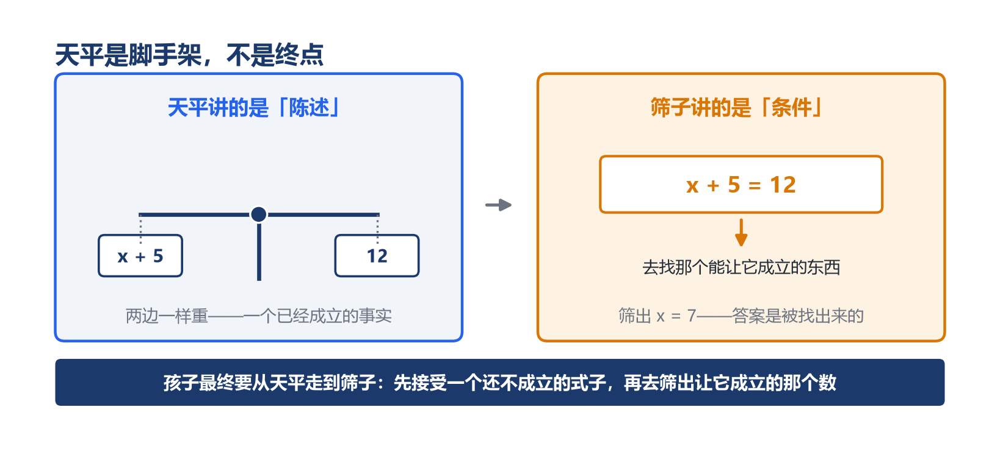

---

## 九、结语：把未知请进等式

这一讲从头到尾只讲了一个动作。

**把一个还不知道的数，请进等式里，和已知的数一起做运算**。

就这么一件事，人类用了八百多年才敢做。

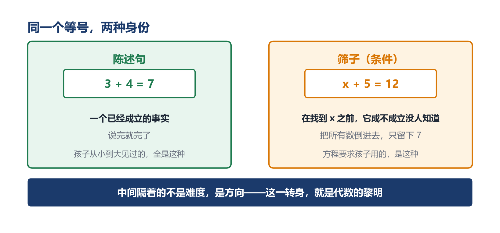

这条路上的三个人——丢番图、花拉子米、韦达——第二章已经讲过。他们共同卡住的，是那一步：不敢把一个符号交给一个"还不知道是多少"的量。

而每个孩子，都在五年级的某个下午，独自把这条路重走一遍。

他迟疑，他觉得设 x 像作弊，他把 x 划掉退回到算术，这些反应都不愚蠢。它们和花拉子米用整本散文写方程、和丢番图只肯给未知数一个临时代号，是同一种谨慎：**在一个符号背后还没有内容的时候，先不要用它**。

人类花了八百多年才想明白，这个谨慎是可以放下的。

因为符号可以先于内容存在。

---

这一讲真正想留下的，是那个筛子。

$3 + 4 = 7$ 是一句话。$x + 5 = 12$ 不是话，它是一张筛子——把所有数倒进去，摇一摇，只留下 7。

这个区别看起来很小，但它是算术和代数的分水岭。

算术的世界里，等号永远指向一个已经确定的答案。代数的世界里，等号可以指向一个**还不确定的条件**——你可以先把条件写下来，再慢慢把筛子改造得越来越简单，直到答案自己跳出来。

而跨过分水岭之后，撑住成绩的方式必须换掉。**小学认题型就够，中学必须认关系**。 列方程要认出"什么东西和什么东西是同一个"，记公式要认出"这条式子和哪块地基是同一个"——两头都不是记性活。而认关系不是天赋，是小学那几年有没有人让孩子自己找过、自己推过的差别。

**而改造筛子有一条铁律：筛住的数，一个都不能多，一个都不能少**。

等式的性质保证的就是这件事。两边同乘 0 之所以危险，是因为它把筛孔撑到了最大，凭空多出无穷多个"解"。初中那四个字"检验增根"，检验的就是你有没有不小心把筛孔改大了。

刘徽一千八百年前那六个字"势不可失本数也"，说的也是这件事。

从公元 263 年的注文，到五年级的作业本，到初中的分式方程，是同一句话的三次现身。

---

而这张筛子不会停在五年级。 它会筛出一整段（不等式），会叠起来（方程组），会在筛空的时候逼出新的数（负数、无理数、虚数），最后会被画在坐标纸上，变成一条直线。

每一次筛空，都是数系扩张的信号；每一次扩张，都是因为有人不肯把"无解"当成终点。

而这一切的起点，是五年级那个下午，孩子第一次接受了一个还不存在的数，把它写进等式，然后照常运算。

---

从 3+4=7 到 x+5=12，难度没增加多少，变的是方向。

算术让人从已知走向未知；代数让人先接住未知，再回头筛出它。

**这一转身，就是代数的黎明**。

而黎明之后，符号会继续生长：x 会乘自己变成 x²，会在边长未知时依然表达出面积；两个会一起变化的量会被同一张筛子拴住，成为比例；连"不确定"这件事，最后也会被放进筛子里度量。

这一讲只负责把第一块地基夯实：**让孩子接受，等号右边不一定写着答案，它也可以写着一个条件，等着你去筛**。

---

而"筛"这个动作，故事还远没完。

这一讲筛的，是**满足条件的数**。可数学里还有另一种筛，筛的是**数本身**：把 2 的倍数划掉，把 3 的倍数划掉，把 5 的倍数划掉……划完剩下的那些数，有个特别的名字，也有一段特别的故事。

两千多年前，就有人用这样一张筛子，把那样的数一个个筛了出来。而它们身上，藏着一个比"无解"更深的秘密：

**有些数，拆到最后就拆不动了**。

那是另一张筛子，另一段黎明。但摇筛子的那只手，是同一只。

"数学成神之路"是一条从启蒙一直通到成神的长路。

**我们现在，才刚走完小学的第五步**。

---

## 参考文献

1. Kieran, C. (1981). *Concepts Associated with the Equality Symbol*. In E. Fennema & T. Romberg (Eds.), Mathematics Education Research: Implications for the 1980s. — 儿童把等号理解为"算出答案"而非"两边相等"的经典研究。
2. Piaget, J. *Intellectual Operations and Their Development*. — 形式运算阶段与假设-演绎推理。
3. 花拉子米（al-Khwarizmi），《代数学》（*al-Kitāb al-mukhtaṣar fī ḥisāb al-jabr wal-muqābala*），约公元 820 年。— 历史上第一部系统讲解方程的著作，全文字叙述无符号。
4. Viète, F. (1591). *In artem analyticem isagoge*. — 首次系统用字母表示未知量与已知量。
5. Descartes, R. (1637). *La Géométrie*. — 确立 x/y/z 表未知、a/b/c 表已知的记号约定，并引入指数写法。
6. 《九章算术》第八章"方程"，约公元 1 世纪。— "遍乘直除"即消元法，并因消元需要引入负数与"正负术"。
7. Shen, K., Crossley, J. N., & Lun, A. W. C. (1999). *The Nine Chapters on the Mathematical Art*. Oxford University Press. — 《九章算术》英译与研究。

---

**互动**

你家孩子是"会解方程却想不到用方程"的类型，还是"宁可用方程不肯用算术"的类型？

或者，你还记得自己当年第一次遇到"设 x"时，是什么感觉？

**评论区聊聊**。 我会挑几个有代表性的场景，专门回应。

需要这一讲的练习卡吗？

①「解方程」4 题（用等式的性质，每步想天平）
②「列方程」3 题（先写"设"，再找等量关系）
③「判断等式成不成立」3 题（不用算，看两边）
④「找错」2 题（筛孔被改坏的两种典型）

后台回复 **方程卡** 领取打印版。

---
