# 质数：数的基因

「数学成神之路」小学数学 · 第 6 讲

原创 · 程大大的小记

### 导读

有一件事你每天都在做，但它成立的理由，藏在你孩子五年级的课本里。手机支付、手机银行、网上转账——这些操作之所以安全，是因为它们建立在一个数学事实上：把两个几百位的质数乘起来，一秒钟就够。把乘出来的那个数再拆回原来那两个质数，全世界所有的计算机一起算，算到宇宙终结也算不完。

这个差距有多大：两个质数乘出来是一个六百多位的数，最笨的拆法要从 2 一直试到它的平方根——那是 $10^{308}$ 这个量级，三百多位的一个数；宇宙从诞生到现在才过了大约 $4\times10^{17}$ 秒，就算每秒钟能试十亿次，也差了 $10^{280}$ 倍。

一个方向一步就完，反方向永远走不到头。今天整个互联网的安全，就架在这道鸿沟上。而这道鸿沟的起点，是孩子五年级学的那张表：100 以内一共 25 个质数。教材教这一单元，让孩子会判断一个数是不是质数、会把它分解质因数、会求最大公因数和最小公倍数。全是操作。没有一处告诉他，这些质数正在保护他妈妈的支付密码。也没有一处回答那个孩子迟早会问、而课本从不回答的问题：

"**为什么 1 不是质数**？"标准答案是四个字：这是规定。孩子听完就记住了，然后继续做题。可这句话是敷衍。数学里绝大多数看起来像"规定"的东西，背后都有理由，而且理由比结论重要得多。第 3 讲讲过，运算律是"数"这个概念的承诺；第 4 讲讲过，分数的判据是人挑的入口，但挑得有理由；第 5 讲讲过，等号可以是一张筛子。三次都在说同一件事：看起来是规定的，实际是被别的东西逼出来的。

1 不是质数，也是被逼的。**理由很直接：1 一进质数表，"每个数的拆法只有一种"这句话当场就废了**。而约分、通分、最大公因数，全都建在这句话上。

这一讲要做的，是一件前五讲都没做过的事：把一个数打开，看看里面是什么。前面五讲，数一直是黑箱。第 1 讲讲怎么把数写下来，第 2 讲讲怎么算它们，第 3 讲讲运算凭什么能那样算，第 4 讲讲一个数可以有无穷多个名字，第 5 讲讲怎么把一个还不知道的数请进式子。没有一讲打开过数本身。

打开之后会看见三样东西：每个数都有一份独一无二的配方（60 的配方就是 2、2、3、5，不管从哪条路拆，最后拆出来的都是这四个）；一个数的无穷多个名字里，有一个最简、最标准；两个数放在一起，它们的关系也变得看得见。

**这一讲要讲的六件事**：

1. 每个大于 1 的整数都能拆成质数相乘，**而且拆法只有一种**。质数是数的字母表，配方就是数的身份。
2. 1 不是质数，**是为了保住"拆法只有一种"**。这条定义是被定理挑出来的，不是谁随手定的。
3. 一个数的无穷多个名字里，最简的那一个是它自己。第 4 讲留下的问题，在这里有答案。
4. 最大公因数取交，最小公倍数取并。两个孤立技巧，是同一张基因图上的两个动作。
5. 乘起来一步就完，拆回去要试遍所有可能。这个不对称是筛法的原理，也是今天所有密码的原理。
6. "**拆法只有一种"不是天经地义的**。换一批数，它会失效。而"质数有多少个、又分布在哪些地方"这件事，人类到 1896 年才算清；

>> 如果只读一章，读第二章。

## 一、打开一个数

>> 拆一个数之前，先把四个词定下来：因数、倍数、质数、合数。这一讲从头到尾都用它们说话。

**因数**：a ÷ b 的商是整数、没有余数，就说 b 是 a 的因数。12 ÷ 3 = 4，所以 3 是 12 的因数。（第 2 讲讲过，a ÷ b = c 就是 c × b = a，所以"3 是 12 的因数"和"3 × 4 = 12"是同一句话。）

一个数的因数是有限的。12 的因数有 1、2、3、4、6、12，六个。最小的是 1，最大的是它自己。

**质数**：大于 1 的整数，只有 1 和它本身两个因数。

2 的因数是 1、2，两个，是质数。3、5、7、11、13 都是。

**合数**：大于 1 的整数，除了 1 和它本身还有别的因数。

4 的因数是 1、2、4，三个，是合数。6、8、9、10、12 都是。

1 既不是质数，也不是合数。最后这句，教材写得很干脆，理由一个字不给。理由在后面，而且不难。

**现在做一件每个小学生都做过、但从来没人点破的事**。任何一个大于 1 的整数，都能写成几个质数相乘。

```
6   = 2 × 3
12  = 2 × 2 × 3
30  = 2 × 3 × 5
60  = 2 × 2 × 3 × 5
100 = 2 × 2 × 5 × 5
```

怎么拆？一直拆，拆到拆不动为止：

```
60 = 6 × 10          6 和 10 都不是质数，继续
   = (2×3) × (2×5)    2、3、2、5 全是质数，停
   = 2 × 2 × 3 × 5
```

什么时候停？拆到每一个因子都是质数的时候。质数就是拆不动的那些数——"质"这个字，本身就是底子、本质的意思。拆出来的这些质数有个名字，叫**质因数**（也叫素因数）：既是 60 的因数，又是质数。60 的质因数是 2、2、3、5。"把一个数拆成质数相乘"，教材里叫**分解质因数**。

分解质因数这件事有两层，得分开看。

**第一层：一定拆得完**。为什么不会永远拆下去？因为每拆出一个因子，剩下的那部分至少小一半——最小的质数是 2，所以拆出一个因子之后，剩下的不会超过原来的一半。

```
60 → 拆出 2，剩 30
30 → 拆出 2，剩 15
15 → 拆出 3，剩 5
5 是质数，停
```

**数越来越小，又不可能小到 1 以下，所以总有停下来的时候**。停下来的那个，按定义就是质数。

**第二层：拆法只有一种**。60 换几条路拆：

```
60 = 4 × 15   =  (2×2) × (3×5)
60 = 5 × 12   =   5 × (2×2×3)
60 = 2 × 30   =   2 × (2×3×5)
60 = 3 × 20   =   3 × (2×2×5)
```

四条路，同一个结果。不管怎么拆，最后拆出来的永远是两个 2、一个 3、一个 5。顺序不算区别——2×2×3×5 和 3×2×5×2 是同一份配方。

我们用程序验过：从 2 到 300，每一个数，把所有"因子全是质数"的拆法都列出来（不计先后顺序），每个数都只有一种拆法，299 个数没有一个例外。这条规矩不像"1+1=2"那样一眼可见——第 3 讲讲过那个不对称：举再多例子也证明不了"永远"，可一个反例就足以推翻。它是数在深处悄悄守住的一条规矩。孩子拆了四年数，这条规矩的分量，他以后才看得见。

**所以质数是什么**？质数有无穷多个，但**每个整数，都是其中有限几个乘出来的**。这一讲会一直用一个比方：**质数是数的基因**。

60 的基因是 2、2、3、5。这份配方是它独有的，别的数配不出这一份。就像基因组合决定了一个人是谁，质数配方决定了一个数是谁。这个比方不只是好听。判断两个数有没有共同点，就看它们的基因里有没有共同的部分。

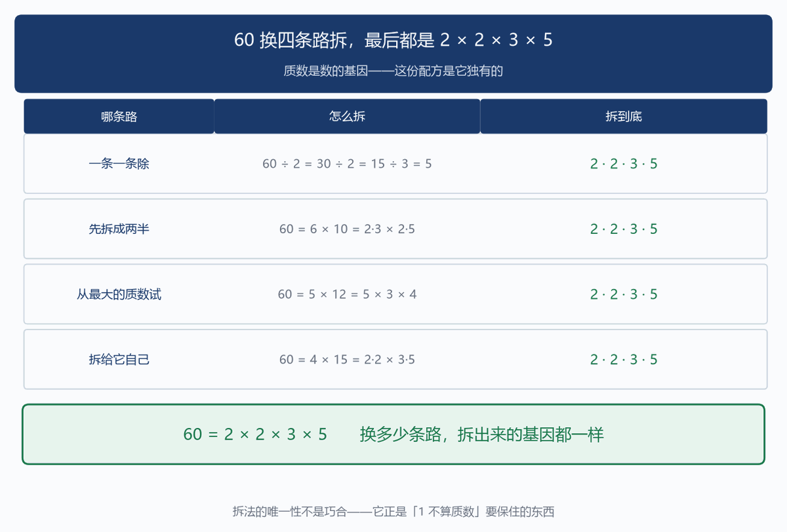

## 二、1 为什么被挡在门外

>> 现在可以回答导读里那个问题了。

**因为 1 一进质数表，"拆法只有一种"这句话当场就废了**。

```
1 算质数的话，6 可以写成：

    2 × 3
    1 × 2 × 3
    1 × 1 × 2 × 3
    1 × 1 × 1 × 2 × 3
    ……
```

加几个 1 都行，乘积一点不变。6 的拆法从一种变成了无穷多种。这不是抠字眼。1 是乘法里的单位元（第 2 讲讲过：任何数乘 1 都不变），它不携带任何信息。把它算进配方里，等于允许你在一份配方后面随便补 1——配方还是那个配方，可写法无穷多。基因说不清，后面一连串东西全跟着说不清。

**约分**：把 6/9 化成 2/3，靠的是约掉共同的质因数 3。什么叫"化成最简"？就是分子分母没有共同的质因数了。可 1 要是算质因数，那"没有共同的质因数"这件事永远做不到——它们总还共有一堆 1，你想约几个约几个。

**最大公因数**：6 和 9 的最大公因数是 3。可如果 1 是质数，1 也是公因数，而且想乘几个乘几个，"最大"就没了意义。

**通分**：找最小公倍数，同样会被 1 搅乱——公倍数可以有无穷多个"最小"的写法。所以"1 不是质数"不是谁随手定的规矩。是整套算术为了能运转，必须把 1 挡在质数外面。

**还有一件事，孩子不一定问，但家长多半会想**。回头看质数的定义：只有 1 和它本身两个因数。

1 有几个因数？**只有它自己，一个——连"两个因数"都凑不齐，严格按定义数，它本来就不够格**。那为什么不把定义改成"只有一个或两个因数"，好让 1 也算质数？因为改了之后，拆法唯一就没了。看清楚这里的顺序：不是先有定义、再看定义能推出什么；是先要那条定理（每个数拆成质数只有一种拆法），再回头把定义写成能让定理成立的样子。

"恰好两个因数"这个说法，是为了把 1 排除掉才这么定的。这在数学里是常态，而且这一系列已经见过三次：第 3 讲讲运算律时说过，交换律、结合律、分配律是"数"这个概念的承诺——一个东西要配叫数，就得兑现交换律、结合律、分配律这三条。**那是先想要"数能算"，再定下数必须满足什么**。

第 4 讲讲分数时说过，1/2 和 2/4 是同一个数，这是人挑的入口；挑完之后，加法则、判据、传递性全都不由人了。那是先想要"同一个量算同一个数"，再选一条能让定理成立的构造。

**第 5 讲讲方程时说过，等号是一张筛子，改造筛子必须保住筛住的数**。那是先想要"解不能变"，再定下每一步变形必须满足什么。

这一讲是第四次，而且是四次里最直接的一次：问一句"如果 1 算质数会怎样"，答案自己就出来了，不需要任何高深工具。

顺便说一件史实。

"**1 是不是质数"在历史上真的摇摆过**。二十世纪初，还有质数表把 1 列进去。后来定义收紧了。收紧的理由不是谁拍板说了算，就是因为唯一分解不成立：只要把 1 当质数，几乎所有定理都得加一句"除了 1 以外"或者"不计 1 的个数"，整个理论处处是补丁。一个定义好不好，看它能不能让定理干净。孩子现在不需要知道这段历史。但这段历史对孩子有用：他问"为什么 1 不是质数"的时候，撞上的是数学史上真发生过、真被解决过的一个问题。而且这个问题他自己就能想明白——你只要问他一句：

"如果 1 也算质数，6 有几种拆法？"

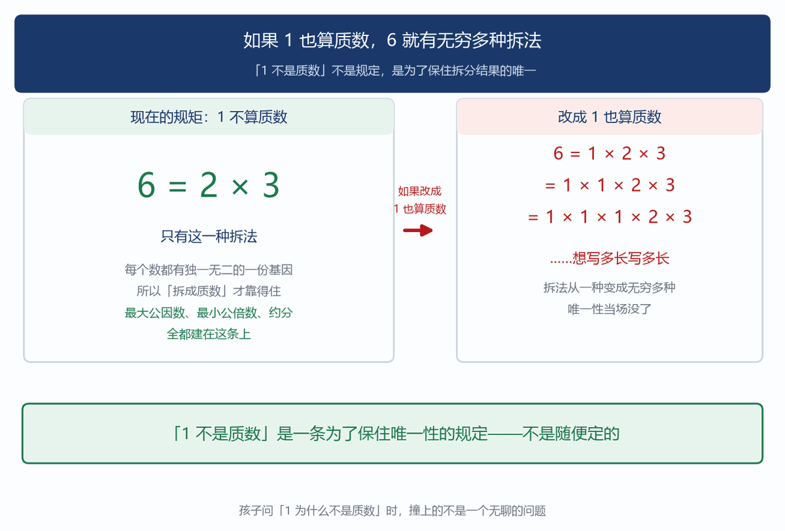

## 三、数第一次有了自己的名字

>> 打开一个数之后，第一件跟着变的事，是第 4 讲留下的一个问题有了答案。

第 4 讲讲过：一个分数有无穷多个名字。

```
1/2 = 2/4 = 3/6 = 4/8 = 5/10 = 50/100 = ……
```

那一讲还说了一句：每个分数类里挑一个最简的当代表。1/2 这一族的代表是 1/2。但那一讲没有回答两个问题：

**这个代表一定存在吗？它一定唯一吗**？如果没有质数，这两个问题答不上来。"最简"是什么意思？凭什么约到某个地步就约不动了？凭什么不会有第二个同样"最简"的写法？有了质数，两个问题一起解决。

"最简"的准确含义：分子和分母没有共同的质因数。

6/9 不是最简：6 = 2×3，9 = 3×3，共同有一个 3。把这个 3 约掉，得 2/3。

2/3 是最简：2 的基因是 {2}，3 的基因是 {3}，没有共同的。约分做的是把两份基因里重复的那部分去掉。去无可去的时候，就停了。用术语说，这时候分子分母**互质**——两个数没有共同的质因数，最大公因数是 1。

**代表一定存在吗**？存在。因为每约一次，分子分母都严格变小（约掉的至少是 2）。数越来越小又不可能小于 1，所以总有约不动的时候。这和第一章"拆数一定拆得完"是同一个道理。

**代表一定唯一吗**？唯一。假设 1/2 这一族里有两个都约到最简的写法，a/b 和 c/d，它们相等，而且都已经没有共同的质因数了。

```
a/b = c/d，按第 4 讲那条判据：a × d = b × c
```

看 a 这一边：a 整除 b × c。**可 a 和 b 没有共同的质因数（a/b 已最简），所以 a 的基因一个都不在 b 里，它们只能全部来自 c**。所以 a 整除 c。同样的道理反过来推：c 整除 a。两个数互相整除，它们只能相等。a = c，于是 b = d。**所以每个分数族里，最简的那个写法只有一个**。它是这个数自己的名字，不是随便挑的一个代表。

（这段推理用到"如果 a 整除 b×c 且 a 与 b 互质，则 a 整除 c"，它是欧几里得《几何原本》里的一条引理，小学不要求会证。孩子只需要知道结论：约到最简之后，两个分数相等不相等，一眼就能看出来，不用再交叉相乘。）

这件事的用处立刻显出来。比较 6/9 和 4/6 是不是同一个数：

```
6/9 → 约掉共同的 3 → 2/3
4/6 → 约掉共同的 2 → 2/3

两个都约到 2/3，所以是同一个数。
```

比较 1/2 和 3/5：

```
1/2 已最简
3/5 已最简

两个不一样，所以不是同一个数。
```

第 4 讲比两个分数大小时要用交叉相乘：6×6 = 36，9×4 = 36，相等。质数给了另一条路：各自回到自己的名字，然后比名字。两条路都对。但第二条路说明了一件更要紧的事：一个数有无穷多个名字，可它有一个名字是它自己的。**第 4 讲说"数是关系，不是标签"，说的是一族名字圈出来的那个东西**。这一讲补上另一半：这一族名字里，有一个是标准的，其余都是它的变形。

而找那一族名字里最标准的那个，孩子一直在做，只是没人告诉他做的是什么。他约分。他把 6/9 化成 2/3。老师告诉他"要化成最简分数"，他就化。他不知道的是：他每一次约分，都是在把一个数还原成它自己的名字。这个动作有个正式的名字，叫**标准形**——一族等价的写法里，那个唯一确定的代表。分数有分数的标准形（最简分数），多项式有多项式的标准形，矩阵有矩阵的标准形。数学里凡是"一个东西有很多种写法"的地方，都要找它的标准形。而分数的标准形为什么存在、为什么唯一，答案是质数。

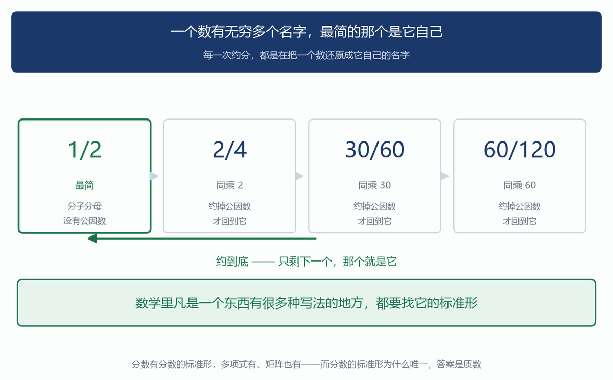

## 四、两个数放在一起看

>> 打开一个数，看见它的基因。把两个数放在一起，它们的关系也就看得见了。

第 4 讲讲约分通分时用了两个东西：把 6/9 化成 2/3，用了 6 和 9 的最大公因数 3；把 1/2 和 1/3 通分，用了 2 和 3 的最小公倍数 6。那一讲没说这两个东西从哪来。教材给的是列举、筛选这类办法；很多老师还会教一套短除法的竖式操作。孩子算得对，但多半说不清这套操作在干什么。把两个数拆成质数写在一起，答案就在眼前。

先看两个词。

**公因数**：几个数共同拥有的因数。12 的因数有 1、2、3、4、6、12；18 的因数有 1、2、3、6、9、18。共同的有 1、2、3、6，这四个叫公因数。其中最大的 6，叫**最大公因数**。

**公倍数**：几个数共同拥有的倍数。12 的倍数有 12、24、36、48……；18 的倍数有 18、36、54……。共同的有 36、72、108……，其中最小的 36，叫**最小公倍数**。现在把 12 和 18 的基因写出来：

```
12 = 2 × 2 × 3
18 = 2 × 3 × 3
```

最大公因数：只拿两边都有的。

```
12 的基因：2、2、3
18 的基因：2、3、3

两边都有的：一个 2，一个 3
（12 有两个 2，18 只有一个，所以只能拿一个——多拿一个，18 就装不下了）

拿过来乘：2 × 3 = 6   ←  最大公因数
```

**为什么必须是"两边都有的"**？因为一个数要能同时整除 12 和 18，它的基因必须**同时在两份配方里都找得到**。2 在两边都有，可以要；3 在两边都有，可以要；12 多出来的那个 2，18 里没有，要了它就除不尽 18。最小公倍数：两边的都要，重复的只算一份。

```
12 的基因：2、2、3
18 的基因：2、3、3

每个质数取出现次数多的那个：
  2 出现 2 次（12）和 1 次（18）→ 取 2 次
  3 出现 1 次（12）和 2 次（18）→ 取 2 次

2 × 2 × 3 × 3 = 36   ←  最小公倍数
```

**为什么这样才对**？一个数要能同时被 12 和 18 整除，它的基因必须**把两份配方都装得下**。12 要两个 2，那它至少得有两个 2；18 要两个 3，那它至少得有两个 3。凑齐就是 36，再少一个就装不下其中一方。最大公因数是取交，最小公倍数是取并。一个拿共有的，一个拿全部的。我们用程序穷举过：从 2 到 60 任取两个数（各自独立取，含两数相同的情形），一共 59 × 59 = 3481 组，"按基因取交"算出来的和最大公因数**一组不差**，"按基因取并"算出来的和最小公倍数也**一组不差**。

第 4 讲那两件事，到这里有了来处。

**约分 6/9**：6 和 9 的基因是 $2×3$ 和 $3×3$，共有的是 3。两边同时除掉这个共有的部分，得 2/3。

**通分 1/2 和 1/3**：分母 2 和 3 的基因没有重叠，取并就是把它们都拿上，得 6。所以公分母是 6。第 4 讲讲通分时，用的是"分母相乘"：4 × 8 = 32。**那是把所有基因都拿上、连重复的都算两遍**，所以 32 是公分母，但不是最小的（最小的是 8）。那个办法省事——不用先拆质数，直接乘就行；只是分母会偏大一点，后面算出来的数大一些。两种都对。

还能白得一条性质。

```
12 × 18 = 216
最大公因数 × 最小公倍数 = 6 × 36 = 216
```

两个数的乘积，等于它们的最大公因数乘最小公倍数。为什么？因为"取交"和"取并"合起来，正好把两份基因各数了一遍：共有的那部分被交了一次，全部的那部分被并了一次，加起来等于原来两份的总和。这条性质在小学是当结论背的。拆到基因层面看，它是一句话的事。穷举验过：2 到 60 全部 3481 组，这一条**一组不差**。

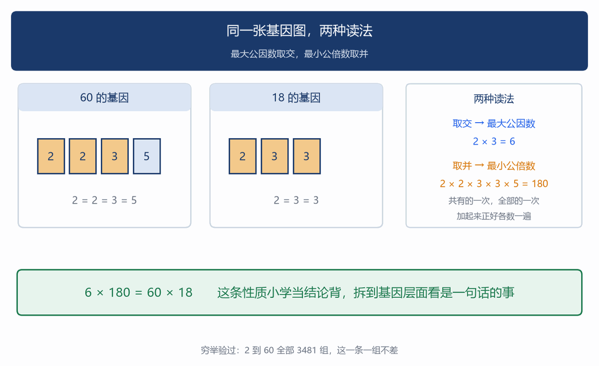

## 五、乘起来容易，拆开难

>> 现在回到导读里那道鸿沟。

乘法是一步。分解质因数可能要试遍所有可能。这个不对称，是这一讲最深的一件事，而且它在两个地方同时现身：一个在孩子五年级的作业本上，一个在你手机的支付密码里。

### 1. 先看作业本上的那一处

判断 91 是不是质数。

**要证明它不是质数，一步就够**：给出一个因子就行。91 = 7 × 13，一步完事。

**要证明它是质数，得把可能性全排掉**：2、3、5、7 都得试一遍，一个都不能漏（试到 $\sqrt{91} \approx 9.5$ 就够，下面说为什么）。

**对 91 来说，这个差别小得几乎看不出来——无非多试三个数**。它不是"难"和"容易"的差别，是"做一步"和"把可能性全排掉"的差别。**差别平时不显眼，可它跟着数长大：判 91 只试 4 个数，判一个一百位的数要试 $10^{50}$ 个**。这一章后面那道鸿沟，就是从这几个"多试几次"里长出来的。

"不是"只要一个例子，"是"要排除全部。两千三百年前，古希腊学者埃拉托色尼（约公元前 276—前 194 年）用的正是这个不对称。他的办法叫**埃拉托色尼筛**：

```
把 2 到 100 全写下来。留下 2，把 2 的倍数全划掉（4、6、8、10……）
留下 3，把 3 的倍数划掉（9、15、21……）
下一个没被划掉的是 5，留下 5，把 5 的倍数划掉（25、35、55……）
下一个是 7，把 7 的倍数划掉（49、77、91……）

划到 10 就停。剩下没被划掉的，全是质数。
```

他从头到尾没有证明过任何一个数是质数。**他只是把肯定不是质数的划掉，剩下的就是了**。四轮下来，100 个数里划掉 74 个（1 既不是质数也不是合数，单独算），剩下 25 个：

```
2、3、5、7、11、13、17、19、23、29、
31、37、41、43、47、
53、59、61、67、71、73、79、83、89、97
```

我们用程序验过：这样筛出来的，和逐个试除得到的结果**完全一致**（100 以内、1000 以内都验过）。

**为什么划到 10 就能停**？因为要找 100 以内的质数，一个合数必定有一个不超过 $\sqrt{100} = 10$ 的质因数。道理很短：一个合数总能写成两个因子相乘，a × b = n。这两个因子不可能都大于 $\sqrt{n}$——要是都大于 $\sqrt{n}$，乘起来就超过 n 了。所以至少有一个不超过 $\sqrt{n}$。而那个因子的质因数，也一定不超过 $\sqrt{n}$。所以只要把不超过 $\sqrt{n}$ 的质数的倍数划完，剩下的一定是质数。对 100 来说，$\sqrt{100} = 10$，10 以内的质数是 2、3、5、7，四轮就够。

这里要把两种"筛"分清。第 5 讲讲过一个筛子：$x + 5 = 12$ 是一张筛子，把所有数倒进去，只留下 7。这一讲也有个筛子：埃拉托色尼筛，把 2 到 100 倒进去，留下 25 个质数。名字一样，动作完全不同。

| | 第 5 讲的筛子 | 埃拉托色尼筛 |
|---|---|---|
| 筛什么 | 满足某个条件的数 | 数里的一类 |
| 条件从哪来 | 从方程来，题目给的 | 从"是不是质数"来，固定的 |
| 留下几个 | 通常一个 | 一批（25 个） |
| 动作 | 改造条件，让它越来越简单 | 排除掉肯定不是的 |

第 5 讲的筛子是**求解**：把条件收紧到只剩答案。埃拉托色尼的筛子是**分类**：把一类数选出来。它们共同的地方，只是"过滤"这个动作。

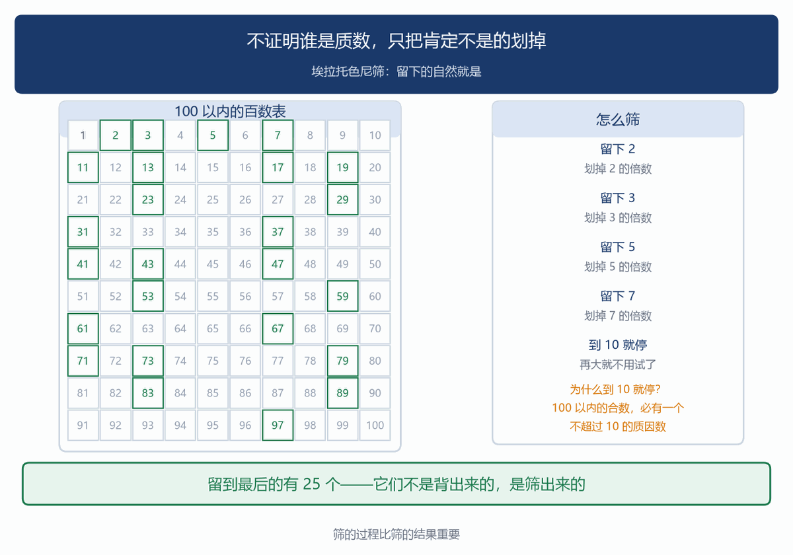

### 2. 再看密码里的那一处

现在说清导读里那道鸿沟。

**加密**：拿两个几百位的质数 p、q，乘出 n = p × q——一步乘法，一秒不到。把 n 公开出去。

**破解**：拿到 n，要拆回 p 和 q。为什么拆不回来？最笨的办法是从 2 一直试到 $\sqrt{n}$；换用目前已知最好的算法，也只是把次数压下来一些，离算得完还差着天文数字。

加密是一步乘法，破解是天文数字次的尝试。反直觉的是：就算知道 n 是两个质数乘出来的，也帮不了多少——知道答案的形式，不等于知道答案。今天所有的网络支付、加密通信、数字签名，安全性都建立在这道鸿沟上：**用今天所有的计算机，想破解也算不完**。（量子计算机理论上能填平这道鸿沟，可那台机器还没造出来，密码学界已经在换新锁了。）数的基因，成了锁。而锁的原理，就是孩子五年级做的那个动作：把一个数拆成质数相乘。只不过教材里拆的是 60，密码里拆的是 600 位的数。动作一模一样，规模差出宇宙。

### 3. 这个不对称还有一层

上面说的是"拆一个大数很难"。还有一层更要紧——它还是同一个动作，只是对象从一个数，换成了整张质数表。

把一个数拆开，看见的是它的配方。把质数摊在整张表上看，又能看见什么？

先看单个：质数在数轴上的位置，没有规律可循。看这张表：

```
2、3、5、7、11、13、17、19、23、29、
31、37、41、43、47…

间隔：1、2、2、4、2、4、2、4、
6、2、6、4、2、4…
```

忽大忽小。你看不出下一个质数在哪，只能一个一个试——到今天也没有一条实用的公式能直接算出"第 n 个质数是多少"。人类找了两千多年。

可是，换个问法：到 100 为止有多少个质数？到 1000 呢？

```
到 10     为止：4 个
到 100    为止：25 个
到 1000   为止：168 个
到 10000  为止：1229 个
到 100000 为止：9592 个
到 1000000 为止：78498 个
```

越往后越稀，这是能感觉到的。稀到什么程度，是有精确规律的。

1896 年，两位数学家（法国的阿达马、比利时的德拉瓦莱·普森）各自独立证明了一条定理：到 N 为止，质数的个数大约是 N ÷ ln N。

（ln 是自然对数，高中的内容。这里只需要知道它是个慢慢变大的数：ln 100 ≈ 4.6，ln 1000 ≈ 6.9，ln 100000 ≈ 11.5。）

拿真实数据对一下：

```
N = 1000：N ÷ lnN ≈ 145，实际 168 个
N = 10000：N ÷ lnN ≈ 1086，实际 1229 个
N = 100000：N ÷ lnN ≈ 8686，实际 9592 个
N = 1000000：N ÷ lnN ≈ 72382，实际 78498 个
```

N 越大越准。单个质数在哪，完全没法预测；可质数一共有多少个，能算得极准。局部毫无规律，整体有铁一样的规律。这两件事同时成立，是很反直觉的。这件事和掷骰子是同一类现象——单次不可预测，掷一万次每个点数出现的次数却几乎相等。

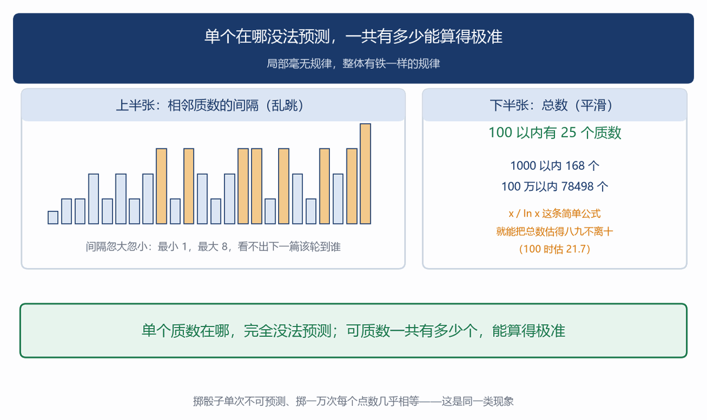

## 六、质数有多少个

>> 上一章说质数越往后越稀。那会不会稀到某个地方就没有了？

不会。质数有无穷多个。

（这一条超出小学课标，只作兴趣拓展。但道理非常短，孩子听得懂思路，可以讲一次。）

两千三百年前，欧几里得在《几何原本》第九卷里给出了一个证明。它出名不在技巧难，而在换了个问法：不去找一个一个的质数，而是证明"想把质数表列全"这件事永远做不到。

**听着抽象——落到纸上只有三步**：

```
第 1 步　先假设表已经列全了：2、3、5、7、11、13（就这六个）
第 2 步　用表里的数造一个新数：2×3×5×7×11×13 + 1 = 30031
第 3 步　看这个新数——它身上必定带着一个不在表里的质数
```

第 3 步一成立，前两步就塌了：表既然漏掉一个，就不算"列全"。**所以"列全"永远做不到，质数有无穷多个**。

**思路是这样**：假设质数只有有限个。那就把它们全列出来，一个不漏：

```
假设质数只有：2、3、5、7、11、13　（就这么六个，没有别的了）
```

把它们全乘起来，再加 1：

```
2 × 3 × 5 × 7 × 11 × 13 = 30030
30030 + 1 = 30031
```

问：30031 能不能被那六个质数中的任何一个整除？

```
30031 ÷ 2  = 15015 余 1
30031 ÷ 3  = 10010 余 1
30031 ÷ 5  = 6006  余 1
30031 ÷ 7  = 4290  余 1
30031 ÷ 11 = 2730  余 1
30031 ÷ 13 = 2310  余 1
```

六行都余 1。为什么？30030 是这六个数的乘积，六个都能整除它；加 1 之后，每个都差着这一点点，除不动了。

**所以那六个质数，一个也除不尽 30031**。

接下来只问一句：30031 身上带着的质因数，会在哪儿？它不可能在表里——表里那六个都除不尽它。所以它只能在表外。

**这一步就是全部的关键**。表外冒出一个质数，可这张表刚说好是"全的"。前后对不上，假设就塌了。

所以质数不可能只有有限个。

这里有个细节，很多书讲错了。

30031 **本身不是质数**：

```
30031 = 59 × 509
```

59 和 509 都是质数，而且都不在原来那六个里面。所以证明的准确说法不是"这个新数是质数"，而是——这个新数必定有一个不在表里的质因数。它自己是不是质数无所谓，它只要带着一个表外质数就够了。前几次运气好，新数恰好是质数：

```
2×3 + 1 = 7　　　　　是质数
2×3×5 + 1 = 31　　　 是质数
2×3×5×7 + 1 = 211　　是质数
2×3×5×7×11 + 1 = 2311　是质数
```

到第六个就露馅了：30031 = 59 × 509。**但证明一点不受影响**，因为要的并不是"新数是质数"。

（这个证明用的是**反证法**：先假设结论不成立，推出矛盾，从而说明假设错了。反证法是初中的正式内容，小学不要求会写。孩子听懂思路就够——这个思路有意思：不去找一个一个的质数，而是把"列表"这件事本身证倒。）

还有一件事，孩子会觉得意外：连续不是质数的数，可以任意长。质数越往后越稀，稀到什么程度？稀到你想多长的一段"没有质数"，就有多长。

```
8! = 40320

40320 + 2 = 40322 = 2 × 20161      能被 2 整除
40320 + 3 = 40323 = 3 × 13441      能被 3 整除
40320 + 4 = 40324 = 2 × 2 × 17 × 593　能被 4 整除
40320 + 5 = 40325 = 5 × 5 × 1613   能被 5 整除
……
40320 + 9 = 40329                  能被 9 整除
```

从 40322 到 40329，连着 8 个数，全是合数。道理很简单：8! 是 1 到 8 全部数的乘积，所以它能被 2、3、4……8 每一个整除。那么 8! + 2 能被 2 整除，8! + 3 能被 3 整除，一直加到 8! + 9 能被 9 整除（8! 里有 3 和 6 这两个因子，相乘得 18，所以 8! 本身能被 9 整除；8!+9 = 40329 = 9 × 4481）。想要连续 100 个合数？用 101! 就行。想要一百万个？用 (1000001)! 。质数有无穷多个，可它们之间的空洞也可以任意大。这两件事同时成立，正是上一章那句"局部乱、整体有律"的另一面。

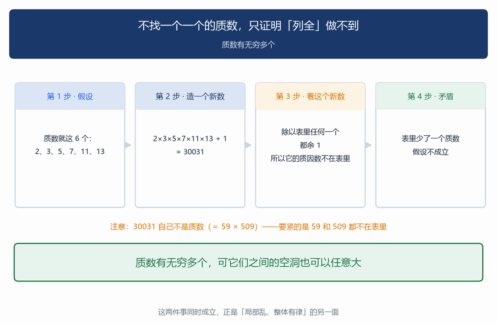

## 七、四道错题，都在没打开数

>> 质数这一单元，孩子的错误高度集中。四道最典型的，病根是同一个。

### 错题一：把质数和奇数当成一回事

```
判断：9 是质数吗？孩子的答案：是。因为它不是 2 的倍数，是奇数。
```

9 = 3 × 3，是合数。孩子把"不能被 2 整除"当成了质数的判据。这两件事确实很像——除了 2，所有质数都是奇数。但反过来不成立：奇数不一定是质数。

```
质数：2、3、5、7、11、13、17、19、23…
奇数：1、3、5、7、9、11、13、15、
17、19、21、23、25…

9  = 3×3     合数
15 = 3×5     合数
21 = 3×7     合数
25 = 5×5     合数
27 = 3×3×3   合数
33 = 3×11    合数
```

判据只有一个：除 1 和自己以外，还有没有别的因数。跟奇偶无关。两个极端要留意：**2 是唯一的偶质数**（其他偶数都能被 2 整除）；**1 既不是质数也不是合数**（第二章讲过为什么）。

**病根**：孩子记的是特征（质数大多是奇数），不是定义（只有两个因数）。特征能帮你猜，定义才能帮你判。

### 错题二：没拆到底

```
把 60 分解质因数：孩子写：60 = 4 × 15
```

4 × 15 确实等于 60，但**4 和 15 都不是质数**，还能再拆：

```
60 = 4 × 15 = (2×2) × (3×5) = 2 × 2 × 3 × 5
```

"分解质因数"这四个字里，"**质"是硬性要求**：拆出来的每一个因子都必须是质数。停在 4×15 只算拆了一半。还有个变体是拆过头：

```
孩子写：60 = 2 × 2 × 3 × 5 × 1
```

多写了个 1。1 不是质数，也不该出现在分解式里——**它是乘法里的单位元**，写它等于什么都没写。这正是第二章说过的：1 进来，写法就不唯一了。

### 错题三：公因数漏找

```
求 12 和 18 的最大公因数。
```

**错误一：列举不全**。12 的因数只列了 1、2、12，漏了 3、4、6，于是找出的公因数只有 1、2，答成 2。列举法的问题就在这里：它靠细心，而细心是不可靠的。

**错误二：短除法乘错**。一路除下来，最后把所有除数**和商**全乘在一起，答成 12 × 18 = 216 之类。短除法的问题也在这里：它是一套操作，孩子照着做能得对答案，但不知道为什么这么做，一旦记错乘哪几个就全错。用基因看，两个错误都不会犯：

```
12 = 2 × 2 × 3
18 = 2 × 3 × 3

共有的：一个 2、一个 3   →  2 × 3 = 6
```

拆出来之后，"拿两边都有的"这句话不需要记，看着就知道。

### 错题四：最小公倍数算成两数乘积

```
求 12 和 18 的最小公倍数。
孩子答：12 × 18 = 216
```

216 确实是公倍数，但**不是最小的**：

```
12 和 18 的公倍数：
36、72、108、144、180、216…

216 是第六个。最小的是 36。
```

**病根**：孩子以为"最小公倍数 = 两数相乘"。这句话只在两个数**互质**的时候成立——比如 4 和 9，最小公倍数是 36 = 4×9，因为它们没有共同的基因，取并就是全乘上。

12 和 18 有共同的 2 和 3，那部分不该算两遍。

（这也解释了第四章那条性质：最大公因数 × 最小公倍数 = 两数乘积，6 × 36 = 216。共有的部分被交了一次，全部的部分被并了一次，合起来正好是两份基因的总和。）

四道题，一个病根：孩子在操作，没在看基因。列举因数、短除法、背"最小公倍数怎么求"，这些都是操作。操作能算对，但一旦题目变形就乱。而"拆成质数、看共有和全部"是一个**看得见的图像**：两份配方摆在眼前，哪些是共同的、哪些是各自的，一目了然。操作会忘，图像不会。家长能做的最有用的，是让孩子养成一个习惯：碰到最大公因数和最小公倍数，先把两个数拆成质数写出来——取交还是取并，看就知道。

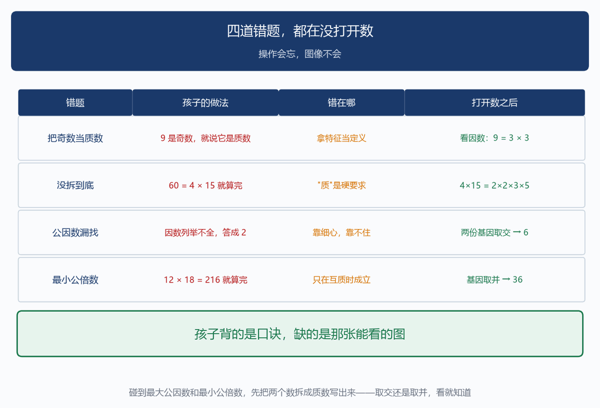

## 八、三次远征

>> 前面七章都在小学范围内。这一章走远一点，看三样东西。

这一章的内容，孩子一个都不需要会。它是给家长的——让家长知道，五年级那张质数表往后通向什么地方。

### 远征一："拆法只有一种"，不是天经地义的

第一章说，每个整数拆成质数只有一种拆法——这在整数里成立。换一批数，它会失效。有一批数长这样：$a + b\sqrt{-5}$，其中 a、b 是整数。比如 2、3、$1+\sqrt{-5}$、$1-\sqrt{-5}$ 都是。（$\sqrt{-5}$ 是"负数开平方"，超出小学甚至初中的范围。）

在这批数里，6 有两种拆法：

$$6 = 2 \times 3$$

$$6 = (1 + \sqrt{-5}) \times (1 - \sqrt{-5})$$

第二种为什么等于 6？

$$(1 + \sqrt{-5})(1 - \sqrt{-5}) = 1 - (\sqrt{-5})^2$$
$$= 1 - (-5) = 6$$

而 2、3、$1\pm\sqrt{-5}$ 这四个，在这批数里都拆不动了。怎么确认拆不动？用一个叫**范数**的量：$a + b\sqrt{-5}$ 的范数是 $a^2 + 5b^2$。

（范数是大学数学专业的课，泛函分析里最基础的概念之一；多数专业不学。这里只需要知道：它能把"还能不能再拆"变成一个能算出来的数。）

- $2$ 的范数 $= 4$
- $3$ 的范数 $= 9$
- $1+\sqrt{-5}$ 的范数 $= 6$
- $1-\sqrt{-5}$ 的范数 $= 6$
- $6$ 的范数 $= 36$

范数相乘：4 × 9 = 36，6 × 6 = 36，两种拆法对得上。而要拆开 2（范数 4），就得找到两个范数相乘等于 4 的数，也就是范数 2 的数。可 $a^2 + 5b^2 = 2$ 没有整数解（$b=0$ 时 $a^2=2$ 无解，$b=1$ 时 $a^2=-3$ 无解）。所以 2 拆不动。3、$1\pm\sqrt{-5}$ 同理。四个都拆不动，可 6 有两种拆法。可"拆法只有一种"，在这里失效了。十九世纪的数学家真被这个失效卡住了：他们想证明一些关于整数的定理，做法是先跑到更大的数系里去证，再回来。可一旦大数系里"拆法只有一种"不再成立，整套推理就靠不住了。代数数论这个分支，就是从"拆法只有一种"失效开始的。

补救的办法很有意思：既然数拆不唯一，就引入一种新对象（叫"理想"），让它恢复唯一分解。这是大学的内容，此处只需要知道一句话。

那句话是：**小学五年级那条"拆法只有一种"，是整数这个特定世界的性质；换个世界，它就不成立**。第 5 讲讲过：一个式子合不合法，不取决于式子本身，取决于它所在的系统允许什么。这里轮到"拆法只有一种"本身——连这么基本的东西，都是看系统的。

### 远征二：局部乱、整体有律，这次是被证明的

第五章那张表看到的是"整体有律"。这一章还是同一个动作——不盯单个，摊开来看整体——只是再往前推一层：这次要证明的，正是那个"整体有律"。

到 N 为止大约有多少个质数？那条估计（N ÷ lnN）是定理，不是猜想；它有个名字，叫素数定理。它做到了一件事：把"越往后越稀"从观察变成了定理——稀得多准，从此能算，误差多大都能估。

（得先说清 lnN——那条公式的道理全在它身上。对数这个工具，高中才正式学；这里只借它两条性质说一件事。）

对数数的不是"值"，是"量级"：lnN 说的是"N 到了第几档"。它有两件好用的性质。一是乘法变加法：ln(ab) = ln a + ln b（位数相加——10^a × 10^b = 10^(a+b)）。二是长得极慢：N 乘 10，lnN 只加 2.3；N 从 100 到 100 万，翻了一万倍，lnN 也只从 4.6 到 13.8。

**所以 N ÷ lnN 说的就是"密度"**：在 N 附近随便挑一个数，它是质数的机会约是 1/lnN。

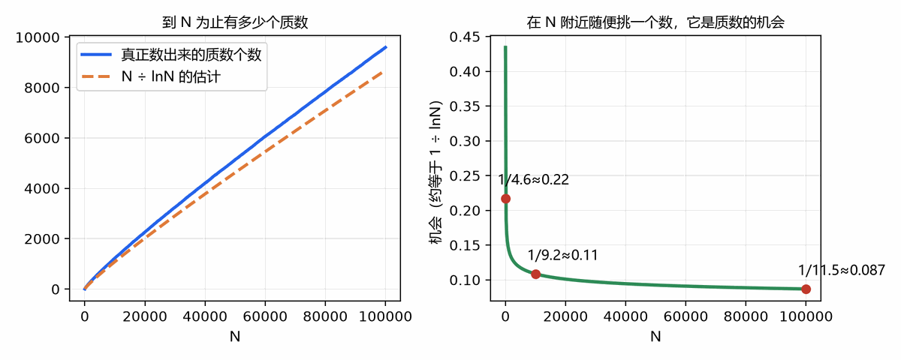

这个 1/lnN 从哪儿来？一个数要是质数，就得躲过所有比它小的质数：躲过 2 的机会是一半，再躲过 3 是三分之二，再躲过 5 是五分之四……每躲一个就打一次折；数越大要躲的越多，折扣乘下来只剩 1/lnN 这么多。（说的是量级，差一个固定倍数。）

猜出这条规律的人是高斯：十几岁那年，他靠查质数表猜出答案是 N ÷ lnN。猜容易，证极难——这一猜押了一百多年。

1896 年，两位数学家各自独立把它证了出来：法国的阿达马、比利时的德拉瓦莱·普森。（他们用的工具比课本上任何东西都深，这也是它等一百多年的原因。）

这条线往后还有很长。质数在数轴上忽疏忽密，看着像掷骰子——可"到 N 为止有多少个"，能算得极准。单次不可预测，整体有铁律。（孩子将来学统计，会碰到一模一样的结构：掷一次没法预测，掷一万次每个点数的次数几乎相等。）

### 远征三：再往前一步，是人类最深的未解之谜

素数定理说的是"大约有多少个"。"大约"这两个字里，有一个至今没人能解决的问题——误差到底能有多大。看真实数据：

```
N = 1000：估计 145，实际 168，差 23
N = 10000：估计 1086，实际 1229，差 143
N = 100000：估计 8686，实际 9592，差 906
```

差值在变大。**这个误差到底能有多大，有没有一个上界**？1859 年，德国数学家黎曼写了一篇很短的论文，讨论质数的分布。他在文章里提出了一个猜想，说的正是这个误差的边界。这个猜想至今没有被证明，也没有被推翻。它叫黎曼假设。

2000 年，美国克雷数学研究所把它列为七个"千禧年大奖难题"之一，悬赏一百万美元。一百六十多年过去，它仍是数学界公认最重要的未解问题之一。而这条线的起点，是五年级那张质数表。从"1 为什么不是质数"，到"拆法只有一种"，到"质数有无穷多个"，到"越往后越稀"，到"稀得有精确规律"，到"规律的误差有多大"——最后停在一个悬赏百万、无人能解的问题上。中间没有断点。每一步都是上一步的自然追问。

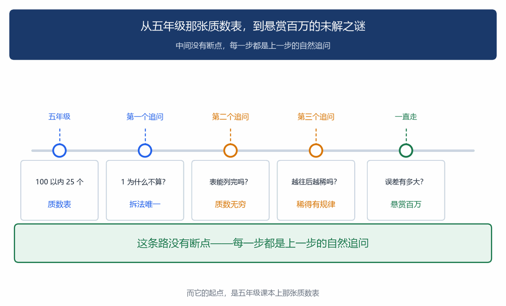

## 九、给家长的分寸

>> 先给一条反向提醒。

这一讲讲的都是"拆到基因层面看"，很容易让家长得出一个结论：早点教孩子分解质因数，最大公因数最小公倍数就不会错。那同样是错的。分解质因数、短除法，人教版五年级下册才正式出现，而且教材的教法是**以列举法为主**，分解质因数法属于拓展。孩子在没建立"因数"概念之前学拆质数，只会多背一套操作。

| 阶段 | 孩子该到什么程度 | 家长别做什么 |
|---|---|---|
| 三、四年级 | 知道"几乘几得几十"，能说出 12 = 3×4 = 2×6；认识因数就是"能整除它的数" | 别提"质数""分解质因数"这些词 |
| 五年级下 | 认识质数合数，能判断一个数是不是质数；会找公因数、最大公因数、公倍数、最小公倍数 | 别只教短除法口诀，先让他把两个数拆成质数写出来 |
| 六年级 | 约分通分熟练，能说出"最简分数就是分子分母没有共同的质因数" | 别把"唯一分解定理"这个名字甩给他 |
| 小升初衔接 | 知道质数有无穷多个（听个思路就行）；知道 1 为什么不是质数 | 别讲负数开平方、别讲对数，那是远征章给家长看的 |

表中年级划分对应《义务教育数学课程标准（2022 年版）》三个学段的大致安排。因数与倍数、质数合数是人教版五年级下册第二单元；最大公因数在第四单元"约分"里教，最小公倍数在"通分"里教。各地教材进度略有差异，请以孩子实际使用的教材为准。

**三个最有用的做法**：

一、孩子问"为什么 1 不是质数"，别回答"这是规定"。这是他主动撞上来的一个真问题，也是全系列里"定义被定理挑出来"最清楚的一例。花三分钟讲：

1 要是质数，6 就能写成 2×3、1×2×3、1×1×2×3……拆法不再唯一。约分、通分、最大公因数都靠"拆法唯一"，所以 1 必须挡在外面。讲完问他一句："那你说，是定义重要，还是那个'拆法唯一'重要？"

他要是答"拆法唯一重要，定义是为了它"，这一讲的核心他就拿到了。

二、碰到最大公因数和最小公倍数，先让他拆基因，别急着套短除法。

```
24 = 2 × 2 × 2 × 3
36 = 2 × 2 × 3 × 3

最大公因数：拿两边都有的 → 2×2×3 = 12
最小公倍数：两边的都要，重复算一份
→ 2×2×2×3×3 = 72

验算：12 × 72 = 864 = 24 × 36　对上了
```

拆出来之后，取交还是取并**看就知道**，不需要记口诀。而且最后那一步验算，孩子能自己做，不用等老师批改。短除法可以之后再介绍，作为"写得快一点的方法"。但顺序不能反：先有图像，再有操作。这和第 5 讲讲的一样——先看见事实，再给名字，最后才是符号。

三、把"质数表"当成一张地图，不是一份背诵任务。

100 以内 25 个质数，教材让孩子记住。背下来当然好，但更有用的是让他自己在百数表上筛一遍：留下 2，划掉 2 的倍数；留下 3，划掉 3 的倍数……

这个动作做一遍，他就明白质数是**筛出来的**，不用背。而且他会自己发现"划到 10 就能停"这件事——问他为什么，他能说出个大概（因为 100 以内的合数必有一个不超过 10 的质因数）。筛的过程比筛的结果重要。

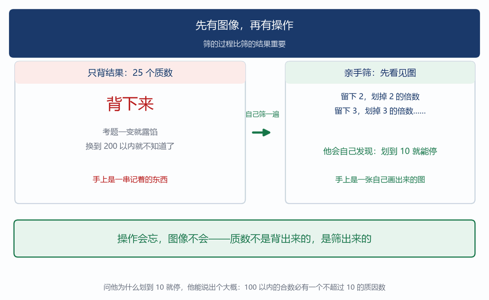

## 十、结语：第一次打开一个数

>> 这一讲做的事，用一句话说：把数拆开了看。

前面五讲，数一直是黑箱。没有一讲打开过数本身。这一讲打开了。打开之后看见：每个数都有自己的配方，配方由质数写成，而且**每个数的配方是独一无二的**。

而配方唯一最出人意料的地方，是它反过来改写了"定义"。

**1 不算质数，不是因为谁规定了，而是它一进质数表，配方就不唯一了。定义被定理牵着走**。这在数学里是常态，而在小学阶段，这是孩子第一次能亲手摸到它——不需要任何高深工具，只要问一句"如果 1 算质数会怎样"，答案自己就出来了。第 3 讲讲运算律是数的承诺，第 4 讲讲判据是人挑的入口，第 5 讲讲等号可以是筛子，这一讲讲定义是为了让定理成立而写的。

**四件事说的是同一件：数学里那些看起来像规定的东西，绝大多数是被别的东西逼出来的**。打开一个数，数就有了自己的名字，两个数之间的关系就变得看得见，"乘起来容易、拆开难"第一次出现。这三样都来自同一个动作：拆开看。

而这个动作埋下一个问题，第 2 讲说过的那个悖论——把算交给规则，换来"不用懂也能算对"——在这里又出现了一次。孩子会用短除法求最大公因数，卷面全对。可他不知道自己在干什么。短除法是一套操作，操作可以背、可以练熟、可以在考试里拿满分。

**而"取交取并"是一个图像——图像不能背，只能看懂**。会操作不会图像的孩子，小学阶段没问题——小学题目有限，操作够用。到了初中，因式分解、分式化简、二次方程，全都要在"拆开看结构"这件事上做文章。那时候只会操作的孩子会突然卡住。这和第 5 讲那道分水岭是同一条：认题型，还是认关系。只不过这一次，"关系"有了具体的样子：两个数共有哪些基因。

质数这条路还很长。它往后会通到加密——今天所有的网络支付、加密通信、数字签名，安全性都建立在"大数拆成质数极难"这件事上。它也会通到那些还没解决的问题：

- 有没有无穷多对相差 2 的质数（3 和 5、11 和 13、17 和 19、29 和 31 这样的）？1000 以内这样的对有 35 组，可有没有无穷多组，没人知道。
- 每个大于 2 的偶数是不是都能写成两个质数之和？我们验到两万，一个反例都没有，可这不叫证明。

这些问题问出来一句话就能懂，答案至今没有。而它们的起点，都是五年级那张 25 个数的质数表。孩子往后学因式分解、学分式、学二次方程，做的都是这一讲练过的同一个动作，只是对象从数换成了式子。**动作练过了，换对象他认得出来**。

---

**参考文献**

- 欧几里得《几何原本》第七、九卷——整除理论与质数无穷多个的证明（第九卷命题 20）
- Caldwell, C. K. & Xiong, Y. (2012). *What is the Smallest Prime?* — "1 是否为质数"的历史考证，指出"1 曾经是质数"这一通俗说法过于简化
- Hadamard, J. & de la Vallée Poussin, C.-J. (1896) — 素数定理的独立证明
- Riemann, B. (1859). *Über die Anzahl der Primzahlen unter einer gegebenen Größe* — 黎曼假设的出处，九页论文
- Clay Mathematics Institute, *Millennium Prize Problems* (2000) — 黎曼假设悬赏一百万美元
- 《义务教育数学课程标准（2022 年版）》第二学段"数与运算"——因数倍数、质数合数、最大公因数最小公倍数
- 人教版五年级下册第二单元《因数与倍数》、第四单元《分数的意义和性质》（约分、通分）教师教学用书

---

**互动**：你家孩子问过"为什么 1 不是质数"吗？你当时怎么答的？如果还没问过，可以今晚就问一句——这个问题的答案，比质数表本身值钱得多。

需要这一讲的练习卡吗？
1. 分解质因数 2 题（一直拆到全是质数为止）
2. 质数判定 3 题（先想清楚「试除到几就够了」）
3. 最大公因数与最小公倍数 4 题（公共部分与全部部分）
4. 判断与找错 3 题（含「1 是不是质数」这一道）

后台回复 **质数卡**领取打印版。
