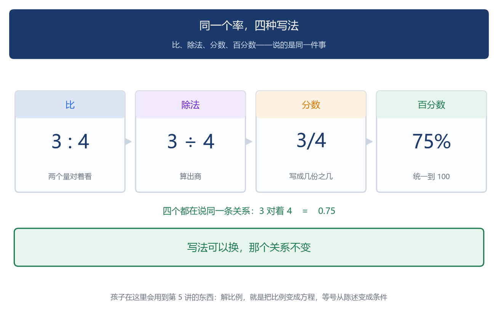
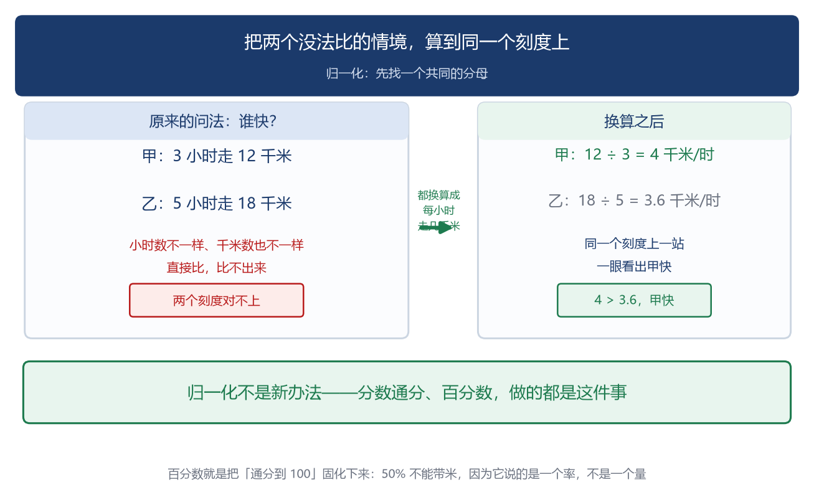
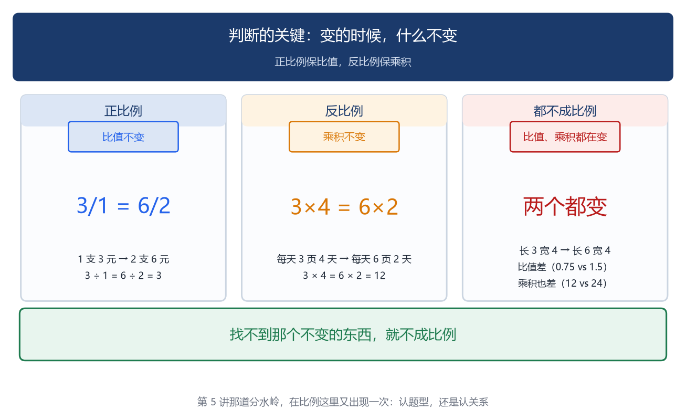
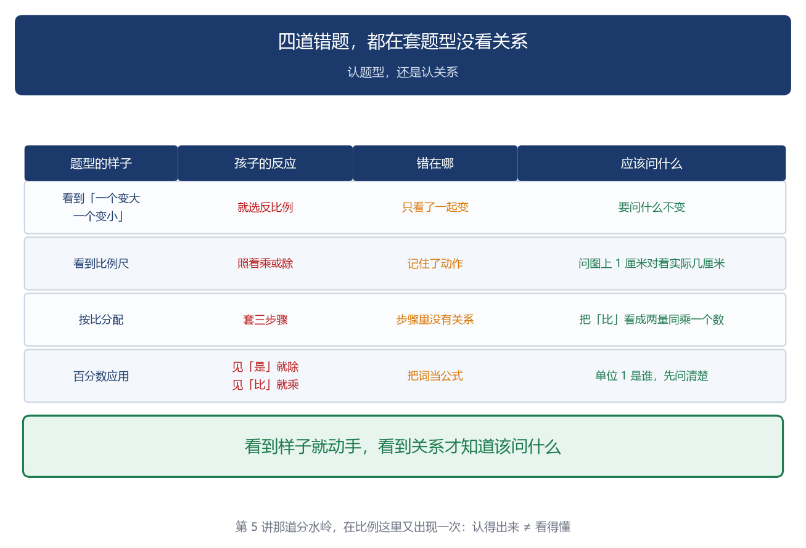
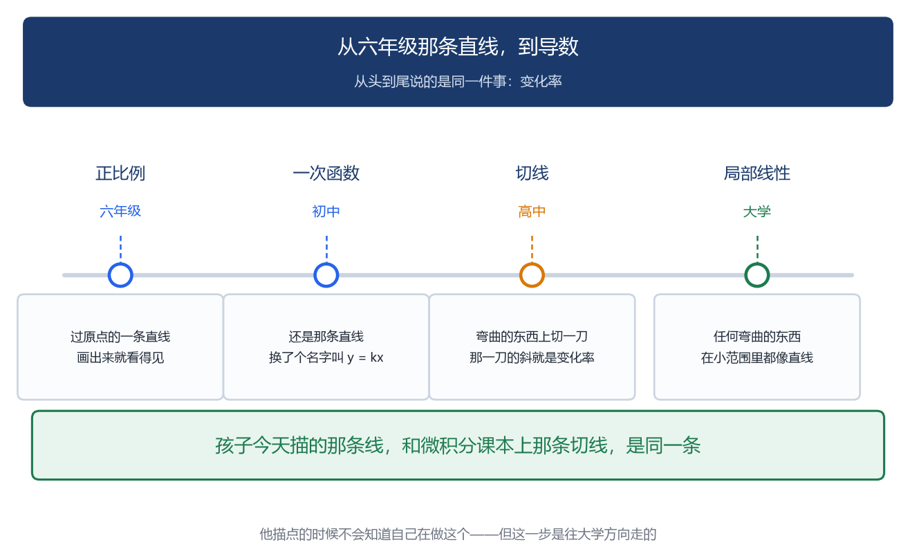
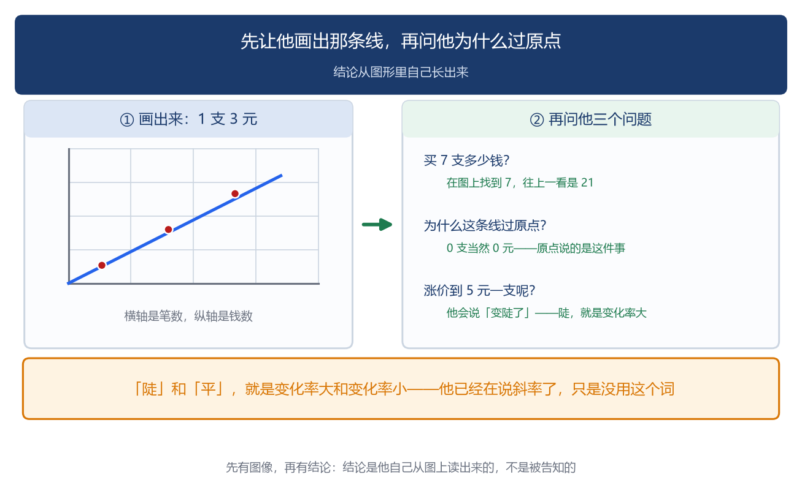

# 比例：一起变化的两个量

「数学成神之路」小学数学 · 第 7 讲

原创 · 程大大的小记

### 导读

两杯蜂蜜水摆在面前：一杯是一勺蜂蜜兑两勺水，一杯是两勺蜂蜜兑一勺水。不尝一口，怎么说得清哪杯甜、为什么甜？

再比如跳绳：一个孩子跳了 1 分钟，一个孩子跳了 3 分钟，怎么比谁跳得快？

这两件事里，装的是同一样东西——**两个量之间的关系**：哪杯甜，看的是蜜和水几比几；谁跳得快，看的是每分钟跳多少下。

可这两个场景里，藏着同一个问题：**两个量一起变的时候，什么没变**？

这一讲就问这一件事。

有一件事，从买笔开始就摆在孩子面前：买 1 支笔 3 元，买 2 支 6 元，买 3 支 9 元。总价跟着数量走——数量定了，总价就定了。

换一件事，方向就反了：走 60 千米，速度 1 就要 60 小时，速度 2 只要 30 小时。速度上去了，时间就下来。

两件事摆在一起，问题就出来了：**它们都是"一个量牵着另一个量走"，可一个同向、一个反向。这两种"一起变"，有没有共同点**？

有。它们各自都有一个**不变的东西**：

```
总价 ÷ 数量 = 3（单价不变）
速度 × 时间 = 60（路程不变）
```

**这一讲要找的，就是那个不变的东西**。找到了，正比例、反比例、比、百分数、比例尺，全在它手底下。

小学把这两种叫正比例和反比例，初中会改口叫函数，高中给它起了名字，叫斜率和导数。六年级那条过原点的直线，和高中课本里那个 f′(x)，中间没有断点。

先说一件跟孩子利害直接相关的事。正比例和反比例，是小学阶段孩子最容易"会做题但不懂"的一块。**判断题型很固定**："单价一定，总价和数量成什么比例？"孩子背下来了——单价一定，成正比例。卷子全对。到了初中第一次上函数课，老师写 $y = kx$，说"y 是 x 的函数"。孩子懵了。懵的原因是：小学教他的是一种题型，初中要的是一种关系。**题型是"看到'单价一定'就选'正比例'"**。关系是"x 定了，y 就被定死了，一个 x 只对应一个 y"。题型靠认，关系靠懂。

第 5 讲讲过那道分水岭：认题型，还是认关系。这一讲又一次撞上这道坎，而且比方程那次更深。

方程里，孩子要找的还是一个固定的数（x = 7）。比例里，**没有任何一个数是答案**。y = 3x 里，x 不是答案，y 不是答案。这一讲要找的是那个 3。孩子第一次要研究的对象，是"两个数怎么一起变"。这是小学六年里，研究对象第一次从"数"变成"变化"。

**这一讲要讲的六件事**：

1. **同一个率有四种写法**：3:4、3÷4、3/4、75%。比、除法、分数、百分数，是一件事的四个样子。
2. 归一化让不可比的东西变得可比。一个跳 1 分钟、一个跳 3 分钟，谁快？直接比没法比，化成"每分钟跳多少下"就比出来了。百分数就是归一化到"每一百份"。
3. 协变（数学教育研究里的说法：两个量一起变）：一个由另一个决定。前六讲的对象都是静态的，这一讲第一次有东西动起来。
4. **图像是把两个量的关系画出来：正比例画出来是一条直线，反比例不是**。正比例过原点，是因为数量取 0 时，乘出来的值只能是 0。
5. 比的基本性质就是第 4 讲那条判据：a:b = c:d 当且仅当 a×d = b×c。
6. **正比例是「变化率不变」里最简单的那种关系**（图像过原点、y 正比于 x），所以它成了所有关系的直线近似。微积分干的事，就是在足够小的范围里把弯的当成直的。

>> 如果只读一章，读第四章。

## 一、比是什么

>> 先把词定下来。

**比**：两个数相除，又叫这两个数的比。3 ÷ 4 可以写成 3:4，读作"3 比 4"。比号前面的数叫**前项**，后面的叫**后项**，前项除以后项所得的商叫**比值**。

```
3 : 4 = 3/4
↑   ↑    ↑
前项 后项 比值
```

后项不能为 0。因为后项就是除数，第 4 讲讲过：除以 0 根本构不成一个运算。

拿导读里那两杯蜂蜜水看：一杯的蜜和水是 1 : 2，另一杯是 2 : 1。前一杯的**比值**是 1/2，后一杯是 2/1 = 2。**甜不甜，看的是这个比值**——比值大的那杯蜜多水少，自然更甜。

同一个率，有四种写法。

```
3 : 4　　　比
3 ÷ 4　　　除法
3/4　　　　分数
0.75 = 75%　小数、百分数
```

四个写法，一个东西。它们说的都是"3 对 4 这个关系"。这四个写法，教材是分开教的：分数从三年级就开始认识，比要到六年级上册第四单元，百分数在六年级上册第六单元。分数和比隔了三年；比和百分数在同一册，却是两个单元、两套题。孩子很容易以为是几件事。它们是一件事。区别只在用处：

- 说"男生和女生的比是 3:4"，用比，强调的是两个量之间的关系
- 说"男生占全班的 3/7"，用分数，强调的是一个量占整体的多少
- 说"命中率 75%"，用百分数，强调的是跟别的场合比

比的基本性质：前项和后项同时乘或除以同一个数（0 除外），比值不变。

```
3 : 4  =  6 : 8  =  9 : 12  =  30 : 40
```

为什么？因为比值就是前项除以后项——**被除数和除数同乘一个数，商不变**。

这条性质孩子见过两次。一次在四年级：教材里"商不变"那条规律讲的就是它。一次在第 4 讲：讲分数的基本性质时用的是同一个道理——分子分母同乘或同除一个不为零的数，分数的大小不变；而分数本来就是"分子 ÷ 分母"。比的基本性质，说的是同一件事的第三种样子。

**化简比**，就是把比写成前项后项互质的形式：

```
6 : 8　　同除以 2　→　3 : 4
12 : 18　同除以 6　→　2 : 3
15 : 25　同除以 5　→　3 : 5
```

同除的那个数，是前项后项的最大公因数。第 6 讲讲过，最大公因数就是两份基因里共有的那部分。

这里有一件事要点破。第 4 讲讲分数时说过一条判据：

(a, b) 和 (c, d) 是同一个数，当且仅当 a × d = b × c

比例的基本性质是这么说的：

a : b = c : d，当且仅当 a × d = b × c。

写成 a : b = c : d 这种形式，四个数分两组：两头的 a 和 d 叫**外项**，中间的 b 和 c 叫**内项**。记不住就往位置上找——**离等号最近的两个是内项，最前和最后的两个是外项**（教材的说法是"中间两项、两端两项"，一回事）。判据就是一句：外项相乘 ＝ 内项相乘。

第 4 讲那条判据和比例的基本性质，是同一句话：第 4 讲用它判断"两个分数是不是同一个数"，这一讲用它判断"两个比能不能组成比例"。工具没变，用途变了。所以 3:4 和 6:8 能组成比例，因为 3 × 8 = 4 × 6 = 24。

**解比例**也是这一条：

```
x : 4 = 9 : 12

x × 12 = 4 × 9      ← 两外项之积 = 两内项之积
12x = 36
x = 3

验算：3 : 4 的比值是 3/4，9 : 12 的比值也是 3/4　对上了
```

孩子在这里会用到第 5 讲的东西：解比例就是把比例变成方程。等号从"陈述"变成"条件"，然后筛出 x。

（顺带分清一件事：比和分数是同一个数的两种写法，可这一讲要研究的不是那个数，是**两个量怎么一起变**——量各自在动，比值动不动。）

系列最前面那篇启蒙篇里说过一句话：**数是关系，不是标签**；第 4 讲讲分数时把它兑现了一次——分数是一族名字圈出来的那个关系。到这一讲，关系第一次**动了起来**：不再是"两个东西之间是什么关系"，而是"这两个东西的关系，自己会怎么变"。往后的层级还会更高——初中讲函数，研究的是关系之间的关系；再往后讲变化率，研究的是关系怎么变。这条路是从这里迈出去的。



## 二、归一化：让不可比的东西变得可比

>> 这一章讲一个动作。它是比例真正的威力所在，也是百分数存在的全部理由。

先看两道没法直接比的题。第一道：

```
小明 1 分钟跳了 120 下
小红 3 分钟跳了 270 下
谁跳得快？
```

120 和 270 能比吗？不能。270 多，可小红多跳了两分钟。1 和 3 能比吗？也不能，跳的时间短的不一定快。这两个比，一个是 120:1，一个是 270:3，分母不一样，直接看不出高低。怎么办？把它们算到同一个基准上，**都算成"每 1 分钟跳多少下"**：

```
小明：120 ÷ 1 = 120　　每分钟 120 下
小红：270 ÷ 3 = 90　　 每分钟 90 下

小明快。
```

第二道，我们把基准换个数字——不必是"1"：

```
A 商品 300 克卖 6 元
B 商品 500 克卖 15 元
都算成"每 100 克多少钱"：

A：6 ÷ 300 × 100 = 2　元/100克
B：15 ÷ 500 × 100 = 3　元/100克

A 划算。
```

这个动作有个名字，叫归一化。

"归一"就是回到"一份"：每 1 分钟、每 1 个人、每 100 克、每 100 份。归一化的作用是：**把两个本来没法比的情境算到同一个基准上，于是能比了**。

小明和小红，跳的时间和下数都不一样，直接比没有意义。可"每分钟跳多少下"是同一个基准，一比就出来了。归一化这件事，孩子在三年级就做过，教材叫"归一问题"：

```
买 3 支笔要 12 元，买 7 支要多少钱？先求 1 支：12 ÷ 3 = 4 元
再求 7 支：4 × 7 = 28 元
```

那个"先求 1 支"，就是归一化。孩子做了三年，做的一直是这件事，只是不知道它有个名字。

百分数就是归一化到"每一百份"。

```
3/4　　= 75/100　= 75%
1/2　　= 50/100　= 50%
2/5　　= 40/100　= 40%
7/20　 = 35/100　= 35%
```

**百分数不是一个新东西，它就是分数，只不过分母统一成 100**。为什么要统一成 100？因为归一化需要一个大家都用的基准。你用"每 1 份"，我用"每 10 份"，他用"每 100 份"，还是没法比。全世界约定用 100，于是所有率都能直接比了。

```
甲队命中率 18/25
乙队命中率 42/60

直接比看不出来。化成百分数：甲 18÷25 = 72%
乙 42÷60 = 70%

甲高。
```

18/25 和 42/60，这两个分数要比较得通分，公分母是 300，算起来麻烦。化成百分数，一眼就看完。**百分数的全部价值在这里：它让不同场合的率可以直接比较**。手机电量、命中率、增长率、合格率、含棉量，这些东西来自完全不同的场景，分母五花八门，可一旦都写成百分数，就能放在一起排高低。

百分数不能带单位。第 4 讲有一道错题是"50% 米"。为什么不成话？**因为百分数说的是"占一半"，是一个率，不是一段长度**。率描述的是两个量之间的关系，关系没有单位。

```
50% 米　　✗　不成话
0.5 米　　✓　这是一个具体的长度
50%　　　 ✓　这是一个率，得说清是谁的 50%
```

这也是第 4 讲那个区分的延续：具体的量能带单位，分率不能。



### 百分数：把「通分」这件事固化下来

先看一个麻烦。甲班男生和女生的比是 3 : 4，乙班是 5 : 7。哪个班男生占比高？

3 : 4 说的是男生占全班的 3/7，5 : 7 说的是男生占全班的 5/12。分母一个是 7、一个是 12，**直接比不了**。要比就得先通分。3/7 = 36/84，5/12 = 35/84，所以甲班略高。通分孩子从第 4 讲就会了。可每遇到一次比较就得通分一次，分母还越通越大，84 已经比 7 和 12 都大了。麻烦。于是人类做了一个约定：别每次都临时通分，统一通到 100。百分数就是这么定下来的。

```
3 : 4　　男生占 3/7　　→　42.9%
5 : 7　　男生占 5/12　 →　41.7%
```

**为什么是 100，不是别的数**？因为我们的数系是十进制的。第 1 讲讲位值制时说过，人类一共就十个符号，满十进一。100 是两个十相乘，是十进制里最整齐的那个分母。换成 60 也行，时间就是六十进制，但那样换算出来的数不好看。100 是十进制里最顺手的那个。所以百分数不是一种新数。它就是分数，只是**分母被固定成了 100**。75% 就是 75/100，就是 3/4，就是 0.75。第 4 讲讲过的「一个数有很多名字」，到这里又多了一个名字。

```
3/4　　分数的写法　　三份、四份
0.75　 小数的写法　　位值制的写法
75%　　百分数的写法　每一百份里的 75 份
```

三种写法，一个数。说说小数那一栏。数位是往左边长的：个位、十位、百位——往右边也能长：0.75 里的 7 在十分位，5 在百分位。小数点右边，就是位值制往小的一头接着长——每往一位，小十倍。正因为小数和百分数用的是同一套十进制，它们之间换算才只要移动小数点。

```
0.75　→　75%　　　小数点右移两位
75% 　→　0.75　　 小数点左移两位
```

最后说清楚百分数和分数的分工。它们是同一个数的两种名字，但用场不同：分数适合说「一块饼的几分之几」，**落在一个量上**；百分数适合说「两个场合的率谁高谁低」，**落在一个关系上**。

```
这块饼吃了 3/4　✓　说得出是多大一块
甲班男生占 42.9%　✓　比两个班时百分数才顺
甲班男生占 3/7　✓　换个班就不好比了
```


（人教版六年级上册第六单元《百分数（一）》讲的就是这块，教材（第 80 页）从「格式化进度 14%」「面料含毛 65.5%」「汽车销量增长 120%」这类生活场景进入，先讲意义与读写，再讲与分数、小数的互化。这一章不重复教材的操作，只补一件教材没说透的事：百分数是一次「通分固化」，是人类为了比较方便统一出来的刻度。）

## 三、第一次有东西动起来

>> 前面两章讲的都是静态的：比是什么、怎么化简、怎么归一。这一章第一次有东西动起来。

买笔，单价 3 元。

```
数量（支）　　1　2　3　4　5　6　7　8……
总价（元）　　3　6　9　12 15 18 21 24……
```

看这张表。它跟前面所有讲过的东西都不同。表里没有任何一个数是答案。数量不是答案，总价不是答案。你要研究的不是"3 支笔多少钱"（那是第 2 讲的除法），是**总价怎么跟着数量变**。而且这里有一个前面几讲都没有过的东西：两个量都在变，而且是绑在一起变的。数量定了，总价就被定死了。

数量是 5，总价只能是 15，不可能是别的。一个量由另一个量决定。总价离开数量就说不清——两个量绑在一起动。这件事有个名字，叫**协变**，说的就是"两个量一起变"。（这个词数学教育研究里常用，只是小学初中的课本不用它，这里借来用。）

协变是这一讲的立足点，因为它是系列里第一次出现"依赖"。前面所有的数都是独立的。3 就是 3，它不依赖任何东西。1/2 就是 1/2，它也不依赖谁。哪怕第 5 讲的 x，虽然一开始不知道是多少，可它也是一个固定的数：筛子筛完，x = 7，就定死了。这里的总价是一族数，每一个都对应一个数量。你说"总价是多少"，这句话本身不完整，必须先问"数量是多少"。总价离开了数量就没有意义。这是孩子第一次遇到**一个量必须靠另一个量才说得清**。

（第 4 讲的分率也有这个特点——"用去它的 1/2"必须先知道"它"是多少。但那里只是一个数跟着另一个数走，这里是**一整族对应关系**。）

协变有两种，教材给它们起了名字。

**正比例**：两个量一起变，**比值一定**。

```
总价 ÷ 数量 = 3（一定）

1 支 → 3 元　　3÷1 = 3
2 支 → 6 元　　6÷2 = 3
5 支 → 15 元　 15÷5 = 3
```

写成式子：总价 ÷ 数量 = 单价（一定）。

**反比例**：两个量朝相反方向变，**乘积一定**。

```
速度 × 时间 = 60（一定，路程固定 60 千米）

速度 1 → 时间 60　　1×60 = 60
速度 2 → 时间 30　　2×30 = 60
速度 6 → 时间 10　　6×10 = 60
```

写成式子：x × y = k（k 一定）。

怎么判断是哪种？看哪个量不变。

```
单价一定 → 总价和数量成正比例
（总价 ÷ 数量 = 单价）
路程一定 → 速度和时间成反比例
（速度 × 时间 = 路程）
```

这里有一个孩子最容易踩的坑：和一定、差一定，都不成比例。

拿长方形周长一定（24 厘米）来说：长加宽 = 12，是定值；可长÷宽、长×宽都在变——两个都不保，所以既不是正比例，也不是反比例。

比值变、乘积也变，所以长和宽既不成正比例也不成反比例。它们确实一起变，但变的规律不是这两种里的任何一种。判断的关键是问一句"变的时候，什么保持不变"。正比例里保持不变的是比值，反比例里保持不变的是乘积。找不到那个不变的东西，就不成比例。

**办法就一句话：两个量一起变的时候，找那个不变的东西**。



## 四、图像：把关系画出来

>> 把第三章那两张表画在方格纸上，会看见这一讲最深的一件事。

**正比例的图像**：

```
横轴：数量 x　　纵轴：总价 y

(1,3) (2,6) (3,9) (4,12) (5,15)

描出来，这些点在一条直线上。
```

**反比例的图像**：

```
横轴：速度 x　　纵轴：时间 y

(1,60) (2,30) (3,20) (4,15)
(5,12) (6,10) (10,6) (12,5)

描出来，这些点在一条弯线上。
```

先看正比例。从 (1,3) 走到 (2,6)：x 加了 1，y 加了 3。从 (2,6) 走到 (3,9)：x 加了 1，y 加了 3。从 (4,12) 走到 (5,15)：x 加了 1，y 还是加 3。每往前走一步，升高的幅度都一样。走得匀，线就直。这个"升高的幅度"，就是变化率。正比例里变化率是 3，始终是 3，所以线是直的。

**而那条线为什么必过原点**？因为 x = 0 的时候，y = 3 × 0 = 0。买 0 支笔，花 0 元钱。任何率乘 0 都得 0，所以这条线只能从原点出发。孩子问"为什么非要从原点出发"，答案就在 x = 0 这一格。要是这条线不过原点——比如从 (0, 2) 出发，那就意味着买 0 支笔要花 2 元钱，说不通。

（教材说的是"一条经过原点的直线"；严格说数量不能为负数，课本画的只是原点右边那半条。）

再看反比例。速度 × 时间 = 60。

```
速度 1 → 时间 60
速度 2 → 时间 30　　速度加 1，时间掉了 30
速度 3 → 时间 20　　速度加 1，时间掉了 10
速度 4 → 时间 15　　速度加 1，时间掉了 5
速度 5 → 时间 12　　速度加 1，时间掉了 3
速度 6 → 时间 10　　速度加 1，时间掉了 2
```

同样加 1，掉的量每次都不一样：30、10、5、3、2……

掉得越来越少，所以这条线开头陡、后面平——每一段的陡缓都不一样。

（它为什么长成这个样子、每一个点上变化率到底是多少，要等学了函数才说得清。小学这一站，看见两件事就够了：它一直是弯的，而且越往右越平。）

（这条弯线叫什么名字，小学不讲。教材只要孩子看出它不是直的。）

**把两件事放一起看**：

| | 正比例 | 反比例 |
|---|---|---|
| 什么不变 | 比值（y ÷ x = k） | 乘积（x × y = k） |
| 变化率 | 不变 | 一直在变 |
| 图像 | 直 | 弯 |
| 过原点吗 | 过 | 不过（x 和 y 都不能是 0） |

反比例为什么不过原点？因为 x × y = 60，x 要是 0，乘积就是 0，不等于 60。而且速度是 0 的话，就永远走不到了——时间要多少有多少。

**这一章说的是一件事**：变化率不变，还是变。不变，两个量就按同一个倍数一起走；一变，画出来就是你上面看见的那样。而"变化率"这个东西，孩子六年级在方格纸上画那条直线的时候就画出来了：每往前走一格，升得多高，就是变化率——升得越多，那条线看着越陡。初中的正比例函数 y = kx 里，这个数就是 k；高中给它起了名字，叫斜率。

画图这件事，还带出一件更值得说的。前面几讲也用图——苹果摆成的阵列、四宫格的方块、天平、百数表——可那些图都是**帮着算**的：看懂一个算式，数清一张表。这一讲的方格纸不一样，画出来的那个东西本身就是研究对象——**两个量怎么一起变，成了一条能看的线**。变化率不变，它是一条直线；在变，就不是。眼睛看得见的差别，背后是一个算得出来的差别。

近四百年前，法国人笛卡尔（他既是哲学家，也是数学家）把代数和图形对了起来：从此一个方程画得出图形，一条曲线也写得出方程。解析几何，就是从这种方格纸上开始的。（同一时期，费马也独立走到了这一步。）孩子今天在方格纸上描点的时候，不会知道自己在做这个。可他要找的那件东西——每往前走一格，升高多少——和微积分课本上那条切线要找的东西，是同一件：变化率。

## 五、四道错题

>> 比例这一块，孩子的错误也很集中。四道最典型的。

### 错题一：看到"一起变"就说成比例

```
长方形的周长一定，长和宽成什么比例？孩子答：成反比例。因为它们一个变大一个变小。
```

不成比例。

```
长 + 宽 = 12（一定）

长 1 → 宽 11　　长×宽 = 11
长 2 → 宽 10　　长×宽 = 20
长 3 → 宽 9　　 长×宽 = 27
```

乘积在变，所以不是反比例。

```
长÷宽：1/11、2/10、3/9……
```

比值也在变，所以也不是正比例。

"一个变大一个变小"不是反比例的定义。反比例要求的是**乘积一定**，不是方向相反。这时候还是要搬出那句话：**什么保持不变**？

### 错题二：解比例时把内外项弄反

```
解比例：x : 4 = 9 : 12

孩子写：x × 9 = 4 × 12
　　　　9x = 48
　　　　x = 48/9
```

错了。两外项是 x 和 12，两内项是 4 和 9：

```
x × 12 = 4 × 9
12x = 36
x = 3

验算：3 : 4 的比值是 3/4，9 : 12 的比值也是 3/4　对上
```

**病根**：孩子记的是"交叉相乘"这个动作，没记住哪两个是外项。用第 4 讲那条判据看就不会错：x:4 = 9:12 就是 x/4 = 9/12，两个分数相等，所以 x × 12 = 4 × 9。认不清哪两个是外项，就看位置：**离等号最近的两个是内项（4 和 9），最前和最后的两个是外项**（x 和 12）。而且验算能自己救他：算出 x = 48/9 之后代回去，48/9 : 4 = 4/3，而 9:12 = 3/4，不相等，当场发现错了。养成验算习惯的孩子，这类错误自己就能抓住。

### 错题三：比例尺的单位没统一

```
一幅图的比例尺是 1 : 1000，图上 3.5 厘米代表实际多少米？孩子答：3.5 × 1000 = 3500 米
```

错了。比例尺 1:1000 的意思是图上 1 厘米代表实际 1000 **厘米**，不是 1000 米。

```
图上 3.5 厘米 → 实际 3.5 × 1000 = 3500 厘米
3500 厘米 = 35 米
```

**病根**：比例尺是一个比，比的前项后项必须是同一个单位才能写成 1:1000。孩子把"1000"直接当成了米。这也是第 4 讲那条规则的再现：**同类才能放在一起**（第 4 讲讲通分时说的是"单位不同不能直接相加"）。比的两个量必须同单位，不然这个比就不成立。

### 错题四：按比分配，把比当成了份数直接用

```
把 60 颗糖按 2 : 3 分给甲乙，各多少颗？孩子写：甲 60 × 2 = 120，乙 60 × 3 = 180
```

全错了，而且分出来比总数还多。正确做法：

```
总份数：2 + 3 = 5 份
每份：60 ÷ 5 = 12 颗
甲 2 份：12 × 2 = 24 颗
乙 3 份：12 × 3 = 36 颗

验算：24 + 36 = 60　对
　　24 : 36 = 2 : 3　对
```

**病根**：孩子没理解 2:3 说的是"分成 5 份，甲拿 2 份、乙拿 3 份"，直接把 2 和 3 当成了乘数。

"先求每份是多少"这个动作，就是第二章那个归一化。按比分配的核心，是先把比还原成"每一份"。

四道题，一个病根：孩子在套题型，没在看关系。看到"一个变大一个变小"就选反比例，看到比例尺就乘，看到按比分配就套步骤，这些都是认题型。而认关系是问：**什么保持不变？这个比在说什么**？第 5 讲那道分水岭——**认题型，还是认关系**——在比例这里又出现了一次。



## 六、三次远征

>> 前面五章都在小学范围内。这一章走远一点。

这一章的内容，孩子一个都不需要会。它是给家长的：让家长知道，六年级那条过原点的直线往后通向什么地方。

### 远征一：从比例到函数

初中二年级下学期的函数课（人教版放在八年级下册），老师会写：

```
y = 3x
```

然后说："y 是 x 的函数。"

这句话，孩子六年级就学过了，只是那时候不叫这个名字。六年级那张表——数量 1、2、3、4、5，总价 3、6、9、12、15，就是一个函数。它的名字当时叫"成正比例的量"。函数说的是同一件事：给一个 x，就有唯一一个 y 跟它对应。

```
y = 3x　　给 x = 5，y 只能是 15
y = x²　　给 x = 3，y 只能是 9
y = 60/x　给 x = 4，y 只能是 15
```

正比例、反比例，都是函数。只是小学不叫这个名字。

**为什么小学不给它起这个名字**？因为"函数"这个词要求孩子接受一件事：y 不是一个数，是一个跟着 x 变的量。这个抽象程度，六年级还接不住。所以教材用"成正比例的量"这种说法，把动作藏在具体情境里。可孩子六年级做的那些题（填表、描点、画图），**做的正是函数这件事**。

他画过的那条直线，就是 y = 3x 的图像。所以初中函数课是把六年级做过的事换个名字重讲一遍，不是从零开始。名字换了，孩子看不出来是同一件事，就以为是全新的东西。这也是第 5 讲那句话的延续：认题型的孩子，换个名字就不认识了；认关系的孩子，能看出来。

（"函数"是初中八下的正式内容。这里只是让家长知道，孩子六年级已经在做函数的事了，不需要提前教术语。）

### 远征二：从直线到线性

正比例的图像是直线。直线这件事在数学里格外关键，关键到一个分支就是研究它的，叫**线性代数**。

"线性"这个词，在一元（一个自变量）的情形里就是：变化率不变，而且图像过原点——两句话合起来就是 y = kx。（数学上的正式定义是两条：两个输入加起来再映射，等于各自映射之后再相加；输入乘几倍，输出也乘几倍。一元的时候，这两条说的是同一件事。）

这里要多一句。y = 3x + 2 的变化率也恒为 3，图像也是直线，可它不过原点（x = 0 时 y = 2），所以数学上不叫它线性，叫它"仿射"。严格意义上的线性，比"直线"还多一个条件：过原点。六年级学的正比例，恰好是"变化率不变、又过原点"的那一种，所以它才是最简单的那条直线。

```
y = 3x　　　变化率恒为 3　　直线
y = 3x + 2　变化率恒为 3，也是直线
y = x²　　　变化率在变　　　弯的（抛物线）
y = 60/x　　变化率在变　　　弯的
```

为什么线性这么重要？因为它**少到不能再少**：一个数就能定下全部。

y = 3x，一个数字 3 就说完了全部：x 是多少，y 就是它的 3 倍。不用管 x 是 1 还是 100 万，规律一样。而变化率一旦在变，你就得说"在 x = 1 的时候变化率是多少，在 x = 2 的时候又是多少"——每一个点都要单独说。那就需要新的工具。

还有一条更像"现实用处"的性质：**线性的事能拆开算，再合起来**。两边各加一份力，等于分别加完再相加。电路、力的合成、成本核算，用的都是这一条。

再往后还有第三条——弯的东西，只要范围够小，都能当成直的用（远征三要讲的这件事）。所以线性不只是"好算"，它是所有复杂关系的万能近似。大学里的线性代数，研究的就是这种"变化率不变"的关系在多维空间里长什么样。而它的起点，是六年级那条直线。

### 远征三：从变化率到导数

现实世界里的关系，绝大多数是弯的。水加热的温度曲线是弯的，人口增长是弯的，抛出去的球走的路线是弯的。变化率一直在变。可人类处理弯的东西，用的办法是：在足够小的范围里，把它当成直的。看反比例那条弯线：

```
速度 1 → 时间 60
速度 2 → 时间 30　　这一段的平均变化率是 -30
速度 5 → 时间 12
速度 6 → 时间 10　　这一段的平均变化率是 -2
```

整条线的变化率一直在变。但**只看速度 5 到 6 这一小段**，变化率差不多就是 -2，可以当成直的。范围取得越小，这个近似就越准。微积分干的就是这件事。导数 f′(x) 说的不是"整条线的变化率"（那不存在，因为一直在变），而是"**在 x 这一点上的变化率**"。

这里要说得准一点：点上是没有"一段"可言的——算变化率至少要有两个点。准确的说法是：**范围越缩越小，这一小段上的近似就越准；缩到要多近有多近，得到的就是这一点上的变化率**（一个数）。相应地，在这一点**附近**，曲线和它的切线几乎分不出来——曲线本身当然还是弯的。

这个思路有个名字，叫**局部线性化**：任何弯曲的关系，在足够小的局部里，都可以用一条直线来代替。所以这条线是连着的：

```
六年级：画正比例图像，每往前走一格，升高的量是 3
初中：这个"每格升高多少"由 k 决定，k 越大线越陡
高中：给它起名叫斜率；
曲线上每一点的变化率，叫导数
大学：任何弯曲的东西，
在足够小的局部都可以当成直线
```

六年级那条过原点的直线，是微积分的起点。孩子描的那几个点——(1,3)、(2,6)、(3,9)——连成的线，和他将来要求导的那条曲线，说的是同一件事：变化率。



## 七、给家长的分寸

>> 先给一条反向提醒。

先说一句：**这一篇是写给家长的，不是给孩子读的**。这一讲讲的都是"变化率""函数""导数"，很容易让家长觉得该提前教。不用，而且不该。

"函数"是初中八下的正式内容，导数是高中的。孩子在小学阶段要拿到的，只有一件事：**看见两个量一起变的时候，去找那个不变的东西**。

| 阶段 | 孩子该到什么程度 | 家长别做什么 |
|---|---|---|
| 三年级 | 会做归一问题（先求 1 份是多少）；知道"每"字后面是基准 | 别提"归一化"这个词 |
| 四年级 | 会算"路程 ÷ 时间""总价 ÷ 数量"，能说出商说的是什么 | 别提前教比和比例 |
| 六年级上 | 认识比，会求比值、化简比；认识百分数；能说出 3:4 和 6:8 是同一个关系 | 别提"函数""斜率""导数" |
| 六年级下 | 会解比例；能判断正反比例；会画正比例图像 | 别提前上函数概念，初中会重讲 |
| 小升初衔接 | 能说出"正比例图像过原点，是因为买 0 支笔花 0 元" | 别提前教 y = kx 这类写法 |

表中年级划分对应《义务教育数学课程标准（2022 年版）》三个学段的大致安排。各地教材进度略有差异，请以孩子实际使用的教材为准。

**三个最有用的做法**：

一、孩子问"为什么图像要过原点"，别回答"书上这么画的"。这是一个真问题，而且答案很短：买 0 支笔，花 0 元钱——率乘 0 得 0。讲完可以反问一句："要是这条线不过原点，从 (0, 2) 出发，那是什么意思？"

他会说"买 0 支笔要花 2 元"，然后自己笑起来。这个"不对劲"的感觉，比记住"正比例过原点"这条结论有用。

二、判断正反比例，只教他问一句话。不要教"单价一定成正比例、路程一定成反比例"这种对应表，那是题型，题型背不完。教他问："这两个量一起变的时候，什么保持不变？"

```
总价和数量：单价不变 → 正比例
速度和时间：路程不变 → 反比例
长和宽（周长一定）：长+宽不变，可乘积在变、比值也在变 → 不成比例
```

**找不到那个不变的东西，就不成比例**。这一句话能应付所有判断题，包括那些故意设坑的（和一定、差一定）。

三、百分数别当新东西教，当"换一种写法"教。孩子学百分数的时候容易当成一个全新的知识点，于是多了一套换算要背。它只是分数的另一种写法：

```
3/4 = 75/100 = 75%
```

分母统一成 100 而已。为什么要统一？因为要比较。18/25 和 42/60 直接比很麻烦，72% 和 70% 一眼就看完。让孩子自己遇到一次"两个分数不好比"的场合，再告诉他百分数就是为这个发明的，他会记得住。

**一个可以做的练习**：给孩子一张方格纸，让他画 3 元一支笔的总价图像：描 (1,3)、(2,6)、(3,9)、(4,12)，连起来。然后问三句：

1. 这条线为什么要从原点出发？
2. 买 7 支笔多少钱？（不许算，在图上找）
3. 要是笔涨价到 5 元一支，这条线会怎么变？

第三个问题最有意思。他会说"变陡了"。

"陡"和"平"，**就是变化率大和变化率小**。他已经在说斜率了，只是没用这个词。

这一章说到底就两句话：**多动手，然后多思考**。让他把那条线亲手画出来，比记住"正比例过原点"这条结论有用得多。



## 八、结语：第一次研究"变化"

>> 前六讲，孩子在学数是什么。

第 1 讲讲怎么把数写下来。第 2 讲讲怎么算。第 3 讲讲运算凭什么能那样算。第 4 讲讲一个数可以有无穷多个名字。第 5 讲讲怎么把一个还不知道的数请进式子。第 6 讲讲一个数里面装着什么。每一讲的答案，都是一个数，或者一个数的性质。这一讲不一样。买笔那张表里，数量不是答案，总价不是答案。要研究的是总价怎么跟着数量变。这一讲要研究的，第一次不是某个数是多少，而是两个量怎么一起变。而要找的，是它们之间**不变的那个东西**——找到了，这一讲就通了。

而"变化"这件事，一旦开始看，就到处都看得见。孩子画的每一条正比例直线，每格升多少，就是变化率。他判断正比例还是反比例，看的就是变化率变不变。他做归一问题、算百分数、看比例尺，做的都是把不同的情境算到同一个基准上，好比较它们变化的快慢。而这些东西，小学叫比值，初中叫正比例函数的 k，高中叫斜率——导数说的是同一件事。从六年级方格纸上那条过原点的直线，到大学里的微积分，中间没有断点。它们说的是同一件事：一个量变的时候，另一个量跟着怎么变，变得多快。

这一讲也接上了第 5 讲那道分水岭。判断正反比例，是可以背题型的：单价一定成正比例、路程一定成反比例、工作效率一定成正比例……辅导书能整理出十几条。背熟了，小学阶段的判断题不会错。可初中函数一上来，题型就不够用了。y = x²、y = 1/x，每一个都要重新问：x 变的时候 y 怎么变？那时候还能用的，只有一句话：**什么保持不变**？背题型的孩子，记的是十几条对应关系；认关系的孩子，记的是一句话。到了初中，十几条不够用了，那一句还在。

比例这条路往后还长。它会通到函数：那道图像，孩子六年级就画过了。

它会通到线性代数，大学里研究"变化率不变"的关系在高维空间长什么样。它会通到微积分，把任何弯曲的东西，在足够小的局部当成直线。而这三条路的入口，都是六年级那张表：

```
数量（支）　　1　2　3　4　5
总价（元）　　3　6　9　12 15
```

他觉得这是一道填空题，其实是在取一个函数的第一个数据点。

---

**参考文献**

- 《义务教育数学课程标准（2022 年版）》第三学段"数量关系"：比和比例、百分数——本讲内容对应的课标位置
- 人教版六年级上册第四单元《比》、第六单元《百分数（一）》、六年级下册第四单元《比例》教师教学用书——比、百分数、比例三个单元的册次依据
- 弗赖登塔尔《作为教育任务的数学》：数学化与再创造，比例作为"率"的教学——数学化与再创造的理论来源
- Confrey, J. & Smith, E. (1995). *Splitting, Covariation, and Their Role in the Development of Exponential Functions*. JRME 26(1) — 从"协变"视角看函数概念的建构
- Lesh, R., Post, T., & Behr, M. (1988). *Proportional Reasoning* — 比例推理的认知研究，指出比例思维是小学到中学的关键转折
- Stump, S. L. (2001). *Developing Preservice Teachers' Pedagogical Content Knowledge of Slope*. Journal of Mathematical Behavior, 20(2), 207–227. — 斜率理解的困难来源

---

**互动**：你家孩子问过"为什么正比例的图像要过原点"吗？如果没问过，可以拿一张方格纸让他画一次 3 元一支笔的总价图，然后问那三句话，尤其是第三句："笔涨价到 5 元，这条线会怎么变？"

他说"变陡了"的时候，他已经在说斜率了。需要这一讲的练习卡吗？
1. 解比例 2 题（先写「两外项之积 = 两内项之积」）
2. 正反比例判断 4 题（先问一句"什么保持不变"）
3. 用比例解决问题 4 题（归一化：先算一份）
4. 找错与提高 2 题（含"按比分配"那道陷阱）

后台回复 **比例卡**领取打印版。
