# 几何：把看不见的，变成看得见的

「数学成神之路」小学数学 · 第 8 讲

原创 · 程大大的小记

### 导读

家里那个玩具魔方，孩子可能拧得比你都熟。

可他一定试过一件事：**只把一个角块翻个个儿，别的都不动**——试了很久，怎么都不行。

小学六年，几何课教的都是同一件事：**把看不见的，变成看得见、量得出的**。

这些事练的是同一样东西：**空间想象力**——眼睛不在场，脑子里也能有个东西转得动。
（心理学里把这块地方叫作心智空间，孩子做几何题时用的就是它。这个说法不用记，知道有这回事就行。）

桌上有一张平行四边形的纸，孩子不会算它的面积。剪一刀、移一块，拼成长方形。这是课本教过的第一招。
立体的纸盒摊在桌上，是一张展开图；再折回去，又成了盒子。
一个三角形的三个角合起来是多少度？撕下来拼一拼，正好一个平角。
圆呢？剪开、拼起来，越拼越像个长方形。可它的两条长边是一片片圆弧接起来的，始终是弯的，
直不了。数学为这一点，找了两千多年办法。

小学六年学几何，不是为了会算几块地、几个盒子，是为了让孩子有一种本事：**不亲眼看见，也知道**。

土地看不见边，他能算；一个土豆有多大，他也能换算出来。

这一讲从那个拧不出来的魔方开始，把小学六年里孩子做过的几何一件一件说清：每一件在解决什么问题，
为什么非得这么解决，以及它悄悄给了他什么。

>> 如果只读一章，读第一章。

## 一、剪一刀：把不会的变成会的

桌上有一张平行四边形的纸。孩子想知道它有多大，可他只会算长方形。

课本教的办法是：沿着一条高剪开，把剪下来那块挪到另一边。它就成了长方形。长方形的面积
孩子三年级就会算：数格子，一行几个、几行，一乘。

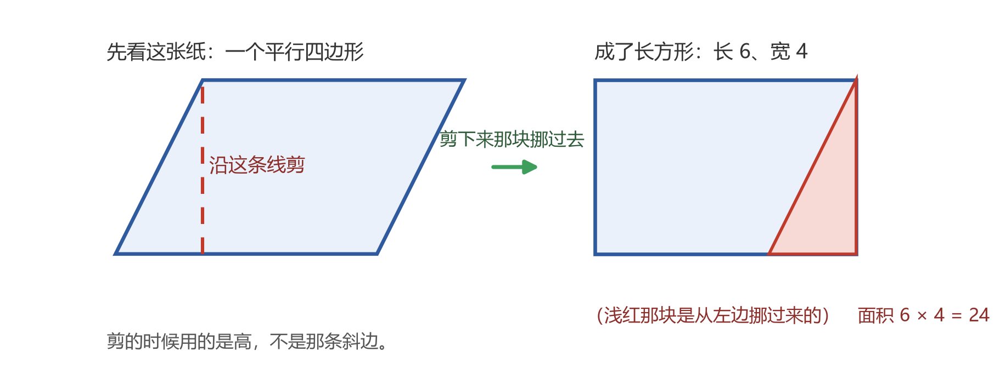

这个动作叫转化：把不会算的，变成会算的。

孩子做完这一步，多半觉得"这就完了"。可有一件事他大概没想过：**凭什么**？剪下来那块纸，
换了个地方，为什么还是原来那么大？

这件事两千三百年前就有人较真过。欧几里得（约公元前 300 年的古希腊数学家）把当时的几何结论收进一本书，
叫《几何原本》。这本书后来两千多年里，是欧洲人学几何的标准课本。
他的办法是先立下几条谁都不反对的话，然后一步一步往下推。其中一条是：
**能重合的两样东西，一样大**。

孩子剪这一刀，用的就是这条。**剪下来那块挪到另一边，正好把缺的那块补齐，和它完全重合。这才是"一样大"的依据**。
**课本不会说这句话，因为小学生不需要学证明；可这一刀能算数，靠的就是它**。

剪完，孩子常问一句：那条斜边哪去了？它跑到图形里头，成了里面的一条线，不再是边了。所以量面积用高、
不用斜边。这不是规定，是这一刀留下的结果。**斜边长一点短一点，只要底和高不动，面积一点不变**。

同样的动作，换两个图形再来一遍。

**三角形**。两个一样的三角形，把其中一个转 180 度，拼在一起，正好是一个平行四边形；它的底就是
三角形的底，它的高就是三角形的高。所以一个三角形只占一半。**那个"÷ 2"不是规定，是两个拼一个**
留下的痕迹。

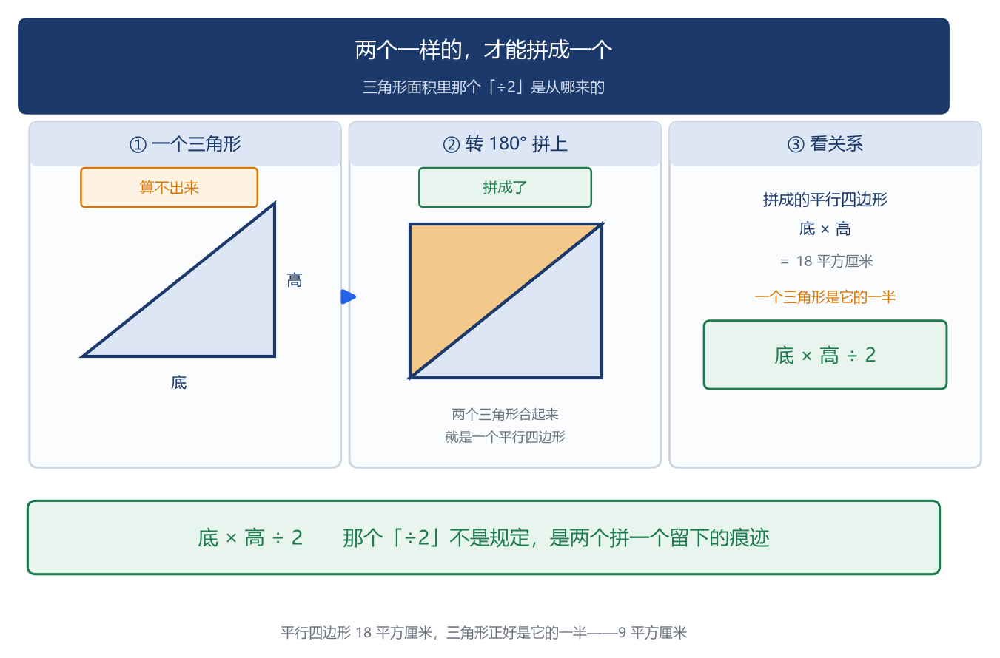

**梯形**。照样来：两个一样的梯形，一个正着放、一个倒过来扣上去，又是一个平行四边形。
**这个平行四边形的底，正好是上底加下底；梯形占它一半，所以梯形面积 =（上底 + 下底）× 高 ÷ 2**。

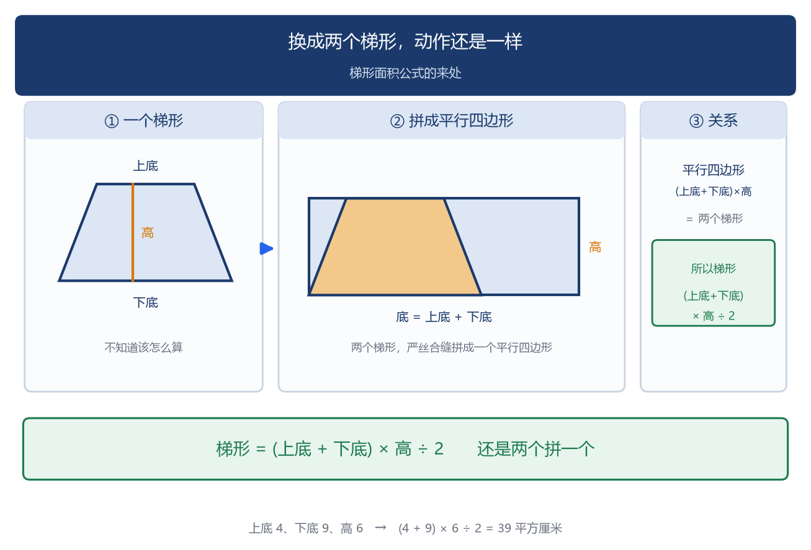

平行四边形、三角形、梯形，三个公式一个动作。课本给这个动作起的名字，就是"转化"。

**剪一刀给孩子的是"看见"，还不是"证明"**。他看见了它变成长方形；
要说清"为什么一定变"，那是初中几何课的事。

>> 上一章说的是桌上的一张纸。这一章把它立起来。

## 二、摊平与折起：立体的东西，怎么变成桌上的一张纸

平面上的斜，剪一刀就解决了。立体呢？连"看"都不容易。

一个正方体的纸盒摆在桌上。孩子看得见它，可真要说清它长什么样，不容易。

从外面看，从一个角上看，一个正方体最多看到三面，另外三面藏在背面。可只要把它拆开、摊平在桌上，
六个面一个不少，全都在那儿。这张摊平的图，叫展开图。

反过来更有意思：给你一张展开图，折起来能不能成为一个盒子？

有些能，有些不能。**看着差不多的几张图，都是六个正方形拼的，有的折得起来，有的折到一半就打架**。
**孩子要判断，靠的不是背有几种，而是想：这个面折过来，会和哪个面碰在一起**？哪条边会和哪条边粘上？

（正方体的展开图一共十一种。想让孩子信"不止一种"，让他把同一个纸盒沿不同的棱剪开试试。）

孩子判断起来有个笨办法，很管用：给纸盒的六个面写上一、二、三、四、五、六，剪开摊平，
看看哪两个面在图上挨着、哪两个隔得远。他会发现一条规律——**原来相对的那两个面，在展开图里从来没有挨着过**。
挨着的那两个，折起来一定是相邻的面。记住这一条，比背十一种管用。

一个纸箱，从一块平整的纸板上裁下来、折起来、粘上，就是照展开图做的。
**纸箱厂的师傅不是在折箱子，他是在排料：一块纸板上怎么摆，才不浪费，折起来两个面才不会碰在一起**。

**立体的东西看不见全部，摊平了就看得全**；摊平的图看着是平的，
折起来又是立体的。两个方向来回走一遍，孩子才算认识"一个盒子"。

>> 前面几节的形状都是规则的，剪一剪、量一量就算得出来。这一节换一个量不出来的。

## 三、一个土豆有多大

盒子能摊平，是因为它的面都是平的。有些东西连一个平面都没有，比方说一块土豆。

土豆是不规则的，没有公式，尺子也量不出来。

孩子的办法很简单：拿一个有刻度的量杯，倒上水，记下水面在哪儿；再把土豆按进去，
看水升到哪儿。**水升了多少，土豆就有多大。水是看得见的，土豆的体积看不见**。 **这一步，叫排水法**。道理很短：土豆占了多少地方，
水就得让出多少地方。

看不见的量，换成另一件看得见的东西。这个办法孩子往后会一直用。温度看不见，看温度计里那根柱；
一年的雨水看不见，看雨量筒；台风离岸还有多远，看雷达回波。

这个实验有两处要留神。一是读水面，眼睛要和水面平，蹲低了读和站高了读会差一点；
二是土豆按进去的时候别溅出水来——溅出去的那些水本来该算在土豆头上，洒掉了，读出来的数就少了，量出来会偏小。

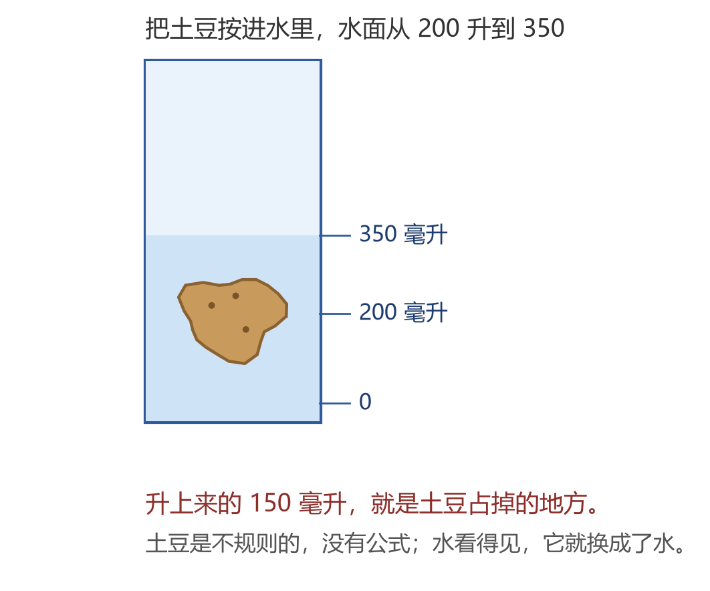

升上来的那 150 毫升，就是土豆的体积（1 毫升正好是 1 立方厘米）。

孩子多半还会问一句：为什么不规则的东西往往没有公式？因为公式要能用几个数把形状说清。
正方形只要一条边，长方形要两条，圆要一条半径。土豆呢？你说不出几个数能把它描述完。
说不清形状，就没有公式；没有公式，就只能换办法：拿一件看得见的东西去换。

（这个办法孩子见过。二年级语文课本里有一篇《曹冲称象》：大象太重，没有那么大的一杆秤，
曹冲（东汉末年曹操的儿子，公元 196—208 年）让人把大象牵上船，记下船沉到哪儿；再把大象牵下来，往船上装石头，装到船沉到同一个地方——
石头的重量就是大象的重量。

土豆和水，曹冲和石头，用的是同一个办法：要量的那件东西没办法直接量，就换成一件好量的，
**曹冲让石头和大象一样重，量土豆让水和土豆一样大——换的是同一种量，不是随便换一个**。）

>> 前面三节，讲的都是把一件难办的事，换成另一件好办的事。这一节换一件事：看得见的是不是全部。

## 四、从三个方向看：背面也说得清

看不见的量，能用另一件看得见的东西换出来。还有一样看不见的：从哪个方向看，都只看得到一部分。

桌上放一个杯子。你站在这儿看，看见杯口一个圆；走两步再看，看见的是它的侧影。同一个杯子，
为什么看到的不一样？

因为杯子没动，你站的地方变了。

四年级有一节课叫"观察物体"：几个小正方体搭起来的一个形状，让孩子从三个方向看——前面、上面、左面——
再把看到的样子画下来。画出来的三张图常常很不一样：这一面看着是两个方块，那一面看着是三个。

孩子一开头容易画错，错在只按正面那一眼去猜另外两面。

这节课要教的事比画图大：**同一个物体，换一个方向看，看见的不一样；三张图合起来，就说清它了：照这三张图，能把它搭回来——有时候搭法不止一种，可搭出来的东西，从这三个方向看过去一模一样**。背面他看不见，可背面长什么样，三张图里已经写着。

（工程图纸上画三视图，就是这个道理：一个零件没法搬到别人眼前，三张图就能说清它的样子。）

看人也是这样。只从一个方向看，看不准一个人——老话说"知人知面不知心"，说的就是这个。

要看清一个人，**得换几个位置看，还得把看到的那几面合起来想**。三张图能说清一个盒子，
人比盒子难多了。他每一面都在变，而且他也在看你。

第 2 讲讲运算律的时候举过一个例子："我爱你"不等于"你爱我"——两个东西换个位置，结果就不一样了。
这里不是同一件事，但意思相通：**你站在这面看，和站在那面看，看到的不一样**。

这节课上，孩子最容易错的是"上面看"。几个小正方体搭起来，从正面看是两块，从上面看——也许有五个。
正面的两块很显眼，后头那几块不显眼，可它们一样占地方。**看不见的那部分，一样占着地方，得靠另外两面的图把它推出来**。

**心里能把这个立体转起来的孩子，画这三张图会轻松得多**。

现在的孩子几乎都搭过积木，两三岁就开始了。搭的时候，他正在做几何课要做的事。这一块放上去会不会塌，
转过来会挡住哪一块，**他得先在脑子里摆一遍**。

积木也不是随手做出来的。福禄贝尔（1782—1852，德国的教育家，世界上第一所幼儿园的创办人）
给孩子设计的一套玩具里，最有名的就是积木，他给它们起名叫"恩物"——给孩子的礼物。
**他在差不多两百年前就主张：孩子认识形状和空间，是从手上开始的**。

>> 形状和大小都说过了。几何还剩一样东西：位置。

## 五、给位置起个名字

几何研究三件事：形状、大小、位置。前面几节说的是形状和大小，这一节说位置。

这一件，小学只学了一小步——用两个数凑成一对，就说清了这个东西摆在哪儿。

**小学这一步，到初中会接着用**。初中几何里那一整套用数去算图形的办法，就是从这一对数开始的：孩子在五年级把"用两个数说清位置"弄熟了，到初中接着往下走就行，不用从零开始。

小学没有把这一步讲得更深，不是因为不重要，是它得等到孩子大一点才学得动。

看电影要对号入座，票上写着"5 排 8 号"。这一对数字，把你该坐的地方说清了——不用手指、
不用"那边那边"。教室里也一样：第 3 列第 4 行，谁坐在那儿，全班都知道。

五年级上册有一节叫"位置"，教的就是这个：用一对数写下一个位置。
孩子第一次发现：**一样东西摆在哪儿，可以用两个数说出来**。起步就在这一节：给位置起个名字。

为什么非得给位置起个名字？因为位置这东西谁都看得见，可谁也说不清。你指着一片地界说"就那儿"，
站你对面的人未必找得到；换成一对数，写给谁都一样。

**说不清的东西，一旦有了名字，就能写下来、传出去、照着找**。

给位置起名字还有一条规则：**先说列，再说行**；写成 (3, 4)，中间用逗号隔开。
写反了，(4, 3) 指的是另一个位置。

这个规定是人定的。可一旦定了，所有人得一样——不然你报的"3 列 4 行"和他听的"4 列 3 行"，
说的不是一处。数学里很多重要的东西都是这样：先有一个说法，然后大家守它。位置这件事，
靠的就是这一条。

用处比课堂大得多：地球上任何一点，用经度和纬度两个数就说清了；棋盘上一手棋，用第几路第几列；
导航说"前方三百米右转"，背后也是一串数在算：你所在的位置是一对数，要去的地方也是一对数，两个位置一对，才算得出往哪拐。

再往前走一步：**位置能用数说出来，图形也能用数说出来**。

在方格纸上画一个三角形，它只有三个顶点；三个顶点，就是三对数。把这三对数写给另一个人，
他不看你的图，照着也能画出同一个三角形——多一点少一点都不对。形状这东西，居然可以不说形状、
只说数就说清。

（拿张方格纸试一下：给孩子一串数对——(1, 1)、(4, 1)、(4, 3)、(1, 3)——让他依次点上、连起来，看是什么形。他会越连越顺手。）

数和形之间的这层关系，初中会正式学，名字叫平面直角坐标系；再往后，屏幕上的每一个图形、
地图上的每一条路，都是这么用数说出来的。

>> 下面说一件孩子做过、可从没问过为什么的事。

## 六、为什么恰好一百八十度

四年级下册有一节课，让孩子量三角形的三个角，再把三个度数加起来。

他会碰到一件怪事：不管画的是哪种三角形——瘦长的、扁平的、看着很不规则的——加起来总是
一百八十度上下。量出来 179°、180°、181°，都有。

差的那一点是尺子和眼睛的误差。可为什么恰好一百八十度？

课本给的办法是：把三个角撕下来，拼在一起。

**拼出来正好是一条直线**。孩子一试就"哦"了一声——三个角合起来，正好凑成一条直线（这叫平角）。

这里又要说清一句：撕下来拼一拼，是"看见"了这件事，还不是"证明"了它。这个三角形拼出了平角，
换个更大的三角形凭什么也一样？那是初中几何课要写的事：从几条不许反对的话出发，一步一步推出来。

为什么三个角加起来，不多不少，正好凑成一条直线？**这个问题孩子答不出，老师也多半不讲**——
小学这一段能拿到的，是亲手拼那一下。**他把三个角撕下来，摆在桌上往里凑**：第一个角放平，
第二个挨上去，第三个再补上——**三个角一合，边和边正好接上。他会停一下。那一下是他自己发现的**。

那一声里有两件事：一件是"原来它跟一条直线有关"，另一件是"这是我自己试出来的"。
到初中，这个"哦"会被换成一段能站住的理由。那几条"不许反对的话"，数学里叫**公理**；
从公理一步一步推出来的每一条，叫**定理**——三角形内角和是一百八十度，就是这么推出来的一条。
>> 前面几件，剪一刀、摊平、换个方向看，都办成了。圆这一件最难。

## 七、圆的面积：拼不成直线，也得算出来

这一节要算的是一个圆的面积。它有多大。前面几件到最后都算出来了：斜的剪一刀，就成了会算的图形；
立体的摊平，六个面一个不少；看不见的体积，用一盆水换出来。圆不行。

要算面积，先得知道一个数：**圆的周长和直径的比**，也就是圆周率 π。这个数到底是多少？

两千二百多年前，阿基米德（约公元前 287—前 212，古希腊的数学家）就在算它。他不是画个图估个大概，而是两头夹：在圆里画一个正多边形，量出它的周长，再除以圆的直径，得到的商比 π 小；
在圆外再套一个，同样算一算，得到的商比 π 大；边数一路翻倍。翻到 96 边形，他得出：π 比 3.1408 大，
比 3.1429 小。

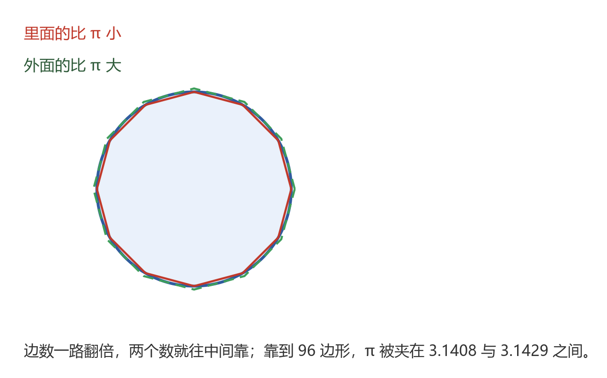

这两个数不是猜的，是算出来的。他最了不起的地方在这儿：**他不去猜一个近似的数，而是给出两个数，把 π 夹在中间**。
一个说不准的数，被给定在一条窄缝里。这是第一次有人把它做严。

再往后七百多年，祖冲之（429—500，中国南北朝的数学家）把 π 算到了 3.1415926 和 3.1415927 之间，
小数点后七位。
欧洲人要再等约一千年才追上这个数。

孩子课本上写着"π 约等于 3.14"。这几个字后面，是阿基米德夹出来的那条缝，和祖冲之领先了上千年的那个数。

把圆平均分成 8 份，像切西瓜那样，再上下一交错拼起来——大致像个长方形。分成 16 份、32 份、128 份，
一次比一次更像长方形。

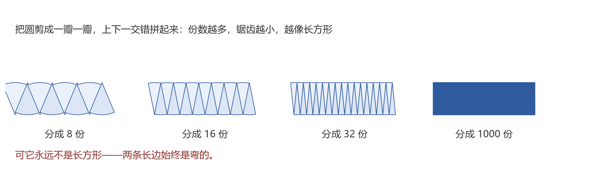

那面积到底怎么算出来？把拼出来的图形当成长方形看：它的长，是圆周的一半，也就是 πr；它的宽，是圆的半径 r。（这里的"等于"，是六年级先这么用：份数够多，拼出来的图形和长方形差的那一点，已经量不出来；差的那一点算不算数，是初中才讲的事。）
**所以圆的面积 = πr × r = πr²**。孩子六年级就会念这个公式。

差在哪儿？**拼出来的两条长边，是一片片圆弧拼起来的，始终是弯的**。份数再多，也只是越来越接近直线；
拼出来的图形，跟长方形总差着那一点弯。

**差的那一点看着不算什么，可它正说明圆和前面几个图形不一样：那几件剪拼完是"就是"，圆剪拼完只是"差不多"**。

阿基米德用的办法说到底就是一句话：**算不准的，就用两个算得准的把它夹住**。
往后遇到算不准的量，数学用的往往还是这一招。它比多背几位 π 重要。

所以回到圆面积，就得换个说法：不说"剪拼成长方形"，只说"分的份数越多，越接近长方形"——六年级那个圆面积公式，就是这么来的。

>> 前面几章讲的都是纸上的图形。来看一件孩子天天拿在手里的东西。

## 八、魔方：有些局面，拧不到

现在的小学生，多半都有一个玩具魔方。

乱起来容易，复原难。孩子是怎么学会的？两条路。一条是背公式：哪一步转哪一面，
一条一条记下来。另一条是自己看懂了。他会盯着看一块怎么走：这一层转过去，它落到哪儿；
再转，又落到哪儿。看明白了，公式忘了也能自己摸回来。

第一条路也能复原。只是公式一多就乱阵脚，跟他做面积题一个样：全是套路，题目一变就不知道用哪一条。

（那套背下来的转法有名字，叫**层先法**，也叫入门七步法。想让孩子学，搜这个名字，教程一大把。这里就不抄了。）

魔方为什么难？

先看第一件：**你转一面，变的不只是那一面**——上下左右四面都跟着动。想在脑子里跟住它，你得同时记着二十来块，每一块在哪儿、朝哪边。

第二件，是魔方要有点底子才转得动。空间想象力得够用。那块转过去会落到哪儿，眼睛看不见，要在脑子里先摆一遍；位置关系也得清楚——一块被转了三下，它到底在哪儿，是正着还是翻着。

孩子在几何课上练的，正是这两样：从三个方向看一个盒子、在方格纸上用数对说位置、把立体的纸盒摊平了又折起来。所以魔方转得欢的孩子，空间想象力一般不弱。这两件事用的是同一套本事。

往远处再说一层。一个人长大以后，能不能同时处理好几件事、能不能对付很复杂的事，跟他在脑子里
能同时记住、比较几件事有关——记得住、比得过来，才谈得上做决定。

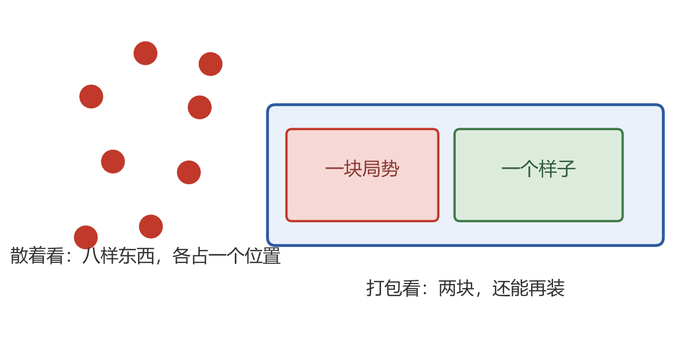

（这件事一半是天生的，一半是练出来的。专家有个本事：把零碎的东西打包成一块。下棋的高手看棋盘，
不看成十六个棋子，看成几块局势；老练的医生看病人，不看成二十个症状，看成几个样子。一组的块数越多，
同时想得过来的事就越多。）

魔方上还有一件更怪的事，孩子早晚会去试：**把一个角块原地转个方向，别的块一块都不动**。

说具体点。复原好的魔方，顶面是白的、正面是绿的、右面是红的。看最前面右上角那一块：它现在白面朝上。
把这一块原地转个方向——转过来之后，它顶上那一格成了红的（和右面一个颜色），原来朝上的白面跑到正面来了。
就转这一块，就转这么一下，别的都不动。

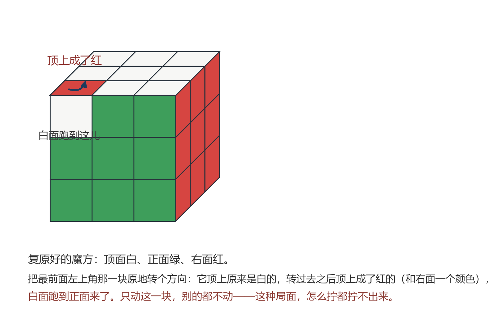

他试了很久，还是不成。这是魔方的规则：**有些乱，拧得出来；有些乱，怎么也拧不出来**。

为什么单单这个做不到？因为角块要翻，就是几个一起翻，翻的量加起来必须正好抵消：你可以让两个角
对着翻、三个角朝同一个方向翻，就是不能只有一个。棱块也一样，只把一个棱块反过来，同样做不到。

你要非让它翻过来，只有一条路：把魔方拆开、重装。
可拆过重装的魔方，已经不是原来那个了。
拿生活中的感情来说也一样：两个人分了手，就不能再像从前那样见面了，是想见也见不到了。这件事本身回不去——**有些事不是"愿不愿意"的问题，是"回得去回不去"的问题**。任何事情都有最基本的规则，违反了，就不是那么回事了。

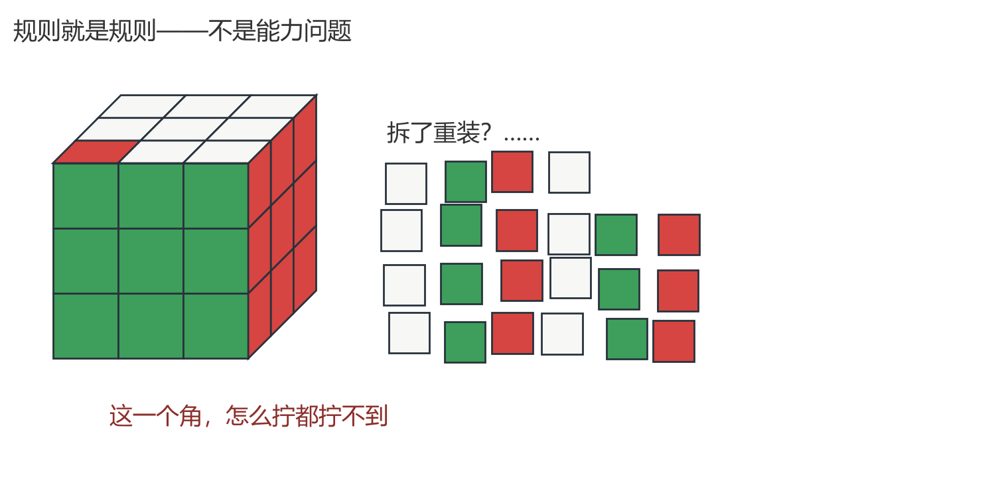

（这件事不用往深处讲。孩子只要知道：魔方不是随便乱转的东西，它有自己的规则。就像几何里
那些"看着就该这样"的地方，背后也各有各的理由。）

>> 几何这一块，孩子的错误高度集中。四道最典型的，病根是同一个。

## 九、四道错题，病根是同一个

**一、平行四边形用斜边乘底**。底 6 厘米、斜边 5 厘米、高 4 厘米，求面积。

我见过一个五年级的孩子做这道题。他先写 6 × 5，划掉；改成 6 × 4，又划掉；最后空着交了上来。
老师问他为什么不写，他说：我不知道该用哪两个数。

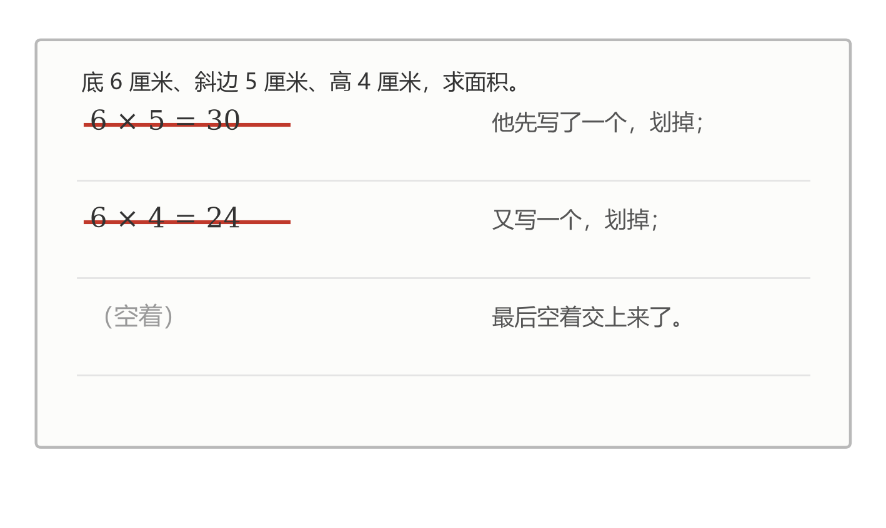

6 × 5 是 30，答案是 24。他记住的是"两个数一乘"这个形状，没记住乘的是哪两条。剪拼过一次的孩子不容易犯这个错：
剪的时候用的是高，斜边剪完就跑到图形里去了。

**二、三角形忘了除以 2**。底 8 厘米、高 5 厘米，孩子写 8 × 5 = 40 平方厘米，正确答案是 20。那个"÷ 2"在他脑子里
是一条附加规定，不是一件事实。事实是：两个一样的三角形拼起来，正好是一个平行四边形，一个三角形只占它的一半。

**三、等底等高的两个图形，答「面积相等」**。题目是一个三角形和一个平行四边形，底一样、高也一样，问它们面积什么关系；孩子答：相等。他把话说串了："等底等高面积相等"这句本是对两个三角形说的；这里是一个三角形对一个平行四边形，三角形只有那个平行四边形的一半。

**四、面积和周长混着用**。一个长方形，长 5 厘米、宽 3 厘米。孩子答：面积 16 平方厘米。16 是周长。
他把"把四条边加起来"和"把两个方向乘起来"搅到一起了。这两件事不一样：周长量的是围着的那一圈线，面积量的是里面整个面；算完看单位也看得出来——一个是厘米，一个是平方厘米。

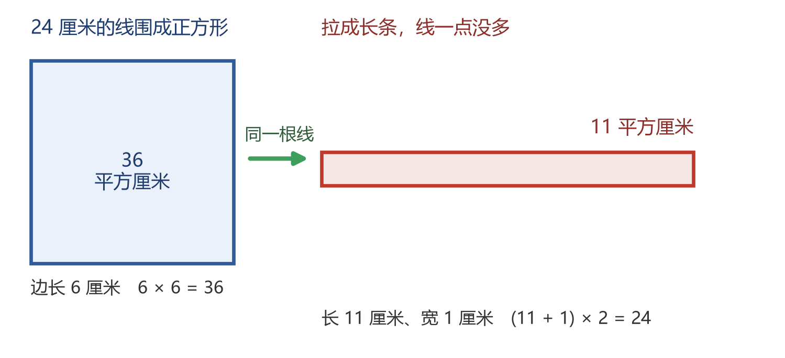

**一个能当场做给孩子看的例子**：拿一根 24 厘米长的线，先围成一个正方形，边长 6 厘米，面积是 6 × 6 = 36 平方厘米；再把同一根线拉成长 11 厘米、宽 1 厘米的长条，面积只剩 11 平方厘米。
线一点没变，围出来的面积差了三倍多——周长管"多长"，面积管"多大"，真的是两回事。

**四道错，病根是一个**：**公式是背来的，不是推来的**。他只有结论，没有那个"为什么"。题目稍微一变，他就不知道该拿哪一条结论去套，只能猜。

这四道错，办法不一样，得分开说。前两道（选错边、忘除以 2）动手最快：**剪一刀、拼一次，比讲十遍管用**。
后两道不一样——等底等高是"一半"没想通，面积周长混用是单位没分清，裁剪纸片治不了单位。
这两道得把话说透：厘米和平方厘米差在哪儿，"围一圈"和"铺一层"为什么是两件事。
第三道（等底等高）可以这样做：把平行四边形遮住一半给他看，让他自己说三角形只占一半；
再说清这个"一半"是说面积的一半，不是说两个图形一样。

>> 先给一条反向提醒。

## 十、给家长的分寸

先说一句：这一篇是写给家长的，不是给孩子读的。孩子该做的是动手，不是读文章。
真要给他看，把前面几节里他亲手做过的事指给他看就行。

小学里，孩子的几何课大致是这么铺开的（以人教版为例，各地进度略有差异）：

| 年级 | 他该做到哪一步 | 别提前做什么 |
|---|---|---|
| 一、二年级 | 认识长方形、正方形这些基本图形 | 别讲面积单位，也别讲"转化"这个词 |
| 二年级下 | 认识轴对称、平移，会照着画 | 别讲平移的方向和距离 |
| 三年级下 | 会数方格求面积；知道面积就是铺满它要多少个单位方块 | 别提前教平行四边形的公式 |
| 四年级下 | 会从前面、上面、左面看一个物体；轴对称、平移再学一遍 | 别让他写推导过程 |
| 五年级 | 会剪拼推出平行四边形、三角形、梯形面积；会量长方体的体积；认识数对、旋转 | 别要求把推导背下来 |
| 六年级 | 圆的面积会拼会算；能说出"分的份数越多越接近长方形" | 别引入"极限"，也别让孩子做辅助线证明题 |

三条底线，家里最好守住。

**一、别把"底 × 高"讲成"两条边相乘"**。这一句省事，可它正把孩子推向第一道错题。

**二、别给孩子布置证明题，别让他写因为所以**。小学是动手看，写因为所以是初中的事。

**三、别提"极限"**。课本说的是"分的份数越多，越接近长方形"，它没说"就是"。多给一个词，
等于用一个词代替一次理解。

这一章说到底就两句话：**多动手，然后多思考**。

动手在先，是因为小学孩子的想法长在手上——做过的，他才想得动。思考在后，是因为光动手也不够：剪完、拼完、量完，得让他自己说一句"为什么这样就行了"。这一句说不出来，那一下手就白动了。

所以家里最该做的不是讲，是问。剪完问他一句"你刚才剪的是哪一条线"，比替他讲一遍管用得多。

还有一条最重要的：**剪之前，先别告诉他怎么剪**。让他自己找那条高——**找的过程就是理解的过程**。
实在卡住了，再提示一句"找一条垂线"。

>> 这一讲做的事，用一句话说：把看不见的，变成看得见的。

## 十一、结语：不看见，也知道

小学六年，几何课上让孩子亲手做的事，数得过来：剪过一刀纸，摊平过一个纸盒，量过一块土豆，从三个方向看过一个杯子，
撕过三个角，拼过一个圆。再加上拧过许多次的那个魔方。

土地看不见边，他能算；盒子看不见背面，他能想出来。一个土豆有多大，他也能换算出来。

这些事单独看都很小，合起来是一件事：**看见的总是一小半，剩下的靠自己拼出来。不看见，也知道**——说的就是这种事。

可人心呢？人心不是土地，也不是盒子。它没有边，更量不出来。

长大以后，走上社会，谈了喜欢的人：他好久没主动联系你，发消息总是应付两句，约他总说在忙——
这份感情的全貌你没看见，可你心里清楚自己站在哪儿。

**这套本事，一辈子都用得上**。人这一生，真正的大事大多没有图形可看——
心里那套"从片段拼出全貌"的手艺，就是从小学那几十次动手开始练出来的。

这一讲翻来覆去讲的，是一句老话。陆游（1125—1210，南宋的诗人）给儿子写过两句诗：
**纸上得来终觉浅，绝知此事要躬行**。

孩子会忘掉大部分公式，这没关系。**公式忘了可以再学一遍；那一下没做过，什么时候补都来得及——只是别只在纸上补**。
系列开头那篇（启蒙篇）里说过一句话：**数是关系，不是标签**。几何管的是同一件事，
只是对象换成了形状——**高和面积、方向和看见的样子、三个角和一百八十度**，都是一个和一个的关系。
他剪过那一刀，这些关系在手上过了一遍；以后再用到面积，公式忘了，关系还在，还能自己把它想回来。

今晚可以试一件事：拿一张平行四边形的纸，问孩子能不能剪一刀变成一个长方形。先别告诉他怎么剪。
他剪出来那一刻的表情，就是这一讲想说的一切。

---

**参考文献**

- 《义务教育数学课程标准（2022 年版）》"图形与几何"领域——图形的认识与测量、图形的位置与运动两个主题（贯穿三个学段）
- 人教版《义务教育教科书·数学》三年级下册（面积）、四年级下册（三角形、图形的运动、观察物体）、五年级上册（多边形的面积、位置）、五年级下册（长方体和正方体、图形的运动）、六年级上册（圆）教师教学用书
- 人教版《义务教育教科书·语文》二年级上册第 4 课《曹冲称象》——把"称大象"换成"称石头"，换的是同一种量
- 欧几里得《几何原本》（约公元前 300 年）——从少数几条公理出发推出一整套结论，几何"讲理"的起点
- 《隋书·律历志》——祖冲之圆周率"3.1415926—3.1415927"的记载，比欧洲早约一千年
- 福禄贝尔《人的教育》（1826）——教育思想；他创办幼儿园（约 1837 年）时设计"恩物"积木，幼儿从手上开始认识形状与空间
- 陆游《冬夜读书示子聿》（收入《剑南诗稿》）——"纸上得来终觉浅，绝知此事要躬行"

---

**互动**

留一道题给你的孩子：先别让他写，给他一张平行四边形的纸，看他找不找得到该剪的那条线。
再问他一个开放的问题：这六年里，他问过你哪个几何问题，你当时答不上来？

（本讲的「剪拼卡」已生成，公众号对话框回复 **剪拼卡** 可取。）
