# 统计与可能性：不确定也能被度量

「数学成神之路」小学数学 · 第 9 讲

原创 · 程大大的小记

### 导读

妈妈经常给小明零花钱，隔几天给一次——有时候隔两三天，有时候隔一个星期。
小明把每次给多少都记在一个本子上：3、3、5、3、2、3、5、20、3、3、5、3、3、5、3、3（单位：块）。

（给 20 块那次，是因为他那天表现好。）

明天放学，妈妈可能又会给他。小明想猜一猜：妈妈会给多少？

他想了三种猜法——

**按平均算：十六次一共 72 块，平均每次 4 块 5 毛，猜 4 块 5 毛**。
**按最多算：妈妈给过 20 块，猜 20 块**。
**按最常给的算：十六次里有十次是 3 块，猜 3 块**。

三种猜法都不算错，可它们回答的不是同一个问题。

所以做统计之前，得先问一句：**你想知道什么**？这一讲从头到尾，都在回答这一句。

>> 如果只读一章，读第一章。

## 一、先问一句：你想知道什么

小明的三种猜法，差别不在算法，在问题。

妈妈给钱这件事，他心里可以有三个问题：她给我的大概是什么水平？最多能给到多少？平常什么样？
三个问题，三个答案——4 块 5 毛、20 块、3 块。三个答案，都是从同一串数里出来的。

这三个问题，各有各的名字：问"大概什么水平"，用的是**平均数**；问"最多能给到多少"，看的是**最大值**；
问"平常什么样"，看的是**出现最多的那个数**。同一串数，问法一变，答案就换一个。

**课本上看不到这一问**。课本教的是"怎么求平均数"，题目一开头就告诉你"求平均数"。
可生活里没有人给你出题，你得自己先想清楚要问什么。这是统计真正的第一步，也是课本没写的那一步。

再举一个大的例子。全国人一年的收入，平均下来是 43377 块——这是 2025 年的数。
这个数回答的是"全国整体大概什么水平"。

可要是问"中间那个人一年挣多少"，它就答不上来了。中间那个人的收入是 36231 块，只有平均数的八成多。把全国人按收入从低到高排成五组：
最低的那一组，一年 10150 块；最高的那一组，一年 103778 块——差了十倍。
平均下来那 43377 块，落在高低之间，可它不属于其中任何一个人。

## 二、什么是统计

>> 先说平均数。

小明有十六个数。"统计"这两个字，说的就是从这儿开始的事：**把散着的一个一个数，合成你想看的那一个数**。

十六笔记录怎么合成一个数？十六次一共 72 块，除以十六次，得 4 块 5 毛。
这一步课本上有，四年级下册就教。

可这一步有一件容易忽略的事：**4 块 5 毛，不是小明哪一次拿到过的钱**。妈妈给过 3 块，给过 5 块，
给过 2 块，还给过 20 块——没有哪一次是 4 块 5 毛。

它是个**代表**。一个数，站出来代表十六个数。

这件事和你学分数的感受不一样。第 4 讲说的是"一个数有很多名字"：1/2、2/4、3/6 是同一个数，
同一个数换了几种写法。这一次正好反过来：**一个名字，代表了很多个东西**。两个方向掉了个头。

那么，它凭什么代表？

不是因为它准——它跟哪一个都不像。是因为它有一样别人没有的性质：**加起来一样多**。
十六笔加起来 72 块；说"平均每次 4 块 5 毛"，等于说"假如每次都给得一样多，每次就是 4 块 5 毛，
加起来还是 72 块"。它把不均摊平了，总数一分没少。

还有另一种代表：**把十六笔从小到大排队，正中间那两个（第 8、第 9 个）**——排下来，中间隔着的正好是 3 块。
这个数，就叫**正中间那个数**。它不摊平，它只站队。两种代表各有各的用处：
**平均数对每一笔都敏感，站在中间那个数只认位置**。所以问"大家大概什么水平"，用平均数；
问"中间那个人是怎样的"，站在中间那个数更可靠——它不被那一笔 20 块带走。

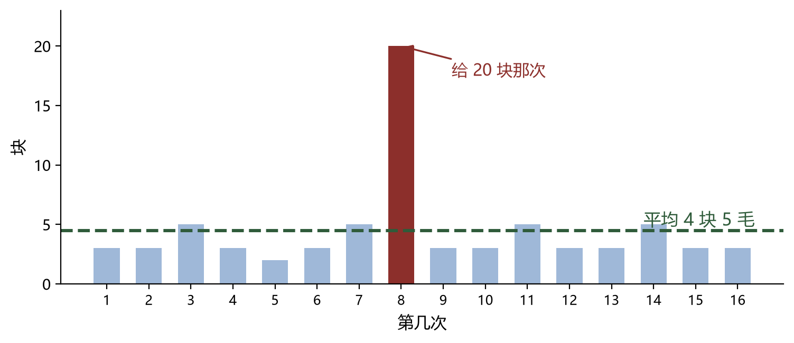

## 三、一笔 20 块，把平均抬高了

>> 平均数好算，也好骗。下面这一笔，就能让它整个挪位。

小明那十六笔里，有一笔 20 块。把这一笔拿掉，剩下十五笔的平均是多少？是 52 除以 15，3 块 5 毛不到。

**一笔 20 块，把平均从 3 块 5 毛不到，抬到了 4 块 5 毛**。就一笔。

这不是小明算错了，也不是平均数不好。**这是它本来的样子**。这个数是用"总和 ÷ 个数"算出来的——
定义里写着"总和"，那总和一变，它就跟着变；一笔特别大的数，对总和的贡献比别的大得多，
它当然被拉动。

第 6 讲讲 1 不是质数时说过：那条定义是为了保住"拆法只有一种"。"1 不是质数"，是为了保住"每个数拆开的写法只有一种"——
质数那一讲，是定义在支撑结论。这一次一样：**因为它是"总和 ÷ 个数"，所以它必然被极端的数据拉动**。
这不是它的毛病，这是它的定义里就带着的性质。

（有一件事你大概见过：比赛打分要去掉一个最高分、一个最低分。为什么要去掉？
就是为了不让一两个极端数把代表值带跑。）

生活里这样的例子不少。"我们这个城市平均工资八千"——可你自己拿的是五千，这很正常：
少数拿得很高的人，把线抬上去了。看到平均数，第一件事不是信它，而是**问一句：这串数里有没有特别高的、或者特别低的**？
有，平均数就得配着它一起看。

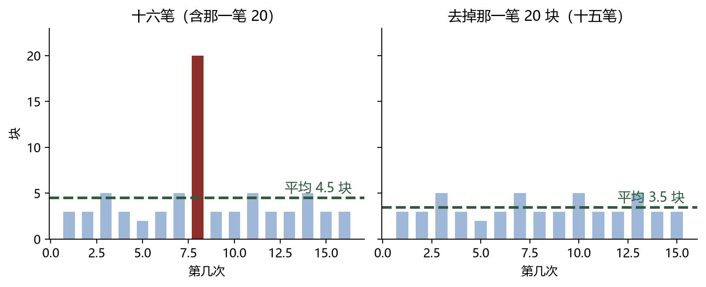

## 四、统计的结果，真的回答了问题吗

>> 数字算出来了，接下来该问一句：它替谁说话？

体育课上，老师在操场中间画了一条线，看谁能跳过去。全班 30 个小朋友，一个一个来。

已经跳完 20 个小朋友了，只有 8 个跳了过去。轮到小明了。

他心里想：二十个小朋友里才八个跳过去，我大概也不行。

他猜得对吗？这里有一件容易混的事，要说清楚：

**五分之二说的是那 20 个小朋友。它回答的是"这一批人大概怎么样"，不是"我能不能跳过去"**。

换成他自己。真要回答"我能不能跳过去"，光看已经跳过的 20 个小朋友的比例远远不够。他还得知道：
他平时能跳多远、个子多高、这一次使了多大力气……这些数他现在没有，当场也没人给他算。

这两个问题之间隔着一件事：**小明不在那 20 个小朋友里面**。前面跳过的那一批里没有他，
所以那一批的答案，再怎么算都不是他的答案。

这正是统计的本事，也是它的边界：从已经发生的一批里，找出这一批的特征——**它说的永远是一批**。把"一批"的答案拿去替某一个具体的人作主，就是误用。

统计学家乔治·博克斯（1919—2013，英国的统计学家）讲过一句话：
**所有模型都是错的，但有些是有用的**。

统计给你的那个数，就是一个这样的东西：**它一定不是小明，可它有用——前提是你知道它错在哪儿**。

（还有一个更细的地方。就算那 20 个人里头有跟小明差不多的，也还有个问题：谁是"差不多"？
个子一样算不算？今天脚上有点不舒服算不算？——"差不多"这三个字，没法直接算。）

换一件事也一样。中午在食堂吃饭，两个班平均都用了 15 分钟。

甲班：大部分人 13 分钟到 17 分钟吃完。
乙班：一半人 8 分钟就吃完了，另一半人 22 分钟还没放下筷子。

平均一样，这两个班一样吗？不一样。**平均数说的是"整体什么水平"，它没说"散得有多开"**。

同一个平均数，底下可以是两幅完全不同的图。想看见后面这些，就得把每一个数摆在它自己的位置上，
看它们散在哪儿——小学里做这件事的工具是统计图。（更细的那把尺子，初中才学。）

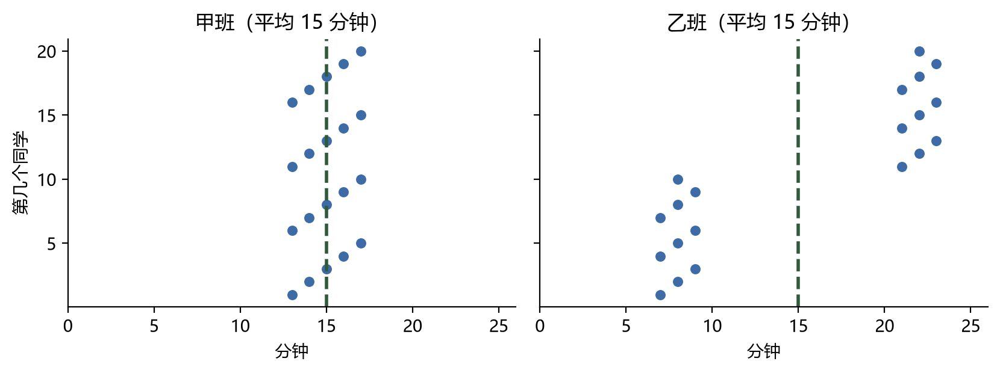

**统计回答"这一批人大概怎么样"，回答得挺好；它回答不了"我这一个会怎么样"**。

## 五、可能性：五张纸条里的五分之三

>> 前面说的都是已经发生的事。现在换一个方向：还没发生的事。

班里开联欢会，老师做了 5 张纸条：3 张写着"表演一个节目"，2 张写着"当观众"。每人抽一张。

抽到"表演节目"的可能性是多少？

（孩子多半会说：五分之三——五张里头有三张。）

这个五分之三，是怎么来的？

它靠的是一个前提：**这 5 张纸条长得一模一样，抽到哪一张的机会一样大**。有这个前提，
就能用"符合条件的张数 ÷ 全部张数"来算：3 ÷ 5，得五分之三。

这是分数的一次全新用法。

第 4 讲里，分数度量的是"量"：一块饼的五分之三，是饼的一部分，实实在在的一块。
这里的五分之三不是一块饼，它说的是**趋势**——抽很多次的话，五次里大约有三次会抽到表演节目。
同一个工具，一个全新的对象。

（五年级上册《可能性》那一单元做的就是这件事：不可能、一定、可能，以及可能性的大小怎么比。
课本上还有一个更简单的例子：盒子里放几个红球几个蓝球，摸到红球的可能性是多少。）

**可这个数什么都不能保证**。

想抽到"表演"的人，第一次偏偏抽到"当观众"——完全可能。**五分之三说的是这件事本身：五张里三张要表演。抽一次，两种结果都可能——它不保证你抽到哪一张**。

（这里有一个错想法：前三次都抽到当观众，第四次总该抽到表演节目了吧？不对。
**纸条不会记得前面抽过什么**。每一次，都是新的五次机会里的一次。）

还有两个误读得说清。**第一，五分之三不是"抽五次里头三次"**——抽五次，中三次、中一次、一次不中，都很正常。
**第二，可能性小不等于不会发生**。千分之一的可能，照样可能落在你身上；换过来，九成九的可能，也可能偏偏不是这一次。所以"多试几次"不能当成办法——**它不是"运气攒够了就轮到你"——每一次，都是从零开始**。

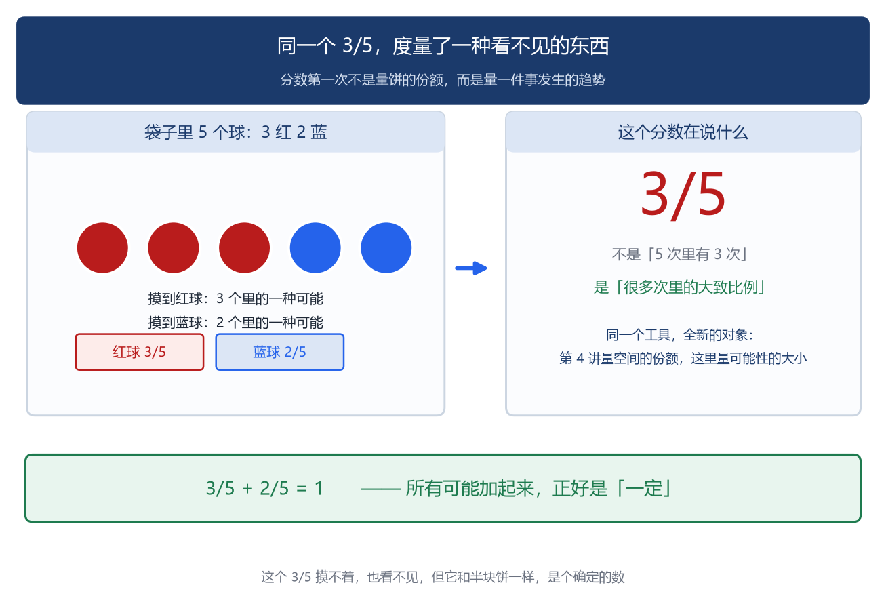

## 六、单次算不准，多次有规律

>> 算不准的事，凭什么能说有规律？

再说一件小事，这件事有正经研究。

2017 年，美国佐治亚理工学院的研究者拍下 23 种哺乳动物上厕所的过程，从猫到大象。
结果有点出人意料：**不管是猫还是大象，用的时间都是 12 秒上下**。换算成分布，
大约三分之二的动物落在 5 秒到 19 秒之间。

（大象一次的量差不多是狗的近一千倍，时间却几乎一样。研究者找到了原因：肠壁上有一层黏液，
体型越大，那层黏液越厚，滑得越快。）

这件事刚好把这一节要说的话摆出来了。

**单看一次，什么都看不出来**。你自己上一次用了多久？说不准——5 秒和 19 秒都在正常范围里。

（有人要说：那我怎么一进去就是半小时？那半小时里，真正用掉的大概就十几秒，
剩下都归手机。研究这件事的人自己也说过一句：看报纸的时间不能算进去。）

**把很多次放在一起，规律就出来了**。23 种动物、体重差三个数量级，可平均起来，都落在 12 秒上下。

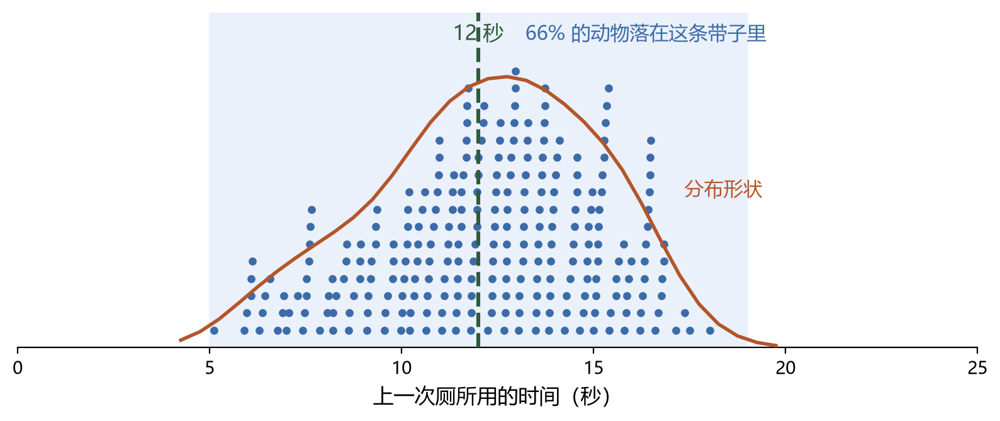

第 6 讲讲质数的时候，已经见过一次：质数在数轴上冒出来的位置看着毫无章法，可"到 N 为止大约有多少个"
清清楚楚。**那次是局部乱、整体有律。这一次是同一件事，换到了"发生不发生"上**。

扔一次骰子，掷出几点说不准；扔一万次，每个点大约各占六分之一。

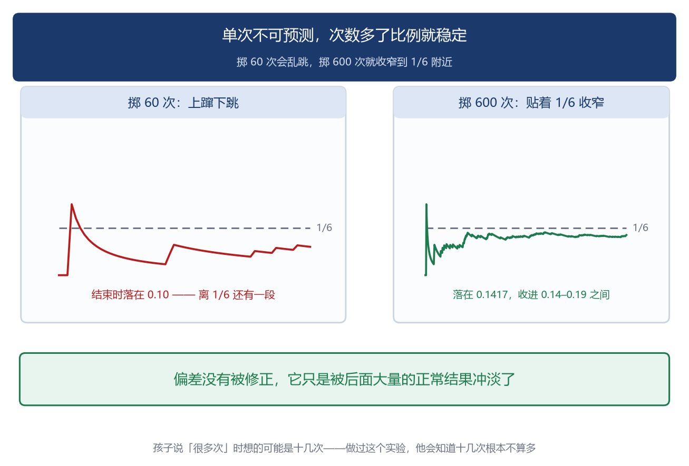

一件事单次算不准，做很多次反而有规律。

### 为什么恰好是十几秒

研究者给出的直接原因，在物理上：肠道里的压力几乎恒定，跟体型没什么关系；粪块的长宽比例也差不多；
再加上肠壁上那层黏液，也是这个道理。**三样凑在一起，速度跟着体长变大，时间就被拉平了**。

那为什么没有变得更长？有人推测：排泄物有气味，气味会引来捕食者。
**在野外多待十几秒，就是把危险多留给自己十几秒**。十几秒能干完的事，没理由拖成几分钟。

所以这个 12 秒不是谁规定的。**它是身体的条件和外头的危险一起算出来的结果——是大自然选择、进化的结果**。

## 七、想猜得更准，缺什么

>> 规律看见了。可要拿它做判断，还缺几样东西。

回到小明的零花钱。他记下来的只有一件事：每次给了多少。

真要把"下一次给多少"猜准，这十六个数远远不够。他还得知道：

- **时间**——隔三天给一次，和隔一个星期给一次，给的多少一样吗？星期五和星期一有差别吗？
- **妈妈的心情**——给钱那天，她顺不顺；
- **家里的条件**——这个月有没有额外开支，手头紧不紧；
- **他自己的表现**——那一笔 20 块，不正是因为那天表现好吗？
- **还有他说过的话**——他最近有没有提过想要什么。

**这些他一个都没有记**。

这不是小明笨。这是小学六年里数学只走到的地方：**一个量**。平均数是一个量的代表，
统计图是一个量（或者两个量）的样子。而"很多个量一起看"——它们在什么条件下一起变、
谁跟着谁变——要到很久以后才学。

（这一层得说明白：**不是我们不想往下讲，是这一层真的在后面**。）

后面这几步，要到这些时候才学：初中开始学两个量的关系——一个变了，另一个跟着怎么变
（第 7 讲的比例，就是这一步的开头）；高中才有正式的统计推断：从一批数里，
能推出多少关于全体的话；到了大学，"从数据到推断"自己成了一门学科——
那些猜得准的系统，靠的都是几十上百个量一起看。

所以小明今天能做的只有一件事：**把他真正关心的那个问题问清楚**，
再用手上这几个数，答到它答得动的程度。

真要开始记，也不难。**先想清楚要问什么，再决定记哪几样**。想猜"下回给多少"，
那就在"多少钱"旁边多记两样：那天是星期几、那天他表现怎么样。记上一个月，
回头看那张表，规律往往自己就浮出来了。多加一个量，就是这个意思。
初中的孩子学函数，做的也是这件事，只是换成了字母。

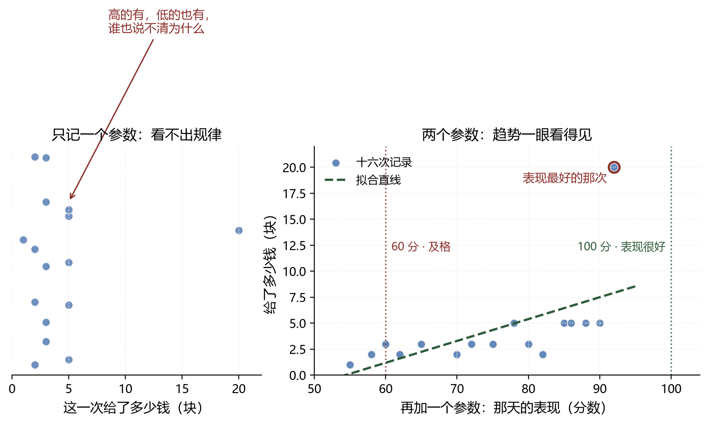

## 八、四道错题，都在把"代表"当成"事实"

>> 统计和可能性这一块，孩子的错很集中。挑四道最典型的。

| | 孩子的想法 | 错在哪 |
|---|---|---|
| 一 | 班里平均分 85，我考了 85 分，我应该排中间 | 平均分说的是这个班，不是名次——同样是 85 分，可能是前五名，也可能是倒数第五，光看平均分分不出来 |
| 二 | 全班平均身高 1.4 米，我也 1.4 米，那条线我跨得过去 | 平均身高说的是全班，不是某个人的腿长和力气 |
| 三 | 抽到表演的可能性是五分之三，抽五次总该中三次 | 五分之三不是"五次里的三次"，也不是"多抽几次就轮到我了" |
| 四 | 前三次都没抽到，第四次该轮到我了 | 纸条不记得前面抽过什么 |

这四道题，看着是四个毛病，其实是一个动作没做：**听到一个数，先问它代表谁**。
它代表的是这一批、这一群，是"大概"而不是"一定"，而且只管已经被记下来的那些。

给孩子一个能上手的三问：**这个数是谁算出来的？它替谁说话？它丢掉了什么**？三问里只要有一问答不上来，这个数就先别急着用。

第三道要单说一句。五分之三是**对这件事本身的描述**：五张纸条里三张写着表演，
所以抽到表演的机会大一些。它回答的是"这件事有多悬"。

它不是"抽五次里有三次"的承诺，也不是"抽多了总会轮到"的保证。
**五分之三不欠你任何一次结果**。

**四道题一个病根：把"一批的答案"当成了"我这一个的答案"**。

头两道犯的是同一件事：拿一个代表值，替一个具体的人作主。
后两道犯的是同一件事：把"很多次之后的比例"，当成"接下来要抽的那一回的保证"。

（这两类坑，孩子最容易掉，大人也最容易掉。买保险的人、看行情的人、
听一句"这个管用"就下单的人，犯的是同一个动作。这一讲能做的，
是让他第一次看清这个动作。）

这几道错，现在看不出代价。

考卷上它们最多扣两分。可它们不是"小学的错"，是一辈子的错。等他开始看行情、买保险、
听人讲"这个办法的有效率是百分之九十"，真正要用的就是今天这一课——
到那时候再想回头改，已经很难。

作家 H. G. 威尔斯（1866—1946，英国作家，《时间机器》的作者）在 1903 年写过一段话：
**要想成为新兴大国里一个合格的公民，会算、会用平均数和大大小小来想事情，和会读会写一样必要**。

他把"会读会写"和"会用平均数想事情"放在了一起——**读写不行，人走不远；看数据不行，也一样**。

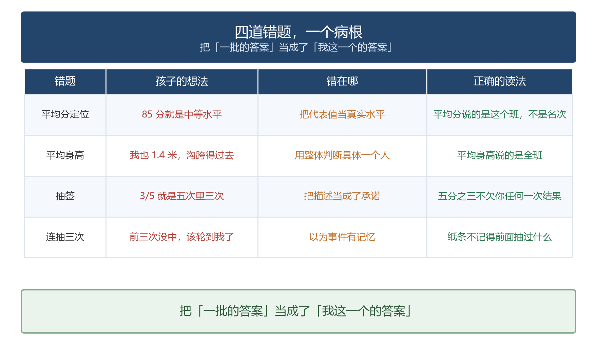

## 九、四次远征

>> 前面几节说的都在小学范围内。这一节走远一点，看四样东西。

这四样东西，和今天学的平均数、可能性，
做的是同一件事。

### 远征一：从一堆点里找出一条线索

1854 年，伦敦有一条街，十天里死了五百多人。那时候没有人知道霍乱是怎么传的，
流行的说法是"空气不好"。

有个医生叫约翰·斯诺（1813—1858，英国医生）。他做了一件很笨的事：
把每一个死者的住址，用红点一个一个标在街区地图上。

点标完，地图上浮出来一个形状：**死者围着宽街的一个水泵**。
离水泵越近，红点越密。他还打听到一件事：附近有家啤酒厂的工人，几乎没人得病——
因为他们喝厂里的酒，不喝那口井的水。

他跑去让市政把那个水泵的手柄拆了。疫情很快退了。

这件事了不起在哪？**他不知道下一个会是谁得病**——单个人，他一个都预测不出来。
可他把一整批数据摊在一张图上，就看出了原因。这正是这一讲从头说到现在的那个动作：
**单次算不准，一批里能看出规律**。（他用的方法，后来叫"数据可视化"，是今天每个统计软件都在做的事。）

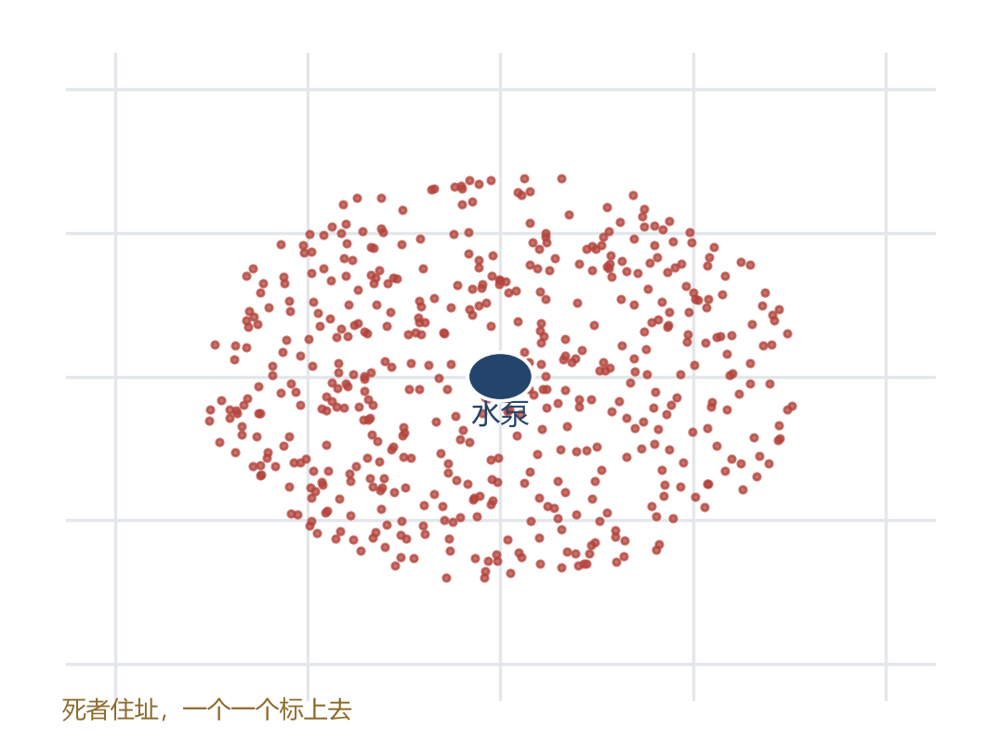

### 远征二：不知道谁会出事，也能做生意

保险公司卖一份保险，收你几百块。要是你出了事，它赔你几十万。

它凭什么敢？它并不知道你会不会出事——**它算不出来你**。
可它知道另一件事：一万个像你这样的人里，大概有多少会在这一年里出事。
这个数是从过去很多年的记录里来的，稳得很。

于是它收一万个人的钱，赔给其中出事的那几十个。剩下的，是它的本钱。

"保险"两个字的全部秘密就是这个——**它不承诺任何人不出事，它用一批人的数据，把一个人担不起的风险，摊到一万个人身上**。
（这也是为什么，健康的人也要买保险：不是替他一个人赔，是替这一批人一起赔。）

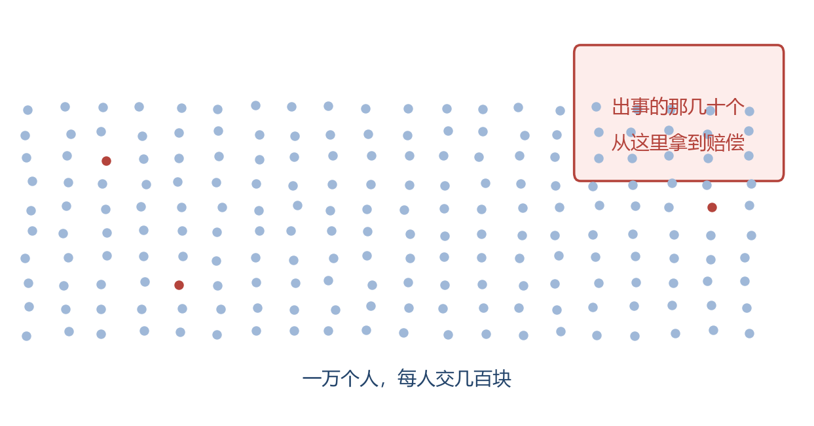

### 远征三：AI 靠的是哪一门算术

今天最热的东西是 AI。它读得懂你写的字，画得出你要的画，还能当场回答你的问题。

它靠的是哪一门算术？

不是有人把每一句话的答案写好了交给它——那要写到天荒地老。
**它是从几十亿条样本里，找出"什么样的输入，常常对应什么样的输出"**。
这跟小明做的事，形状是一样的：从一批已经发生的事里，找出一个能用的规律。

看清这一点，有两件事就顺了。

第一，它为什么有时会一本正经地胡说？因为它给的从来不是"保证"，是"按过去的样本看，
这样答的可能性比较大"。这是统计的口气，不是数学证明的口气。

第二，它为什么会越来越准？因为给它看的样本越来越多——**这一讲说的"一起看的量越多、看的样本越多，猜得越准"，就是它变强的全部道理**。

所以 AI 不是另一种数学。**它是这一讲那个动作，被机器做了几十亿次**。
孩子今天学的平均数、可能性，是这条路的起点。

（下面这几个词，都是大学里的。孩子现在不需要懂——写在这儿，是让你知道他将来会碰到什么。）

**概率**。小学叫"可能性"，大学叫"概率"，还要专门给它立一套公理。第五节那张纸条上的五分之三，
到大学是一门独立的学科。

**梯度**。机器怎么"学会"？它每猜一次，就回头算一下错了多少，然后沿着"能让错变小"的方向
调一小步——这样调几百万次。这个方向在数学里叫梯度，按它调的方法叫梯度下降。
（"梯度"要到大学微积分里才正式学。）

**线性逼近**。机器学东西，最后学到的常常是一大堆"小直线段"：在每一小片范围里，
它当成直的来处理，一片一片接起来，就凑出了弯曲的形状。
**这正是第 7 讲留过的那句话**：任何弯曲的东西，在足够小的局部，都能当成直的用。

**特征值和特征向量**。一批数据里常常有几十上百个量，其中只有几个真正说明问题，
剩下的多半在凑热闹。大学里有一种办法，是从这些量里先找出少数几个"最说明问题"的方向——
那些方向在数学里叫特征向量，每个方向配一个数叫特征值，说明它有多重要。
（这正是第七节那个意思：要用的量越多，越准。机器挑特征时，借用的就是这一套。）

**机器的每一次回答，底下都是一大片概率，和一次又一次沿着梯度的调整；而它调得好不好，看的是那几千亿个参数**。

还有几个词，孩子以后上学迟早会碰到。它们说的是同一件事——从一大批数里，找出能用的规律：

**损失函数**——用来说"这次错了多少"的那个算法。错了多少得能算成一个数，才谈得上改。
（这跟小学"求平均数"是一路的：先把情况变成一个数，才谈得上下一步。）

**神经网络、深度学习**——把"加权求和、再判断一下"这套动作叠很多层。层数越多，越深，
所以叫深度。（大学课程里叫神经网络，孩子不需要碰。）

**参数**——机器要一点点调的那些数。今天的大模型，参数是几千亿个。
（这一讲第七节说过：要用的量越多越准。机器走的是同一个方向，只是量级不同。）

**训练集和测试集**——一部分数据用来学，留一部分它从没见过，用来看它是不是真学会了。
（机器也会犯第八节那四道错题里的毛病：**把见过的当成全部**。）

**过拟合**——机器把训练数据背得滚瓜烂熟，换一批新的就露馅。
**这跟孩子"认题型不认关系"是同一个毛病**：记住了题目的样子，没抓住背后的关系。

**矩阵**——一次算几万个数的那套写法。大学线性代数整门课都在讲它。

这些名词你不用记。写在这儿，是想让你看见一件事：**从小学那串零花钱，到几千亿个参数的大模型，中间没有换过题目——一直是同一道题：从一批数据里，找出那个你关心的东西**。

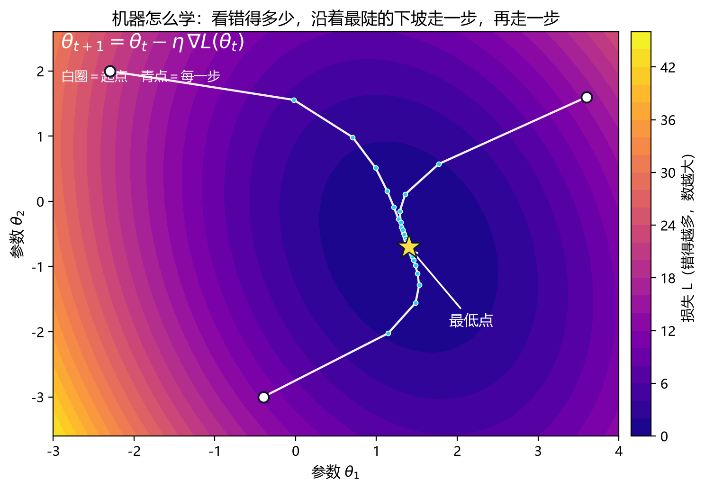

### 远征四：它怎么知道你想看什么

短视频一刷几个小时，为什么不觉着累？

因为你划走的那一条，也是它算出来递过来的。它不是在猜你想看哪一条——**一条谁也猜不准**（第六节那句话：单次算不准）。它做的是另一件事：把你点过的、看完的、划走的，一条条记下来，拼出"你像谁"。

还有一件差不多的事，你可能也遇过。

你只是跟家里人聊了一句"最近想买个手机"，转头就翻了几个型号、比了两家价。第二天，App 就开始给你推手机。有人说：这是手机在偷听。

不用偷听，也轮不到偷听，更不敢偷听。**你翻过的页面、搜过的词、比过的价、问出去的那一句，全都在那儿躺着**。**看你做过什么，比听你说话准得多，也便宜得多。**

系统要的不是"你想买什么"，它要的是"你像谁"。

往下就进数学了。

**第一，"像"是能算出来的。**

把你写成一行数，把每条视频也写成一行数。两行数之间的夹角越小，就越"像"。这个"像"，数学里叫余弦相似度。

$$\cos\theta=\frac{a\cdot b}{|a|\,|b|}$$

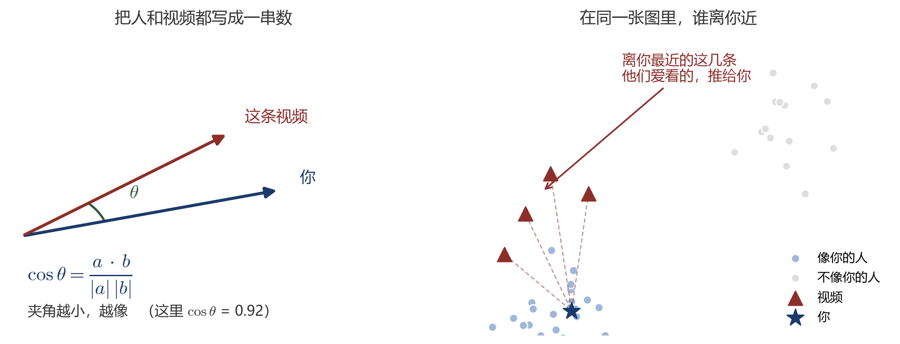

**第二，你那行数是怎么来的？**

把所有人和所有视频排成一张大表：横着是人，竖着是视频，看过就打一个分。这张表有个特点——**绝大部分格子是空的**（一个人一辈子也看不完几百万条）。数学做的事是：把这张大表拆成两张小表——一张记"每个人偏向什么"，一张记"每条视频偏向什么"，两张一乘，能还原出原来那张大表。拆出来的小表上，你的那一行，就是你的口味。

这套做法大学里叫**矩阵分解**（也叫潜在因子模型）。它做的不只是猜你喜欢什么：那几行数把人按口味排了序，机器第一次有了"你像谁"这个说法。

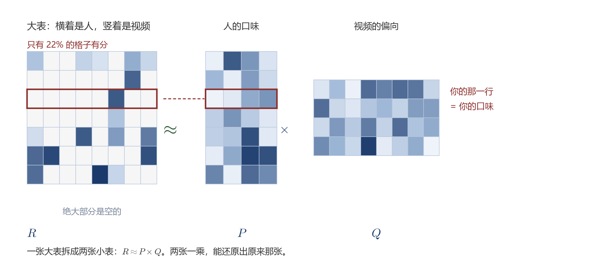

**第三，两行数怎么比大小？**

一项一项乘起来再加。这个动作孩子做过——**加权求和**。只是这里不是几项、十几项，是几百上千项。这个数在数学里的名字叫内积（点积）。

**第四，分数高不等于你一定会看。**

机器把分数压成 0 到 1 之间的一个数，代表"可能性多大"。

$$P=\frac{1}{1+e^{-z}}$$

这个函数大学里叫 logistic 函数。所以它给的是"按过去看，可能性大"，不是"你一定看"。这也是它为什么有时推得离谱——它说的是可能性，不是保证。

**第五，几百个方向的"像"，人眼看不见。**

"你像谁"是在几百个方向上比的。这不是画得出来的图——小学里的图形是两三个方向的；几百个方向的"近"和"远"，只能靠算。

（下面这几个词，都是大学里的。孩子现在不需要懂——写在这儿，是让你知道他将来会碰到什么。）

**矩阵分解**。刚才那张大表是怎么拆的。大学线性代数里正经学。

**内积（点积）**。两行数一项一项乘了再加。它是"加权求和"的一般写法，也是所有"相似度"的地基。

**余弦相似度**。刚才那个夹角。人和人、人和东西之间像不像，都靠它说话。

**embedding（嵌入）**。把一个人、一条视频变成一行数，让它们能放到一起做算术——这个词现在到处都在用。

**logistic 函数**。把任意一个分数压到 0 和 1 之间，好当成可能性来读。

**协同过滤**。这套办法的总名：不研究"你喜欢什么"，研究"像你的人喜欢什么"。

这些名词你不用记。写在这儿，是想让你看见一件事：**它没偷听你，也没猜心。它做的，就是孩子今天在课本上学的那一件——从一批里，找规律。**

## 十、给家长的分寸

>> 讲完了。最后几页是给家长看的：哪些别碰、哪些该做。

先说一句：**这一篇是写给家长的，不是给孩子读的**。

统计这一块和前面几讲不太一样：孩子的任务不是读懂这些道理，是**自己记一次数、自己猜一回**。
真要给他看，指两处就够：小明那串零花钱（开头），还有文末那道互动题。其余等他先动过手再说。

### 这一块，各年级到哪儿

| 年级 | 他该做到哪一步 | 别提前做什么 |
|---|---|---|
| 一、二年级 | 会分类、会数一数，能照着图说出一件事 | 别讲"平均数"这三个字 |
| 三年级下 | 会填统计表 | 别急着教平均数怎么算 |
| 四年级上 | 会看条形统计图 | 同上 |
| 四年级下 | **会算平均数**（总和 ÷ 个数），知道它能代表一组数的水平 | 别拿难题去练"平均数应用题" |
| 五年级上 | 知道可能性有大有小，会说"一定、可能、不可能" | 别把这个词换成别的说法 |
| 五年级下 | 会看折线统计图，能看出什么地方涨了、什么地方落了 | 别讲"趋势"这一类词 |
| 六年级上 | 会看扇形统计图 | — |
| 初中才学 | 中位数、众数、方差，以及正式的统计推断 | 小学不要提前碰 |

（中位数、众数、方差都是初中的工具。小学遇到"多少人考在一半以下"这类题，
课本自有别的办法，不必提前把那把尺子交给他。）

### 三条底线

**一、别把"平均"讲成"每个人都这样"**。这一条排在这一讲的最前面。平均分 85 分，
不等于谁都考了 85；平均身高 1.4 米，不等于每个人都能跨过同一条线。

**二、别用"多试几次就轮到我"去解释可能性**。这句话会让孩子的理解跑偏——
从"五分之三"到"多试几次就轮到我"，中间只隔着一句错话。

**三、让他自己记一次数**。记什么都行：零花钱、跳绳个数、一周的天气。
有了自己记的一串数，"平均数是个什么东西"才落得下去。

### 多动手，然后多思考

写这一块，和写几何那一讲一样，最有用的一条建议是：**把"讲"换成"问"**。
他算完平均数，问一句"这个数能代表谁、不能代表谁"，比替他讲一遍管用；
他记完一周的数，问一句"你想知道什么"，比直接教他算管用。

动手在先，思考在后——**只动手不想，那一下就白动了**。

## 十一、结语：统计的意义不在猜准，在会读

>> 这一讲要说的，到最后只剩一句。

这一讲从一串零花钱开始：三个猜法，三个答案，从"你想知道什么"起步，
一路走到机器学习那几千亿个参数。

回头看，这一讲做的事只有三件：

**平均数，是一个数代表一堆数**——它可能不属于那堆数里的任何一个人。

**可能性，是分数的一次全新用法**——它说"这件事有多悬"，不承诺任何一次结果。

**单次算不准，多次有规律**——从质数的分布，到上厕所的十几秒，都是同一件事。

想猜得更准，要靠更多的参数，那一层在很久以后。而今天能拿到的，是另一件事——
自己记下一串数，自己问清一句"我想知道什么"。

前八讲，数学都在把东西让出去：算法让给运算律，机巧让给程序，逼近让给"越来越接近"。
这一讲让出去的是**判断**——你不想自己拍板，就让数据替你说话。

可让出去的只是判断。**读懂它，还是你自己的事**：知道它在替谁说话，知道它丢掉了什么，
知道它回答的是"那一批"，不是你这一次。

**这一讲最想防的，不是算错，是算对了、却读错了**。

**数据只是照着被问的那一句答。你问错了，它照样答**。

---

**参考文献**

- 《义务教育数学课程标准（2022 年版）》第三学段"数据的收集、整理与表达"与"随机现象发生的可能性"——平均数、统计图、可能性
- 人教版《义务教育教科书·数学》四年级下册（平均数与复式条形统计图）、五年级上册（可能性）教师教学用书
- 国家统计局《2025 年居民收入和消费支出情况》（2026 年 1 月 19 日发布）——全国居民人均可支配收入 43377 元，按五等份分组数据
- John Snow, *On the Mode of Communication of Cholera*, 1855——伦敦宽街霍乱调查，用死亡地点的分布找出水源
- A. N. Kolmogorov, *Grundbegriffe der Wahrscheinlichkeitsrechnung*, 1933——概率的公理化，"不确定"正式进入数学

---

**互动**

留一道题给你的孩子：他最近一次考试的分数，和班里平均分比，谁高？再问他一句——这个平均分，能代表班里的谁？

（本讲的「零花钱卡」已生成，公众号对话框回复 **零花钱卡** 可取。）
