# 思想地图：等号的一生

「数学成神之路」小学数学 · 第 10 讲 · 终篇

原创 · 程大大的小记

## 导读

**成绩单只告诉你他会不会做题，告诉不了你娃真正是什么水平**。

两个数学都考了 95 分的娃，真实水平可能差着两年。一个的 95 分底下，等号的意思是"算完了"；另一个的 95 分底下，等号的意思是"这两个写法指的是同一个数"。卷面上看不出这两个娃的差别，往后的路却不一样。认为是"算完了"的娃，容易在五年级方程那一站跟不上；早认出"两个名字指同一个数"的，早就过去了。

家长其实一直想问这件事，只是问法不对。"我家娃数学学得怎么样"这个问题没有答案，因为它的答案只是几百道题的平均。**娃的真实水平，是他对几个关键符号的理解到了哪一层**。水平问不出来，只能看。

**这个符号，就是"等号"。**

题目一年一年地换，娃第一天认识它，用到六年级，很可能从没想过它是什么意思。甚至大人也可能没想过。

在数学史上，这个符号比我们以为的出现得晚多了。欧洲人早先用文字写算式，"3 加 4 等于 7"要写成一句话。1557 年，英国数学家雷科德（Robert Recorde，约 1510—1558）第一次用两条平行线代替那个词。他给的理由其实很简单：**要说"相等"，再没有哪两样东西，比两条平行线更相像了**。那时明朝人正拨着算盘，这个符号其实才刚出现。第二年，雷科德死在债务监狱里；两条平行线被全欧洲接受，又多花了将近一百年。

小学这六年里，等号换过九副面孔。每一副面孔，正好落在娃的一个学段上。**这九副面孔，其实是一件事分成的九个阶段**。课本编排的顺序、娃长大的顺序，也跟着这九个阶段走。

这一篇有一个序站、九站正篇。每一站固定五样：**学到哪儿、等号在这一站的新意思、这一站想的是什么、娃常卡在哪儿、家长能做什么**。不必从头读，找到娃那一站，读那一站就够。全部读一遍也无碍。读到后面你会发现，这九站讲的其实是同一件事。**这九站排在一起，就是一张关于等号的地图**——先给你用的。怎么用、哪儿最容易用岔，后面有一节专门说。

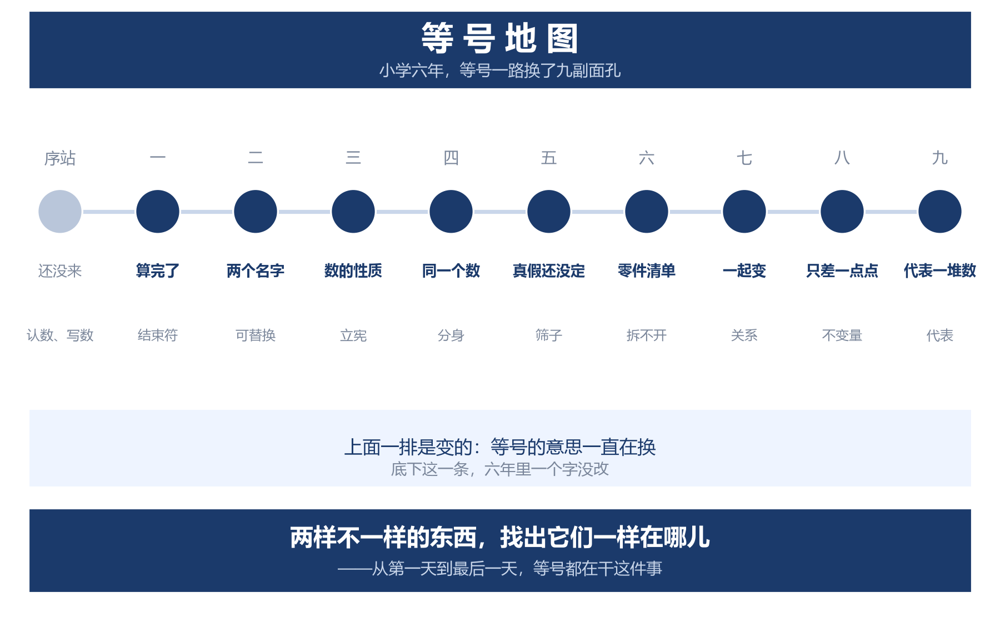

## 序站：出生之前（学前到一年级）

**学到哪儿**：认数、写数、数数。

人类为把数写下来这件事，走了几千年。巴比伦人用六十进制，今天钟表上六十分进一小时、角度三百六十度，都是它留下来的；玛雅人用二十进制，手指加脚趾，还独立造出了零的记号；罗马人不用位置，一个数一个记号，八十八要连写八个记号。记一个数，纸就不够用。后来有人改了主意：只给十个符号，一个数是多大，看它写在哪一位上。这一改，能写的数就没有上限了。

中间还出过一次有名的意外。公元一千年左右，热尔贝（约 945—1003）把这套记法往欧洲推。他后来当上教皇，号西尔维斯特二世，算学上的本事在当时没人比得上。可他带回来的算板，档上偏偏缺了零——那块板上只摆了九个符号，空出来的那一档，就当作零用。他本人的算学本事先进了一大步，自己写数却还是用罗马数字。位置制真正在欧洲落地，还要再等两百来年。

**等号在这一站的新意思**：此时还不需要等号。可这一站是它的前提，是整个数学的前提——你得先认识数、会写数，不然还学个 der 啊。

**这一站想的是**：同一个 1，写在个位上是一，写在十位上就是十。位置一变，数就变了。

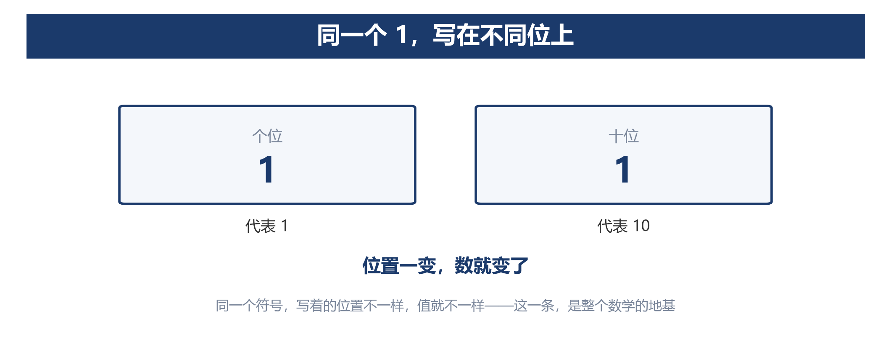

**娃常卡在**：数数背成儿歌。让他数一堆糖，数到 1、2、3，他能数出来，但不明白最后那个"3"是说，前面数过的那些都在里头。

**家长能做的**：玩位值。一根小棒是一，十根一捆，让他把 25 摆出来——两捆零五根，"2"写在十位上，代表的就是那两捆。不用讲名词，摆过就够了。

## 第一站：出生——"算完了"（一二年级）

**学到哪儿**：加减法口算。

**等号在这一站的新意思**：结束符。`3+4=7` 娃读作"三加四——答案是七"。等号的意思不是"两边一样"，是"算到这儿为止"。

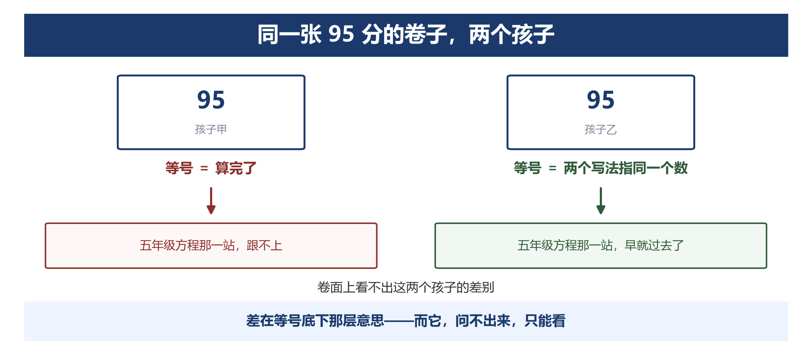

这事怪大人，不怪他。每道例题，等号右边写的都是答案；每次批改，看的都是等号右边对不对。**他见过的每一个等号都是这个读法，当然以为等号只有一个意思。**

**这一站想的是**：20 以内加减法得练到不用想——不是练会，是练到闭着眼也对。算数还占着脑子，别的事就装不进去。

**娃常卡在**：不敢写 `3+4=□+2`。你让他填，他盯着题说："这题出错了，右边应该写 7。"在他的等号语法里，右边只能是一个数；让他承认两边一样多，等于要他改掉对这个符号的全部经验。他填不出来，跟算术没关系，是他对等号的用法只认一种。数学教育里研究这件事几十年了，这样的娃其实不少。

**家长能做的**：别急着讲题。先让他把 `3+4=7` 重读一遍——不读"答案是七"，读"左边和右边一样多"。读顺了，`□+2` 他就敢写了。整个过程十分钟。

## 第二站：可替换——换名字（二三年级）

**学到哪儿**：乘除法、四则混合运算。

**等号在这一站的新意思**：`3+4` 和 `7` 不是"题和答案"，是同一个数的两个名字。等号在这里不再表示一个结果，它表示一件事：写法可以换，东西还是原来那个。

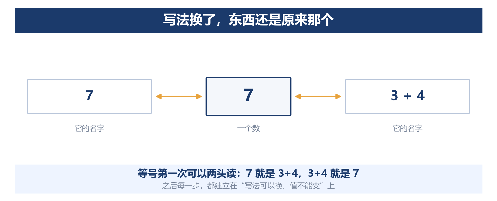

别看这一副面孔朴素，它是后面每一站的基础。一旦承认"写法换了东西没换"，娃就能做两件事：拿不准的算式重算一遍核对，复杂的式子拆开变形。数学从一次就得做对的考试，变成可以重做的练习。"写法换了东西没换"这一条，后面每一站都在用。

**这一站想的是**：算错了能重算，天塌不下来。数学跟别的科目不一样，它允许你错——错了再算一遍就行。

**娃常卡在**：会算，不知道为什么能这么算。"先乘除后加减"背得很熟，可问一句凭什么，答"规定"。

**家长能做的**：拿 `3+2×4` 问他：先别算，猜——从左往右算得 20，先算乘法得 11。一道题两个答案，这就不行了。**"先乘除后加减"不是谁随手定的；不定这条，同一道题就保不住唯一答案。** 让他两种算法都算一遍，亲眼看见不一样——规定就不再是背下来的，是他自己发现非定不可的。

## 第三站：立宪——承诺（三年级）

**学到哪儿**：运算定律。

**等号在这一站的新意思**：`a+b=b+a`。等号连的是一条规则：这个运算，交换位置，结果永远不变。

**这一站想的是**：运算律不是老师定的，是数本身就这样。所以它背不来——你只能自己动手验，验过才敢信。

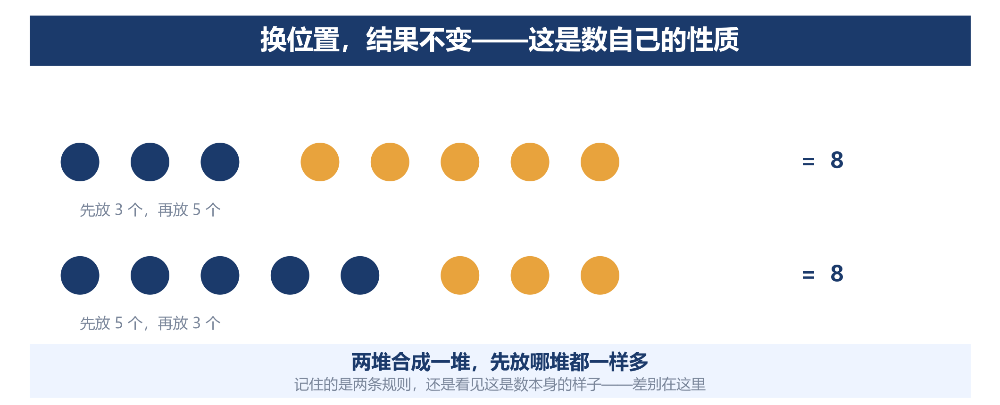

想知道他是真懂还是背的，问他一句：**假如明天世界改用十二进制，交换律还成立吗？**

答案是：成立。换进制换的是写法系统——逢几进一、用几个符号；交换律保的是"合并"这个动作——先合哪两堆，结果都一样，换成十二进制也一样。娃答得上来，说明他分得清哪一层能换、哪一层不能换；答不上来，说明他背下的是一句话，不是一条结构。**一条规则里，有的部分可以改，有的部分改不掉——分得清这两部分，就算入门了。**

**娃常卡在**：交换律结合律背得很熟，可你问他"3+5 和 5+3 为什么一样"，他答"老师说的"。他记住的是两条规则，没看见这是数自己的性质。

**家长能做的**：让他自己挑三个大数，验一遍加法交换律。验完追半句："你只验了三个数，就敢信所有的数？"——他答不上来没关系，答不上来正说明：小学能做的只是验证，给所有数打包票的那套东西叫证明，是初中才学的。

## 第四站：分身——两个不同的东西，是同一个（四年级）

**学到哪儿**：分数。

**等号在这一站的新意思**：`1/2=2/4`。前面几站，等号两边写着不一样、读出来是同一个；这一站，等号第一次把两个不同的东西连起来——两块饼，切法不同、拿法不同、读法也不同，被人宣布成同一个。

这一次改变，人类等得格外久。古埃及人只会用几分之一记账：2/5 他们要写成 1/3 加 1/15，一张纸草上满满写着拼出来的单位分数；罗马人只会拿十二分之一当零件，再复杂的量都拆成一堆零碎。不是没有聪明人。只是**一个数可以有很多个名字，这些名字都作数**，这个想法在他们那儿其实还没有出现。从算得出来，到承认写法不同可以是同一个，文明走了几千年；娃在这一站用一学期走完。

**这一站想的是**：切法随便换，饼还是那块饼。娃第一次碰上"看着不一样、其实是同一个"——这一关过不去，后面通分约分就只剩背口诀。

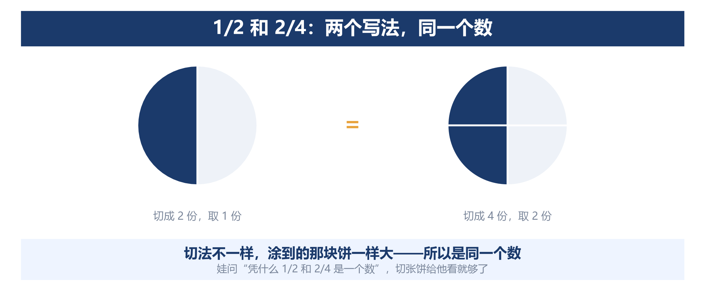

**娃常卡在**：约分通分很熟，问一句"凭什么 1/2 和 2/4 是一个数"，答不上来；诚实的娃会直接说"不是，分母不一样"。

**家长能做的**：切一张饼。先切 4 份取 2 份，再切 8 份取 4 份，摆在一起，问哪块大。"一样大"三个字说出口，他就接受了这个等号——"分母不一样"和"是同一个数"这两句，从此刻起可以在他脑子里同时成立。

## 第五站：筛子——还没成立的等式（五年级）

**学到哪儿**：简易方程。

**等号在这一站的新意思**：`x+5=12`。这一站的等号**可能不成立**——找到 x 之前，没人知道它成不成立。它不再是一句说完就完的话，是一张筛子：把数一个个放进去，只留下 7。

这次变化拖的时间最长——从丢番图记未知量到笛卡尔定下字母，前后一千三百多年。公元三世纪，丢番图（Diophantus，古希腊数学家）解题时已经会给未知量起缩写记号；约公元 820 年，花拉子米（al-Khwārizmī，约 780—约 850，阿拉伯数学家）写出《代数学》，全书没有一个符号，"某数加上五等于十二"是一整段文字；直到 1591 年，韦达（François Viète，1540—1603，法国数学家）才第一次用字母表示一般的量。到 1637 年，笛卡尔（René Descartes，1596—1650，法国数学家、哲学家）才把 x、y、z 的用法定下来。**从会解题到敢写 x，人类走了八百多年。卡住他们的不是解题能力——花拉子米解的题娃都会——是不敢把符号交给一个还不知道是多少的东西。**

娃不敢写 `x+5=12`，当年人类最聪明的那批人，也怕过同一件事。不必责怪，只要有人带他一下。

**这一站想的是**：不知道是多少，也能先给它起个名字。名字一进算式，就能当数用——x 就是这么来的。这一步人类卡了一千多年，娃也卡。

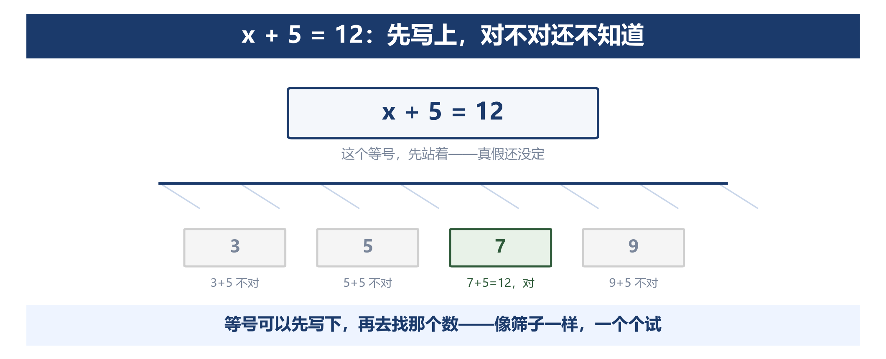

**娃常卡在**：会解，不会列。很多家长以为病根是"没抓住等量关系"，不是的——病根更深：**娃不敢先写下一个"还不知道对不对"的等式**。在他心里，写下一个等式就等于说它是真的；他不确定真不真，就不敢写。

**家长能做的**：一句话——让他把题目里那句"两样东西一样多"的话，**原封不动翻译成等式，先不许算**。等式写在纸上，这一步就成了，解是第二步。多做几次"只翻译、不解"的练习，比多刷二十道方程题管用。**很多娃"数学掉队"就掉在这儿**，不在分数、几何。

## 第六站：零件清单——一个数＝它的基因（五年级下）

**学到哪儿**：因数与倍数、质数与合数、最大公因数。

**等号在这一站的新意思**：`60=2×2×3×5`。等号在这里的意思是：一个数，等于它的零件清单。而且清单只有一种写法——这一条最吃重。

古希腊人把质数叫"第一的、不可分解的数"，说别的数都由它们生成（后人常把它们比作数的原子）；埃拉托色尼（约前 276—前 194）——那位测出地球周长的亚历山大图书馆馆长——发明了一个筛法：从 2 开始，把每个质数的倍数挨个划掉，剩下的就是质数。用排除法造一张质数表，两千多年前的人就在干了。但"拆法只有一种"这一条，人们花的时间更长：两千三百年前欧几里得（Euclid，约前 325—前 265，古希腊数学家）在《原本》里证过。第六讲讲过它最远处的样子：小学五年级这张质数表，和素数定理、黎曼假设在同一条线上。

**这一站想的是**：拆到不能再拆，而且不管怎么拆，结果都一样。这一条不是天上掉的——为了让"拆法只有一种"成立，数学干脆不把 1 算作质数。一条规则好不好，不看它顺不顺眼，看它保住了什么。

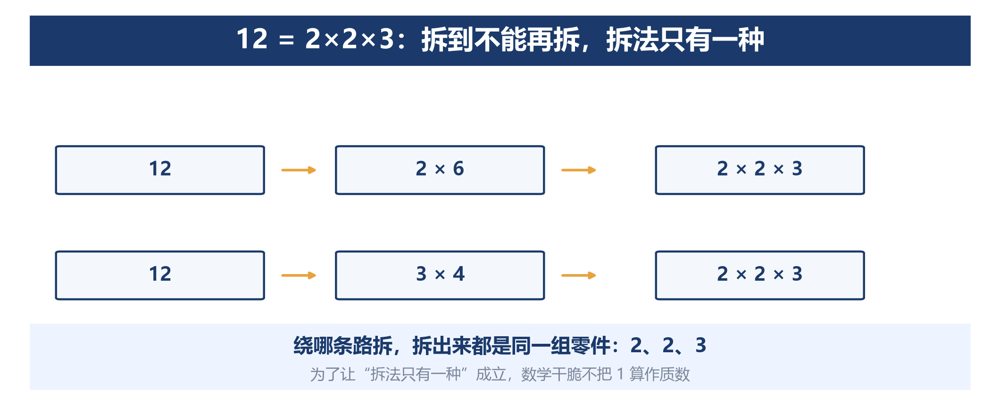

**娃常卡在**：短除法会列，但不知道这是在干什么。

**家长能做的**：让他自己拆 60，拆到拆不动为止，然后问：还能换一种拆法吗？让他真的去试三种。试过之后，"拆法只有一种"就不再是课本上的规定，是他自己摸到的事实——**摸过一遍的事实，和背下来的规定，是两种东西**。

## 第七站：关系——连接两个会动的东西（六年级）

**学到哪儿**：比和比例、正比例。

**等号在这一站的新意思**：`y=kx`。k 是一个不变的数（比如每支铅笔三块，k 就是 3），y 和 x 是两个一起变的量。等号两边不再是两个静止的数——你动，我就按那个固定的比例跟着动。

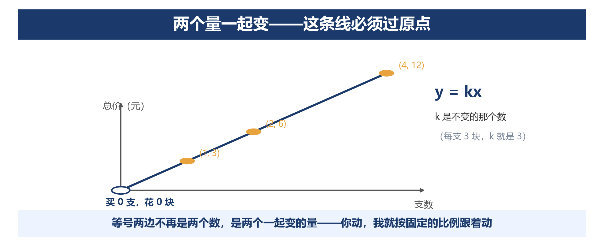

从这一步起，数学开始用来写自然规律。伽利略（Galileo Galilei，1564—1642，意大利物理学家）盯着斜面上滚下来的小球，发现它走过的距离总跟着时间的平方一起走：时间变成 2 倍，距离变成 4 倍。他不是先有公式再去验证——他是先看见两个量之间那种按比例一起变的关系，然后认定这种关系必须用数学写出来。他说宇宙这本大书是用数学语言写成的，凭据就是这一类发现：变化本身，也能用等号写下来。

**这一站想的是**：不能比的东西怎么比？都归到"每一份"就比得了。单价、速度、浓度，全是这一招。

**娃常卡在**：应用题会套"归一"，看着图像认不出那条直线；不明白正比例的线为什么非得过原点。

**家长能做的**：问他"买 0 支笔花多少钱"。他答"0 元"，就让他把 (0, 0) 这个点描上去。0 支对 0 元，这个点只能落在原点。他要是追问一句"那'0 支花 2 元'行不行"，那正好——这一问就说明他过了第七站。

## 第八站：不变量——跨越一次变形（六年级）

**学到哪儿**：多边形面积、圆的面积、圆柱圆锥。

**等号在这一站的新意思**：剪一刀、移一块，形状换过了，那个面积还是原来那个。等号一边是变形前，一边是变形后，两边说的是同一个面积。圆的面积更进一步：拼出来的图形永远差一点点，只能说"越来越接近"——这是娃头一回遇到不许说"等于"、只许说"接近"的等号。

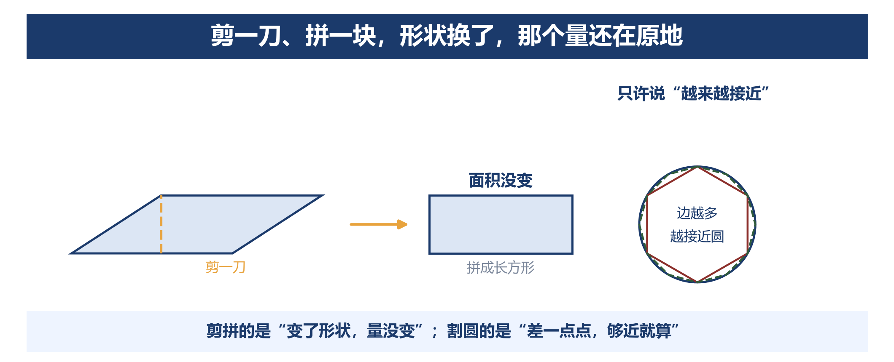

这一段最早是中国人做的。公元三世纪，刘徽（约 225—约 295，中国魏晋数学家）给《九章算术》作注，用圆内接正多边形逼近圆：割得越细，丢得越少，"割之又割，以至于不可割，则与圆周合体而无所失矣"。两百年后祖冲之（429—500，中国南北朝数学家）把这个方法做到极致，把圆周率算到 3.1415926 和 3.1415927 之间，领先世界近千年。再往前几百年，西方的阿基米德（Archimedes，约前 287—前 212，古希腊数学家）也在做同样的事。而他有一本讲"怎么想到的"的《方法》，只靠一份中世纪的羊皮纸抄本传下来，抄本后来被人洗掉字迹、改写成祈祷书——此后将近七百年没人读得懂，直到 1906 年才有人把它重新读出来。这种逐步逼近的算法，差一点就没人再知道了。

**这一站想的是**：不会算的，剪一刀就变成会算的。还不会？那就一直切，切到"差不多"——数学第一次允许了"够近就算"。

**娃常卡在**：公式全会背，问"底乘高除以二凭什么"，答不上来。

**家长能做的**：剪一张纸。剪一次就够，但要他自己剪、自己拼。拼成的那一下，公式不再是他背下来的，是他自己造出来的。往后学新公式，他会习惯性地想找那张"剪一刀"的纸。

## 第九站：代表——一个数＝一堆数（六年级）

**学到哪儿**：统计与可能性。

**等号在这一站的新意思**：平均数＝这一组数据的代表。这是小学六年里，等号最大胆的一次：**一个数**和**一堆数**之间画了等号。这个数甚至可能不等于其中任何一个，可它敢说"我代表他们"。可能性也一样：3/5 度量的不是一块饼，是摸球的趋势。

这一副面孔出现得最晚，用的人却最多。

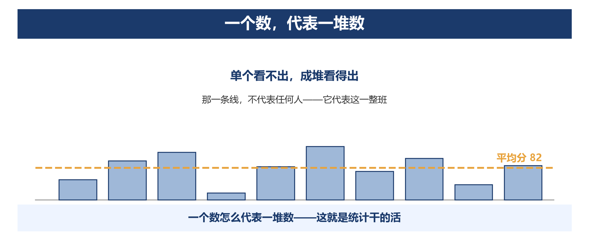

1854 年伦敦霍乱暴发，医生约翰·斯诺（1813—1858）不相信"瘴气"的说法，他把病例一处处标在街区地图上——图上那些死亡，密密地围着同一个水泵。1854 年 9 月，他说服教区拆掉了那个手柄。那时候疫情本来已经在往下走，可他给出的道理是对的：病人喝的是同一口井的水。他用的就是把"单个看不出、成堆看得出"这件事做到极致。他四十五岁就去世了，"霍乱经水传播"很多年后才被医学界公认。

**这一站想的是**：一次说不准，一万次就说得准了。掷一次骰子谁也猜不到，掷一万次，谁都知道大概几个 6。

**娃常卡在**：会算，不会读。看到"班级平均分 85"，就以为"考 85 分的人在班里排中间"——实际上，他可能是前五，也可能是倒数第五。

**家长能做的**：只问两个词。第一个："这个平均数代表谁？"第二个："有几个数把它带跑了？"会读比会算难，也比会算值钱——人均收入、平均寿命、班级平均分，全是同一种东西。

## 指北针：关系在哪里

九站的家长动作看下来，千差万别：切饼、剪纸、验算、描点。抽到最后一层，它们其实是同一句话的九个变体。

第四站讲的是，一个数写成什么样子，和它到底是多少，是两件事。第六站讲的是，一个数里面装着什么，和它外面看着多大，也是两件事。第七站把两个一起变的量连起来，第八站和第九站各说了一次：图形剪过拼过、数据换了一批，那个要看的量还在原地。第二站那条"先乘除后加减"，守的也是这件事。连第五站也在这条线上：等号在那儿的意思一直在换，可**把关系写下来**这个动作，从第一天到最后一天，都是同一个。

再看背面，就知道这条线有多管用。0 为什么不能做除数？因为 `0×3` 和 `0×5` 都等于 0；你要是把等号两边都除以 0，就得承认 3=5。**一旦允许除以 0，等号两边就不再相等，这个等号就废了。**

所以家长真正管用的工具只有一件。娃无论卡在哪一站、哪道题，你都可以问同一句：**"你这么一变，关系还在不在？"** 他答得上来，这一站就通了；答不上来，缺口就在那儿。

还有一件事只有这一篇适合说：这个问法，初中、高中、大学，**没有人会再教第二遍**。初中老师默认他会问。小学这六年，是有人陪他一遍一遍练这个问法的最后一段。

## 长大以后（这一节是给大人的，娃现在不需要懂）

等号到了初中还在用，只是换了名字，一个比一个陌生。

初中多了一个说法，叫"全等"——两个三角形翻转、平移之后能重合，就算同一个。高中和大学，"同一个"后来分出好几种：相等、等价、同构、同胚，数学里专门有一支研究"什么算同一个"。同构是大学代数课的第一课，同胚是拓扑学的门槛——拓扑学家研究揉皱了也不变的东西，咖啡杯和甜甜圈在他们眼里是同一个。二十世纪的格罗滕迪克（Alexander Grothendieck，1928—2014，法国数学家）干脆从"等价"出发，重写了整个几何。这些娃都不需要懂，你只要知道一件事：

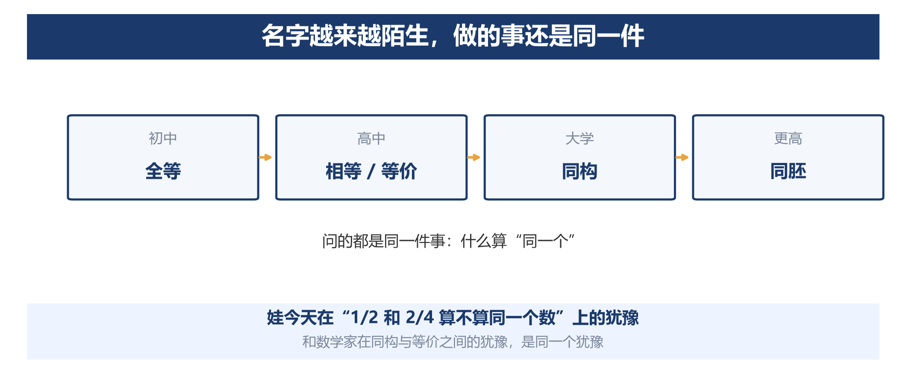

**娃今天在"1/2 和 2/4 算不算同一个数"上的犹豫，和数学家在同构与等价之间的犹豫，是同一个犹豫。**

小升初有三道坎，其中字母和写理由这两道，前面的九站已经练过了。**负数**（人教版六下只要求认识、不做运算，运算是初中的事）：等号第一次跨过正负——把方向编进数里，本质上是给数换个名字。**字母**：x 从"答案"变成"对象"，在等号两边都会出现，位置可以换，不再只是右边等着被填的那个格子。**写理由**：初中几何每一步都要说明这个等号凭什么成立——这一步凭什么成立？九站里问了一路的"什么没变"，到这儿有了正式的名字。

再往前，这门学问自己也有没解决的地方。三百多年前费马（Pierre de Fermat，1601—1665，法国数学家）在书页边上写下一句"这页空白太小，写不下"，后人为它找了三百年，到 1994 年才证完；还有一个到今天还开着口的：随便挑一个数，偶数除以 2，奇数乘 3 加 1，反复下去，最后一定落到 1 吗——没有人证明得了，也没有人找到过一个反例。

最后说说今天。**机器能给出等号右边的答案，也能背出左边的理由，可它不会替娃问出那一句。** 娃将来问 AI 一道题，一秒就得到解答，比家长快，比老师准。可"这个等号凭什么成立"，没有人替他问。

## 这张地图怎么用（以及五个容易走岔的地方）

这张地图，就是前面讲的「等号的一生」：九站既是等号在这六个年级里的样子，也是娃要经过的九个地方。它给的是位置和方向，不是课程表。

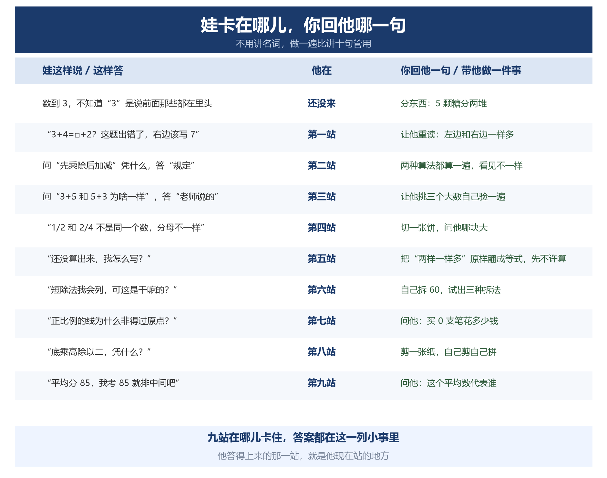

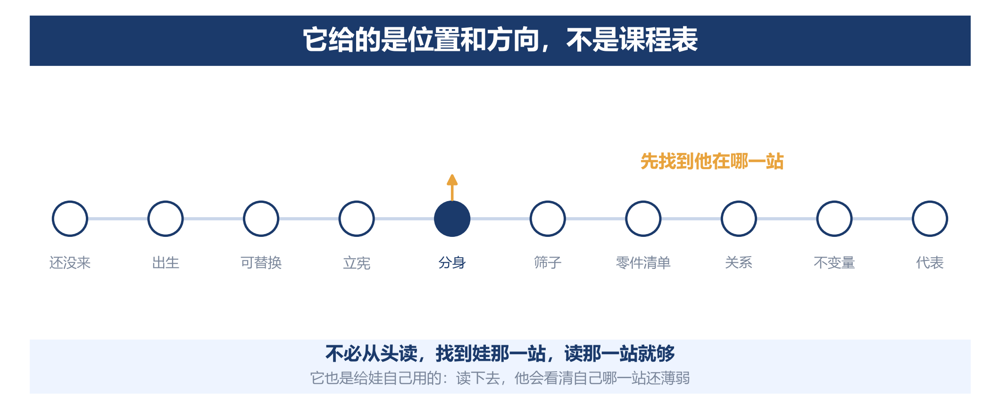

**一、多让娃动手，不等于书本练习不重要。**

这一篇通篇劝你多问、多让娃动手，最容易被听岔成"那书本练习就不重要了"。回头看这九站——每一站的家长动作之前，娃都得先练熟那一站的计算：口算练到自动化，用运算律时才不用分心去算；口算不占脑子，方程才有地方放。**光会想不肯练、光会练不肯想，都会停在那儿。** 练到自动化就够了，不用一直练下去——省下的脑子，留给"查找关系"。

动手也一样，别做过头。剪一张纸、拼一个平行四边形，"一次就够"是说，这一次得他亲手做，做完就回到纸笔和符号。反过来也一样——一个学期光做动手活动，和一天不动手，都不行。

**二、念给他听，不等于他学会了。**

**听懂和会了，是两件事。** 听来的、看来的，都还搁在别人那儿；得他自己走一遍，那个东西才归他。

差别一眼就能看出来。你问他，他能复述；换他自己做，他就做不出来——那还没归他。你把道理讲得再清楚也搬不进去，话是你的，手是他的。想知道归没归他，让他讲给你听：讲得下去，就是真懂了。

这一篇也一样。别急着让他背下九站的全貌，那不是它的用法。它的用法是让他自己读——读下去，他会看清自己站在哪一站，哪一站还薄弱。知道自己哪儿不会，下一步往哪走就清楚了；要连自己不会都不知道，那是真没方向。

**三、课本剪掉了过程，不等于课本不好。**

六年要装下几千年，剪掉"当年为什么想到"，是省时间付出的代价，不是偷工减料——真把过程全留下，六年根本学不完。课本是把过程省略过的。

老师不是讲不清楚。抽象的东西，他能讲明白，只是有课时任务在，讲过去了就得往前赶，顾不上回头看每个娃跟上没有。当时没听明白的，得靠自己去问——问老师，或者回家问家长。娃得知道"不懂是可以问的"，这比多考几分重要。

家长能做的，是挑几个关键点，把剪掉的那段陪他走一遍。

对这件事，你也别太自信，也别太悲观。前面讲的那些"当年为什么想到"，丢掉的比留下来的多。反过来说，正因为会丢，你陪他走的那一遍，可能就是关键的那一遍。

物理学家费曼（Richard Feynman，1918—1988）去世时，他办公室黑板上留着一句话：我自己造不出来的东西，我就还没有真正弄懂。课本上的结论，娃背下来，不等于他自己造过一遍。你陪他走的那一遍，就是让他自己造一遍。

**四、问"凭什么"不是每题都问。**

在关键节点问，在卡住的地方问。一天三问，不如一周一问、问在点子上。这一问也不拖成绩：真正拉开差距的题，就是把旧知识挪到新场景的那几道——而他会不会找关系，就是挪得动挪不动的关键。

怀特海（Alfred North Whitehead，1861—1947）既做数学也讲教育。他说最要防的是"惰性观念"——只被接收进脑子、没有被用过、检验过、重新组装过的想法。知识是这样，追问也一样：问出来的东西能用上才算数。问得太少，娃只会照着算；问得太密，他先烦的是数学。力气攒着，用到真该问的那几处。

**五、别提前学知识，不等于别提前想。**

"这是初中的事"说的是知识和符号——负数的运算、移项变号、证明格式，留给初中老师；系统学和抢跑都会打乱他自己的顺序。但想法可以提前沾：娃问"有没有比零小的数"，就聊方向，聊到哪算哪，不系统、不考核、不指望记住。

有的娃自己会走得更远。负数、小数，甚至极限、微积分，他自己有兴趣，看书、看视频、自己琢磨，弄明白了还能讲出里面的门道——这非常好，不用拦，也不用怀疑。

有人问爱因斯坦是不是天才，他说自己没有什么特别的才能，只是热切地好奇。娃问"为什么"，不是跟你捣乱，是好奇在动。自己乐意学来的东西，你不用推，他也往前走。

你要做的就是两件事：看着，陪着。看他是不是自己愿意的，陪他把话讲完、把问题追下去。要留神的只有一条：别让他把学校正在学的那一段落下。

## 给娃的三句话（这一节可以直接念给娃听）

第一句：你学过的每一样东西，都有来处。底乘高除以二，不要只记它——想一想那两个三角形拼起来的样子。想不起来，拿张纸剪一下。

第二句：一个数代表不了谁。碰到"平均"，先问它代表谁；考了 95，只代表这次考了 95 分。

第三句：不会，是可以问的。老师没答，问爸妈；爸妈也答不上来，就把问题留着，留到你自己能答上来的那天。

## 结语

小学六年，等号的九副面孔讲完了。它从一个"结束符"，变成两个名字指同一个数，变成承诺，变成分身，变成筛子、零件清单、关系、不变量，最后变成代表。**这九副面孔，都是后来的人类往"同一个"这个词里一层一层添上去的意思**。

九副面孔里，一直在变的是等号。没变的是另一件事：**写下等号的人，总想在两样不一样的东西里，找出它们一样在哪儿**。 欧几里得（Euclid，约前 325—前 265，古希腊数学家）写《原本》，开头那几条公理里就有一条是关于等号的："等于同量的量，彼此相等。"三岁的娃认"这两块饼一样大"，数学家认"这两个结构是同一个"。同一个念头，娃那边走了三四年，人类历史经历了四千年。

**这张地图留给你的那句"关系在哪里"，只有一个使命：传下去**。哪一天你听见娃自己问出这句话，他盯着一道题、一条规定、一个"本来就是这样"的说法，皱着眉找里面的关系——那一刻，这张地图要说的就都到了：他能自己问出这句话，不用你在旁边提醒。

在数学前沿，往"等号"这个词里赋予新定义的人，以前是雷科德（Robert Recorde，约 1510—1558，英国数学家），是欧几里得（Euclid，约前 325—前 265，古希腊数学家），是格罗滕迪克（Alexander Grothendieck，1928—2014，法国数学家）。下一个，**说不定就是你的娃**。

**看出关系、再把它写成一个等号，这件事娃一站一站来，接下来就是初中数学了**！等号的威力真正显出来，是在那个时候——方程、函数、证明，全都从这一步起。

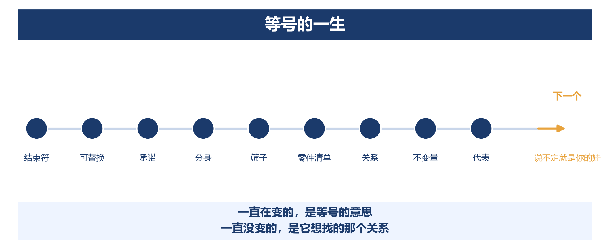

小学数学讲完了，我就想说一句话：娃问"为什么"的时候，别糊弄他。

---

**参考文献**
- 罗伯特·雷科德（Robert Recorde），*The Whetstone of Witte*（1557）——等号"="的首次使用。他给的理由原文是 "noe 2 thynges, can be moare equalle"（没有两样东西能"更相等"）——他自己就造了一个不合逻辑的说法，中文照译是病句，文中作"更相像"
- 《义务教育数学课程标准（2022 年版）》——学段划分；负数、几何论证的学段位置照此标注
- 人教版《义务教育教科书·数学》一至六年级——各站册次依据（正比例在六年级下册、简易方程在五年级上册等）
- 热尔贝（教皇西尔维斯特二世，约 945—1003）的算板——板上以空档代零；用阿拉伯数字书写计算的位值制，要到 12 世纪才真正重新传进欧洲
- Kieran, C. (1981), "Concepts Associated with the Equality Symbol"——儿童把等号当作"操作指令"而不是"关系"符号的经典研究
- 丢番图《算术》——三世纪起用缩写记号表示未知量
- 花拉子米《代数学》（约 820）——全书无符号，未知量写成一整段文字
- 韦达《分析术引论》（1591）——第一次用字母表示一般的量
- 笛卡尔《几何学》（1637）——x、y、z 的用法由此定型
- Galileo Galilei, *Discorsi*（《两门新科学》，1638）——落体距离与时间的平方成正比
- 阿基米德《方法》——中世纪羊皮纸重写本，1906 年重新辨识
- 刘徽《九章算术注》（公元三世纪）——割圆术"割之弥细，所失弥少"；祖冲之的圆周率
- 埃拉托色尼（Eratosthenes，约前 276—前 194）——测出地球周长；以筛法求质数
- 约翰·斯诺（John Snow），*On the Mode of Communication of Cholera*（1855）——霍乱地图与宽街水泵
- 费马在丢番图《算术》页边的批注（1637）——「这页空白太小，写不下」；此问题至 1994 年由怀尔斯证完
- 费曼去世时（1988）加州理工学院办公室黑板上的字——"我自己造不出来的东西，我就还没有真正弄懂"
- 怀特海《教育的目的》（1916 年对英格兰数学协会的主席演讲）——"惰性观念"：只被接收、却未被运用、检验或重新组合的观念
- 爱因斯坦致 Carl Seelig 的信（1952-03-11）——"我没有特别的才能，我只是热切地好奇"
- 欧几里得《原本》卷一——公理「等于同量的量，彼此相等」
- 亚历山大·格罗滕迪克（Alexander Grothendieck，1928—2014）——二十世纪代数几何的重建者，1966 年菲尔兹奖

**互动**

留一道题给你的娃，用它看看他现在到哪一站了：问他一句——**1/2 和 2/4 是同一个数吗？**

答"不是，分母不一样"——他对等号的理解还停在最初那一层，不着急，切张饼就行。

答"是，约分约掉的"——他已经过了第四站，但还没说清凭什么，那正是下一站的路标。

答"是，切开来一样大"——说明他已经过了第四站。

（小学数学十讲到此结束。本讲的「地图卡」已生成，公众号对话框回复 **地图卡** 可取。）