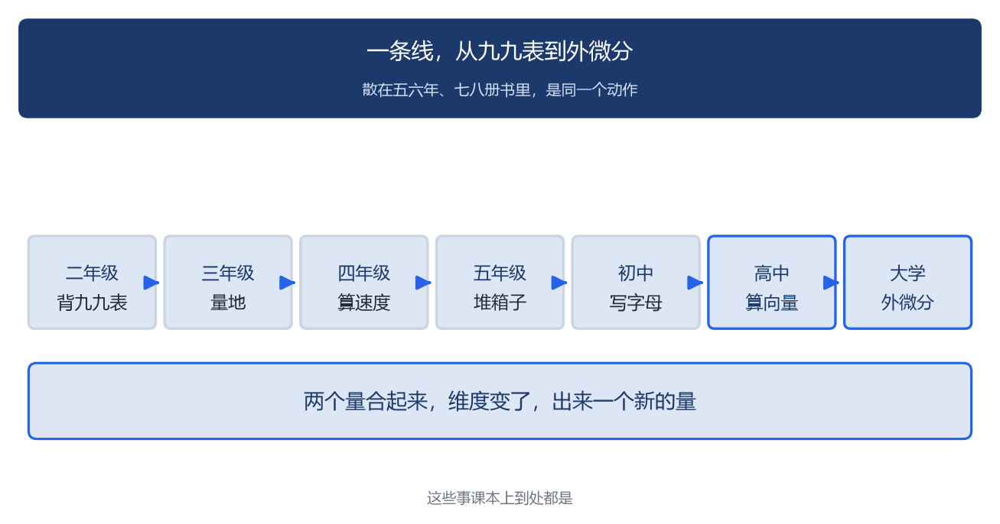
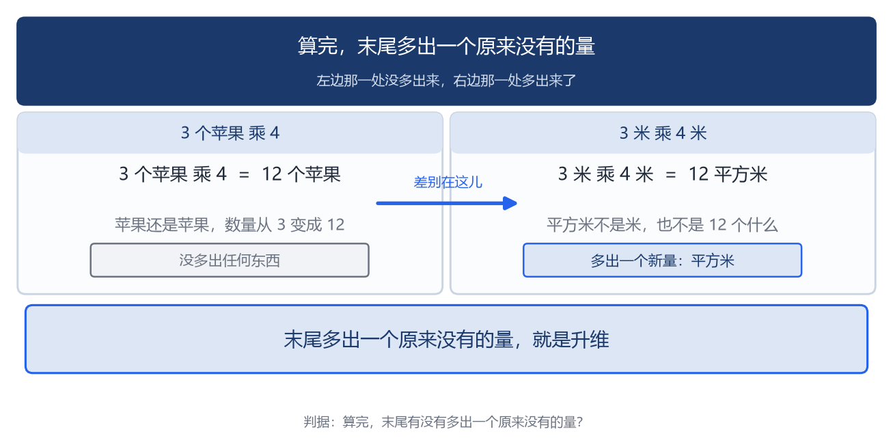
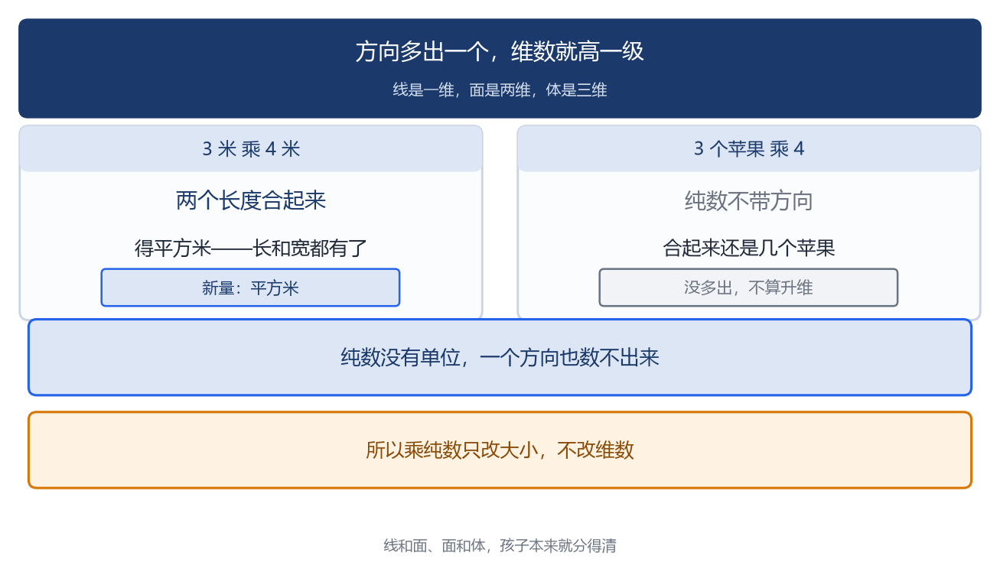
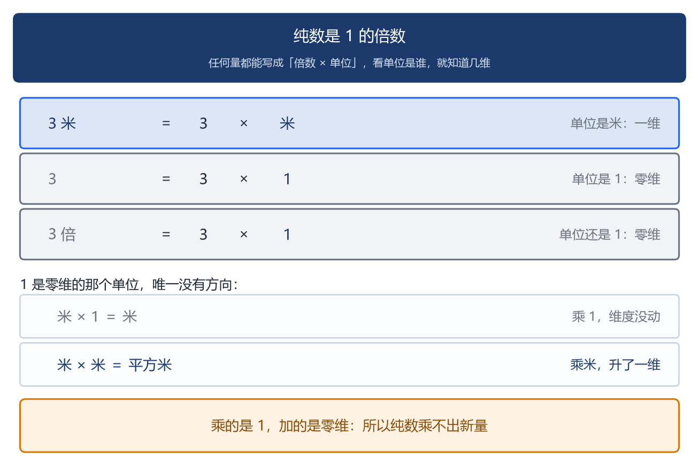
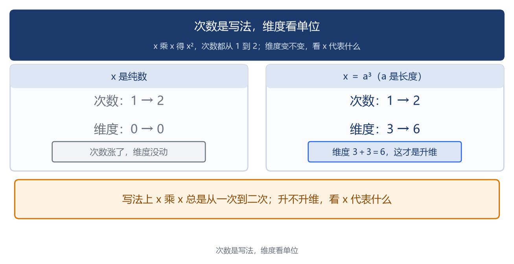
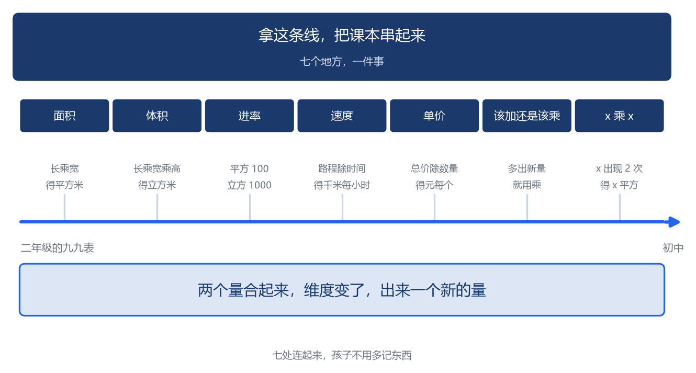

# 乘法在升维

**导读**

>> **先说一句**：这一篇不教课，就是图个兴趣。**我就想干一件事：看看课本上和乘法相关的那些知识点，能不能连成一条线。**哪儿说错了，懂行的读者别客气，指出来。

乘法不是一样东西，是一串。

乘法在课本上一路都是：

- 二年级，背九九表。
- 三年级，量地。
- 四年级，算速度。
- 五年级，堆箱子。
- 初中，写字母。
- 高中，算向量。
- 再往上，到了大学，它有一个正式的名字，叫外微分。



一路学下来，大多是学一样记一样，很少摆到一块儿看。

这几个摆一块儿看，做的是同一种运算。我给它起了个名字：升维——两个量合起来，维度变了，出来一个新的量。

我干吗要找这个词？跟孩子没关系，是我自己心里过不去。

不是孩子算错了题。是我自己看着别扭：他一样一样地学，一样一样地背，学完了未必知道这几样是一回事。

我想找一根线，把它们串起来。找来寻去，落在“升维”两个字上。

为什么非要新说法？课本上的话是**算法**：照着做，能算对；而“升维”是**图景**：能看见为什么该这么做，或者说，很容易想象得到。**一个是算出来的，一个是看出来的。**孩子两个都要。只会算的，做过的题会做；能看见的，没做过的题也敢想。

---

## 一、升维在课本上的样子

你翻开课本，这些地方都带乘法：

| 课本上的位置 | 那里学的是什么 |
| --- | --- |
| 二三年级，九九表 | 3 乘 4 得 12 |
| 三年级下学期，面积 | 长乘宽，得平方米 |
| 三年级下学期，面积单位 | 1 平方米等于 100 平方分米 |
| 四年级，速度 | 路程除以时间，得千米每小时 |
| 四年级，单价 | 总价除以数量，得元每个 |
| 五年级，体积 | 长乘宽乘高，得立方米 |
| 五年级，体积单位 | 1 立方米等于 1000 立方分米 |
| 初中，字母运算 | x 乘 x 得 x 平方 |
| 高中，向量 | 两个向量合起来：点积得一个数，外积得一个矩阵 |

课本之外还有升维出来的单位：米每秒、元每斤、元每平方米、千瓦时。带斜杠的单位孩子天天见，多半也是背下来的。

你翻翻孩子的课本就明白：这些内容摊在五六年、七八册书里，一处一处地学，每一处都得花力气。

你说，这些地方有什么共同点？先看最简单的两句话。

```
一条线，量一个数：多长。
一块地，量两个数：长多少、宽多少。
```


第二个数，是那块地多出来的方向。

## 二、升维这一步，做的是同一件事

### 摆在一起，差别就在这一步

这几处摆一块儿，你一眼就能看出来，哪处升了、哪处没升：

- 3 个苹果乘 4，得 12 个苹果。苹果还是苹果，维数没动，只是多了 8 个。

*（注：这里的 4 是个纯数。纯数的维数怎么算，后面有一节专门说。）*

- 3 米乘 4 米，得 12 平方米。一维变成了两维：平方米不是米，也不是 12 个什么。

- 3 米乘 4 秒，得 12 米秒。也是升维：原来只有米一个方向，现在米和秒都有了。

- 120 千米除以 2 小时，得 60 千米每小时。也是升维：多出来一个“每小时”。

- 3 米加 4 米，得 7 米。还是米，没升维。

*（注：米乘秒是合法的导出单位，只是中学题目里少见。）*

**一步算完，末尾多出一个原来没有的量，就是升维。**末尾没多出来的，就不是。



它不帮你做题，帮你认出来。

### 多出来的量，是从哪儿来的

升维多出来的那个量，从哪儿来？你就盯住单位。

“维”这个字，数的是方向。米、秒、个、元、千克，每个名字都是替一个方向起的名：长是一个方向，时间是另一个方向，个数又是一个方向。

**方向是看得见的东西，维是数：有几个方向，就是几维。**3 米是一个方向，算一维；一块地有长和宽两个方向，算两维；一个箱子长宽高都有，算三维。你拿手比划一下，就是这个意思。

再往下问一句：怎么才算“一个方向”？得是能自己变、不跟着别的变的东西。一张纸上的点，两个数各自能变、互不影响，所以是两维；可要是一个点在一条画好的圆上（圆已经定了，半径不用管），报一个角度就能定住它，所以只有一维。

**几个能独立变化的量，就是几维**——数学里这叫自由度。小学说的“几个方向”，就是它的大白话版。

*（注：这篇里的“维”有两层意思。小学说的是几何方向——长、宽、高这样的方向；高等数学说的是空间自由度——能各自独立变化的量有几个。两者并不完全等同，读到“维”字时留意一下它说的是哪一层，别把两层混起来。）*

线和面、面和体，孩子本来就分得清。

两个量一乘，升维就出在这儿：两边各有几个方向，合起来就是结果的维数。

- 3 米乘 4 米。两个长度合起来，升出一维，写出来就是平方米。

- 3 米乘 4 秒。长度和时间合起来，也升出一维，写成米秒。

- 3 个苹果乘 4。这里的“个”跟米一样，也是个单位，算一个方向；4 是个纯数，没有方向，合起来还是几个苹果。没多出来东西，这一步没升维。

除法也一样，方向翻到下面去：120 千米除以 2 小时，2 小时倒过来落到下面，就成了千米每小时。除之前没有这个单位。

>> 方向多出一个，维数就高一级——升维。



### 乘纯数不算升维

纯数没有单位，一个方向也数不出来。它是 1 的倍数——3 就是 3 个 1。1 是零维的，所以乘纯数只改大小，改不了维度：3 乘 3 还是零维，乘多少都不升。



*（注：“个”这类计数单位，物理里算无量纲——在这篇文章的算法里，它跟米一样，算一个方向；不带单位的数，数学里叫 0 阶。）*

## 三、用升维把课本串起来

升维说清楚了。下面咱们一处一处对课本。

- 面积：长乘宽，得平方米。长是一个方向，宽是另一个方向，乘起来两个都有了。
- 体积：长、宽、高三个方向都有了，得立方米。
- 单位换算：1 平方米等于 100 平方分米。为什么不是 10？因为 1 米是 10 分米，而 1 平方米就是 1 米乘 1 米，换过来是 10 分米乘 10 分米，得 100。**两个方向各换一次，所以两个 10 相乘**；立方是三个方向，10 乘 10 乘 10 得 1000。
- 速度：120 千米除以 2 小时，得千米每小时。千米留在上面，小时落到下面。**反过来乘回去，千米每小时乘小时，「小时」上下约掉了，又回到千米，这一步就是降维。**
- 加速度：速度除以时间，得米每平方秒。米是一个方向，秒出现了两次（速度里一次，再除时间又一次），算两个方向，合起来三个方向——**所以加速度是三维的**。
- 单价：总价除以数量，得元每个。同一个道理。
- 该加还是该乘：**先看这道题要的是什么量**。要的是米（一个方向），四条边加起来还是米，用加；要的是平方米（两个方向），长乘宽才出得来，用乘。周长和面积最容易反着用：一块地长 4 米、宽 3 米，围栅栏要多少米？铺草皮要多少平方米？栅栏要米，用加；草皮要平方米，用乘。

初中的 x 乘 x，得单说。x 是个字母，次数是 1。它代表什么、是几维，你得看它在哪儿用：

- 用在长度上，x² 就是两维，平方米那一套。
- x 代表的是体积：x ＝ a³（a 是长度），x 就是三维；x² ＝ a⁶，所以 **x 的平方是六维**（3＋3＝6）。
- x 只是个纯数，那就从头到尾零维，一步也没升。
- 列方程的时候，x、y、z 是未知数：一个未知数算一个方向，三个各占一个。

*（注：这条只说“未知数有几个方向”。至于方程本身圈出多大的东西，是另一回事——一个方程降一维，比如 x+y+z=1 解出来是一张面，那张面是二维的。）*

一句话：**次数是写法，几维看 x 代表什么。**字母是空的，里面装什么，它就是几维。



中学跟小学是一套算法，只是把单位抽掉了。小学是 3 米乘 4 米得平方米，中学是 x 乘 x 得 x 平方。

你把这几处对完，回头看：**两个量合起来，维度变了，出来一个新的量。**单位换算、该加还是该乘，也都是从它这儿来的；x 平方得单独看它代表什么。

我第一次把它们摆到一起的时候，自己也愣了一下。



## 四、升维能用到哪儿

说到这儿，我得先把话说明白：升维不是哪儿都能串。它能用到哪儿，得先划个界。

**先说它不是另起一套。**升维串的就是数学里那个“维”：线一维、面二维、体三维，跟“一块地要两个数各自能变”是一回事，就看有几个能各自独立变化的量。单位是它在小学的样子：米是一个量，秒是另一个量，乘起来两个都有了。

它算不出**朝哪边**。

方向有几个，它算得出；朝哪边，它算不出。3 米乘 4 米跟 4 米乘 3 米，得数一样，可到了中学，面积要分正反面：同样是长乘宽，画出来的那块地翻个面，数字就变号。那归另一套算法。


还有一层，我得说破：**一个说法管得越宽，往往管得越浅。**

“升维”能罩住面积、体积、速度、单价、字母，看着挺厉害。可它只在一个方向上使力：**给已经算出来的东西换个名字、归个类**，说不出新的规矩。

“这只麻雀会飞”，说错了就是错；“鸟嘛，有的会飞有的不会”——怎么说都不算错，可它也没告诉你什么。**罩得住，是因为话说得软。**“升维”就属于这一种：它不猜世界的规矩，只说“这几个量合起来，叫升维”。

**能预测的才叫理论**，升维做不到这一条。

所以它的位置很清楚：**在“理解”这一层，不在“发现”这一层。**

可这不算白搭。

它产出不了新定理，可它能让一个七八岁的孩子看懂学过的东西：平方米为什么是长乘宽，看一眼就知道；一道题该加还是该乘，看要什么量就知道。

**发现是长大以后的事，眼下他缺的是理解。**“升维”补的就是这一段。

## 五、升维这个名字

一个名字能顶事，也能变成空话。万一孩子只记住这个名字，嘴上会说，说不出哪儿升了，那就只是个空壳子。

算完看一眼，末尾多出一个原来没有的量，就不是空壳子。

升维不是在挑课本的错。“乘法是加法的简便运算”没有错，它说的是乘数是纯数的那一半，3 乘 4 等于四个 3 相加。这里补的是另一半。课本那句、“升维”这句，各管一半，不是谁替谁。

>> 升维这个名字是我起的，数学不是：外微分几百年前就有了，二年级背的九九表今天还写在课本上——从二年级到大学，是同一条路。


*（注：图上三个名字里，只有“升维”是这篇起的，向量、外微分都是数学里本来的叫法。）*

最后，聊下我对数学本身的看法。

数学里一直有两种走法。一种靠看图：画出来，看明白。一种靠符号：不画，按规则变形，照样能算对。

数学家阿蒂亚（英国数学家，1966 年拿过菲尔兹奖）说过：几何里视觉思维占主导，代数里有序思维占主导；换一对词，就是“洞察”对“严格”。他还补了一句：**这两种思维都得养，只顾一头不行。**

“升维”介于两者中间。它给你一个画面，帮你看懂；可它**不是证明，也替代不了规则**（指数律、量纲）。

这说法能用多久，得看孩子学到哪儿。

低龄段最有用。那会儿孩子还没学过代数，主要靠画面和单位想事，“升维”能帮他把这件事看明白：长乘宽为什么出平方米，不用背，看见就行。

到了初高中，指数律、量纲一条条学上来，**代数思维结实了**——照规则算就能算对，这时候就不用升维了。它没错，只是孩子不再需要它。

**它是还没有代数时的替代品**：代数没到手，先用看得见的；代数一到手，它的事就做完了。

## 结语

孩子一级一级学上去，学的东西是连着的，不必知道后面还有多远。你要是想给他讲，就从“一条线一个数、一块地两个数”那两句开始。等他回头一看，会认出自己学的原来是同一件事。到那时候，有没有“升维”这个名字都无所谓了。

**说到底，升维不是什么新知识，它是给低学段的一个说法——把散在各处的乘法，用一副看得见的样子串起来。**这时候孩子还没学过代数，光靠讲不顶用，得让他看见。

比多认几个单位更要紧的，是**让他早点知道：学过的东西是连着的。**这个底子打下来，往后每学一样新东西，他都会自己去找那条线。

要是你读完也想了想：那些学过的东西，是不是本来就连着的——那升维就有点用。

## 参考文献

1. 外微分 d：把 k 阶微分形式映到 k+1 阶。参见 Spivak《Calculus on Manifolds》（1965）。
2. 点积与外积：两个向量的点积得一个标量，外积（outer product）得一个矩阵。参见 Strang《线性代数导论》1.2；Axler《Linear Algebra Done Right》9D。
3. 国际计量局（BIPM）：《国际单位制（SI）》；GB 3100-1993、GB 3101-1993。导出单位由基本单位经乘、除、乘幂得到；量纲上，量相乘则量纲指数相加。
4. 直觉与严格：阿蒂亚（M. Atiyah）：《数学的统一性》，袁向东编译，大连理工大学出版社，2014。原话为“几何是数学中这样的一个部分，其中视觉思维占主导地位，而代数则是数学中有序思维占主导地位的部分……这种区分也许用另一对词刻画更好，即‘洞察’对‘严格’。”
